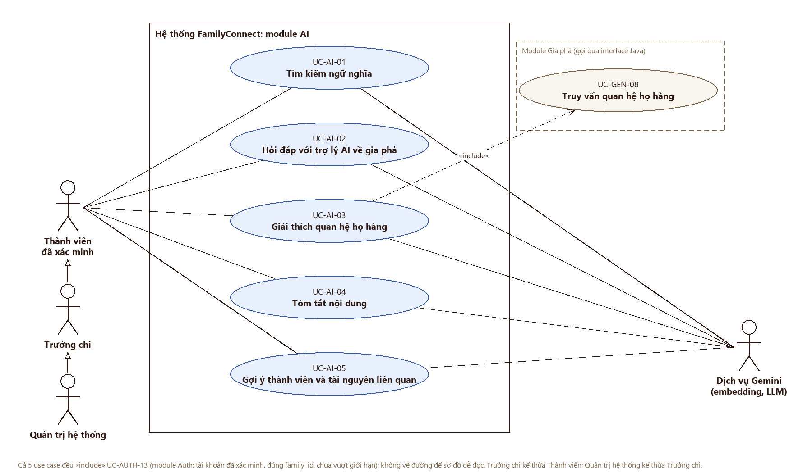

# Use case: AI: tìm kiếm, trợ lý hỏi đáp, giải thích quan hệ, tóm tắt, gợi ý

> **Người viết:** TV5 (Lê Nhựt) | **Reviewer:** TV3 (PiLo257) | **Task Jira:** SCRUM-34 | **Hạn nộp review:** Thứ Năm 15/10 (Sprint 2)
> **Trạng thái:** Đã merge vào `develop` (Sprint 2)

## 1. Phạm vi và Actor
Module `ai` cung cấp tìm kiếm ngữ nghĩa, hỏi đáp gia phả bằng RAG, giải thích quan hệ, tóm tắt và gợi ý thành viên/tài nguyên. Module sử dụng dữ liệu qua interface của các module `genealogy`, `community` và `heritage`; không SELECT trực tiếp bảng của module khác. Module khác gọi AI qua interface Java `AiGateway`, không gọi REST nội bộ.

### Actor
- **Thành viên đã xác minh (`MEMBER`)**: sử dụng các chức năng AI trong phạm vi dữ liệu mà mình được phép xem.
- **Trưởng chi (`BRANCH_ADMIN`)**: sử dụng các chức năng AI trong phạm vi gia đình/nhánh mà quyền quản trị cho phép; không được mặc nhiên xem dữ liệu ngoài phạm vi đó.
- **Quản trị hệ thống (`SYSTEM_ADMIN`)**: có quyền gọi API theo phân quyền hệ thống; không được bỏ qua các quy tắc bảo vệ dữ liệu gia đình.
- **Dịch vụ nội bộ qua `AiGateway`**: actor hệ thống cho lời gọi từ module khác; phải truyền danh tính người dùng/ngữ cảnh quyền để AI kiểm tra quyền thay cho người dùng cuối.

Tài khoản chưa xác minh không được sử dụng AI: trả HTTP `403`, mã `PERM_002`. Khi vượt giới hạn câu hỏi: HTTP `429`, mã `RATE_001`.

### Use Case Diagram

*Ký hiệu theo UML: tác nhân ở ngoài khung hệ thống; đường liền là quan hệ tác nhân với use case; mũi tên tam giác rỗng là kế thừa giữa các tác nhân; mũi tên nét đứt `«include»` đi từ use case gọi sang use case được gọi. Trưởng chi kế thừa Thành viên; Quản trị hệ thống kế thừa Trưởng chi. Cả 5 use case `«include»` UC-AUTH-13 (đã xác minh, đúng `family_id`, chưa vượt giới hạn) nên không vẽ đường riêng. UC-AI-03 `«include»` UC-GEN-08 của module Gia phả (lấy kết quả thuật toán quan hệ). Dịch vụ Gemini là tác nhân phụ (tạo embedding, gọi LLM). Lời gọi nội bộ qua `AiGateway` (cập nhật chỉ mục) không phải use case của người dùng nên mô tả ở mục 6.1. File nguồn (mở bằng draw.io): `docs/images/ai-usecase.drawio`.*

## 2. Danh sách use case

| Mã UC | Tên | Actor chính | Mã FR | Ưu tiên |
|---|---|---|---|---|
| UC-AI-01 | Tìm kiếm ngữ nghĩa | MEMBER, BRANCH_ADMIN, SYSTEM_ADMIN đã xác minh | FR-AI-01 | Must |
| UC-AI-02 | Hỏi đáp với trợ lý AI về gia phả | MEMBER, BRANCH_ADMIN, SYSTEM_ADMIN đã xác minh | FR-AI-02 | Must |
| UC-AI-03 | Giải thích quan hệ họ hàng | MEMBER, BRANCH_ADMIN, SYSTEM_ADMIN đã xác minh | FR-AI-03 | Must |
| UC-AI-04 | Tóm tắt nội dung | MEMBER, BRANCH_ADMIN, SYSTEM_ADMIN đã xác minh | FR-AI-04 | Must |
| UC-AI-05 | Gợi ý thành viên và tài nguyên liên quan | MEMBER, BRANCH_ADMIN, SYSTEM_ADMIN đã xác minh | FR-AI-05 | Must |

## 3. Đặc tả từng use case
### UC-AI-01: Tìm kiếm ngữ nghĩa
| Mục | Nội dung |
|---|---|
| Mã FR liên quan | FR-AI-01 |
| Actor | Thành viên đã xác minh; trưởng chi; quản trị hệ thống |
| Mô tả ngắn | Tìm nội dung liên quan theo ý nghĩa truy vấn thay vì chỉ khớp từ khóa. |
| Tiền điều kiện | Người dùng đã đăng nhập và xác minh; có quyền xem dữ liệu thuộc `family_id`; truy vấn không rỗng. |
| Dữ liệu đầu vào | `q` (câu tìm kiếm tiếng Việt, 1 đến 500 ký tự); `familyId` lấy từ ngữ cảnh đã xác thực; chỉ `SYSTEM_ADMIN` phải truyền `familyId` (`conventions.md` mục 6.2); `limit` tùy chọn. |
| Nguồn tri thức | Các chunk đã lập chỉ mục từ dữ liệu gia phả, bài đăng/câu chuyện và tài liệu di sản mà người dùng được quyền xem. Dữ liệu nguồn lấy qua interface module tương ứng. |
| Luồng chính | 1. Người dùng nhập truy vấn. 2. API xác thực tài khoản, trạng thái xác minh và quyền truy cập. 3. Module xác định `family_id` hợp lệ từ security context. 4. Tạo embedding truy vấn với `gemini-embedding-001`, cấu hình `outputDimensionality=768`. 5. Truy vấn `ai_embedding_chunk` theo độ tương đồng và lọc `family_id`, `branch_id` trong các chi người dùng được xem (BR-AI-13), bản ghi chưa xóa mềm. 6. Loại kết quả dưới ngưỡng cấu hình; sắp xếp theo độ tương đồng. 7. Trả danh sách kết quả cùng loại nguồn, mã nguồn và điểm tương đồng nếu được phép hiển thị. |
| Luồng thay thế / ngoại lệ | 1a. `q` rỗng hoặc quá 500 ký tự: HTTP 400 `VALID_001`. 1b. Quản trị tắt tìm kiếm (`ai.search.enabled = false`): HTTP 409 `AI_002`. 2a. Chưa xác minh: HTTP 403 `PERM_002`. 2b. Vượt hạn mức: HTTP 429 `RATE_001`. 4a. Lỗi embedding/LLM hoặc dịch vụ phụ thuộc: HTTP 503 `AI_001`. 5a. Không có kết quả phù hợp: trả danh sách rỗng và thông báo “Không tìm thấy thông tin phù hợp.” 5b. Không được trả kết quả từ gia đình khác dù điểm tương đồng cao. |
| Hậu điều kiện | Không thay đổi dữ liệu nghiệp vụ; kết quả chỉ chứa tài nguyên người dùng có quyền xem. |
| Quy tắc nghiệp vụ | BR-AI-01, BR-AI-02, BR-AI-03, BR-AI-05, BR-AI-06 |

### UC-AI-02: Hỏi đáp với trợ lý AI về gia phả
| Mục | Nội dung |
|---|---|
| Mã FR liên quan | FR-AI-02 |
| Actor | Thành viên đã xác minh; trưởng chi; quản trị hệ thống |
| Mô tả ngắn | Trả lời câu hỏi về gia phả dựa trên dữ liệu được truy xuất, có nguồn tham chiếu. |
| Tiền điều kiện | Đã đăng nhập, đã xác minh, được phép xem dữ liệu thuộc gia đình; câu hỏi hợp lệ; chưa vượt hạn mức. |
| Dữ liệu đầu vào | `question`; `sessionId` tùy chọn; `familyId` và quyền lấy từ security context (riêng `SYSTEM_ADMIN` truyền `familyId`, `conventions.md` mục 6.2). |
| Nguồn tri thức | Top-k chunk của `ai_embedding_chunk`, được lọc theo `family_id`, quyền xem và chính sách riêng tư. Lịch sử chat chỉ dùng trong cùng phiên và không vượt quyền truy cập hiện tại. |
| Luồng chính | 1. Người dùng gửi câu hỏi. 2. Hệ thống kiểm tra xác minh, quyền và rate limit. 3. Truy xuất top-k chunk sau khi lọc quyền. 4. Nếu không có ngữ cảnh đủ liên quan, trả “Không tìm thấy thông tin.” và không gọi LLM. 5. Loại dữ liệu cấm gửi LLM, bao gồm mật khẩu, số điện thoại và thông tin trẻ em theo `privacy.md` mục 6. 6. Ghép prompt hệ thống, câu hỏi và ngữ cảnh đã lọc. 7. Gọi Gemini qua REST API (`RestClient`, `adr-ai-spike.md` mục 4). 8. Lưu user/assistant message trong `ai_chat_message` và cập nhật `ai_chat_session` nếu có phiên. 9. Trả lời kèm nguồn được dùng. |
| Luồng thay thế / ngoại lệ | 1a. Câu hỏi rỗng, quá 4000 ký tự hoặc `sessionId` sai định dạng: 400 `VALID_001`. 1b. Quản trị tắt chatbot (`ai.chat.enabled = false`): 409 `AI_002`. 1c. `sessionId` là phiên của người khác: 403 `PERM_001`. 2a. Chưa xác minh: 403 `PERM_002`. 2b. Quá hạn mức (20 câu/giờ): 429 `RATE_001`. 4a. Không đủ ngữ cảnh: trả đúng “Không tìm thấy thông tin.” 7a. Timeout/quota/nhà cung cấp lỗi: 503 `AI_001`; không trả lời suy đoán. 8a. Lưu lịch sử lỗi: không làm lộ câu hỏi/nội dung nhạy cảm trong log kỹ thuật. |
| Hậu điều kiện | Có câu trả lời và nguồn hoặc thông báo không tìm thấy; lịch sử được lưu nếu chính sách lưu trữ cho phép. |
| Quy tắc nghiệp vụ | BR-AI-01, BR-AI-02, BR-AI-03, BR-AI-04, BR-AI-05, BR-AI-06, BR-AI-07 |

### UC-AI-03: Giải thích quan hệ họ hàng
| Mục | Nội dung |
|---|---|
| Mã FR liên quan | FR-AI-03 |
| Actor | Thành viên đã xác minh; trưởng chi; quản trị hệ thống |
| Mô tả ngắn | Diễn đạt dễ hiểu quan hệ giữa hai người dựa trên kết quả thuật toán quan hệ của module genealogy. |
| Tiền điều kiện | Người dùng đã xác minh; có quyền xem cả hai hồ sơ và đường quan hệ cần thiết. |
| Dữ liệu đầu vào | `personAId`, `personBId`, ngôn ngữ đầu ra tùy chọn. |
| Nguồn tri thức | Kết quả thuật toán quan hệ trong module genealogy và các dữ kiện được phép hiển thị. |
| Luồng chính | 1. Người dùng chọn hai thành viên. 2. AI kiểm tra quyền xem hai hồ sơ. 3. Gọi interface của genealogy để lấy kết quả thuật toán quan hệ. 4. Nếu có đường quan hệ hợp lệ, gửi kết quả đã lọc cho LLM để diễn đạt lại, không yêu cầu LLM tự suy luận quan hệ. 5. Trả lời kèm đường quan hệ hoặc các bước quan hệ nguồn. |
| Luồng thay thế / ngoại lệ | 1a. Thiếu `personAId`, `personBId` hoặc trùng nhau: 400 `VALID_001`. 2a. Hồ sơ thuộc gia đình khác: 403 `PERM_001`, không tiết lộ hồ sơ. 2b. Hồ sơ không tồn tại: 404 `NOT_FOUND_001`. 3a. Không tìm được quan hệ: trả “Không tìm thấy thông tin.” 4a. LLM lỗi: có thể trả kết quả thuật toán ở dạng cấu trúc nếu hợp đồng API hỗ trợ; nếu không, trả 503 `AI_001`. |
| Hậu điều kiện | Không thay đổi hồ sơ hoặc quan hệ; chỉ trả kết quả đã được kiểm chứng bởi thuật toán. |
| Quy tắc nghiệp vụ | BR-AI-01, BR-AI-02, BR-AI-04, BR-AI-05, BR-AI-08 |

### UC-AI-04: Tóm tắt nội dung
| Mục | Nội dung |
|---|---|
| Mã FR liên quan | FR-AI-04 |
| Actor | Thành viên đã xác minh; trưởng chi; quản trị hệ thống |
| Mô tả ngắn | Tóm tắt một bài đăng, câu chuyện hoặc tài liệu mà người dùng có quyền xem. |
| Tiền điều kiện | Đã đăng nhập và xác minh; có quyền xem nguồn; nguồn tồn tại và chưa bị xóa. |
| Dữ liệu đầu vào | `sourceType`, `sourceId`, `maxLength` tùy chọn. |
| Nguồn tri thức | Nội dung lấy qua interface của module community/heritage; cache trong `ai_summary_cache` nếu còn hiệu lực và đúng phiên bản nguồn. |
| Luồng chính | 1. Người dùng yêu cầu tóm tắt nguồn. 2. Hệ thống xác thực quyền xem nguồn. 3. Lấy nội dung qua interface module sở hữu dữ liệu. 4. Loại dữ liệu không được gửi LLM theo `privacy.md`. 5. Kiểm tra cache theo khóa nguồn, phiên bản/nội dung và tham số tóm tắt. 6. Nếu cache hợp lệ, trả tóm tắt. 7. Nếu chưa có cache, gọi Gemini với chỉ dẫn chỉ tóm tắt nội dung nguồn, lưu cache và trả kết quả. |
| Luồng thay thế / ngoại lệ | 1a. Quản trị tắt tóm tắt (`ai.summary.enabled = false`): 409 `AI_002`. 1b. `sourceType` không hợp lệ: 400 `VALID_001`. 2a. Nguồn thuộc gia đình khác hoặc ngoài phạm vi chi được xem: 403 `PERM_001`. 2b. Nguồn không tồn tại hoặc đã xóa: 404 `NOT_FOUND_001`. 4a. Sau khi lọc không còn nội dung đủ để tóm tắt: trả “Không tìm thấy thông tin.” 7a. LLM lỗi: 503 `AI_001`. |
| Hậu điều kiện | Tóm tắt được trả về; cache có thể được tạo/cập nhật; dữ liệu nguồn không bị sửa. |
| Quy tắc nghiệp vụ | BR-AI-01, BR-AI-02, BR-AI-04, BR-AI-05, BR-AI-09 |

### UC-AI-05: Gợi ý thành viên và tài nguyên liên quan
| Mục | Nội dung |
|---|---|
| Mã FR liên quan | FR-AI-05 |
| Actor | Thành viên đã xác minh; trưởng chi; quản trị hệ thống |
| Mô tả ngắn | Đề xuất thành viên hoặc tài nguyên liên quan dựa trên nội dung và ngữ cảnh được phép truy cập. |
| Tiền điều kiện | Đã đăng nhập và xác minh; có quyền xem phạm vi dữ liệu đề xuất. |
| Dữ liệu đầu vào | `contextType` và `contextId` tùy chọn; `limit`; bộ lọc loại tài nguyên tùy chọn. |
| Nguồn tri thức | Chỉ mục embedding và dữ liệu thành viên/tài nguyên lấy qua interface module sở hữu; luôn lọc theo `family_id` và quyền xem. |
| Luồng chính | 1. Người dùng mở một hồ sơ/tài nguyên hoặc yêu cầu gợi ý. 2. Hệ thống kiểm tra quyền và hạn mức. 3. Tạo truy vấn từ ngữ cảnh được phép. 4. Tìm top-k ứng viên trong phạm vi `family_id` và các chi được xem (BR-AI-13), loại bỏ bản ghi bị xóa, bản ghi người dùng không có quyền xem và nội dung nhạy cảm. 5. Xếp hạng và trả danh sách kèm lý do ngắn dựa trên dữ kiện có thật. |
| Luồng thay thế / ngoại lệ | 1a. `contextId` không tồn tại: 404 `NOT_FOUND_001`; thuộc gia đình khác: 403 `PERM_001`. 2a. Chưa xác minh: 403 `PERM_002`. 2b. Quá hạn mức: 429 `RATE_001`. 4a. Không có ứng viên phù hợp: trả danh sách rỗng. 5a. Không đủ dữ kiện để giải thích lý do: chỉ trả tài nguyên, không tự tạo lý do. 4b. Lỗi dịch vụ: 503 `AI_001`. |
| Hậu điều kiện | Không thay đổi dữ liệu nguồn; mọi gợi ý đều nằm trong phạm vi được phép xem. |
| Quy tắc nghiệp vụ | BR-AI-01, BR-AI-02, BR-AI-03, BR-AI-05, BR-AI-10 |

## 4. Quy tắc nghiệp vụ
| Mã | Quy tắc |
|---|---|
| BR-AI-01 | Chỉ tài khoản đã xác minh mới được dùng chức năng AI; nếu chưa xác minh, trả HTTP 403, mã `PERM_002`. |
| BR-AI-02 | Mọi truy xuất phải lọc theo `family_id` và quyền xem trước khi ghép ngữ cảnh hoặc trả kết quả. `family_id` phải lấy/đối chiếu từ security context; không tin dữ liệu client tự khai. |
| BR-AI-03 | Nếu không có kết quả phù hợp hoặc ngữ cảnh không chứa câu trả lời, trả chính xác `Không tìm thấy thông tin.`; không bịa hoặc suy luận ngoài dữ liệu. |
| BR-AI-04 | Chat AI giới hạn 20 câu mỗi giờ cho mỗi người dùng (`conventions.md` mục 7.1), đổi được qua khóa cấu hình `ai.chat.limit_per_hour` (`auth.md` mục 5.3); vượt giới hạn trả HTTP 429, mã `RATE_001`, kèm header `Retry-After`. Giới hạn riêng cho tìm kiếm, tóm tắt, gợi ý chưa chốt (mục 8). |
| BR-AI-05 | Chỉ module `ai` đọc/ghi các bảng `ai_*`; module khác gọi qua Java interface `AiGateway`, không join trực tiếp và không gọi REST nội bộ. |
| BR-AI-06 | Khi truy xuất RAG, áp dụng lọc `family_id`, quyền xem và ngưỡng tương đồng trước khi ghép prompt. Ngưỡng 0,88 hiện là giá trị thử nghiệm ban đầu, chưa được xác nhận tối ưu. |
| BR-AI-07 | Dữ liệu gửi LLM và đưa vào chỉ mục theo đúng `docs/01-srs/privacy.md` mục 6. **Được gửi:** họ tên, quan hệ, năm sinh, nghề nghiệp mức chung của người cùng gia đình; nội dung bài đăng, câu chuyện, tài liệu, sự kiện trong phạm vi được xem. **Không bao giờ gửi:** mật khẩu, token, email, số điện thoại, địa chỉ chi tiết, địa chỉ IP, dữ liệu của gia đình khác. **Người dưới 16 tuổi:** chỉ đưa họ tên và quan hệ (BR-GEN-18). Dùng dữ liệu giả trong phát triển; không dùng gói miễn phí với dữ liệu gia đình thật (gói miễn phí cho phép Google dùng nội dung để cải thiện sản phẩm). |
| BR-AI-08 | Giải thích quan hệ phải dựa trên kết quả thuật toán của module genealogy; LLM chỉ diễn đạt lại, không tự suy luận quan hệ. |
| BR-AI-09 | Cache tóm tắt phải gắn với nguồn và phiên bản/nội dung nguồn; vô hiệu hóa khi nguồn thay đổi hoặc bị xóa. |
| BR-AI-10 | Gợi ý không được vượt phạm vi quyền xem và không được tạo ra dữ kiện/lý do không có trong nguồn. |
| BR-AI-11 | Lỗi phụ thuộc AI (embedding, LLM) hoặc quá thời gian chờ trả HTTP 503, mã `AI_001`; thời gian chờ tối đa cho một lời gọi LLM đề xuất 30 giây, cấu hình được (đo spike: 5 đến 42 giây, `adr-ai-spike.md` mục 3.3). Dữ liệu đầu vào sai (rỗng, quá dài, sai định dạng UUID) trả HTTP 400, mã `VALID_001` theo `conventions.md`. Không ghi API key hoặc dữ liệu nhạy cảm vào log. |
| BR-AI-12 | Khi quản trị tắt tính năng qua cấu hình (`ai.search.enabled`, `ai.chat.enabled`, `ai.summary.enabled` trong `auth.md` mục 5.3), endpoint tương ứng trả HTTP 409, mã `AI_002` "Tính năng AI đang tạm tắt" (mã riêng đầu tiên của module theo `conventions.md` mục 3.1). Giao diện ẩn ô nhập và hiện thông báo. |
| BR-AI-13 | **Phạm vi chi.** Nội dung có `branch_id` (bài đăng, thông báo, sự kiện theo BR-COM-03) chỉ được trả cho người thuộc chi đó và các chi con; Trưởng chi quản lý cả gia đình và Quản trị hệ thống thấy tất cả. Vì vậy mỗi chunk lưu `branch_id` (NULL là toàn gia đình) và truy xuất lọc theo danh sách chi người dùng được xem, không chỉ theo `family_id`. |
| BR-AI-14 | **Chỉ mục dùng chung cho mọi vai trò.** Chunk loại `PERSON` chỉ chứa các trường Thành viên được xem theo BR-GEN-10 (họ tên, năm sinh, quan hệ, nghề nghiệp, tỉnh/thành; không ngày sinh đầy đủ, không địa chỉ chi tiết). Thông tin chỉ Trưởng chi được xem không đưa vào chỉ mục. |
| BR-AI-15 | **Đồng bộ chỉ mục.** Module sở hữu nguồn gọi `AiGateway` khi tạo, sửa, xóa mềm hoặc ẩn nội dung (kiểm duyệt `hidden_at`, UC-AUTH-09); module `ai` xóa mềm chunk tương ứng để truy vấn không còn trả nội dung đó. |
| BR-AI-16 | Câu trả lời, tóm tắt và giải thích do AI tạo được giao diện gắn nhãn "Do AI tạo" (`privacy.md` mục 6). Nhật ký kiểm toán chỉ ghi sự kiện, không chứa nội dung câu hỏi (BR-AUTH-16). |

## 5. Thiết kế bảng cơ sở dữ liệu
Quy ước chung: schema `public`; khóa chính UUID; thời gian `TIMESTAMPTZ`; các bảng có `id`, `created_at`, `updated_at`, `deleted_at`, `created_by`, `updated_by`. Không tạo khóa ngoại sang bảng module khác; `family_id`, `source_id`, `user_id` là UUID và được kiểm tra qua service/interface. Chỉ module `ai` đọc/ghi các bảng này.

### 5.1. `ai_embedding_chunk`
| Cột | Kiểu | Khóa / Ràng buộc | Mô tả |
|---|---|---|---|
| id | UUID | PK, NOT NULL | ID chunk |
| family_id | UUID | NOT NULL, INDEX | Phạm vi gia đình |
| branch_id | UUID | NULL, INDEX | Phạm vi chi của nguồn (BR-AI-13); NULL là toàn gia đình; không FK liên module |
| source_type | VARCHAR(40) | NOT NULL, CHECK source_type IN ('PERSON','POST','STORY','DOCUMENT','EVENT') | Loại nguồn; `EVENT` cho sự kiện (BR-EVT-06) |
| source_id | UUID | NOT NULL, INDEX | ID nguồn từ module sở hữu; không FK liên module |
| chunk_no | INTEGER | NOT NULL, CHECK (chunk_no >= 0) | Thứ tự chunk trong nguồn |
| content | TEXT | NOT NULL | Nội dung đã lọc dữ liệu nhạy cảm |
| embedding | VECTOR(768) | NOT NULL | Vector từ `gemini-embedding-001`, `outputDimensionality=768` |
| content_hash | VARCHAR(64) | NOT NULL | Hash để phát hiện nội dung thay đổi |
| metadata | JSONB | NOT NULL DEFAULT '{}' | Metadata không nhạy cảm |
| created_at | TIMESTAMPTZ | NOT NULL DEFAULT now() | Ngày tạo |
| updated_at | TIMESTAMPTZ | NOT NULL DEFAULT now() | Ngày cập nhật |
| deleted_at | TIMESTAMPTZ | NULL | Xóa mềm |
| created_by | UUID | NULL, INDEX | Người tạo/tác vụ tạo |
| updated_by | UUID | NULL | Người cập nhật |

Ràng buộc/index đề xuất:
- `UNIQUE (family_id, source_type, source_id, chunk_no)` cho các chunk chưa xóa mềm (dùng partial unique index với `deleted_at IS NULL`).
- B-tree index `(family_id, source_type, source_id)`, `(family_id, branch_id)` và `(family_id, deleted_at)`.
- HNSW cosine index trên `embedding` (ví dụ `USING hnsw (embedding vector_cosine_ops)`), kết hợp điều kiện lọc `family_id`; kiểm tra kế hoạch truy vấn với dữ liệu thực tế.
- `vector(768)` theo ADR; nếu đánh giá tiếng Việt không đạt, thử `1536` và cập nhật schema/ERD trước khi triển khai.

### 5.2. `ai_chat_session`
| Cột | Kiểu | Khóa / Ràng buộc | Mô tả |
|---|---|---|---|
| id | UUID | PK, NOT NULL | ID phiên |
| family_id | UUID | NOT NULL, INDEX | Phạm vi gia đình |
| user_id | UUID | NOT NULL, INDEX | Chủ phiên; không FK liên module |
| title | VARCHAR(200) | NULL | Tiêu đề phiên |
| status | VARCHAR(20) | NOT NULL DEFAULT 'ACTIVE', CHECK status IN ('ACTIVE','ARCHIVED') | Trạng thái |
| last_message_at | TIMESTAMPTZ | NULL | Thời điểm có tin nhắn gần nhất |
| created_at | TIMESTAMPTZ | NOT NULL DEFAULT now() | Ngày tạo |
| updated_at | TIMESTAMPTZ | NOT NULL DEFAULT now() | Ngày cập nhật |
| deleted_at | TIMESTAMPTZ | NULL | Xóa mềm |
| created_by | UUID | NULL | Người tạo |
| updated_by | UUID | NULL | Người cập nhật |

Index: `(family_id, user_id, updated_at DESC)` và `(user_id, deleted_at)`.

### 5.3. `ai_chat_message`
| Cột | Kiểu | Khóa / Ràng buộc | Mô tả |
|---|---|---|---|
| id | UUID | PK, NOT NULL | ID tin nhắn |
| session_id | UUID | NOT NULL, FK -> `ai_chat_session.id` | Phiên trong cùng module |
| role | VARCHAR(20) | NOT NULL, CHECK role IN ('USER','ASSISTANT','SYSTEM') | Vai trò tin nhắn |
| content | TEXT | NOT NULL | Nội dung; áp dụng chính sách lưu trữ và riêng tư |
| sources | JSONB | NOT NULL DEFAULT '[]' | Danh sách nguồn đã dùng, không chứa nội dung nhạy cảm |
| model_name | VARCHAR(100) | NULL | Model LLM dùng cho phản hồi |
| input_tokens | INTEGER | NULL, CHECK input_tokens >= 0 | Token đầu vào nếu nhà cung cấp trả |
| output_tokens | INTEGER | NULL, CHECK output_tokens >= 0 | Token đầu ra nếu nhà cung cấp trả |
| latency_ms | INTEGER | NULL, CHECK latency_ms >= 0 | Độ trễ tổng |
| created_at | TIMESTAMPTZ | NOT NULL DEFAULT now() | Ngày tạo |
| updated_at | TIMESTAMPTZ | NOT NULL DEFAULT now() | Ngày cập nhật |
| deleted_at | TIMESTAMPTZ | NULL | Xóa mềm |
| created_by | UUID | NULL | Người tạo |
| updated_by | UUID | NULL | Người cập nhật |

Index: `(session_id, created_at)`; FK nội bộ `session_id` có `ON DELETE RESTRICT` hoặc xóa mềm theo chính sách. Không lưu API key hoặc dữ liệu cấm vào metadata/log.

### 5.4. `ai_summary_cache`
| Cột | Kiểu | Khóa / Ràng buộc | Mô tả |
|---|---|---|---|
| id | UUID | PK, NOT NULL | ID cache |
| family_id | UUID | NOT NULL, INDEX | Phạm vi gia đình |
| source_type | VARCHAR(40) | NOT NULL | Loại nguồn |
| source_id | UUID | NOT NULL, INDEX | ID nguồn; không FK liên module |
| source_version_hash | VARCHAR(64) | NOT NULL | Hash phiên bản/nội dung nguồn |
| summary | TEXT | NOT NULL | Nội dung tóm tắt đã lọc |
| model_name | VARCHAR(100) | NOT NULL | Model tạo tóm tắt |
| expires_at | TIMESTAMPTZ | NOT NULL | Hạn cache |
| created_at | TIMESTAMPTZ | NOT NULL DEFAULT now() | Ngày tạo |
| updated_at | TIMESTAMPTZ | NOT NULL DEFAULT now() | Ngày cập nhật |
| deleted_at | TIMESTAMPTZ | NULL | Xóa mềm |
| created_by | UUID | NULL | Người tạo/tác vụ |
| updated_by | UUID | NULL | Người cập nhật |

Index: `(family_id, source_type, source_id, source_version_hash)` và `(expires_at)`; unique partial index theo khóa cache khi `deleted_at IS NULL`.

> **Gửi TV2 (Trí):** đưa 4 bảng vào ERD tổng. Chú ý `ai_chat_message.session_id` là FK nội bộ; các UUID tham chiếu module khác không tạo FK.

## 6. API của module
Đặc tả chi tiết nằm tại `docs/04-api/openapi/ai.yaml`.

| Phương thức | Đường dẫn | Mô tả | Quyền |
|---|---|---|---|
| GET | `/api/v1/ai/search` | Tìm kiếm ngữ nghĩa | MEMBER, BRANCH_ADMIN, SYSTEM_ADMIN đã xác minh |
| POST | `/api/v1/ai/chat` | Hỏi đáp RAG | MEMBER, BRANCH_ADMIN, SYSTEM_ADMIN đã xác minh |
| POST | `/api/v1/ai/relationship-explanations` | Diễn giải quan hệ đã tính | MEMBER, BRANCH_ADMIN, SYSTEM_ADMIN đã xác minh |
| POST | `/api/v1/ai/summaries` | Tóm tắt nội dung | MEMBER, BRANCH_ADMIN, SYSTEM_ADMIN đã xác minh |
| GET | `/api/v1/ai/recommendations` | Gợi ý thành viên/tài nguyên | MEMBER, BRANCH_ADMIN, SYSTEM_ADMIN đã xác minh |

Các endpoint đều cần bearer JWT. Trường `familyId` (query của tìm kiếm và gợi ý, body của chat) theo `conventions.md` mục 6.2: bắt buộc với `SYSTEM_ADMIN`, vai trò khác không cần truyền và nếu truyền khác gia đình của mình thì 403 `PERM_001`; server không dùng nó để mở rộng quyền truy cập. API không được lộ dữ liệu ngoài quyền người gọi.

### 6.1. Interface Java `AiGateway` (cho module khác gọi)
Module `genealogy`, `community`, `events`, `heritage` gọi để đồng bộ chỉ mục (BR-AI-15, BR-COM-11, BR-EVT-06, BR-GEN-18). Gọi sau khi transaction của module nguồn commit; lỗi AI không làm hỏng thao tác nghiệp vụ của module nguồn (ghi log, thử lại sau).

| Phương thức | Khi nào gọi | Ghi chú |
|---|---|---|
| `void upsertSource(SourceType type, UUID sourceId, UUID familyId, UUID branchId, String content)` | Tạo hoặc sửa nguồn | `content` do module nguồn dựng, đã lọc theo BR-AI-07 và BR-AI-14; `branchId` NULL là toàn gia đình |
| `void removeSource(SourceType type, UUID sourceId)` | Xóa mềm, ẩn khi kiểm duyệt, hoặc nguồn đổi sang phạm vi không còn hiển thị | Module `ai` xóa mềm mọi chunk của nguồn |

`SourceType`: `PERSON`, `POST`, `STORY`, `DOCUMENT`, `EVENT`.

Module `ai` gọi ngược các interface sẵn có: truy vấn quan hệ của module genealogy (UC-GEN-08) cho UC-AI-03; interface đọc nội dung và kiểm tra quyền xem của module sở hữu cho UC-AI-04; `MembershipQuery` của module auth để lấy `family_id`, vai trò và chi của người gọi.

### 6.2. Mã lỗi của module
| Mã | HTTP | Khi nào |
|---|---|---|
| `VALID_001` | 400 | Dữ liệu đầu vào sai |
| `AUTH_002` | 401 | Token thiếu, sai hoặc hết hạn |
| `PERM_001` | 403 | Truy cập dữ liệu gia đình khác hoặc ngoài phạm vi chi |
| `PERM_002` | 403 | Tài khoản chưa xác minh |
| `NOT_FOUND_001` | 404 | Hồ sơ, nguồn hoặc ngữ cảnh gợi ý không tồn tại |
| `AI_002` | 409 | Tính năng AI đang bị quản trị tắt (BR-AI-12) |
| `RATE_001` | 429 | Vượt giới hạn câu hỏi, kèm `Retry-After` |
| `AI_001` | 503 | Dịch vụ AI không khả dụng hoặc quá thời gian chờ |

## 7. Màn hình liên quan
Link Figma (file chung, xem `docs/05-ui/figma-links.md`):
- Web 1440 / 768 / 360: page `05 Heritage, Directory, Dashboard`, section "Trợ lý AI · web", khung `UC-AI-02 Trợ lý AI` ([1440](https://www.figma.com/design/LDT41oUdTnmwaUugJlvrLK/Java?node-id=265-15057)). Màn có ô hỏi, câu trả lời kèm nguồn, gợi ý liên quan (UC-AI-05) và trạng thái AI đang tắt.
- Mobile: page `06 Mobile`, khung `Chat AI / 360` ([link](https://www.figma.com/design/LDT41oUdTnmwaUugJlvrLK/Java?node-id=74-7822)) và `Tìm kiếm / 360` ([link](https://www.figma.com/design/LDT41oUdTnmwaUugJlvrLK/Java?node-id=244-34089)).
- Tóm tắt (UC-AI-04) và giải thích quan hệ (UC-AI-03) là nút trong màn chi tiết bài đăng, tài liệu, và màn tra quan hệ của module tương ứng.

## 8. Câu hỏi còn mở
- [ ] Có cần API và màn xem lại danh sách phiên chat, tin nhắn cũ không? Bảng `ai_chat_session` đã có nhưng `ai.yaml` chưa có endpoint đọc lịch sử.
- [ ] Giới hạn riêng cho tóm tắt, gợi ý (chat 20 câu/giờ; tìm kiếm 30 lượt/giờ đã chốt ở `conventions.md` mục 7.1, SCRUM-49). Đề xuất dùng chung bộ đếm với chat.
- [x] Mã lỗi khi tắt tính năng: đã chốt 18/10/2026 giữ HTTP 409 `AI_002` (BR-AI-12); tiền tố `AI_` đã có trong `conventions.md` mục 3.1.
- [ ] Thời gian chờ LLM 30 giây là đề xuất; chốt lại sau khi đo bằng gói trả phí.