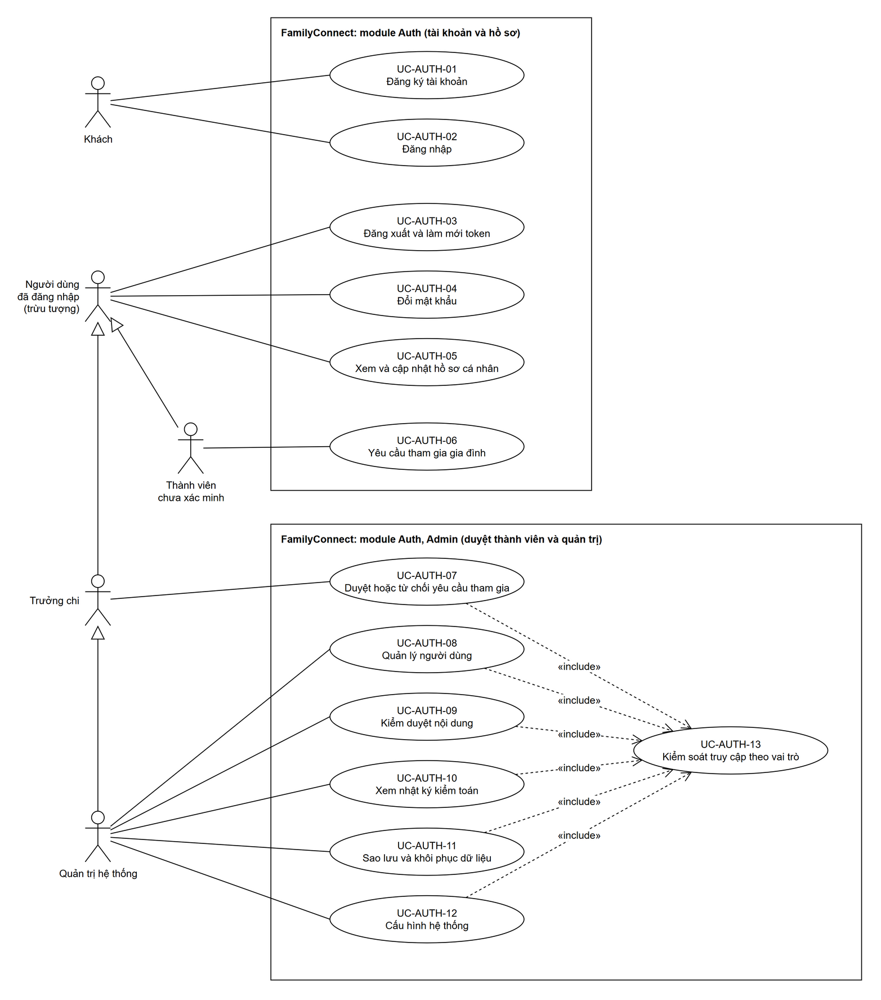
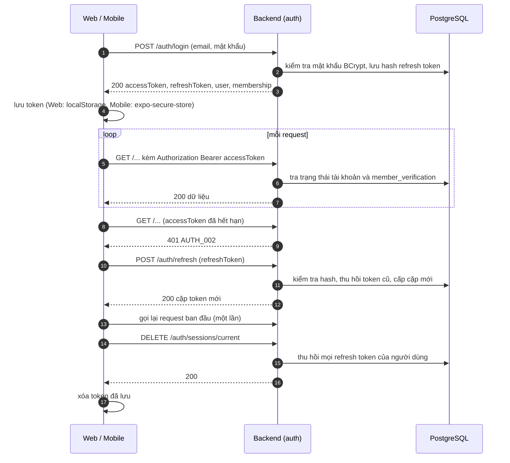
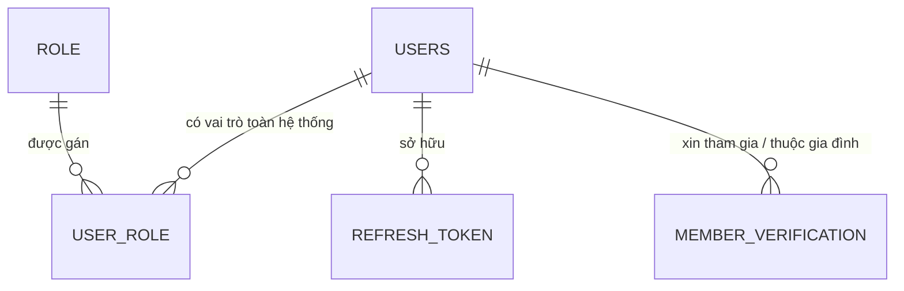

# Use case: Auth, RBAC, Profile, Admin

> **Người viết:** TV1 (Tuấn Nguyễn Thanh) | **Reviewer:** TV4 (Huy Quốc) | **Task Jira:** SCRUM-26 | **Hạn nộp review:** Thứ Năm 15/10 (Sprint 2)
> **Trạng thái:** Đã merge vào `develop` (Sprint 2) | **Nhánh:** `docs/SCRUM-26-auth`
> **Bám theo:** `srs.md` mục 3 (FR-AUTH-01 đến 04, FR-ADM-01 đến 05) và Phụ lục A bản 0.3; `privacy.md`; `04-api/conventions.md`; `02-design/architecture.md`; `03-database/erd.md`; mô tả cập nhật sau Sprint 1 của SCRUM-35, 43, 50, 57, 86, 94 trên Jira. Đặc tả API đầy đủ (request, response mẫu, mã lỗi) ở `docs/04-api/openapi/auth.yaml`.

---

## 1. Phạm vi và Actor

Tài liệu này mô tả ba module backend trong `com.familyconnect.modules` (`architecture.md` mục 5): `auth` (đăng ký, đăng nhập, JWT, xác minh thành viên, phân quyền), `user` (hồ sơ) và `admin` (quản lý người dùng, kiểm duyệt, nhật ký, sao lưu, cấu hình). Ba module dùng chung 7 bảng ở mục 5 (đúng danh sách trong `erd.md` mục 3), nên khóa ngoại giữa chúng được phép; các bảng này **không** nối khóa ngoại sang module khác (`architecture.md` mục 7, quyết định 9).

**Phạm vi không gồm:** tạo gia đình, chi họ, hồ sơ thành viên (module Gia phả); nút "Báo cáo bài viết" và việc gỡ bài đăng, bình luận, sự kiện trong chi (module Community, TV3); script sao lưu cụ thể (SCRUM-86).

**Actor.** Hệ thống chỉ có 4 vai trò (`srs.md` Phụ lục A): `GUEST`, `MEMBER`, `BRANCH_ADMIN`, `SYSTEM_ADMIN`. "Thành viên chưa xác minh" là **trạng thái** của `MEMBER` (chờ trưởng chi duyệt), không phải vai trò riêng.

| Actor | Vai trò hệ thống | Làm được gì trong module này |
|---|---|---|
| Khách | `GUEST` | Đăng ký, đăng nhập. |
| Người dùng đã đăng nhập (actor trừu tượng) | `MEMBER` trở lên | Đăng xuất, làm mới token, đổi mật khẩu, xem và sửa hồ sơ của mình. Mọi actor bên dưới kế thừa. |
| Thành viên chưa xác minh | `MEMBER` (chưa được duyệt) | Xin tham gia gia đình, xem trạng thái, hủy yêu cầu. Gọi API dữ liệu gia đình nhận `403 PERM_002`. |
| Thành viên đã xác minh | `MEMBER` (đã duyệt) | Không có chức năng riêng trong module này; dùng các chức năng của Người dùng đã đăng nhập. |
| Trưởng chi | `BRANCH_ADMIN` | Xem và duyệt yêu cầu tham gia trong gia đình/chi của mình (kèm chi con). |
| Quản trị hệ thống | `SYSTEM_ADMIN` | Duyệt mọi yêu cầu; quản lý người dùng; kiểm duyệt nội dung; xem nhật ký; sao lưu và khôi phục; cấu hình hệ thống. |

### Use Case Diagram



*Ký hiệu theo UML: tác nhân ở ngoài khung hệ thống; đường liền không mũi tên là quan hệ giữa tác nhân và use case; mũi tên tam giác rỗng là kế thừa giữa các tác nhân; mũi tên nét đứt `«include»` đi từ use case gọi sang use case được gọi. Thành viên chưa xác minh và Trưởng chi kế thừa Người dùng đã đăng nhập; Quản trị hệ thống kế thừa Trưởng chi (nên có cả quyền duyệt yêu cầu tham gia, UC-AUTH-07). Các use case duyệt và quản trị `«include»` UC-AUTH-13 (kiểm tra quyền theo vai trò); các use case còn lại chỉ cần đăng nhập nên không vẽ include. Thành viên đã xác minh không có use case riêng trong module nên không vẽ. Module có 13 use case nên tách hai khung (tài khoản và hồ sơ; duyệt thành viên và quản trị), mỗi khung dưới 10 use case. File nguồn (mở bằng draw.io): `docs/images/auth-usecase.drawio`.*

---

## 2. Danh sách use case

| Mã UC | Tên | Actor | Mã FR | Ưu tiên | Sprint | Task Jira |
|---|---|---|---|---|---|---|
| UC-AUTH-01 | Đăng ký tài khoản | Khách | FR-AUTH-01 | Must | S3 | SCRUM-35, 36 |
| UC-AUTH-02 | Đăng nhập | Khách | FR-AUTH-01 | Must | S3 | SCRUM-35, 36 |
| UC-AUTH-03 | Đăng xuất và làm mới token | Người dùng đã đăng nhập | FR-AUTH-01 | Must | S3 | SCRUM-35, 36 |
| UC-AUTH-04 | Đổi mật khẩu | Người dùng đã đăng nhập | FR-AUTH-01 | Must | S3 | SCRUM-35, 36 |
| UC-AUTH-05 | Xem và cập nhật hồ sơ cá nhân | Người dùng đã đăng nhập | FR-AUTH-03 | Must | S4 | SCRUM-43 |
| UC-AUTH-06 | Yêu cầu tham gia gia đình (xác minh thành viên) | Thành viên chưa xác minh | FR-AUTH-04 | Must | S3 (bảng, interface), S6 (màn hình duyệt) | SCRUM-35, 57 |
| UC-AUTH-07 | Duyệt hoặc từ chối yêu cầu tham gia | Trưởng chi, Quản trị hệ thống | FR-AUTH-04 | Must | S6 | SCRUM-57 |
| UC-AUTH-08 | Quản lý người dùng (khóa, đổi vai trò, gán gia đình) | Quản trị hệ thống | FR-ADM-01 | Must | S5 | SCRUM-50 |
| UC-AUTH-09 | Kiểm duyệt nội dung | Quản trị hệ thống | FR-ADM-02 | Must | S5 | SCRUM-50 |
| UC-AUTH-10 | Xem nhật ký kiểm toán | Quản trị hệ thống | FR-ADM-03 | Must | S6 | SCRUM-57 |
| UC-AUTH-11 | Sao lưu và khôi phục dữ liệu | Quản trị hệ thống | FR-ADM-04 | Must | S5 | SCRUM-86 |
| UC-AUTH-12 | Cấu hình hệ thống | Quản trị hệ thống | FR-ADM-05 | Must | S7 | SCRUM-94 |
| UC-AUTH-13 | Kiểm soát truy cập theo vai trò (RBAC) | Mọi actor (được các use case khác `«include»`) | FR-AUTH-02 | Must | S4 | SCRUM-43 |

> **Khác với gợi ý trong khung sườn:** khung sườn có 12 use case; bản này giữ nguyên 12 use case đó và thêm UC-AUTH-13 để đặc tả FR-AUTH-02 (khung sườn ghi FR-AUTH-02 thuộc tài liệu này). UC-AUTH-04 chỉ gồm đổi mật khẩu, chưa có quên mật khẩu qua email (mục 8, câu 1). UC-AUTH-09 chỉ là phần quản trị; nút "Báo cáo bài viết" thuộc Community.

## 3. Đặc tả từng use case

> Dùng đúng mẫu `_template.md`. Mọi use case (trừ UC-AUTH-01, 02, 03 phần làm mới token) cần access token hợp lệ và đi qua UC-AUTH-13; thứ tự kiểm tra ở mục 4.3.

### UC-AUTH-01: Đăng ký tài khoản
| Mục | Nội dung |
|---|---|
| Mã FR liên quan | FR-AUTH-01 |
| Actor | Khách |
| Mô tả ngắn | Người chưa có tài khoản tạo tài khoản mới bằng email và mật khẩu. Tài khoản mới có vai trò `MEMBER`, chưa thuộc gia đình nào. |
| Tiền điều kiện | Chưa đăng nhập; email chưa được dùng. |
| Luồng chính | 1. Khách mở màn hình Đăng ký, nhập email, mật khẩu, họ tên, ngày sinh, số điện thoại (tùy chọn).<br>2. Hệ thống kiểm tra dữ liệu (định dạng email, mật khẩu từ 8 ký tự, đủ 16 tuổi).<br>3. Hệ thống kiểm tra email chưa tồn tại.<br>4. Hệ thống băm mật khẩu bằng BCrypt, tạo `users` (`status = ACTIVE`) và gán vai trò `MEMBER` ở `user_role`.<br>5. Hệ thống ghi nhật ký `USER_REGISTERED` và trả `201` kèm hồ sơ.<br>6. Ứng dụng chuyển sang màn hình Đăng nhập. |
| Luồng thay thế / ngoại lệ | 2a. Dữ liệu sai (email sai định dạng, mật khẩu ngắn hơn 8 ký tự, chưa đủ 16 tuổi): `400 VALID_001`, `details` chỉ rõ từng trường.<br>3a. Email đã đăng ký: `409 AUTH_004`. |
| Hậu điều kiện | Có tài khoản `ACTIVE`, vai trò `MEMBER`, chưa xác minh; gọi API dữ liệu gia đình nhận `403 PERM_002`. |
| Quy tắc nghiệp vụ | BR-AUTH-01, BR-AUTH-02, BR-AUTH-03 |

### UC-AUTH-02: Đăng nhập
| Mục | Nội dung |
|---|---|
| Mã FR liên quan | FR-AUTH-01 |
| Actor | Khách |
| Mô tả ngắn | Người dùng đăng nhập bằng email và mật khẩu để nhận access token và refresh token. |
| Tiền điều kiện | Đã có tài khoản; tài khoản không bị khóa. |
| Luồng chính | 1. Người dùng nhập email và mật khẩu.<br>2. Hệ thống tìm tài khoản theo email và so mật khẩu bằng BCrypt.<br>3. Hệ thống kiểm tra tài khoản `ACTIVE`.<br>4. Hệ thống tạo access token (JWT) và refresh token (lưu hash), cập nhật `last_login_at`.<br>5. Hệ thống ghi nhật ký `LOGIN_SUCCESS` và trả token cùng hồ sơ và trạng thái tham gia gia đình (`membership`).<br>6. Ứng dụng lưu token (Web: `localStorage`; Mobile: `expo-secure-store`) và chọn màn hình: `APPROVED` vào ứng dụng; `PENDING` vào màn chờ duyệt; `NONE` vào màn xin tham gia hoặc tạo gia đình. |
| Luồng thay thế / ngoại lệ | 1a. Vượt 5 lần mỗi phút theo IP và email: `429 RATE_001` kèm `Retry-After`.<br>2a. Sai email hoặc sai mật khẩu: `401 AUTH_001` (cùng một thông báo cho cả hai trường hợp); ghi nhật ký `LOGIN_FAILED`.<br>3a. Tài khoản bị khóa: `403 AUTH_003`; ghi nhật ký `LOGIN_BLOCKED`. |
| Hậu điều kiện | Người dùng có cặp token hợp lệ. |
| Quy tắc nghiệp vụ | BR-AUTH-04, BR-AUTH-05, BR-AUTH-06 |

### UC-AUTH-03: Đăng xuất và làm mới token
| Mục | Nội dung |
|---|---|
| Mã FR liên quan | FR-AUTH-01 |
| Actor | Người dùng đã đăng nhập |
| Mô tả ngắn | Làm mới access token khi hết hạn bằng refresh token; đăng xuất để thu hồi refresh token. |
| Tiền điều kiện | Làm mới: có refresh token còn hạn. Đăng xuất: có access token hợp lệ. |
| Luồng chính (làm mới) | 1. Ứng dụng nhận `401 AUTH_002` khi access token hết hạn.<br>2. Ứng dụng gửi refresh token tới `POST /auth/refresh`.<br>3. Hệ thống tìm token theo hash, kiểm tra chưa hết hạn, chưa thu hồi và tài khoản `ACTIVE`.<br>4. Hệ thống thu hồi refresh token cũ, cấp cặp token mới và trả về.<br>5. Ứng dụng lưu cặp mới và gọi lại request ban đầu (một lần). |
| Luồng chính (đăng xuất) | 1. Người dùng chọn Đăng xuất; ứng dụng gọi `DELETE /auth/sessions/current`.<br>2. Hệ thống thu hồi mọi refresh token của người dùng, ghi nhật ký `LOGOUT`, trả `200`.<br>3. Ứng dụng xóa token đã lưu và về màn Đăng nhập. |
| Luồng thay thế / ngoại lệ | 3a. Refresh token sai, hết hạn hoặc đã thu hồi: `401 AUTH_002`; ứng dụng xóa token và về màn Đăng nhập.<br>3b. Tài khoản bị khóa: `403 AUTH_003`. |
| Hậu điều kiện | Làm mới: token cũ vô hiệu, token mới có hiệu lực. Đăng xuất: không còn refresh token nào dùng được. |
| Quy tắc nghiệp vụ | BR-AUTH-05, BR-AUTH-06 |

### UC-AUTH-04: Đổi mật khẩu
| Mục | Nội dung |
|---|---|
| Mã FR liên quan | FR-AUTH-01 |
| Actor | Người dùng đã đăng nhập |
| Mô tả ngắn | Người dùng đổi mật khẩu của mình khi biết mật khẩu hiện tại. (Quên mật khẩu qua email chưa có, xem mục 8 câu 1.) |
| Tiền điều kiện | Đã đăng nhập. |
| Luồng chính | 1. Người dùng nhập mật khẩu hiện tại và mật khẩu mới.<br>2. Hệ thống kiểm tra mật khẩu hiện tại bằng BCrypt và độ dài mật khẩu mới.<br>3. Hệ thống lưu hash mới, thu hồi mọi refresh token, ghi nhật ký `PASSWORD_CHANGED`.<br>4. Hệ thống trả `200`; ứng dụng yêu cầu đăng nhập lại. |
| Luồng thay thế / ngoại lệ | 2a. Mật khẩu hiện tại sai: `400 VALID_001` với `details[0].field = "currentPassword"`.<br>2b. Mật khẩu mới ngắn hơn 8 ký tự: `400 VALID_001`. |
| Hậu điều kiện | Mật khẩu đã đổi; các thiết bị khác phải đăng nhập lại khi access token hết hạn. |
| Quy tắc nghiệp vụ | BR-AUTH-02, BR-AUTH-05 |

### UC-AUTH-05: Xem và cập nhật hồ sơ cá nhân
| Mục | Nội dung |
|---|---|
| Mã FR liên quan | FR-AUTH-03 |
| Actor | Người dùng đã đăng nhập (kể cả thành viên chưa xác minh) |
| Mô tả ngắn | Xem và sửa họ tên, số điện thoại, ngày sinh của chính mình. Email không đổi được. |
| Tiền điều kiện | Đã đăng nhập. |
| Luồng chính | 1. Người dùng mở trang Hồ sơ; hệ thống trả thông tin của chính người đó.<br>2. Người dùng sửa các trường và lưu.<br>3. Hệ thống kiểm tra hợp lệ (họ tên không trống, số điện thoại đúng dạng, đủ 16 tuổi).<br>4. Hệ thống lưu, ghi nhật ký `PROFILE_UPDATED` và trả hồ sơ mới. |
| Luồng thay thế / ngoại lệ | 3a. Dữ liệu sai: `400 VALID_001` kèm `details`. |
| Hậu điều kiện | Hồ sơ được cập nhật. |
| Quy tắc nghiệp vụ | BR-AUTH-03, BR-AUTH-19 |

### UC-AUTH-06: Yêu cầu tham gia gia đình (xác minh thành viên)
| Mục | Nội dung |
|---|---|
| Mã FR liên quan | FR-AUTH-04 |
| Actor | Thành viên chưa xác minh |
| Mô tả ngắn | Người mới đăng ký xin tham gia một gia đình có sẵn bằng mã gia đình (`familyId` của gia đình, không phải mã mời; BR-AUTH-09); chờ trưởng chi duyệt. Người chưa được duyệt không xem được dữ liệu gia đình. (Người muốn lập gia đình mới dùng UC-GEN-01.) |
| Tiền điều kiện | Đã đăng nhập; chưa thuộc gia đình nào và chưa có yêu cầu đang chờ; không phải `SYSTEM_ADMIN`. |
| Luồng chính | 1. Sau đăng nhập, ứng dụng gọi `GET /users/me/membership`; nếu `NONE` hiện màn "Nhập mã gia đình hoặc tạo gia đình".<br>2. Người dùng nhập mã gia đình (`familyId`, do người thân hoặc trưởng chi cung cấp), chọn chi (tùy chọn) và viết lời nhắn.<br>3. Hệ thống kiểm tra gia đình và chi tồn tại (qua module Gia phả) và người dùng chưa thuộc gia đình nào.<br>4. Hệ thống tạo `member_verification` với `status = PENDING`, `role = MEMBER`; ghi nhật ký `JOIN_REQUESTED`.<br>5. Ứng dụng hiện màn chờ duyệt và hỏi lại `GET /users/me/membership` định kỳ.<br>6. Khi `status = APPROVED`, ứng dụng vào màn hình chính của gia đình. |
| Luồng thay thế / ngoại lệ | 3a. Gia đình hoặc chi không tồn tại: `404 NOT_FOUND_001`.<br>3b. Đã thuộc gia đình hoặc đang có yêu cầu chờ: `409 AUTH_005`.<br>3c. Tài khoản `SYSTEM_ADMIN`: `403 PERM_001`.<br>4a. Cấu hình `membership.approval_mode = AUTO`: yêu cầu được duyệt ngay (`APPROVED`), bỏ qua bước chờ.<br>5a. Người dùng hủy yêu cầu (`DELETE /join-requests/{id}`): trạng thái `CANCELLED`, ghi `JOIN_CANCELLED`.<br>6a. Bị từ chối (`REJECTED`): màn chờ hiện lý do; người dùng được gửi yêu cầu mới. |
| Hậu điều kiện | Có bản ghi `PENDING` (hoặc `APPROVED` nếu tự duyệt). |
| Quy tắc nghiệp vụ | BR-AUTH-07, BR-AUTH-08, BR-AUTH-09 |

### UC-AUTH-07: Duyệt hoặc từ chối yêu cầu tham gia
| Mục | Nội dung |
|---|---|
| Mã FR liên quan | FR-AUTH-04 |
| Actor | Trưởng chi (`BRANCH_ADMIN`), Quản trị hệ thống |
| Mô tả ngắn | Trưởng chi xem danh sách yêu cầu trong phạm vi quản lý, duyệt hoặc từ chối. `SYSTEM_ADMIN` duyệt được tất cả. |
| Tiền điều kiện | Đã đăng nhập với vai trò `BRANCH_ADMIN` hoặc `SYSTEM_ADMIN`; có yêu cầu `PENDING` trong phạm vi. |
| Luồng chính | 1. Người duyệt mở màn "Yêu cầu tham gia"; hệ thống trả các yêu cầu `PENDING` trong phạm vi (họ tên, email, lời nhắn).<br>2. Người duyệt chọn một yêu cầu, bấm Duyệt (có thể chọn hồ sơ thành viên có sẵn để gắn với tài khoản).<br>3. Hệ thống kiểm tra phạm vi và yêu cầu còn `PENDING`.<br>4. Hệ thống chuyển `APPROVED`, ghi `reviewed_by`, `reviewed_at`; nếu có hồ sơ thành viên thì gắn tài khoản qua module Gia phả; ghi nhật ký `JOIN_APPROVED`.<br>5. Người xin có quyền xem dữ liệu gia đình từ request kế tiếp. |
| Luồng thay thế / ngoại lệ | 2a. Từ chối kèm lý do (tối đa 255 ký tự): chuyển `REJECTED`, ghi `JOIN_REJECTED`.<br>3a. Yêu cầu ngoài phạm vi hoặc của gia đình khác: `403 PERM_001`.<br>3b. Yêu cầu không còn `PENDING`: `409 AUTH_006`.<br>4a. Hồ sơ gắn tài khoản không hợp lệ (người dưới 16 tuổi, đã gắn tài khoản khác, hồ sơ không thuộc gia đình của yêu cầu): trả lỗi `GEN_xxx` của module Gia phả, yêu cầu vẫn `PENDING`. |
| Hậu điều kiện | Yêu cầu ở trạng thái `APPROVED` hoặc `REJECTED`; người được duyệt là thành viên đã xác minh. |
| Quy tắc nghiệp vụ | BR-AUTH-10, BR-AUTH-11, BR-AUTH-12 |

### UC-AUTH-08: Quản lý người dùng
| Mục | Nội dung |
|---|---|
| Mã FR liên quan | FR-ADM-01 |
| Actor | Quản trị hệ thống |
| Mô tả ngắn | Xem, tìm kiếm người dùng; khóa hoặc mở khóa; đổi vai trò toàn hệ thống; gán người dùng vào gia đình với vai trò thành viên hoặc trưởng chi. |
| Tiền điều kiện | Đăng nhập với vai trò `SYSTEM_ADMIN`. |
| Luồng chính | 1. Quản trị mở trang `/admin`, mục Người dùng; hệ thống trả danh sách phân trang, có tìm theo họ tên hoặc email, lọc theo trạng thái và vai trò.<br>2. Quản trị chọn một người để xem chi tiết (hồ sơ, vai trò, tình trạng gia đình).<br>3. Quản trị khóa (nhập lý do) hoặc mở khóa; hoặc đổi vai trò toàn hệ thống; hoặc gán gia đình và vai trò (`MEMBER`, `BRANCH_ADMIN` kèm chi quản lý).<br>4. Hệ thống áp dụng ngay; khi khóa thì thu hồi mọi refresh token của người đó.<br>5. Hệ thống ghi nhật ký `USER_LOCKED`, `USER_UNLOCKED`, `ROLE_CHANGED` hoặc `MEMBERSHIP_CHANGED` và trả người dùng sau cập nhật. |
| Luồng thay thế / ngoại lệ | 3a. Khóa mà thiếu lý do, hoặc gán gia đình cho tài khoản `SYSTEM_ADMIN`: `400 VALID_001`.<br>3b. Tự khóa mình, tự thu quyền của mình, hoặc khóa hay thu quyền quản trị viên hoạt động cuối cùng: `409 ADM_001`.<br>3c. Người dùng, gia đình hoặc chi không tồn tại: `404 NOT_FOUND_001`.<br>3d. Người không phải `SYSTEM_ADMIN` gọi: `403 PERM_001`. |
| Hậu điều kiện | Người bị khóa không đăng nhập được và nhận `403 AUTH_003` ở request kế tiếp. |
| Quy tắc nghiệp vụ | BR-AUTH-13, BR-AUTH-14, BR-AUTH-16 |

### UC-AUTH-09: Kiểm duyệt nội dung
| Mục | Nội dung |
|---|---|
| Mã FR liên quan | FR-ADM-02 |
| Actor | Quản trị hệ thống |
| Mô tả ngắn | Xem hàng đợi nội dung bị thành viên báo cáo (bài đăng, bình luận, sự kiện, thông báo) và ẩn nội dung vi phạm hoặc bỏ qua báo cáo. Dữ liệu báo cáo do module Community lưu. |
| Tiền điều kiện | Đăng nhập với vai trò `SYSTEM_ADMIN`; có báo cáo `PENDING`. |
| Luồng chính | 1. Quản trị mở mục Kiểm duyệt; hệ thống trả các báo cáo `PENDING` kèm trích đoạn nội dung.<br>2. Quản trị chọn một báo cáo và chọn Ẩn nội dung.<br>3. Hệ thống gọi module Community đổi trạng thái nội dung thành ẩn (không xóa cứng) và đặt báo cáo `HIDDEN`.<br>4. Hệ thống ghi nhật ký `CONTENT_HIDDEN` (ghi cả chủ nội dung) và trả báo cáo sau xử lý.<br>5. Nội dung bị ẩn không hiện trên bảng tin. |
| Luồng thay thế / ngoại lệ | 2a. Quản trị chọn Bỏ qua: báo cáo chuyển `DISMISSED`, ghi `REPORT_DISMISSED`.<br>3a. Báo cáo đã xử lý: `409 ADM_002`.<br>3b. Báo cáo không tồn tại: `404 NOT_FOUND_001`. |
| Hậu điều kiện | Báo cáo ở trạng thái `HIDDEN` hoặc `DISMISSED`. |
| Quy tắc nghiệp vụ | BR-AUTH-15, BR-AUTH-16 |

### UC-AUTH-10: Xem nhật ký kiểm toán
| Mục | Nội dung |
|---|---|
| Mã FR liên quan | FR-ADM-03 |
| Actor | Quản trị hệ thống |
| Mô tả ngắn | Xem và lọc nhật ký các thao tác nhạy cảm (ai, làm gì, đối tượng nào, lúc nào, từ IP nào). |
| Tiền điều kiện | Đăng nhập với vai trò `SYSTEM_ADMIN`. |
| Luồng chính | 1. Quản trị mở mục Nhật ký.<br>2. Quản trị lọc theo khoảng ngày, người thực hiện, hành động.<br>3. Hệ thống trả danh sách phân trang, mới nhất trước. |
| Luồng thay thế / ngoại lệ | 2a. Khoảng ngày hoặc phân trang sai: `400 VALID_001`.<br>3a. Người không phải `SYSTEM_ADMIN`: `403 PERM_001`. |
| Hậu điều kiện | Không thay đổi dữ liệu; nhật ký không có API sửa hay xóa. |
| Quy tắc nghiệp vụ | BR-AUTH-16, BR-AUTH-19 |

### UC-AUTH-11: Sao lưu và khôi phục dữ liệu
| Mục | Nội dung |
|---|---|
| Mã FR liên quan | FR-ADM-04 |
| Actor | Quản trị hệ thống |
| Mô tả ngắn | Tạo bản sao lưu cơ sở dữ liệu (gồm bảng vector) và thư mục tệp tải lên; khôi phục từ một bản sao lưu. |
| Tiền điều kiện | Đăng nhập với vai trò `SYSTEM_ADMIN`; máy chủ có script sao lưu và thư mục `backups/`. |
| Luồng chính (sao lưu) | 1. Quản trị mở mục "Sao lưu & Khôi phục" và bấm Tạo bản sao lưu.<br>2. Hệ thống chạy script (`pg_dump` và nén thư mục tệp), lưu tệp đặt tên theo ngày giờ vào `backups/`.<br>3. Hệ thống ghi nhật ký `BACKUP_CREATED` và trả thông tin tệp; danh sách bản sao lưu cập nhật. |
| Luồng chính (khôi phục) | 1. Quản trị chọn một bản sao lưu, bấm Khôi phục; giao diện cảnh báo dữ liệu hiện tại sẽ bị ghi đè.<br>2. Quản trị gõ `RESTORE` để xác nhận.<br>3. Hệ thống chạy script khôi phục (`pg_restore`, giải nén tệp), thu hồi mọi refresh token, ghi nhật ký `RESTORE_COMPLETED` và trả kết quả. |
| Luồng thay thế / ngoại lệ | Sao lưu 2a. Đang có một việc sao lưu hoặc khôi phục khác: `409 ADM_003`.<br>Sao lưu 2b. Script lỗi: `500 SERVER_001`, không ghi nhật ký thành công.<br>Khôi phục 2a. Không gõ đúng `RESTORE`: `400 VALID_001`.<br>Khôi phục 2b. Bản sao lưu không tồn tại: `404 NOT_FOUND_001`.<br>Khôi phục 2c. Đang có việc khác chạy: `409 ADM_003`. |
| Hậu điều kiện | Sao lưu: có thêm tệp trong `backups/`. Khôi phục: dữ liệu và tệp trở về thời điểm sao lưu. |
| Quy tắc nghiệp vụ | BR-AUTH-16, BR-AUTH-17 |

### UC-AUTH-12: Cấu hình hệ thống
| Mục | Nội dung |
|---|---|
| Mã FR liên quan | FR-ADM-05 |
| Actor | Quản trị hệ thống |
| Mô tả ngắn | Xem và đổi các tham số vận hành (tên hệ thống, bật hoặc tắt tính năng AI, giới hạn AI, giới hạn ảnh, chế độ duyệt thành viên, thời hạn token); áp dụng không cần khởi động lại. |
| Tiền điều kiện | Đăng nhập với vai trò `SYSTEM_ADMIN`. |
| Luồng chính | 1. Quản trị mở trang "Cấu hình hệ thống"; hệ thống trả các khóa, nhóm theo mục, kèm giá trị hiện tại và mặc định.<br>2. Quản trị sửa một giá trị (hoặc bấm khôi phục mặc định) và lưu.<br>3. Hệ thống kiểm tra đúng kiểu và khoảng cho phép, lưu `config_value`, `updated_by`, `updated_at`.<br>4. Hệ thống ghi nhật ký `CONFIG_CHANGED` (giá trị cũ và mới) và trả cấu hình sau cập nhật.<br>5. Các module đọc giá trị mới qua `SystemConfigQuery` trong vòng 60 giây. |
| Luồng thay thế / ngoại lệ | 3a. Giá trị sai kiểu hoặc ngoài khoảng: `400 VALID_001`.<br>3b. Khóa không tồn tại: `404 NOT_FOUND_001`.<br>3c. Người không phải `SYSTEM_ADMIN`: `403 PERM_001`. |
| Hậu điều kiện | Hành vi hệ thống đổi theo giá trị mới; mọi thay đổi có nhật ký. |
| Quy tắc nghiệp vụ | BR-AUTH-16, BR-AUTH-18 |

### UC-AUTH-13: Kiểm soát truy cập theo vai trò (RBAC)
| Mục | Nội dung |
|---|---|
| Mã FR liên quan | FR-AUTH-02 |
| Actor | Mọi actor; được các use case cần đăng nhập `«include»` |
| Mô tả ngắn | Với mỗi request, hệ thống xác định người gọi, vai trò và phạm vi dữ liệu, rồi cho phép hoặc từ chối theo ma trận phân quyền (mục 4.1). Người chưa xác minh và người sai vai trò hoặc sai phạm vi nhận mã lỗi khác nhau. |
| Tiền điều kiện | Request gọi API không công khai. |
| Luồng chính | 1. Ứng dụng gửi request kèm `Authorization: Bearer <access token>`.<br>2. Bộ lọc JWT kiểm tra chữ ký và hạn của token.<br>3. Hệ thống tải trạng thái tài khoản và tình trạng gia đình (`member_verification`) của người gọi.<br>4. Hệ thống kiểm tra lần lượt theo mục 4.3: tài khoản không bị khóa, đã xác minh (với API dữ liệu gia đình), đủ vai trò theo `x-roles`, đúng phạm vi gia đình và chi.<br>5. Request được chuyển tới xử lý. |
| Luồng thay thế / ngoại lệ | 2a. Token thiếu, sai hoặc hết hạn: `401 AUTH_002`.<br>4a. Tài khoản bị khóa: `403 AUTH_003`.<br>4b. Chưa xác minh gọi API dữ liệu gia đình: `403 PERM_002`.<br>4c. Thiếu vai trò, sai chi hoặc dữ liệu của gia đình khác: `403 PERM_001`. |
| Hậu điều kiện | Chỉ request đủ quyền mới tới được xử lý nghiệp vụ. |
| Quy tắc nghiệp vụ | BR-AUTH-05, BR-AUTH-07, BR-AUTH-10 |

---

## 4. Phân quyền, luồng JWT và quy tắc nghiệp vụ

### 4.1 Ma trận phân quyền (role x chức năng)

Nguồn chuẩn của toàn hệ thống là `srs.md` Phụ lục A (bản 0.3, đã chốt 9/10/2026). Bảng dưới lấy **đúng các dòng của Phụ lục A thuộc module này**, thêm cột API; không thêm chức năng mới. Các dòng của module khác (gia phả, bài đăng, sự kiện, heritage, AI, dashboard) không lặp lại ở đây để hai tài liệu không lệch nhau. `Có` = được; `Không` = bị từ chối; ghi chú trong ngoặc là phạm vi dữ liệu.

| Chức năng (theo Phụ lục A) | API | Khách (GUEST) | Thành viên chưa xác minh | Thành viên (MEMBER) | Trưởng chi (BRANCH_ADMIN) | Quản trị (SYSTEM_ADMIN) |
|---|---|---|---|---|---|---|
| Đăng ký, đăng nhập | `POST /users`, `POST /auth/login`, `POST /auth/refresh` | Có | Có | Có | Có | Có |
| Đăng xuất, đổi mật khẩu | `DELETE /auth/sessions/current`, `PUT /users/me/password` | Không | Có | Có | Có | Có |
| Xem và sửa hồ sơ của chính mình | `GET`, `PATCH /users/me` | Không | Có | Có | Có | Có |
| Xin tham gia gia đình | `GET /users/me/membership`, `POST`, `DELETE /join-requests...` | Không | Có | Không (đã tham gia) | Không | Không |
| Duyệt hoặc từ chối yêu cầu tham gia | `GET`, `PATCH /join-requests...` | Không | Không | Không | Có (gia đình/chi của mình) | Có |
| Quản lý người dùng (khóa, đổi vai trò) | `/admin/users...` | Không | Không | Không | Không | Có |
| Kiểm duyệt nội dung (toàn hệ thống, FR-ADM-02) | `/admin/content-reports...` | Không | Không | Không | Không | Có |
| Xem nhật ký kiểm toán | `GET /admin/audit-logs` | Không | Không | Không | Không | Có |
| Sao lưu, khôi phục dữ liệu | `/admin/backups...`, `/admin/restores` | Không | Không | Không | Không | Có |
| Cấu hình hệ thống | `/admin/configs...` | Không | Không | Không | Không | Có |

> Dòng "Tạo gia đình mới" của Phụ lục A thuộc UC-GEN-01 (module Gia phả). Dòng "Gỡ bài đăng, bình luận, sự kiện của người khác" (trưởng chi trong chi mình quản lý, quản trị) thuộc module Community; trang `/admin` chỉ phục vụ tầng kiểm duyệt toàn hệ thống (SCRUM-50).

**Cách hiểu vai trò khi gọi API.** Mỗi request có một **vai trò hiệu lực**: `SYSTEM_ADMIN` nếu tài khoản có vai trò toàn hệ thống đó; nếu không thì `BRANCH_ADMIN` khi `member_verification` đã duyệt với vai trò đó; nếu không thì `MEMBER`. Ở mỗi endpoint trong `auth.yaml`, `x-roles` liệt kê vai trò hiệu lực được gọi (`GUEST` nghĩa là công khai). "Đã xác minh" là điều kiện riêng, kiểm tra ở bước 3 của mục 4.3.

### 4.2 Luồng JWT

**Hai loại token.**

| | Access token | Refresh token |
|---|---|---|
| Dạng | JWT ký HS256 | Chuỗi ngẫu nhiên, **không phải JWT** |
| Thời hạn (mặc định) | 15 phút (`auth.access_token_minutes`) | 7 ngày (`auth.refresh_token_days`) |
| Dùng để | Gửi kèm mọi request: `Authorization: Bearer <token>` | Đổi lấy cặp token mới ở `POST /auth/refresh` |
| Lưu phía server | Không lưu | Chỉ lưu **hash SHA-256** (`refresh_token.token_hash`) |
| Dùng lại | Nhiều lần đến khi hết hạn | **Một lần**; mỗi lần làm mới cấp cặp mới và thu hồi token cũ (xoay vòng) |

**Nội dung access token (claims):** `sub` (mã người dùng), `roles` (vai trò toàn hệ thống: `["MEMBER"]` hoặc `["MEMBER","SYSTEM_ADMIN"]`), `iat`, `exp`. Token **không chứa** `familyId`, `branchId`, vai trò `BRANCH_ADMIN` hay cờ "đã xác minh", vì các giá trị này đổi khi người khác duyệt hoặc gỡ; server tra từ `member_verification` ở mỗi request (UC-AUTH-13), nên được duyệt hoặc bị khóa có hiệu lực ngay.

**Khóa ký.** `JWT_SECRET` đặt bằng biến môi trường, không commit lên Git (`conventions.md` mục 7.2); hai bản backend sau Nginx dùng chung giá trị này. Thời hạn token đổi được ở trang cấu hình hệ thống (SCRUM-94) và áp dụng cho token cấp từ lúc đổi.



**Cách frontend lưu và dùng token** (theo `architecture.md` mục 4.1 và 6.3):

| Nền tảng | Nơi lưu | Ghi chú |
|---|---|---|
| Web (Next.js) | `localStorage` (access token và refresh token) | Có rủi ro bị đánh cắp nếu có lỗ hổng XSS; giảm thiểu bằng access token ngắn hạn, refresh token xoay vòng và không hiển thị nội dung người dùng dưới dạng HTML thô. |
| Mobile (Expo) | `expo-secure-store` | Lưu mã hóa bằng Keychain (iOS) và Keystore (Android). |

Quy tắc chung cho cả hai client: không đưa token vào URL hay log; khi nhận `401 AUTH_002` thì gọi `/auth/refresh` **một lần** rồi gọi lại request ban đầu đúng một lần; refresh thất bại thì xóa token và về màn Đăng nhập; nhận `403 AUTH_003` thì xóa token và báo tài khoản bị khóa; nhận `403 PERM_002` thì chuyển tới màn xin tham gia hoặc chờ duyệt; nhận `429 RATE_001` thì chờ theo `Retry-After`.

### 4.3 Thứ tự kiểm tra quyền mỗi request

Endpoint thuộc một trong bốn nhóm: **công khai** (`security: []`), **tài khoản** (cần đăng nhập, không cần xác minh gia đình: auth, hồ sơ, xin tham gia), **dữ liệu gia đình** (cần đã xác minh: gia phả, bài đăng, sự kiện, heritage, danh bạ, AI, dashboard), **quản trị** (`/admin/**`). Với endpoint không công khai, hệ thống kiểm tra lần lượt và dừng ở lỗi đầu tiên:

| Bước | Kiểm tra | Lỗi |
|---|---|---|
| 1 | Token có, đúng chữ ký, chưa hết hạn | `401 AUTH_002` |
| 2 | Tài khoản không bị khóa (`users.status = ACTIVE`) | `403 AUTH_003` |
| 3 | Với nhóm **dữ liệu gia đình**: đã xác minh (có `member_verification` `APPROVED`), hoặc là `SYSTEM_ADMIN` | `403 PERM_002` |
| 4 | Vai trò hiệu lực nằm trong `x-roles` của endpoint | `403 PERM_001` |
| 5 | Phạm vi: đúng gia đình (`family_id`), đúng chi (với `BRANCH_ADMIN`), đúng chủ sở hữu (sửa của mình) | `403 PERM_001` |

| Tình huống | Kết quả |
|---|---|
| Thiếu, sai hoặc hết hạn token | `401 AUTH_002` |
| Tài khoản bị khóa | `403 AUTH_003` |
| Thành viên chưa xác minh gọi API dữ liệu gia đình (cây gia phả, bài đăng, AI) | `403 PERM_002` |
| Thành viên chưa xác minh gọi API chỉ dành cho trưởng chi (ví dụ dashboard) | `403 PERM_002` (bước 3 chạy trước bước 4, khớp `heritage-directory-dashboard.md`) |
| Thành viên đã xác minh gọi API chỉ dành cho trưởng chi | `403 PERM_001` |
| Người không phải `SYSTEM_ADMIN` gọi `/admin/**` | `403 PERM_001` (nhóm quản trị không qua bước 3) |
| Thành viên gia đình A gọi dữ liệu gia đình B | `403 PERM_001` |
| Trưởng chi chi X sửa người ở chi Y (không phải chi con của X) | `403 PERM_001` |
| Người dùng hủy yêu cầu tham gia của người khác | `403 PERM_001` |

Mọi API mới phải có một test: người dùng gia đình A gọi dữ liệu gia đình B bị từ chối (`privacy.md` mục 5, `genealogy.md` BR-GEN-14).

### 4.4 Quy tắc nghiệp vụ

| Mã | Quy tắc |
|---|---|
| BR-AUTH-01 | **Email** cắt khoảng trắng và đổi chữ thường trước khi lưu và so sánh; duy nhất giữa các tài khoản chưa xóa mềm. Không đổi email ở phiên bản này. |
| BR-AUTH-02 | **Mật khẩu** từ 8 đến 72 ký tự (BCrypt chỉ dùng 72 byte đầu), băm bằng BCrypt. Không ghi mật khẩu vào log, nhật ký hay response (`conventions.md` mục 7.2). |
| BR-AUTH-03 | **Tuổi tối thiểu 16** khi đăng ký và khi sửa ngày sinh (`privacy.md` mục 4; `genealogy.md` BR-GEN-16: trẻ dưới 16 tuổi không có tài khoản riêng). |
| BR-AUTH-04 | **Đăng nhập.** Sai email và sai mật khẩu cùng trả `AUTH_001` (không lộ email có tồn tại); tài khoản `LOCKED` chỉ trả `AUTH_003` khi mật khẩu đúng. Giới hạn **5 lần mỗi phút theo IP và email** (`conventions.md` mục 7.1), vượt thì `429 RATE_001` kèm `Retry-After`. Ghi nhật ký `LOGIN_SUCCESS`, `LOGIN_FAILED`, `LOGIN_BLOCKED` (`architecture.md` mục 4.1). Bộ đếm giới hạn lưu trong bộ nhớ từng bản backend nên khi chạy 2 bản (SCRUM-96) giới hạn thực tế gấp đôi; ghi vào hạn chế của báo cáo. |
| BR-AUTH-05 | **Token.** Dạng, thời hạn và nơi lưu như mục 4.2. Refresh token dùng một lần: làm mới thành công thì token cũ ghi `revoked_at`. Đăng xuất, đổi mật khẩu, khóa tài khoản và khôi phục dữ liệu thu hồi mọi refresh token của người liên quan. Access token đã cấp vẫn hợp lệ đến khi hết hạn sau khi đăng xuất; riêng tài khoản bị khóa bị chặn ngay vì trạng thái được tra mỗi request. |
| BR-AUTH-06 | **Client lưu và dùng token** đúng mục 4.2: Web `localStorage`, Mobile `expo-secure-store`; chỉ một lời gọi làm mới cho nhiều request đang chờ. |
| BR-AUTH-07 | **Thứ tự kiểm tra** theo mục 4.3. Chưa xác minh gọi dữ liệu gia đình luôn là `PERM_002`; sai vai trò hoặc sai phạm vi luôn là `PERM_001`. |
| BR-AUTH-08 | **Một gia đình mỗi người** (`genealogy.md` BR-GEN-15): một người dùng có tối đa một bản ghi `member_verification` ở trạng thái `PENDING` hoặc `APPROVED` (ràng buộc duy nhất từng phần). `SYSTEM_ADMIN` **không** là thành viên của gia đình nào (không xin tham gia được, không bị gán làm thành viên); quyền xem mọi gia đình đến từ vai trò. |
| BR-AUTH-09 | **Yêu cầu tham gia.** Người xin gửi `familyId` (bắt buộc), `branchId` (tùy chọn) và lời nhắn; hệ thống hỏi module Gia phả xem gia đình và chi có tồn tại. Cấu hình `membership.approval_mode` (SCRUM-94): `MANUAL` (mặc định) chờ trưởng chi duyệt; `AUTO` duyệt ngay với vai trò `MEMBER`. |
| BR-AUTH-10 | **Phạm vi của trưởng chi** (`genealogy.md` BR-GEN-14): `BRANCH_ADMIN` có `branch_id` NULL quản lý cả gia đình; có giá trị thì quản lý chi đó và các chi con (module Gia phả trả lời `isBranchWithin`). Trưởng chi chỉ xem và duyệt yêu cầu của gia đình mình: yêu cầu gắn một chi thì người quản lý cả gia đình hoặc quản lý chi đó (hay chi tổ tiên của chi đó) được xử lý; yêu cầu không chọn chi chỉ người quản lý cả gia đình và `SYSTEM_ADMIN` xử lý. Ngoài phạm vi hoặc gia đình khác: `403 PERM_001`. |
| BR-AUTH-11 | **Hiệu lực duyệt, từ chối, hủy.** `APPROVED`: người xin là `MEMBER` đã xác minh, có hiệu lực ngay ở request kế tiếp, không cần đăng nhập lại; `personId` (tùy chọn) gắn tài khoản với `person` có sẵn qua module Gia phả (BR-GEN-16 cấm gắn người dưới 16 tuổi). **Một nguồn sự thật về gia đình của tài khoản là `member_verification`:** chỉ gắn `person.user_id` khi `person.family_id` bằng `family_id` của bản ghi `APPROVED`; module Gia phả kiểm tra qua `MembershipQuery` (cả khi gắn từ UC-GEN-03). `REJECTED`: lý do tùy chọn tối đa 255 ký tự, người xin được gửi yêu cầu mới. `CANCELLED`: người xin tự hủy yêu cầu `PENDING`. Việc nâng lên `BRANCH_ADMIN` không làm ở bước duyệt mà do `SYSTEM_ADMIN` gán (UC-AUTH-08), đúng Phụ lục A. Mọi bản ghi giữ lại làm lịch sử. |
| BR-AUTH-12 | **Chủ gia đình.** Khi người dùng thường tạo gia đình (UC-GEN-01 bước 4), module Gia phả gọi `MembershipCommand.assignFamilyOwner(userId, familyId)` trong cùng giao dịch: tạo `member_verification` `APPROVED`, vai trò `BRANCH_ADMIN`, `branch_id` NULL; yêu cầu `PENDING` đang có của người đó chuyển `CANCELLED`. Khi `SYSTEM_ADMIN` tạo gia đình hộ thì không gọi hàm này; trưởng chi được gán sau (UC-AUTH-08). |
| BR-AUTH-13 | **Khóa và vai trò.** Khóa bắt buộc có lý do và thu hồi mọi refresh token của người đó. Vai trò toàn hệ thống (`user_role`) chỉ gồm `MEMBER` và `SYSTEM_ADMIN`, luôn có `MEMBER`. Không tự khóa mình, không tự thu quyền `SYSTEM_ADMIN` của mình, không khóa hoặc thu quyền quản trị viên hoạt động cuối cùng (`ADM_001`). Chỉ `SYSTEM_ADMIN` đổi vai trò (Phụ lục A). |
| BR-AUTH-14 | **Gán gia đình bởi quản trị.** `PUT /admin/users/{userId}/membership` đặt `APPROVED` với vai trò `MEMBER` hoặc `BRANCH_ADMIN` (kèm `branch_id`) ngay lập tức; bản ghi cũ của người đó (nếu thuộc gia đình khác) chuyển `REMOVED`, yêu cầu `PENDING` chuyển `CANCELLED`; nếu tài khoản đang gắn với `person` của gia đình cũ thì gỡ liên kết qua `GenealogyPort.unlinkAccount` trong cùng giao dịch (giữ quy tắc ở BR-AUTH-11). Gia đình và chi phải tồn tại. |
| BR-AUTH-15 | **Kiểm duyệt nội dung** (SCRUM-50, Phụ lục A). Có hai tầng: (1) gỡ bài đăng, bình luận, sự kiện của người khác do trưởng chi trong chi mình quản lý và quản trị làm ngay trên bảng tin (thuộc Community); (2) kiểm duyệt toàn hệ thống (hàng đợi báo cáo) chỉ `SYSTEM_ADMIN`, thuộc module này. Bảng lưu báo cáo và nút "Báo cáo bài viết" do module Community (TV3) làm; module admin đọc và xử lý qua interface Java `ContentModerationPort`, không join trực tiếp (quyết định 9). Nội dung bị ẩn bằng cột trạng thái, không xóa cứng. |
| BR-AUTH-16 | **Nhật ký kiểm toán** (NFR-11, FR-ADM-03). Mọi module ghi qua interface `AuditLogger` (mục 6.3), không tự ghi bảng `audit_log`: người thực hiện, hành động, đối tượng, địa chỉ IP, thời điểm. Không ghi mật khẩu, token, nội dung câu hỏi AI. Bản ghi chỉ thêm, không có API sửa hay xóa; chỉ `SYSTEM_ADMIN` xem. Danh mục hành động ở mục 6.4. |
| BR-AUTH-17 | **Sao lưu và khôi phục** (SCRUM-86). Phạm vi: cơ sở dữ liệu PostgreSQL (gồm bảng vector) và thư mục tệp tải lên. Mỗi bản sao lưu là một tệp đặt tên theo ngày giờ trong thư mục `backups/` (nằm ngoài Git), không có bảng riêng. Mỗi lúc chỉ một việc sao lưu hoặc khôi phục (`ADM_003`). Khôi phục bắt buộc gõ `RESTORE`, thu hồi mọi refresh token sau khi xong. Chỉ `SYSTEM_ADMIN` gọi. |
| BR-AUTH-18 | **Cấu hình hệ thống** (SCRUM-94). Chỉ các khóa đã khởi tạo bằng Flyway (mục 5.3) được đổi giá trị, không tạo hoặc xóa khóa qua API; giá trị đúng kiểu và khoảng cho phép. Module khác đọc qua `SystemConfigQuery` với bộ nhớ đệm tối đa 60 giây. Khóa bí mật (JWT secret, khóa LLM, mật khẩu cơ sở dữ liệu) chỉ ở biến môi trường, không nằm trong `system_config`. |
| BR-AUTH-19 | **Riêng tư** (`privacy.md` mục 3 và 7). API không bao giờ trả `password_hash`, `token_hash`. Email và số điện thoại của người khác chỉ hiện ở màn duyệt yêu cầu (email người xin, cho trưởng chi trong phạm vi) và quản lý người dùng (`SYSTEM_ADMIN`). Địa chỉ IP chỉ trong nhật ký, chỉ `SYSTEM_ADMIN` xem. |
| BR-AUTH-20 | **Quản trị viên đầu tiên.** Khi khởi động mà chưa có tài khoản `SYSTEM_ADMIN`, nếu có biến môi trường `BOOTSTRAP_ADMIN_EMAIL` và `BOOTSTRAP_ADMIN_PASSWORD` thì tạo tài khoản đó; không đặt mật khẩu mặc định trong migration hay Git (`conventions.md` mục 7.2). Tài khoản demo từng vai trò (`deploy.md`) nạp bằng dữ liệu mẫu. |
| BR-AUTH-21 | **Xóa mềm.** Các bảng nghiệp vụ dùng `deleted_at` (`architecture.md` mục 7, quyết định 4). Phiên bản này không có API xóa tài khoản; quản trị khóa tài khoản thay vì xóa. |

---

## 5. Thiết kế bảng cơ sở dữ liệu của module

> **Gửi TV2 (Trí) gộp vào ERD tổng (SCRUM-28).** Module này có đúng **7 bảng**, khớp danh sách của TV1 trong `erd.md` mục 3. Quy ước (`architecture.md` mục 7, quyết định 4 và 9): tên bảng `snake_case` số ít (ngoại lệ duy nhất là `users` vì `user` là từ khóa PostgreSQL); khóa chính `id` kiểu `UUID` (`DEFAULT gen_random_uuid()`); thời điểm dùng `TIMESTAMPTZ`; xóa mềm bằng `deleted_at`; bảng nghiệp vụ có thêm `created_by`, `updated_by`; mật khẩu băm BCrypt; schema chỉ đổi qua Flyway.
>
> **Khóa ngoại (FK) chỉ dùng giữa các bảng của module này.** Cột tham chiếu sang module khác (`family_id`, `branch_id`, `target_id`) chỉ lưu UUID có index, service kiểm tra qua interface Java (mục 6.3).
>
> **Cột ghi người thực hiện không có FK** (`created_by`, `updated_by`, `reviewed_by`, `actor_user_id`), kể cả khi trỏ tới `users` trong module này: chỉ lưu UUID để truy vết, giống mọi module khác (`architecture.md` quyết định 4). Lý do: đây là dữ liệu ghi nhận chứ không phải quan hệ nghiệp vụ, không dùng để join (tên người hiển thị lấy qua `UserDirectory`), và `system_config`, `audit_log` thuộc package `admin`. FK chỉ giữ cho quan hệ nghiệp vụ: `user_role` tới `users`, `role`; `refresh_token`, `member_verification.user_id` tới `users`.

### 5.1 Danh sách bảng

| Bảng | Mục đích | Task Jira tạo migration và code | Ghi chú cho ERD |
|---|---|---|---|
| `users` | Tài khoản và hồ sơ cá nhân (mật khẩu BCrypt) | SCRUM-35 (Sprint 3) | |
| `role` | Danh mục vai trò: GUEST, MEMBER, BRANCH_ADMIN, SYSTEM_ADMIN | SCRUM-35 | Dữ liệu khởi tạo 4 dòng |
| `user_role` | Vai trò **toàn hệ thống** của người dùng (MEMBER, SYSTEM_ADMIN) | SCRUM-35 | FK tới `users`, `role` |
| `refresh_token` | Refresh token (chỉ lưu hash) | SCRUM-35 | FK tới `users` |
| `member_verification` | Yêu cầu tham gia gia đình và tình trạng thành viên (ai thuộc gia đình nào, chi nào, đã xác minh chưa, vai trò) | Thiết kế ở SCRUM-26; làm cùng SCRUM-35 (Sprint 3) vì module Gia phả (SCRUM-37) cần ngay (mục 8, câu 3) | FK tới `users`; `family_id`, `branch_id` chỉ là UUID |
| `audit_log` | Nhật ký kiểm toán | SCRUM-57 (Sprint 6) | Không có FK |
| `system_config` | Tham số cấu hình hệ thống | SCRUM-94 (Sprint 7) | Không có FK |

Mọi bảng có đủ `created_at`, `updated_at`, `deleted_at`; `users`, `member_verification`, `system_config` thêm `created_by`, `updated_by`. **Ngoại lệ duy nhất:** `audit_log` là bản ghi chỉ thêm nên chỉ có `id` và `created_at` (người thực hiện nằm ở `actor_user_id`).



> `audit_log` và `system_config` không vẽ quan hệ: `audit_log` không có FK; `system_config.updated_by` chỉ lưu UUID người sửa, không FK. `member_verification.family_id`, `branch_id` trỏ tới `family`, `branch` của module Gia phả bằng UUID thường, không vẽ FK.

### 5.2 Đặc tả từng bảng

#### Bảng `users`
| Cột | Kiểu | Khóa / Ràng buộc | Mô tả |
|---|---|---|---|
| id | UUID | PK, `DEFAULT gen_random_uuid()` | |
| email | VARCHAR(255) | NOT NULL | Lưu chữ thường, đã cắt khoảng trắng (BR-AUTH-01) |
| password_hash | VARCHAR(100) | NOT NULL | Hash BCrypt; không bao giờ trả ra API |
| full_name | VARCHAR(150) | NOT NULL | |
| phone | VARCHAR(20) | NULL | |
| date_of_birth | DATE | NOT NULL | Tuổi tối thiểu 16 kiểm ở service (BR-AUTH-03) |
| status | VARCHAR(20) | NOT NULL, `DEFAULT 'ACTIVE'`, `CHECK (status IN ('ACTIVE','LOCKED'))` | `LOCKED`: không đăng nhập, không gọi API |
| lock_reason | VARCHAR(255) | NULL | Bắt buộc khi `LOCKED` (service) |
| last_login_at | TIMESTAMPTZ | NULL | Lần đăng nhập thành công gần nhất |
| created_at | TIMESTAMPTZ | NOT NULL, `DEFAULT now()` | |
| updated_at | TIMESTAMPTZ | NOT NULL, `DEFAULT now()` | |
| deleted_at | TIMESTAMPTZ | NULL | Xóa mềm |
| created_by | UUID | NULL | NULL khi tự đăng ký; không FK (cột người thực hiện) |
| updated_by | UUID | NULL | Không FK |

Index: `UNIQUE (email) WHERE deleted_at IS NULL`; `(status)`.

#### Bảng `role`
| Cột | Kiểu | Khóa / Ràng buộc | Mô tả |
|---|---|---|---|
| id | UUID | PK, `DEFAULT gen_random_uuid()` | |
| code | VARCHAR(30) | NOT NULL, UNIQUE | `GUEST`, `MEMBER`, `BRANCH_ADMIN`, `SYSTEM_ADMIN` |
| name | VARCHAR(100) | NOT NULL | Tên hiển thị |
| description | VARCHAR(255) | NULL | |
| created_at | TIMESTAMPTZ | NOT NULL, `DEFAULT now()` | |
| updated_at | TIMESTAMPTZ | NOT NULL, `DEFAULT now()` | |
| deleted_at | TIMESTAMPTZ | NULL | |

Dữ liệu khởi tạo: 4 dòng (mục 5.3). `GUEST` là người chưa đăng nhập nên không gán vào `user_role`; `BRANCH_ADMIN` gắn với gia đình và chi nên nằm ở `member_verification.role`.

#### Bảng `user_role`
| Cột | Kiểu | Khóa / Ràng buộc | Mô tả |
|---|---|---|---|
| id | UUID | PK, `DEFAULT gen_random_uuid()` | |
| user_id | UUID | NOT NULL, FK `users(id)` | |
| role_id | UUID | NOT NULL, FK `role(id)` | `MEMBER` hoặc `SYSTEM_ADMIN` |
| created_at | TIMESTAMPTZ | NOT NULL, `DEFAULT now()` | |
| updated_at | TIMESTAMPTZ | NOT NULL, `DEFAULT now()` | |
| deleted_at | TIMESTAMPTZ | NULL | Thu hồi vai trò |

Index: `UNIQUE (user_id, role_id) WHERE deleted_at IS NULL`; `(role_id)`.

#### Bảng `refresh_token`
| Cột | Kiểu | Khóa / Ràng buộc | Mô tả |
|---|---|---|---|
| id | UUID | PK, `DEFAULT gen_random_uuid()` | |
| user_id | UUID | NOT NULL, FK `users(id)` | |
| token_hash | VARCHAR(64) | NOT NULL, UNIQUE | SHA-256 dạng hex của refresh token; không lưu bản gốc |
| expires_at | TIMESTAMPTZ | NOT NULL | |
| revoked_at | TIMESTAMPTZ | NULL | Có giá trị khi đã dùng, đăng xuất hoặc bị thu hồi |
| created_at | TIMESTAMPTZ | NOT NULL, `DEFAULT now()` | |
| updated_at | TIMESTAMPTZ | NOT NULL, `DEFAULT now()` | |
| deleted_at | TIMESTAMPTZ | NULL | |

Index: `UNIQUE (token_hash)`; `(user_id)`; `(expires_at)`.

#### Bảng `member_verification`
| Cột | Kiểu | Khóa / Ràng buộc | Mô tả |
|---|---|---|---|
| id | UUID | PK, `DEFAULT gen_random_uuid()` | |
| user_id | UUID | NOT NULL, FK `users(id)` | Người xin tham gia hoặc thành viên |
| family_id | UUID | NOT NULL | Gia đình (module Gia phả), **không FK**; kiểm tra tồn tại ở service |
| branch_id | UUID | NULL | Chi (module Gia phả), **không FK**. Với `BRANCH_ADMIN`: chi quản lý, NULL là cả gia đình. Với `MEMBER`: chi người xin chọn, chỉ để thông tin |
| role | VARCHAR(20) | NOT NULL, `DEFAULT 'MEMBER'`, `CHECK (role IN ('MEMBER','BRANCH_ADMIN'))` | Vai trò trong gia đình |
| status | VARCHAR(20) | NOT NULL, `DEFAULT 'PENDING'`, `CHECK (status IN ('PENDING','APPROVED','REJECTED','CANCELLED','REMOVED'))` | `APPROVED` là đã xác minh |
| message | VARCHAR(255) | NULL | Lời nhắn của người xin |
| reject_reason | VARCHAR(255) | NULL | Lý do từ chối |
| reviewed_by | UUID | NULL | Người duyệt; không FK |
| reviewed_at | TIMESTAMPTZ | NULL | |
| created_at | TIMESTAMPTZ | NOT NULL, `DEFAULT now()` | |
| updated_at | TIMESTAMPTZ | NOT NULL, `DEFAULT now()` | |
| deleted_at | TIMESTAMPTZ | NULL | |
| created_by | UUID | NULL | |
| updated_by | UUID | NULL | |

Index: `UNIQUE (user_id) WHERE status IN ('PENDING','APPROVED') AND deleted_at IS NULL` (một gia đình mỗi người, BR-AUTH-08); `(family_id, status)`; `(branch_id)`.

#### Bảng `audit_log`
| Cột | Kiểu | Khóa / Ràng buộc | Mô tả |
|---|---|---|---|
| id | UUID | PK, `DEFAULT gen_random_uuid()` | |
| actor_user_id | UUID | NULL | Người thực hiện; NULL khi chưa xác định (đăng nhập sai email). Không FK |
| actor_role | VARCHAR(20) | NULL | Vai trò hiệu lực lúc thực hiện |
| action | VARCHAR(60) | NOT NULL | Mã hành động, ví dụ `USER_LOCKED` (mục 6.4) |
| target_type | VARCHAR(40) | NULL | Loại đối tượng, ví dụ `USER`, `POST` |
| target_id | UUID | NULL | Đối tượng bị tác động |
| family_id | UUID | NULL | Gia đình liên quan, nếu có |
| ip_address | VARCHAR(45) | NULL | |
| detail | JSONB | NULL | Thông tin bổ sung không nhạy cảm |
| created_at | TIMESTAMPTZ | NOT NULL, `DEFAULT now()` | Thời điểm thao tác |

Index: `(created_at DESC)`; `(actor_user_id, created_at DESC)`; `(action, created_at DESC)`.

#### Bảng `system_config`
| Cột | Kiểu | Khóa / Ràng buộc | Mô tả |
|---|---|---|---|
| id | UUID | PK, `DEFAULT gen_random_uuid()` | |
| config_key | VARCHAR(100) | NOT NULL | Khóa, ví dụ `ai.chat.limit_per_hour` |
| config_value | VARCHAR(500) | NOT NULL | Giá trị dạng chuỗi |
| value_type | VARCHAR(20) | NOT NULL, `CHECK (value_type IN ('INTEGER','BOOLEAN','STRING'))` | Kiểu để kiểm tra giá trị |
| config_group | VARCHAR(50) | NOT NULL | Nhóm hiển thị trên trang cấu hình |
| default_value | VARCHAR(500) | NOT NULL | Giá trị mặc định (nút khôi phục mặc định) |
| description | VARCHAR(255) | NOT NULL | Mô tả |
| created_at | TIMESTAMPTZ | NOT NULL, `DEFAULT now()` | |
| updated_at | TIMESTAMPTZ | NOT NULL, `DEFAULT now()` | Thời điểm sửa |
| deleted_at | TIMESTAMPTZ | NULL | |
| created_by | UUID | NULL | |
| updated_by | UUID | NULL | Người sửa; không FK |

Index: `UNIQUE (config_key) WHERE deleted_at IS NULL`.

### 5.3 Dữ liệu khởi tạo (Flyway)

**`role`:** `GUEST` (Khách), `MEMBER` (Thành viên), `BRANCH_ADMIN` (Trưởng chi), `SYSTEM_ADMIN` (Quản trị hệ thống).

**`system_config`** (các tham số liệt kê ở SCRUM-94; giá trị hợp lệ do service kiểm tra):

| Khóa | Nhóm | Kiểu | Mặc định | Giá trị hợp lệ | Nơi dùng |
|---|---|---|---|---|---|
| `app.name` | Hệ thống | STRING | `FamilyConnect` | 1 đến 100 ký tự | Tên hiển thị hệ thống/gia đình |
| `ai.search.enabled` | AI | BOOLEAN | `true` | `true`, `false` | Bật tắt tìm kiếm ngữ nghĩa |
| `ai.chat.enabled` | AI | BOOLEAN | `true` | `true`, `false` | Bật tắt chatbot |
| `ai.summary.enabled` | AI | BOOLEAN | `true` | `true`, `false` | Bật tắt tóm tắt nội dung |
| `ai.chat.limit_per_hour` | AI | INTEGER | `20` | 1 đến 200 | Giới hạn câu hỏi AI mỗi người mỗi giờ (`conventions.md` mục 7.1) |
| `upload.max_image_mb` | Tệp tải lên | INTEGER | `5` | 1 đến 5 | Dung lượng tối đa mỗi ảnh (`conventions.md` mục 7.3) |
| `upload.allowed_image_types` | Tệp tải lên | STRING | `jpg,png,webp` | tập con của `jpg,png,webp` | Định dạng ảnh cho phép |
| `membership.approval_mode` | Thành viên | STRING | `MANUAL` | `MANUAL`, `AUTO` | Chế độ duyệt thành viên mới (BR-AUTH-09) |
| `auth.access_token_minutes` | Bảo mật | INTEGER | `15` | 5 đến 60 | Thời hạn access token |
| `auth.refresh_token_days` | Bảo mật | INTEGER | `7` | 1 đến 30 | Thời hạn refresh token |

Tài khoản `SYSTEM_ADMIN` đầu tiên tạo theo BR-AUTH-20, không đưa vào migration.

### 5.4 Tham chiếu sang module khác (chỉ lưu UUID, có index, kiểm tra ở service)

| Cột | Trỏ tới | Module | Kiểm tra bằng |
|---|---|---|---|
| `member_verification.family_id` | `family(id)` | Gia phả (TV2) | `GenealogyPort` (mục 6.3) |
| `member_verification.branch_id` | `branch(id)` | Gia phả (TV2) | `GenealogyPort` |
| `audit_log.family_id`, `audit_log.target_id` | tùy `target_type` | nhiều module | Không kiểm tra (chỉ ghi nhận) |

Chiều ngược lại: các cột `person.user_id`, `post.created_by`, `notification.user_id`, `event_participant.user_id`... của module khác trỏ tới `users(id)` bằng UUID thường, không FK (đã ghi trong `genealogy.md` và `community-events.md`).

---

## 6. API của module

Tất cả API nằm dưới `/api/v1`, theo `docs/04-api/conventions.md`: thành công `{ "success": true, "data": ..., "meta": {...} }`, lỗi `{ "success": false, "error": { "code", "message", "details" } }` (`details` luôn là mảng), phân trang `?page=0&size=20&sort=createdAt,desc`, xóa trả `200` với `data: null`, tạo mới trả `201`. Đặc tả đầy đủ (request, response mẫu, mã lỗi, `x-roles`) ở `docs/04-api/openapi/auth.yaml`.

**Về URL.** Conventions chỉ cho phép động từ ở `/auth/login`, `/auth/refresh`, `/ai/chat`, nên các thao tác khác viết bằng danh từ: đăng ký là `POST /users` (SCRUM-35 ghi `/auth/register`), đăng xuất là `DELETE /auth/sessions/current` (SCRUM-35 ghi `/auth/logout`), khôi phục là `POST /admin/restores` (SCRUM-86 ghi `/admin/backups/{id}/restore`), duyệt yêu cầu là `PATCH /join-requests/{id}`.

### 6.1 Endpoint

| Phương thức | Đường dẫn | Mô tả | UC | Quyền (`x-roles`) | HTTP lỗi |
|---|---|---|---|---|---|
| POST | `/api/v1/users` | Đăng ký tài khoản | UC-AUTH-01 | Công khai | 400, 409 |
| POST | `/api/v1/auth/login` | Đăng nhập | UC-AUTH-02 | Công khai | 400, 401, 403, 429 |
| POST | `/api/v1/auth/refresh` | Làm mới token | UC-AUTH-03 | Công khai | 400, 401, 403 |
| DELETE | `/api/v1/auth/sessions/current` | Đăng xuất | UC-AUTH-03 | MEMBER, BRANCH_ADMIN, SYSTEM_ADMIN | 401 |
| PUT | `/api/v1/users/me/password` | Đổi mật khẩu | UC-AUTH-04 | MEMBER, BRANCH_ADMIN, SYSTEM_ADMIN | 400, 401, 403 |
| GET | `/api/v1/users/me` | Xem hồ sơ của tôi | UC-AUTH-05 | MEMBER, BRANCH_ADMIN, SYSTEM_ADMIN | 401, 403 |
| PATCH | `/api/v1/users/me` | Cập nhật hồ sơ của tôi | UC-AUTH-05 | MEMBER, BRANCH_ADMIN, SYSTEM_ADMIN | 400, 401, 403 |
| GET | `/api/v1/users/me/membership` | Trạng thái tham gia gia đình của tôi | UC-AUTH-06 | MEMBER, BRANCH_ADMIN, SYSTEM_ADMIN | 401, 403 |
| POST | `/api/v1/join-requests` | Gửi yêu cầu tham gia gia đình | UC-AUTH-06 | MEMBER | 400, 401, 403, 404, 409 |
| DELETE | `/api/v1/join-requests/{id}` | Hủy yêu cầu tham gia của tôi | UC-AUTH-06 | MEMBER | 401, 403, 404, 409 |
| GET | `/api/v1/join-requests` | Danh sách yêu cầu tham gia cần duyệt | UC-AUTH-07 | BRANCH_ADMIN, SYSTEM_ADMIN | 400, 401, 403 |
| PATCH | `/api/v1/join-requests/{id}` | Duyệt hoặc từ chối yêu cầu tham gia | UC-AUTH-07 | BRANCH_ADMIN, SYSTEM_ADMIN | 400, 401, 403, 404, 409 |
| GET | `/api/v1/admin/users` | Danh sách người dùng | UC-AUTH-08 | SYSTEM_ADMIN | 400, 401, 403 |
| GET | `/api/v1/admin/users/{userId}` | Chi tiết người dùng | UC-AUTH-08 | SYSTEM_ADMIN | 401, 403, 404 |
| PATCH | `/api/v1/admin/users/{userId}` | Khóa hoặc mở khóa tài khoản | UC-AUTH-08 | SYSTEM_ADMIN | 400, 401, 403, 404, 409 |
| PUT | `/api/v1/admin/users/{userId}/roles` | Đổi vai trò toàn hệ thống | UC-AUTH-08 | SYSTEM_ADMIN | 400, 401, 403, 404, 409 |
| PUT | `/api/v1/admin/users/{userId}/membership` | Gán người dùng vào gia đình và vai trò | UC-AUTH-08 | SYSTEM_ADMIN | 400, 401, 403, 404 |
| GET | `/api/v1/admin/content-reports` | Danh sách nội dung bị báo cáo | UC-AUTH-09 | SYSTEM_ADMIN | 400, 401, 403 |
| PATCH | `/api/v1/admin/content-reports/{id}` | Xử lý báo cáo nội dung | UC-AUTH-09 | SYSTEM_ADMIN | 400, 401, 403, 404, 409 |
| GET | `/api/v1/admin/audit-logs` | Xem nhật ký kiểm toán | UC-AUTH-10 | SYSTEM_ADMIN | 400, 401, 403 |
| POST | `/api/v1/admin/backups` | Tạo bản sao lưu | UC-AUTH-11 | SYSTEM_ADMIN | 401, 403, 409 |
| GET | `/api/v1/admin/backups` | Danh sách bản sao lưu | UC-AUTH-11 | SYSTEM_ADMIN | 400, 401, 403 |
| POST | `/api/v1/admin/restores` | Khôi phục từ bản sao lưu | UC-AUTH-11 | SYSTEM_ADMIN | 400, 401, 403, 404, 409 |
| GET | `/api/v1/admin/configs` | Danh sách cấu hình hệ thống | UC-AUTH-12 | SYSTEM_ADMIN | 401, 403 |
| PUT | `/api/v1/admin/configs/{key}` | Đổi giá trị cấu hình | UC-AUTH-12 | SYSTEM_ADMIN | 400, 401, 403, 404 |

Cột "HTTP lỗi": `401` là `AUTH_002` (riêng đăng nhập là `AUTH_001`); `403` là `AUTH_003`, `PERM_001` hoặc `PERM_002` tùy endpoint; `409` là mã riêng ở mục 6.2; `500 SERVER_001` có ở mọi endpoint nên không ghi vào cột. Danh sách lỗi theo từng endpoint ở `auth.yaml`. UC-AUTH-13 (RBAC) không có endpoint riêng, áp dụng cho mọi endpoint không công khai.

### 6.2 Mã lỗi

Mã chung dùng nguyên (`conventions.md` mục 3): `AUTH_001`, `AUTH_002`, `AUTH_003`, `PERM_001`, `PERM_002`, `VALID_001`, `NOT_FOUND_001`, `RATE_001`, `SERVER_001`. Mã riêng của module (đều HTTP 409, vi phạm quy tắc nghiệp vụ, theo `conventions.md` mục 3.1):

| Mã | Ý nghĩa | Quy tắc | Endpoint |
|---|---|---|---|
| `AUTH_004` | Email đã được đăng ký | BR-AUTH-01 | `POST /users` |
| `AUTH_005` | Đã thuộc một gia đình hoặc đang có yêu cầu chờ duyệt | BR-AUTH-08 | `POST /join-requests` |
| `AUTH_006` | Yêu cầu tham gia đã được xử lý | BR-AUTH-11 | `PATCH`, `DELETE /join-requests/{id}` |
| `ADM_001` | Không thể khóa hoặc thu quyền của chính mình, hay của quản trị viên hoạt động cuối cùng | BR-AUTH-13 | `PATCH /admin/users/{userId}`, `PUT /admin/users/{userId}/roles` |
| `ADM_002` | Báo cáo nội dung đã được xử lý | BR-AUTH-15 | `PATCH /admin/content-reports/{id}` |
| `ADM_003` | Đang có việc sao lưu hoặc khôi phục khác | BR-AUTH-17 | `POST /admin/backups`, `POST /admin/restores` |

Các trường hợp còn lại dùng mã chung: mật khẩu hiện tại sai, mật khẩu yếu, chưa đủ 16 tuổi, `confirmText` sai, giá trị cấu hình sai kiểu (đều `400 VALID_001` kèm `details`); gia đình, chi, bản sao lưu không tồn tại (`404 NOT_FOUND_001`). Lỗi khi gắn tài khoản vào hồ sơ thành viên (ví dụ `GEN_012`) là mã của module Gia phả, API duyệt chỉ chuyển tiếp.

> `conventions.md` mục 3.1 đã có tiền tố `AUTH_` (mã riêng từ `AUTH_004`; `AUTH_001` đến `AUTH_003` giữ nghĩa dùng chung) và `ADM_`.

### 6.3 Liên kết với module khác

Backend là một khối (modular monolith): module gọi nhau qua **interface Java**, không gọi REST nội bộ (`architecture.md` mục 7, quyết định 3). Để tránh phụ thuộc vòng, các module khác **gọi vào** package `auth.api` bên dưới; còn `auth` và `admin` cần dữ liệu của Gia phả hay Community thì đi qua hai **cổng ra** do `auth` khai báo và hai module kia cài đặt.

**a) Interface do module auth cung cấp** (package `com.familyconnect.modules.auth.api`; SCRUM-35, 57 cài đặt):

```java
public interface MembershipQuery {
    MembershipView getMembership(UUID userId);                 // tư cách hiện tại; chưa có thì verified = false
    void requireVerified(UUID userId);                         // ném PERM_002 nếu chưa xác minh; SYSTEM_ADMIN luôn qua
    void requireFamilyAccess(UUID userId, UUID familyId);      // PERM_002 nếu chưa xác minh, PERM_001 nếu khác gia đình
    List<UUID> findVerifiedUserIds(UUID familyId);             // gửi thông báo cho cả gia đình
}
public record MembershipView(UUID userId, UUID familyId, UUID branchId, EffectiveRole role, boolean verified) {}
public enum EffectiveRole { MEMBER, BRANCH_ADMIN, SYSTEM_ADMIN }   // familyId null với SYSTEM_ADMIN

public interface MembershipCommand {
    void assignFamilyOwner(UUID userId, UUID familyId);        // Gia phả gọi ở UC-GEN-01 bước 4, cùng giao dịch tạo family (BR-AUTH-12)
}

public interface UserDirectory {
    Map<UUID, String> getFullNames(Collection<UUID> userIds);  // hiển thị tên tác giả; không trả email, số điện thoại
}
```

Hai interface dùng chung đặt ở package `common`:

```java
public interface AuditLogger {                                 // SCRUM-57; mọi module ghi nhật ký qua đây
    void log(String action, String targetType, UUID targetId, UUID familyId, Map<String, Object> detail);
}                                                              // người thực hiện, vai trò, IP lấy từ ngữ cảnh request

public interface SystemConfigQuery {                           // SCRUM-94; bộ nhớ đệm 60 giây
    int getInt(String key);  boolean getBoolean(String key);  String getString(String key);
}
```

`MembershipView.branchId` là phạm vi của `BRANCH_ADMIN` (NULL là cả gia đình). Phạm vi chi con do module Gia phả trả lời (`GenealogyPort.isBranchWithin`).

**b) Cổng ra do auth/admin khai báo, module khác cài đặt:**

```java
public interface GenealogyPort {                               // module Gia phả (TV2) cài đặt
    Optional<String> findFamilyName(UUID familyId);            // rỗng nếu không tồn tại
    Optional<String> findBranchName(UUID familyId, UUID branchId);
    boolean isBranchWithin(UUID familyId, UUID branchId, UUID ancestorBranchId);   // chính nó hoặc chi con
    void unlinkAccount(UUID userId);                                                // đặt person.user_id = NULL ở hồ sơ đang gắn tài khoản này (nếu có)
    void linkAccount(UUID familyId, UUID personId, UUID userId);                    // đặt person.user_id; person phải thuộc familyId (BR-AUTH-11); ném lỗi GEN_xxx nếu không hợp lệ
}

public interface ContentModerationPort {                       // module Community (TV3) cài đặt
    Page<ContentReportView> findReports(ReportStatus status, ContentType type, Pageable pageable);
    void hideContent(UUID reportId, UUID adminUserId);         // ẩn nội dung, đặt báo cáo HIDDEN
    void dismissReport(UUID reportId, UUID adminUserId);       // đặt báo cáo DISMISSED
}
```

**c) Việc cần phối hợp:**

| Với | Cần làm | Task |
|---|---|---|
| TV2 Trí (Gia phả, ERD) | Gộp 7 bảng ở mục 5 vào ERD tổng; cài `GenealogyPort`; gọi `MembershipCommand.assignFamilyOwner` khi tạo gia đình | SCRUM-28, 37 |
| TV3 PiLo257 (Community) | Làm bảng báo cáo và nút "Báo cáo bài viết"; cài `ContentModerationPort`; gọi `AuditLogger` khi trưởng chi gỡ nội dung; đọc `upload.*` từ `SystemConfigQuery` | SCRUM-20, 38, 50, 86 |
| TV4 Huy Quốc (Heritage, Directory, Dashboard, web) | Dùng `UserDirectory` lấy tên tác giả; dựng API client web từ `auth.yaml`; Docker: thêm volume `backups/` và công cụ `pg_dump` | SCRUM-33, 39, 68 |
| TV5 Lê Nhựt (AI, mobile) | Gọi `MembershipQuery.requireVerified` trước khi dùng AI; đọc `ai.*` từ `SystemConfigQuery`; mobile lưu token bằng `expo-secure-store` | SCRUM-55, 85 |

### 6.4 Danh mục hành động ghi nhật ký

Tên hành động `UPPER_SNAKE_CASE`. Nhóm hành động của module này (các hành động của module khác theo SCRUM-57):

| Nhóm | Hành động | Khi nào |
|---|---|---|
| Auth | `USER_REGISTERED`, `LOGIN_SUCCESS`, `LOGIN_FAILED`, `LOGIN_BLOCKED`, `LOGOUT`, `PASSWORD_CHANGED`, `PROFILE_UPDATED` | UC-AUTH-01 đến 05; `LOGIN_FAILED` che bớt email |
| Xác minh | `JOIN_REQUESTED`, `JOIN_CANCELLED`, `JOIN_APPROVED`, `JOIN_REJECTED` | UC-AUTH-06, 07 |
| Quản trị | `USER_LOCKED`, `USER_UNLOCKED`, `ROLE_CHANGED`, `MEMBERSHIP_CHANGED` | UC-AUTH-08 (ghi giá trị cũ và mới) |
| Quản trị | `CONTENT_HIDDEN`, `REPORT_DISMISSED` | UC-AUTH-09 (ghi người xử lý và chủ nội dung) |
| Quản trị | `BACKUP_CREATED`, `RESTORE_COMPLETED`, `CONFIG_CHANGED` | UC-AUTH-11, 12 |
| Module khác | Tạo, sửa, xóa dữ liệu quan trọng (user, person, quan hệ, nội dung); gỡ bài đăng, bình luận, sự kiện của người khác; xuất CSV và PDF; `AI_QUERY` (không lưu nội dung câu hỏi) | SCRUM-57, 62, 95 |

### 6.5 Ma trận truy vết (phần Auth và Admin)

| FR | Use case | Bảng DB | API | Task Jira |
|---|---|---|---|---|
| FR-AUTH-01 | UC-AUTH-01, 02, 03, 04 | `users`, `role`, `user_role`, `refresh_token` | `POST /users`, `POST /auth/login`, `POST /auth/refresh`, `DELETE /auth/sessions/current`, `PUT /users/me/password` | SCRUM-35, 36 |
| FR-AUTH-02 | UC-AUTH-13 | `role`, `user_role`, `member_verification` | Mọi API không công khai (`x-roles`) | SCRUM-43 |
| FR-AUTH-03 | UC-AUTH-05 | `users` | `GET`, `PATCH /users/me` | SCRUM-43 |
| FR-AUTH-04 | UC-AUTH-06, 07 | `member_verification` | `GET /users/me/membership`, `/join-requests...` | SCRUM-35, 57 |
| FR-ADM-01 | UC-AUTH-08 | `users`, `user_role`, `member_verification` | `/admin/users...` | SCRUM-50 |
| FR-ADM-02 | UC-AUTH-09 | (bảng báo cáo của Community) | `/admin/content-reports...` | SCRUM-50 |
| FR-ADM-03 | UC-AUTH-10 | `audit_log` | `GET /admin/audit-logs` | SCRUM-57 |
| FR-ADM-04 | UC-AUTH-11 | (tệp trong `backups/`) | `/admin/backups`, `/admin/restores` | SCRUM-86 |
| FR-ADM-05 | UC-AUTH-12 | `system_config` | `/admin/configs...` | SCRUM-94 |

---

## 7. Màn hình liên quan

Wireframe các màn dưới đây ở page `02 Auth và Admin` của file Figma chung (link ở `docs/05-ui/figma-links.md`), vẽ theo `docs/05-ui/design-system.md`.

| Màn hình | Web | Mobile | Vai trò | UC | Task Jira |
|---|---|---|---|---|---|
| Đăng nhập, Đăng ký | Có | Có | Khách | UC-AUTH-01, 02 | SCRUM-36, 85 |
| Hồ sơ cá nhân, đổi mật khẩu | Có | Có | Người dùng đã đăng nhập | UC-AUTH-04, 05 | SCRUM-43, 85 |
| Nhập mã gia đình hoặc tạo gia đình | Có | Có | Chưa xác minh | UC-AUTH-06 | SCRUM-57 |
| Chờ duyệt (làm mới trạng thái, hủy yêu cầu, xem lý do bị từ chối) | Có | Có | Chưa xác minh | UC-AUTH-06 | SCRUM-57 |
| Duyệt yêu cầu tham gia | Có | Không bắt buộc | Trưởng chi, Quản trị | UC-AUTH-07 | SCRUM-57 |
| Quản trị: Người dùng, Kiểm duyệt nội dung | Có | Không (chỉ web) | Quản trị | UC-AUTH-08, 09 | SCRUM-50 |
| Quản trị: Nhật ký kiểm toán | Có | Không | Quản trị | UC-AUTH-10 | SCRUM-57 |
| Quản trị: Sao lưu và khôi phục | Có | Không | Quản trị | UC-AUTH-11 | SCRUM-86 |
| Quản trị: Cấu hình hệ thống | Có | Không | Quản trị | UC-AUTH-12 | SCRUM-94 |

## 8. Câu hỏi còn mở

Các mục dưới đây là điểm tài liệu gốc chưa nói rõ; TV1 đã chọn cách đơn giản nhất (ghi trong ngoặc) để làm tiếp, nhóm xác nhận ở họp Sprint 2.

- [ ] **1. Quên mật khẩu qua email.** Khung sườn ghi "Đổi mật khẩu / quên mật khẩu", nhưng SRS và Jira không có hạ tầng gửi email (SMTP) hay bảng mã đặt lại. (Bản này chỉ làm đổi mật khẩu khi đã đăng nhập; nếu cần quên mật khẩu thì phải thêm dịch vụ email và 1 bảng.)
- [ ] **2. Người xin tham gia biết mã gia đình bằng cách nào?** Module Gia phả không có API tìm hoặc liệt kê gia đình (cố ý, để không lộ dòng họ). (Người xin nhập `familyId` do người thân hoặc trưởng chi cung cấp; cần trang gia đình của Trí hiển thị mã gia đình cho trưởng chi sao chép.)
- [x] **3. Lịch làm `member_verification`: đã chốt 13/10/2026.** SRS xếp FR-AUTH-04 ở Sprint 6 (SCRUM-57), nhưng Gia phả (SCRUM-37, Sprint 3) cần `MembershipQuery` và `assignFamilyOwner` ngay để cổng `PERM_002` hoạt động. Quyết định: bảng `member_verification` và các interface ở mục 6.3 làm cùng SCRUM-35 (Sprint 3); SCRUM-57 làm API xin tham gia, duyệt và màn hình duyệt, cùng nhật ký. Đã cập nhật mô tả SCRUM-35 và SCRUM-57 trên Jira và cột Sprint của FR-AUTH-04 trong `srs.md` (S3-S6).
- [x] **4. `SYSTEM_ADMIN` không thuộc gia đình nào** (BR-AUTH-08): đã chốt 18/10/2026. Các API danh sách, tạo mới và thống kê lấy gia đình từ người đăng nhập có tham số `familyId`, bắt buộc với `SYSTEM_ADMIN` (`conventions.md` mục 6.2); đã thêm vào `community-events.yaml`, `heritage-directory-dashboard.yaml`, `ai.yaml`.
- [x] **5. Wireframe màn Auth và Admin:** đã vẽ ở page `02 Auth và Admin` (mục 7).
- [x] **6. Bảng báo cáo vi phạm và nút "Báo cáo bài viết":** `community-events.md` đã có bảng `content_report` và BR-COM-12 (ERD X16).
- [ ] **7. Sao lưu và khôi phục:** cần thư mục/volume `backups/` và công cụ `pg_dump`, `pg_restore` trong image backend (Docker, SCRUM-68, 77); SCRUM-86 chọn cách chạy script (gọi từ backend hay ngoài).
- [x] **8. Bổ sung `conventions.md` và `srs.md`:** `conventions.md` mục 3.1 đã có tiền tố `AUTH_`; `srs.md` mục 8 đã ghi `POST /users`.