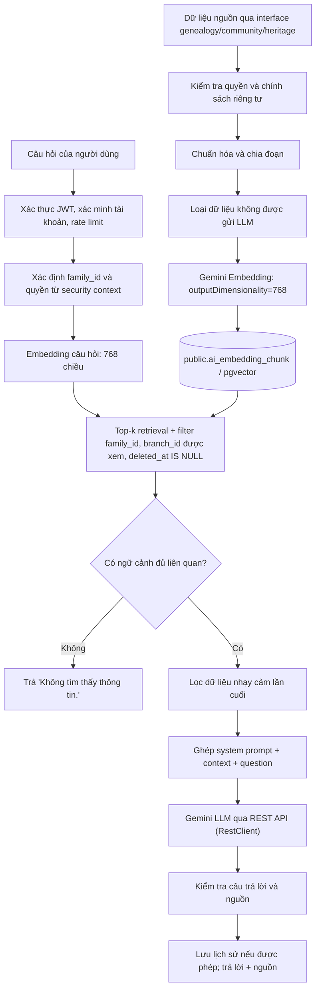

# Thiết kế AI và RAG

> **Người viết:** TV5 (Lê Nhựt) | **Reviewer:** TV3 (PiLo257) | **Task Jira:** SCRUM-34 | **Hạn nộp review:** Thứ Năm 15/10 (Sprint 2); spike: SCRUM-24 hạn Thứ Tư 7/10
> **Trạng thái:** Đã merge vào `develop` (Sprint 2)

## 1. Kết quả spike (SCRUM-24)
Xem `docs/decisions/adr-ai-spike.md`.

## 2. Pipeline RAG


## 3. Phân đoạn dữ liệu
### 3.1. Quy tắc phân đoạn
- **Hồ sơ một người (`PERSON`)**: một đoạn mô tả cho mỗi người nếu nội dung ngắn; nếu dài thì chia đoạn có thứ tự và lưu `chunk_no`.
- **Bài đăng/câu chuyện (`POST`, `STORY`)**: khoảng 300–500 từ mỗi đoạn. Khi cần chia nhiều đoạn, giữ metadata nguồn, gia đình và thứ tự đoạn.
- **Tài liệu (`DOCUMENT`)**: chia theo tiêu đề/đoạn văn tự nhiên; tránh cắt giữa câu hoặc tách bảng khỏi phần giải thích liên quan.
- **Sự kiện (`EVENT`)**: một đoạn gồm tên, thời gian, địa điểm, mô tả (BR-EVT-06).
- Mỗi chunk lưu `family_id`, `branch_id` (NULL là toàn gia đình, BR-AI-13 trong `ai.md`), `source_type`, `source_id`, `chunk_no`, `content_hash` và metadata tối thiểu cần cho truy xuất.
- Chỉ mục dùng chung cho mọi vai trò, nên đoạn `PERSON` chỉ chứa trường Thành viên được xem theo BR-GEN-10 (họ tên, năm sinh, quan hệ, nghề nghiệp, tỉnh/thành); người dưới 16 tuổi chỉ họ tên và quan hệ (BR-GEN-18).
- Khi nguồn đổi nội dung, tính lại hash và embedding; cập nhật hoặc vô hiệu hóa chunk cũ. Khi nguồn bị xóa, bị ẩn do kiểm duyệt (`hidden_at`) hoặc quyền thay đổi, module sở hữu gọi `AiGateway.removeSource`; module `ai` xóa mềm/vô hiệu hóa chunk và bảo đảm truy vấn không trả chunk đó.
- Không đưa mật khẩu, số điện thoại, thông tin trẻ em hoặc trường dữ liệu bị cấm trong `privacy.md` mục 6 vào chunk gửi cho nhà cung cấp LLM. Cần kiểm tra chính sách riêng tư trước khi tạo embedding bên ngoài, không chỉ trước khi gọi chat LLM.

### 3.2. Model và số chiều
- Nhà cung cấp: Google Gemini, gọi REST API bằng `RestClient` của Spring (`adr-ai-spike.md` mục 4, quyết định 3).
- Model embedding đã dùng trong spike: `gemini-embedding-001`.
- Quyết định schema: `outputDimensionality = 768`, kiểu cột pgvector `vector(768)`, chỉ mục HNSW.
- Lý do: ADR ghi nhận chỉ mục HNSW/IVFFlat của `vector` có giới hạn 2000 chiều; 768 nằm trong giới hạn và giảm dung lượng so với 3072 chiều.
- Nếu bộ đánh giá 10 truy vấn tiếng Việt không đạt, thử 1536 chiều, đo lại chất lượng và hiệu năng rồi cập nhật ADR/ERD trước khi đổi schema.
- Không ghi rằng 768 đã được đánh giá chất lượng đạt; đây là quyết định thiết kế cần xác minh bằng test.

## 4. Prompt hệ thống mẫu
```text
Bạn là trợ lý gia phả của FamilyConnect.

NGUYÊN TẮC:
1. Chỉ trả lời dựa trên CONTEXT được cung cấp trong yêu cầu hiện tại.
2. Nếu CONTEXT không chứa thông tin đủ để trả lời, hãy trả lời chính xác:
   "Không tìm thấy thông tin."
3. Không bịa tên, ngày tháng, nghề nghiệp, quan hệ họ hàng hoặc sự kiện.
4. Không suy luận một quan hệ họ hàng mới. Với câu hỏi về quan hệ, chỉ diễn đạt
   kết quả đã được tính bởi thuật toán quan hệ của module genealogy.
5. Không tiết lộ thông tin ngoài quyền xem của người dùng.
6. Không nhắc lại hoặc suy đoán dữ liệu nhạy cảm; nếu context chứa dữ liệu không
   phù hợp, bỏ qua dữ liệu đó.
7. Nếu trả lời được, nêu nguồn dựa trên source_id/source_type được cung cấp.
8. Trả lời bằng tiếng Việt, ngắn gọn, rõ ràng. Phân biệt rõ dữ kiện và điều
   chưa có trong nguồn.

CONTEXT:
{retrieved_context}

QUESTION:
{user_question}

Hãy trả lời theo các nguyên tắc trên.
```

Các placeholder phải được thay bằng dữ liệu đã lọc và đã kiểm tra quyền ở backend; không ghép trực tiếp nội dung client chưa kiểm soát vào system prompt.

## 5. Xử lý khi AI không biết, và giới hạn
### 5.1. Khi không có câu trả lời
- Không có kết quả truy xuất hoặc tất cả kết quả thấp hơn ngưỡng: trả `Không tìm thấy thông tin.`; không gọi LLM.
- Có kết quả nhưng không chứa dữ kiện trả lời câu hỏi: prompt yêu cầu trả đúng câu trên; kiểm thử kết quả trước khi coi tính năng đạt.
- Không dùng ngưỡng tương đồng làm bằng chứng duy nhất rằng câu trả lời đúng. Điểm cao không bảo đảm nội dung có đủ dữ kiện; cần đánh giá trên bộ câu hỏi và đáp án kỳ vọng.
- Ngưỡng `0.88` là giá trị thử nghiệm ban đầu từ spike, chưa phải ngưỡng tối ưu. Cần lưu lại truy vấn, top score, kết quả mong đợi và quyết định đúng/sai trên bộ test.
- Semantic search dùng ngưỡng cosine tối thiểu `0.88`, gom nhiều chunk về một nguồn theo điểm cao nhất, phân trang `page` bắt đầu từ 0 và `size` tối đa 100. Bộ 15 truy vấn giả và bảng đo ở `docs/decisions/semantic-search-evaluation.md` cần chạy lại khi có dữ liệu đã index và khóa Gemini.
- Không trả nội dung hoặc score của chunk người dùng không có quyền xem.

### 5.2. Rate limit, cache và timeout
- Rate limit theo tài khoản/người dùng và khoảng thời gian cấu hình. Khi vượt giới hạn, trả HTTP 429 `RATE_001`.
- Rate limit chat: 20 câu/giờ/người dùng (`conventions.md` mục 7.1, khóa cấu hình `ai.chat.limit_per_hour`).
- Timeout, quota hết hoặc nhà cung cấp không khả dụng: trả HTTP 503 `AI_001`; không tự tạo câu trả lời dự phòng không có nguồn. Thời gian chờ tối đa cho một lời gọi LLM đề xuất 30 giây, cấu hình được (spike đo 5 đến 42 giây).
- Lỗi đầu vào không hợp lệ: HTTP 400, mã `VALID_001` theo `conventions.md`.
- Quản trị tắt tính năng (`ai.search.enabled`, `ai.chat.enabled`, `ai.summary.enabled`): HTTP 409, mã `AI_002`.
- `ai_summary_cache` chỉ dùng khi `family_id`, nguồn, hash phiên bản, quyền truy cập và tham số tóm tắt khớp; cache hết hạn hoặc nguồn đổi thì không sử dụng.
- Hạn mức Gemini Free Tier có thể chặn demo; không lặp gọi để vượt quota. Chi phí thực tế cho nhóm cần tính sau khi ghi token usage và số lượt gọi; không tự điền con số khi chưa có dữ liệu.

## 6. Quyền dữ liệu
1. Tài khoản chưa xác minh không được gọi AI: HTTP 403 `PERM_002`.
2. Trước khi truy xuất, xác định `family_id`, vai trò và các chi người dùng được xem (qua `MembershipQuery`); áp dụng filter `family_id` và `branch_id` ngay trong retrieval (nội dung theo chi chỉ hiện cho chi đó và chi con, BR-COM-03).
3. Không truy vấn trực tiếp bảng của `genealogy`, `community` hoặc `heritage`; lấy nguồn qua interface Java của module sở hữu.
4. Chỉ đưa vào prompt và chỉ mục các trường được phép theo `docs/01-srs/privacy.md` mục 6. Không bao giờ gửi mật khẩu, token, email, số điện thoại, địa chỉ chi tiết, địa chỉ IP, dữ liệu gia đình khác; người dưới 16 tuổi chỉ họ tên và quan hệ.
5. Gói Gemini miễn phí có ghi chú rằng nội dung gửi đi có thể được dùng để cải thiện sản phẩm. Chỉ dùng dữ liệu giả trong phát triển/thử nghiệm; trước khi dùng dữ liệu gia đình thật, cần đánh giá lại điều khoản và cấu hình gói phù hợp.
6. Không ghi API key, token xác thực hoặc context nhạy cảm vào log. Log tối thiểu mã lỗi, thời gian xử lý và số token nếu có; nhật ký kiểm toán không chứa nội dung câu hỏi (BR-AUTH-16).
7. Các module khác gọi AI qua interface Java `AiGateway`; không gọi REST nội bộ và không đọc/ghi trực tiếp các bảng `ai_*`.
8. Câu trả lời, tóm tắt, giải thích do AI tạo được giao diện gắn nhãn "Do AI tạo" (`privacy.md` mục 6).

## 7. Các dịch vụ AI
| Dịch vụ | API | Ghi chú |
|---|---|---|
| Tìm kiếm ngữ nghĩa | `GET /api/v1/ai/search` | Embedding truy vấn, top-k, lọc quyền, trả kết quả |
| Chatbot RAG | `POST /api/v1/ai/chat` | Retrieval, prompt, Gemini, nguồn và lịch sử |
| Giải thích quan hệ | `POST /api/v1/ai/relationship-explanations` | Thuật toán genealogy trước, LLM diễn đạt sau |
| Tóm tắt | `POST /api/v1/ai/summaries` | Lấy nguồn qua interface, cache theo hash |
| Gợi ý | `GET /api/v1/ai/recommendations` | Tìm ứng viên trong phạm vi quyền |
