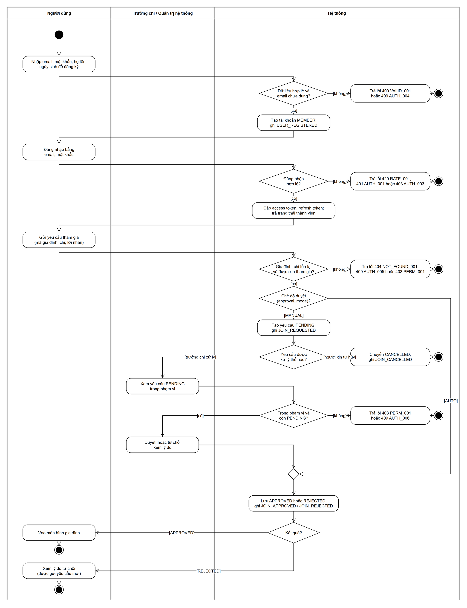
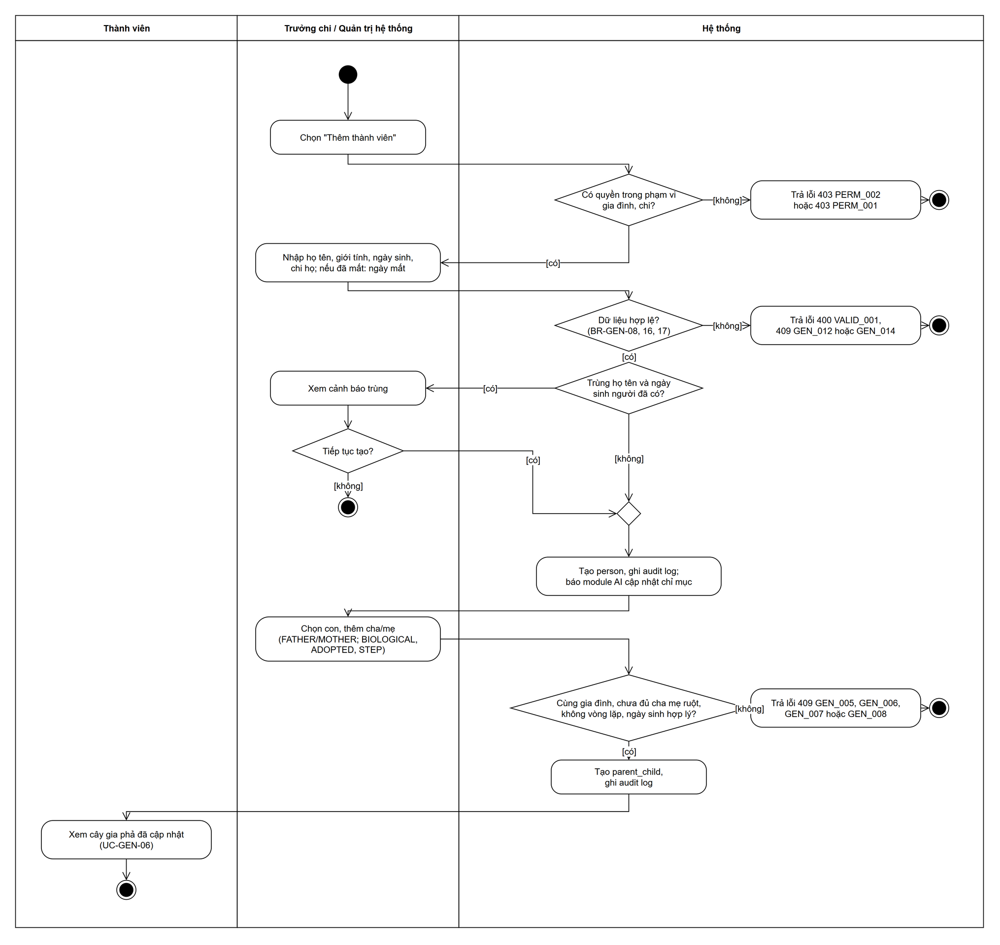
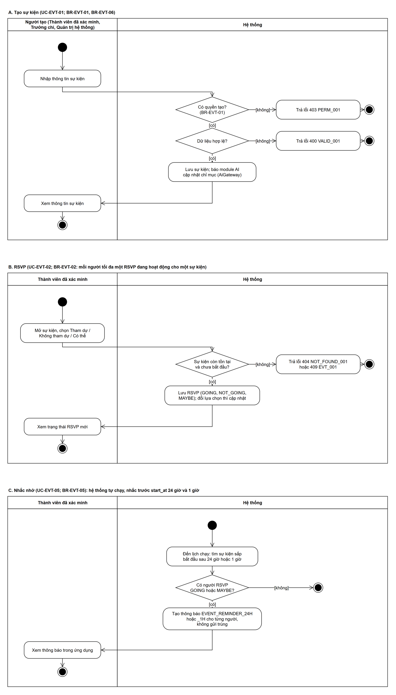
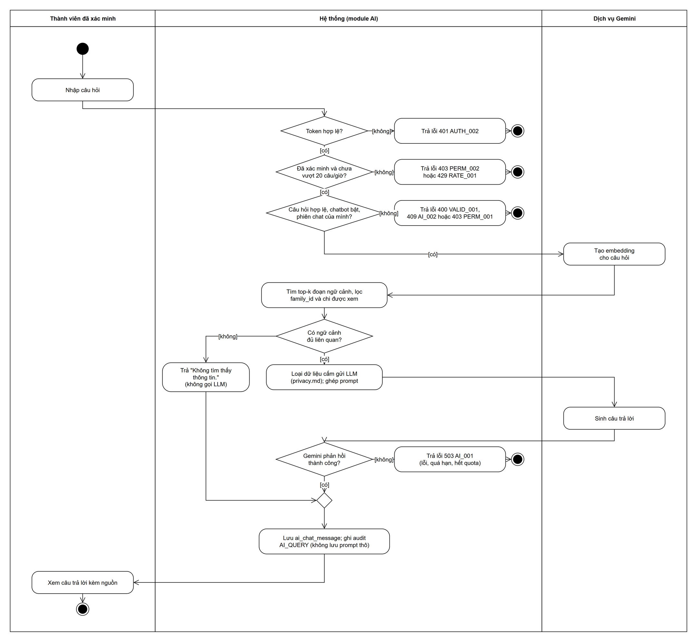

# Mô hình hóa quy trình nghiệp vụ

> **Người viết:** TV3 (PiLo257) | **Reviewer:** TV1 (Tuấn Nguyễn Thanh) | **Task Jira:** SCRUM-83 | **Hạn nộp review:** Thứ Năm 15/10 (Sprint 2)  
> **Trạng thái:** Đã merge vào `develop` (Sprint 2)

Các sơ đồ là Activity Diagram theo UML, chia làn (swimlane) theo người thực hiện; mỗi sơ đồ chỉ có các làn tham gia vào quy trình đó: **Người dùng / Thành viên**, **Trưởng chi / Quản trị hệ thống**, **Hệ thống**, và ở quy trình 4 thêm **Dịch vụ Gemini** (hệ thống LLM bên ngoài mà module AI gọi tới, theo `srs.md` mục 2). Các bước kiểm tra, tìm ngữ cảnh và lưu dữ liệu nằm ở làn **Hệ thống**.

Cách đọc: chấm đen là điểm bắt đầu; chấm đen có vòng tròn bao ngoài là điểm kết thúc; hình chữ nhật bo góc là hành động; hình thoi có chữ là điểm rẽ nhánh, điều kiện của từng nhánh ghi trong `[ ]`; hình thoi nhỏ không chữ là điểm gộp nhánh. Nhánh lỗi kết thúc ngay sau hành động trả lỗi. Sơ đồ chỉ dùng đen trắng. File gốc để sửa: `docs/images/business-process-<số>.drawio` (mở bằng draw.io), sửa xong xuất lại file `.drawio.png` cùng tên.

## 1. Đăng ký, xác minh thành viên và tham gia gia đình

## 2. Thêm thành viên và quan hệ trong gia phả

## 3. Tạo sự kiện, RSVP và nhắc nhở

## 4. Hỏi trợ lý AI (RAG)

## 5. Đối chiếu UC / FR / BR

| Sơ đồ | Use Case | Functional Requirements | Business Rules / tài liệu nguồn |
|---|---|---|---|
| 1. Đăng ký, xác minh và tham gia gia đình | UC-AUTH-01, UC-AUTH-02, UC-AUTH-06, UC-AUTH-07 | FR-AUTH-01, FR-AUTH-04 | BR-AUTH-07, BR-AUTH-08, BR-AUTH-09, BR-AUTH-10, BR-AUTH-11; `auth.md` |
| 2. Thêm thành viên và quan hệ gia phả | UC-GEN-03, UC-GEN-04, UC-GEN-06 | FR-GEN-03, FR-GEN-04, FR-GEN-06 | BR-GEN-01, BR-GEN-02, BR-GEN-03, BR-GEN-04, BR-GEN-05, BR-GEN-11, BR-GEN-14; `genealogy.md` |
| 3. Tạo sự kiện, RSVP và nhắc nhở | UC-EVT-01, UC-EVT-02, UC-EVT-05 | FR-EVT-01, FR-EVT-02, FR-EVT-05 | BR-EVT-01, BR-EVT-02, BR-EVT-05, BR-EVT-06; `community-events.md` |
| 4. Hỏi trợ lý AI (RAG) | UC-AI-02 | FR-AI-02 | `architecture.md` mục 4.2; `privacy.md` (Dữ liệu gửi cho AI) |
