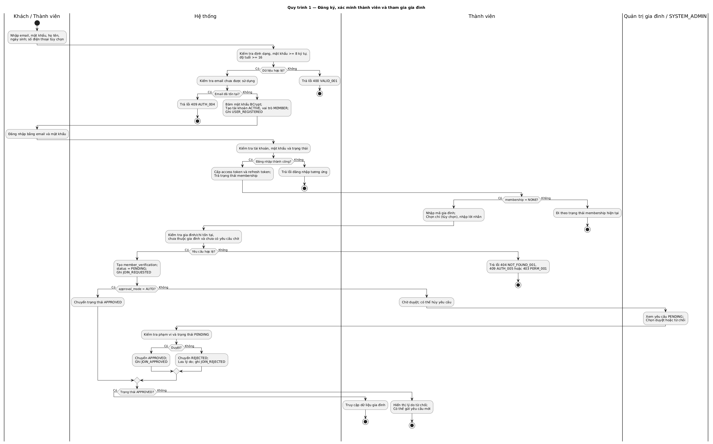
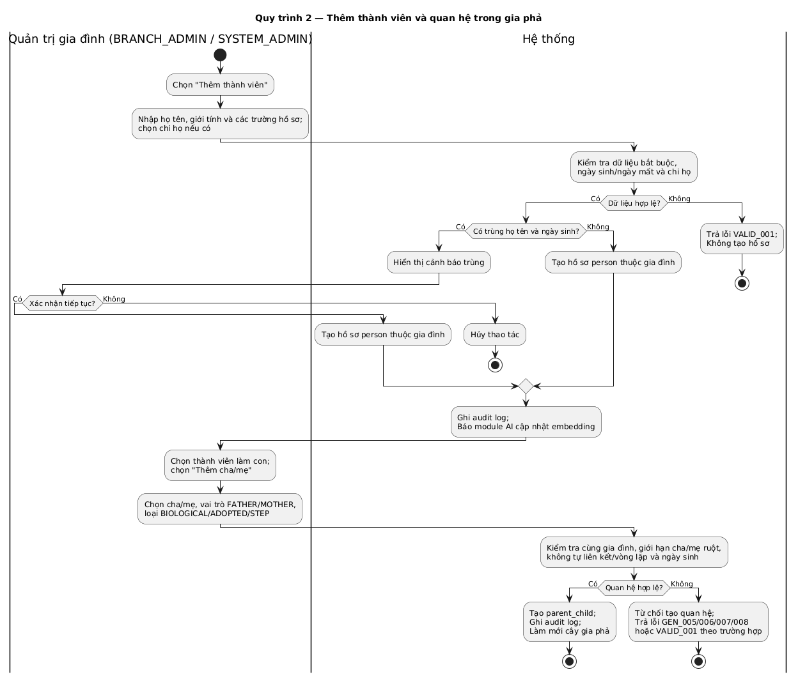
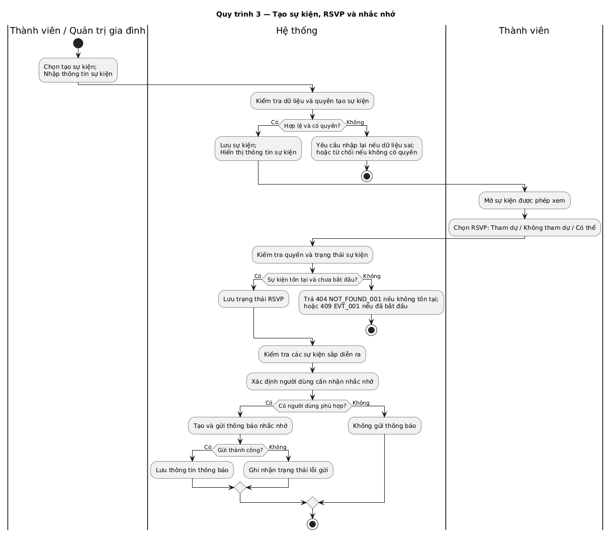
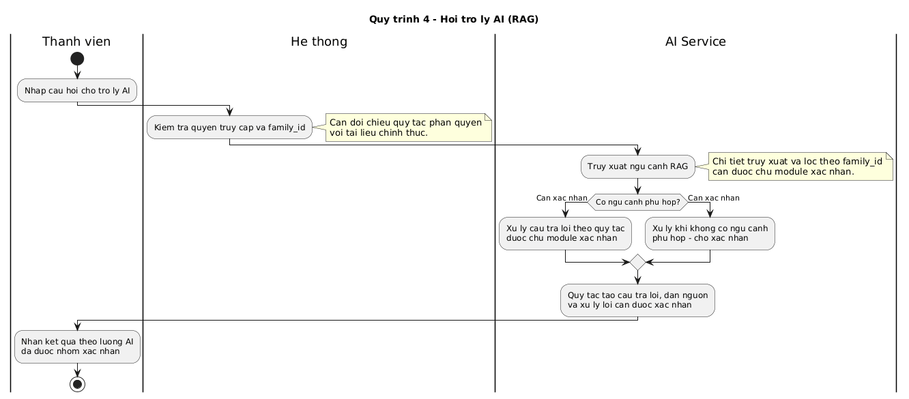

# Mô hình hóa quy trình nghiệp vụ

> **Người viết:** TV3 (PiLo257) | **Reviewer:** TV1 (Tuấn Nguyễn Thanh) | **Task Jira:** SCRUM-83 | **Hạn nộp review:** Thứ Năm 15/10 (Sprint 2)  
> **Trạng thái:** Nháp

Cách làm: tạo nhánh `docs/<mã SCRUM>-<tên-ngắn>` từ `develop`, điền vào file này, mở Pull Request vào `develop`. Xem `docs/README.md`.

Yêu cầu: mô hình hóa 4 quy trình nghiệp vụ bằng sơ đồ có phân làn (swimlane). Các vai trò cần thể hiện gồm: Thành viên, Trưởng chi, Hệ thống và AI Service.

## 1. Đăng ký, xác minh thành viên và tham gia gia đình

## 2. Thêm thành viên và quan hệ trong gia phả

## 3. Tạo sự kiện, RSVP và nhắc nhở

## 4. Hỏi trợ lý AI (RAG)

> **Lưu ý:** Cần đối chiếu các quy trình với Use Case, Functional Requirements và Business Rules tương ứng. Những chi tiết nghiệp vụ chưa có trong tài liệu nguồn cần được chủ module xác nhận trước khi chốt.