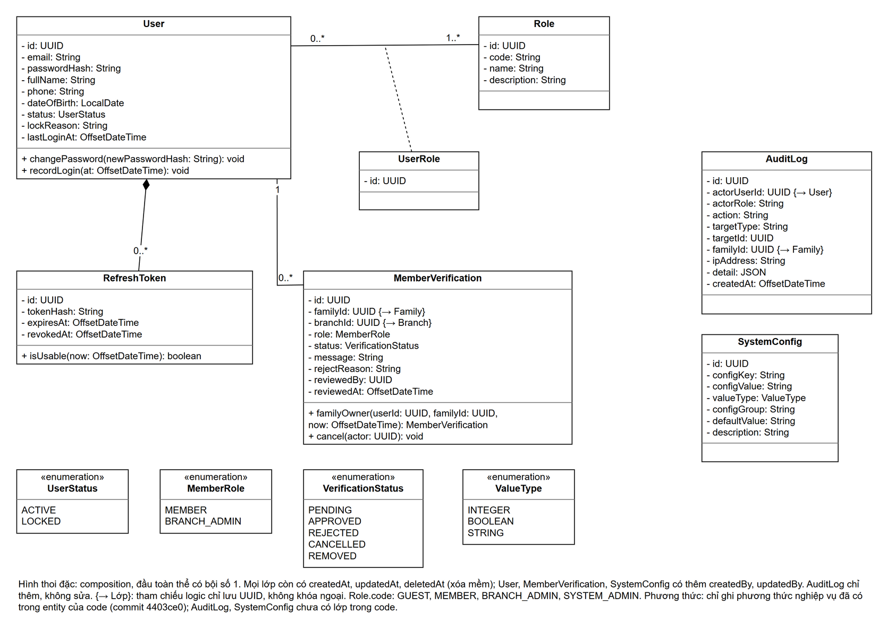
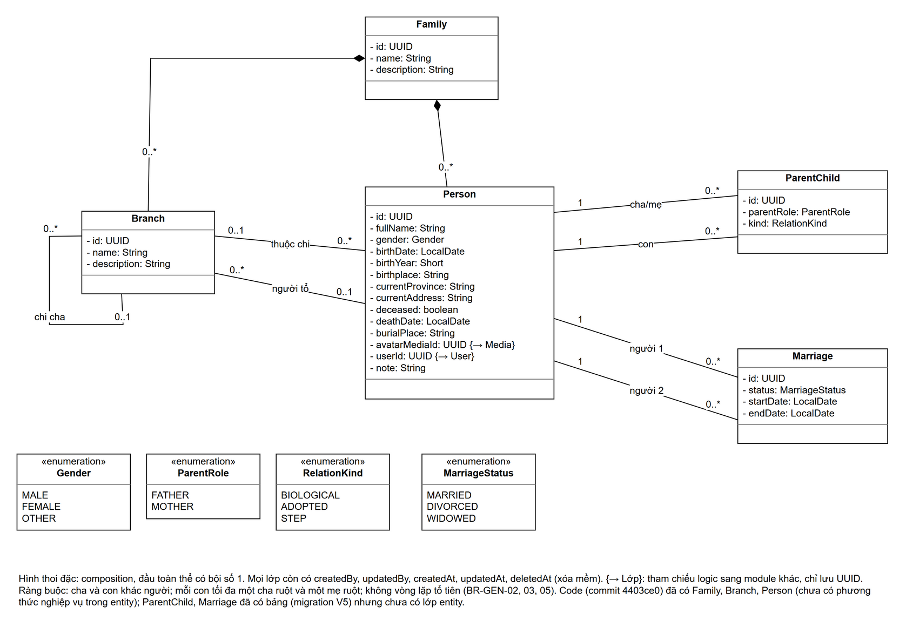
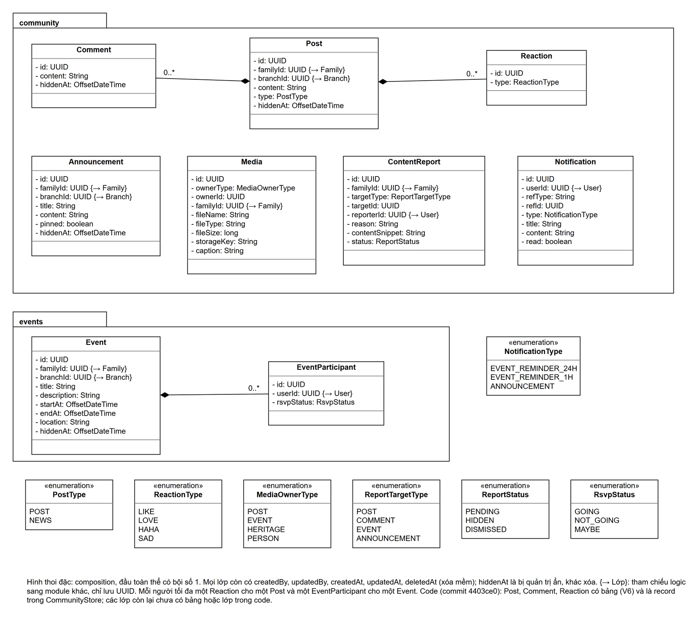
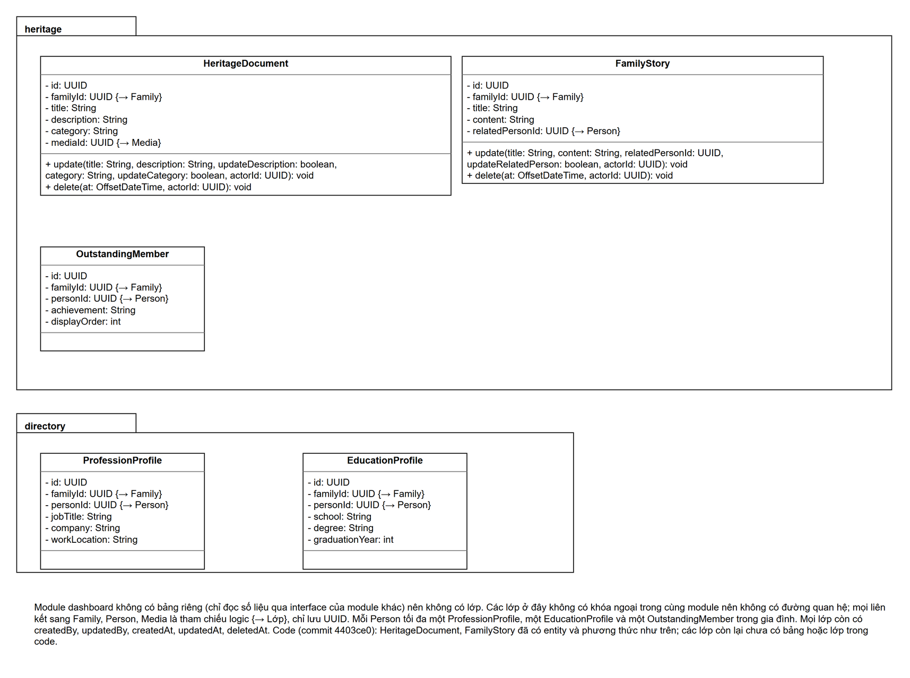
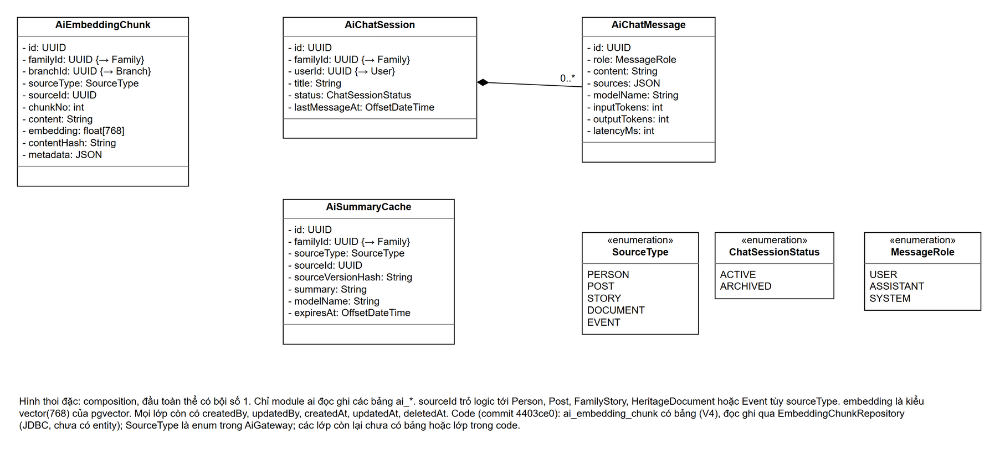

# Sơ đồ lớp (Class Diagram)

> **Người viết:** TV1 (Tuấn) | **Reviewer:** chưa phân công | **Task Jira:** chưa có
> **Trạng thái:** Bản nháp, chưa review

Sơ đồ lớp mức thực thể (lớp dữ liệu) của từng module, dùng cho phần thiết kế cơ sở dữ liệu cùng với ERD (`../03-database/erd.md`) và từ điển dữ liệu (`../03-database/data-dictionary.md`). Mỗi module một sơ đồ để sơ đồ không quá rối.

## 1. Cách đọc

| Ký hiệu | Ý nghĩa |
|---|---|
| Lớp 3 ngăn | Tên lớp; thuộc tính `- tên: Kiểu`; phương thức `+ tên(tham số): Kiểu` |
| Đường liền, số ở hai đầu | Liên kết (association) và bội số: `1`, `0..1`, `0..*`, `1..*` |
| Hình thoi đặc | Composition: lớp bộ phận không tồn tại khi không có lớp toàn thể; đầu hình thoi có bội số 1 |
| Đường nét đứt nối vào một liên kết | Lớp liên kết (association class), ví dụ `UserRole` giữa `User` và `Role` |
| `«enumeration»` | Kiểu liệt kê dùng cho thuộc tính |
| `{→ Lớp}` sau thuộc tính | Tham chiếu sang lớp của module khác: chỉ lưu UUID, không khóa ngoại, không vẽ đường (`architecture.md` mục 7, quyết định 9) |

Quy ước chung:

- Thuộc tính lấy theo `data-dictionary.md` (30 bảng), đổi tên cột sang camelCase.
- Không vẽ các cột chuẩn `createdAt`, `updatedAt`, `deletedAt`, `createdBy`, `updatedBy`; ngoại lệ ghi ở chú thích từng sơ đồ.
- Ngăn phương thức chỉ ghi phương thức nghiệp vụ đã có trong entity của code tại commit `4403ce0`, không ghi getter/setter. Lớp chưa có trong code thì để trống.
- File ảnh xuất từ draw.io, kèm dữ liệu sơ đồ: mở bằng draw.io để sửa rồi xuất lại cùng tên.

## 2. Auth và quản trị (auth, admin)

`User` có nhiều `Role` qua lớp liên kết `UserRole`; `RefreshToken` thuộc về một `User` (composition); mỗi `User` có nhiều `MemberVerification` theo thời gian nhưng tối đa một bản ghi `PENDING` hoặc `APPROVED` (BR-AUTH-08). `AuditLog` và `SystemConfig` không có khóa ngoại. Code đã có `User`, `Role`, `UserRole`, `RefreshToken`, `MemberVerification`.

## 3. Gia phả (genealogy)

`Family` chứa `Branch` và `Person` (composition). `Branch` có chi cha (tự liên kết) và người tổ; `Person` thuộc tối đa một chi. `ParentChild` và `Marriage` mỗi lớp nối hai lần tới `Person`. Code đã có entity `Family`, `Branch`, `Person`; bảng `parent_child`, `marriage` đã có ở migration V5 nhưng chưa có lớp entity.

## 4. Community và Events

`Post` chứa `Comment` và `Reaction`; `Event` chứa `EventParticipant`. `Media`, `Announcement`, `ContentReport`, `Notification` chỉ có tham chiếu logic. Code đã có bảng `post`, `comment`, `reaction` (migration V6), đọc ghi bằng record trong `CommunityStore`.

## 5. Heritage và Directory

Không có khóa ngoại trong cùng module nên không có đường quan hệ. Module dashboard không có bảng riêng nên không có lớp. Code đã có entity `HeritageDocument`, `FamilyStory`.

## 6. AI

`AiChatSession` chứa `AiChatMessage`. Code đã có bảng `ai_embedding_chunk` (migration V4), đọc ghi bằng `EmbeddingChunkRepository`; `SourceType` là enum trong `AiGateway`.
