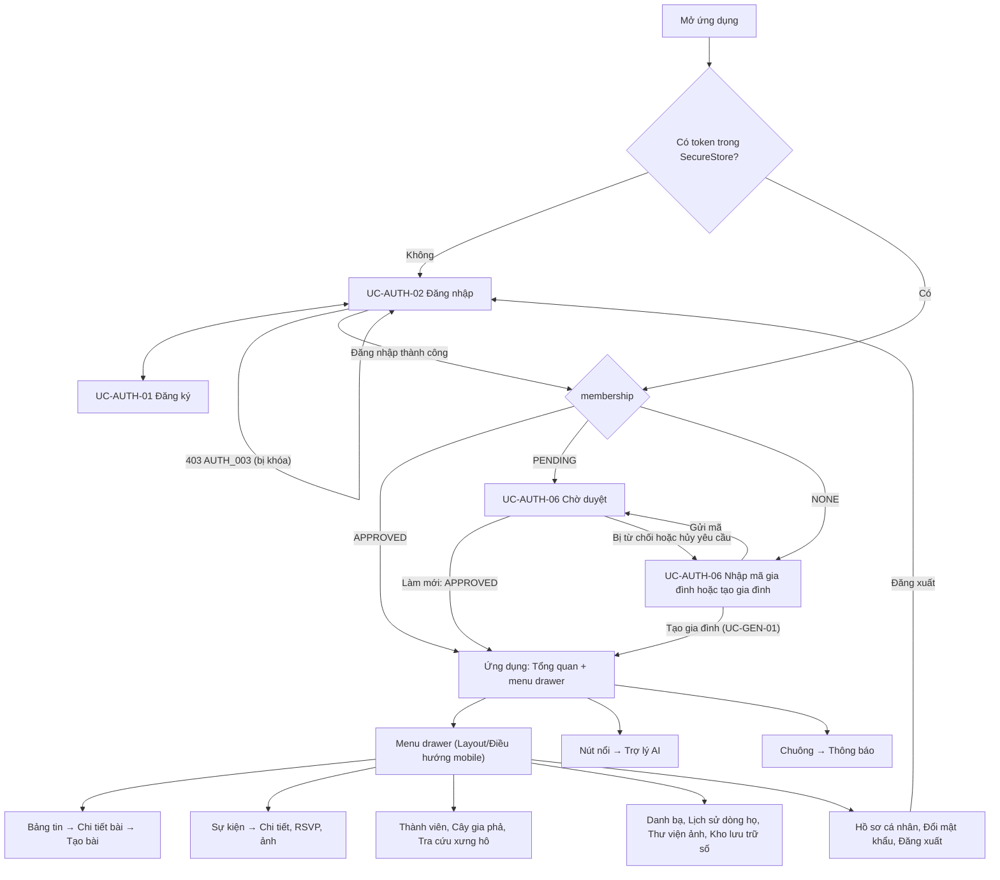

# Thiết kế Mobile (React Native + Expo)

> **Người viết:** TV5 (Lê Nhựt) | **Reviewer:** TV3 (PiLo257) | **Task Jira:** SCRUM-84 | **Hạn nộp review:** Thứ Năm 15/10 (Sprint 2)
> **Trạng thái:** Chờ review
> Căn cứ: `architecture.md` mục 5 và 7, `design-system.md` mục 4, 5.1, 5.2, `use-cases/auth.md` mục 4.2, `conventions.md` mục 2, 3, 8, `srs.md` mục 3 và Phụ lục A (bản trên `develop`).

## 1. Chọn công nghệ
**Quyết định:** React Native + Expo cho ứng dụng mobile iOS và Android, điều hướng bằng React Navigation. Lý do và so sánh với Flutter: [`adr-mobile.md`](../decisions/adr-mobile.md).

Mobile gọi cùng REST API `/api/v1` với web và dùng cùng hợp đồng API (kiểu dữ liệu sinh từ OpenAPI, mục 4.4). Khung ứng dụng tạo ở SCRUM-85 (`mobile/README.md`).

## 2. Phạm vi mobile
Quyền trong từng chức năng theo `srs.md` Phụ lục A, giống web (ví dụ Thành viên chỉ xem cây gia phả; Trưởng chi mới thấy nút gỡ bài của người khác).

| Chức năng | Có trên mobile | Mã FR | Use case / ghi chú |
|---|---|---|---|
| Đăng nhập, đăng ký, đăng xuất, hồ sơ, đổi mật khẩu | Có | FR-AUTH-01, FR-AUTH-03 | UC-AUTH-01 đến 05 |
| Xin tham gia gia đình, chờ duyệt, tạo gia đình | Có | FR-AUTH-04, FR-GEN-01 | UC-AUTH-06, UC-GEN-01 (luồng sau đăng nhập, mục 3) |
| Bảng tin, bài đăng, bình luận, reaction, ảnh, thông báo ghim | Có | FR-COM-01 đến FR-COM-05 | UC-COM-01 đến 06 |
| Sự kiện, RSVP, người tham dự, ảnh sự kiện, nhắc nhở | Có | FR-EVT-01 đến FR-EVT-05 | UC-EVT-01 đến 05. Nhắc nhở hiển thị trong màn Thông báo (BR-EVT-05); push notification là phần mở rộng |
| Danh sách thành viên, cây gia phả, tra quan hệ | Có (xem) | FR-GEN-03 (xem), FR-GEN-06, FR-GEN-07, FR-GEN-08 | UC-GEN-03 (xem), 06, 07, 08. Thêm, sửa thành viên và quan hệ làm trên web |
| Trợ lý AI, tìm kiếm, tóm tắt, giải thích quan hệ, gợi ý | Có | FR-AI-01 đến FR-AI-05 | UC-AI-01 đến 05 |
| Danh bạ, hồ sơ nghề nghiệp và học vấn | Có, ưu tiên thấp | FR-DIR-01 đến FR-DIR-04 | UC-DIR-01, 02. Cắt đầu tiên nếu trễ tiến độ |
| Di sản: tài liệu, câu chuyện, người tiêu biểu, thư viện ảnh | Có, ưu tiên thấp | FR-HER-01 đến FR-HER-05 | UC-HER-01 đến 04. Cắt đầu tiên nếu trễ tiến độ |
| Nhóm Quản lý: duyệt yêu cầu tham gia, thống kê và báo cáo | Không, chỉ web | FR-AUTH-04 (duyệt), FR-DSH-01 đến FR-DSH-05 | `design-system.md` mục 5.2 |
| Nhóm Quản trị hệ thống | Không, chỉ web | FR-ADM-01 đến FR-ADM-05 | `design-system.md` mục 5.2 |

## 3. Sơ đồ điều hướng
### 3.1. Mô hình điều hướng
- **React Navigation** (`architecture.md` mục 5): một stack gốc chọn nhánh theo trạng thái đăng nhập và trạng thái tham gia gia đình (`membership`); trong ứng dụng dùng **menu drawer**, mỗi mục mở một stack (danh sách → chi tiết → tạo, sửa).
- **Menu drawer theo design system** (`design-system.md` mục 4 và 5.1: điều hướng mobile là khối cuối trang, "chuyển thành menu drawer khi làm app"). Nội dung drawer đúng component `Layout/Điều hướng mobile` (Size=360) trên page 01, đúng danh sách theo vai trò ở mục 5.2, bỏ nhóm Quản lý và Quản trị. Mở bằng nút Menu trên `Layout/Header` Size=360. **Không dùng tab bar** (Jira SCRUM-84 bước 3 có ghi "tab bar", đã thống nhất đổi theo review PR #37 ngày 16/10/2026).
- Chuông thông báo trên header mở màn Thông báo. Nút nổi "Trợ lý AI" (component trên page 06) mở màn Trợ lý AI từ mọi màn trong ứng dụng.

### 3.2. Luồng sau khi mở ứng dụng và đăng nhập (UC-AUTH-02, UC-AUTH-06)
Khi mở ứng dụng, nếu đã có token thì gọi `GET /api/v1/users/me/membership` để chọn nhánh, giống bước 6 của UC-AUTH-02.



Bất kỳ lúc nào: nhận `401 AUTH_002` mà làm mới token thất bại thì về Đăng nhập; nhận `403 PERM_002` thì về Chờ duyệt (mục 4.5).

### 3.3. Danh sách màn hình
| Nhóm | Màn hình | Use case | Khung Figma trên page 06 |
|---|---|---|---|
| Xác thực | Đăng nhập | UC-AUTH-02 | `UC-AUTH-02 Đăng nhập / 360` |
| Xác thực | Đăng ký | UC-AUTH-01 | Chưa có |
| Tham gia gia đình | Nhập mã gia đình hoặc tạo gia đình | UC-AUTH-06, UC-GEN-01 | Chưa có |
| Tham gia gia đình | Chờ duyệt | UC-AUTH-06 | Chưa có |
| Trang chủ | Tổng quan | (trang chủ, `design-system.md` mục 5.2) | Chưa có (bản web ở page 05) |
| Menu | Menu drawer | | `Menu / 360` |
| Cộng đồng | Bảng tin | UC-COM-01, 02, 03 | `UC-COM-01 Bảng tin / 360` |
| Cộng đồng | Tạo bài kèm ảnh | UC-COM-01, 05 | `UC-COM-01 Tạo bài / 360` |
| Cộng đồng | Chi tiết bài và bình luận | UC-COM-02, 03 | Chưa có |
| Sự kiện | Sự kiện và Giỗ chạp | UC-EVT-01 | `UC-EVT-01 Sự kiện và Giỗ chạp / 360` |
| Sự kiện | Chi tiết sự kiện, RSVP, ảnh | UC-EVT-02, 03, 04 | `UC-EVT-02 Sự kiện + RSVP / 360` |
| Thông báo | Thông báo | UC-EVT-05 | Chưa có |
| Gia phả | Thành viên | UC-GEN-03 (xem) | `UC-GEN-03 Thành viên / 360` |
| Gia phả | Cây gia phả | UC-GEN-06 | `UC-GEN-06 Cây gia phả / 360` |
| Gia phả | Tra cứu xưng hô | UC-GEN-07, 08 | `UC-GEN-07 Tra cứu cách xưng hô / 360` |
| AI | Trợ lý AI | UC-AI-02 (kèm 03, 04, 05) | `Chat AI / 360` (cần đổi tên `UC-AI-02 Trợ lý AI / 360`) |
| AI | Tìm kiếm | UC-AI-01 | `Tìm kiếm / 360` (cần đổi tên `UC-AI-01 Tìm kiếm / 360`) |
| Danh bạ | Danh bạ, xem hồ sơ | UC-DIR-01, 02 | `UC-DIR-01 Danh bạ / 360` |
| Di sản | Lịch sử dòng họ, Thư viện ảnh, Kho lưu trữ số | UC-HER-01 đến 04 | Chưa có (ưu tiên thấp) |
| Tài khoản | Hồ sơ cá nhân, Đổi mật khẩu | UC-AUTH-05, 04 | Chưa có |

## 4. Kiến trúc mobile
### 4.1. Cấu trúc thư mục
Theo `architecture.md` mục 5 (Mobile) và mục 7, quyết định 2:

```text
mobile/
├── src/
│   ├── navigation/       # React Navigation: RootNavigator (chọn nhánh theo membership), AppDrawer, các stack
│   ├── screens/          # Màn hình toàn trang: LoginScreen, FeedScreen, ChatAiScreen...
│   ├── components/       # UI dùng chung theo design system: Header, Button, Input, Card, Badge, Toast...
│   └── services/
│       ├── generated/    # Kiểu sinh từ docs/04-api/openapi/ bằng openapi-typescript; không sửa tay
│       ├── api.ts        # axios: base URL, gắn token, làm mới token, chuẩn hóa lỗi (giống frontend/src/lib/api.ts)
│       ├── token-storage.ts  # đọc, ghi, xóa token bằng expo-secure-store
│       └── <module>.ts   # hàm gọi API theo module (auth, posts, events...), dùng kiểu trong generated/
├── scripts/
│   └── gen-api-types.mjs # sinh kiểu API, giống frontend/scripts/gen-api-types.mjs
├── App.tsx
├── app.json
├── package.json
└── tsconfig.json
```

### 4.2. Quản lý trạng thái
Dùng cùng thư viện với web (`frontend/package.json`), không thêm thư viện quản lý trạng thái khác:
- **TanStack Query**: dữ liệu lấy từ API, trạng thái đang tải, lỗi, cache, làm mới sau khi tạo, sửa, xóa.
- **React Hook Form + Zod**: form đăng nhập, đăng ký, hồ sơ, tạo bài; kiểm tra ở client trước khi gửi, lỗi server hiện theo `VALID_001` (mục 4.5).
- **Phiên đăng nhập** (người dùng, `membership`) giữ trong một React Context, nạp từ SecureStore và `GET /users/me/membership` khi mở ứng dụng.

### 4.3. Token
Theo `use-cases/auth.md` mục 4.2:
- Access token là JWT hạn 15 phút, gửi ở header `Authorization: Bearer <token>`. Refresh token hạn 7 ngày, gửi trong **body** của `POST /api/v1/auth/refresh`, **chỉ dùng một lần** và được xoay vòng: mỗi lần làm mới nhận cặp mới, token cũ bị thu hồi (BR-AUTH-06).
- Lưu cả hai token bằng `expo-secure-store` (Keychain trên iOS, Keystore trên Android). Không lưu ở `AsyncStorage`, không đưa vào URL hay log.
- Nhiều request cùng nhận `AUTH_002` thì chỉ gọi refresh một lần, các request đang chờ dùng chung kết quả (một promise dùng chung, như `frontend/src/lib/api.ts`), sau đó gọi lại mỗi request đúng một lần.
- Đăng xuất: gọi `DELETE /api/v1/auth/sessions/current`, rồi xóa token khỏi SecureStore và về màn Đăng nhập.

### 4.4. Gọi REST API và kiểu dữ liệu
- Base URL đặt bằng biến môi trường `EXPO_PUBLIC_API_BASE_URL`, cộng tiền tố `/api/v1`; không ghi cứng địa chỉ máy phát triển trong màn hình.
- Mọi lời gọi HTTP nằm trong `src/services/`; màn hình chỉ gọi hàm của service qua TanStack Query.
- **Kiểu request, response sinh bằng `openapi-typescript`** từ `docs/04-api/openapi/` vào `src/services/generated/` (lệnh `npm run gen:api`, theo `conventions.md` mục 8 và `architecture.md` quyết định 2). Commit output của lệnh; không viết tay kiểu DTO.
- Response thành công có dạng `{success: true, data, meta?}`; lỗi có dạng `{success: false, error: {code, message, details}}` (`conventions.md` mục 2). `api.ts` chuẩn hóa lỗi thành một kiểu chung để màn hình xử lý theo mục 4.5.

### 4.5. Xử lý mã lỗi
| Mã | HTTP | Mobile xử lý |
|---|---|---|
| `AUTH_002` | 401 | Gọi refresh một lần (các request đang chờ dùng chung kết quả), rồi gọi lại request ban đầu đúng một lần. Refresh lỗi thì xóa token và về màn Đăng nhập |
| `AUTH_001` | 401 | Chỉ ở màn Đăng nhập: báo "Sai email hoặc mật khẩu" |
| `AUTH_003` | 403 | Tài khoản bị khóa: xóa token, về màn Đăng nhập kèm thông báo |
| `PERM_002` | 403 | Chưa được duyệt: chuyển sang màn Chờ duyệt (hoặc Nhập mã gia đình nếu `membership` là `NONE`) |
| `PERM_001` | 403 | Báo "Bạn không đủ quyền thực hiện thao tác này", giữ nguyên màn hiện tại |
| `VALID_001` | 400 | Hiện lỗi dưới từng ô theo `details[].field` |
| `NOT_FOUND_001` | 404 | Màn "Không tìm thấy" kèm nút quay lại |
| `RATE_001` | 429 | Báo người dùng, đọc header `Retry-After` và khóa nút gửi đến hết thời gian chờ |
| `FILE_001`, `FILE_002` | 413, 415 | Báo ảnh quá dung lượng hoặc sai định dạng (`jpg`, `png`, `webp`, tối đa 5 MB, BR-COM-08) |
| `AI_001` | 503 | Báo "Trợ lý AI tạm thời không khả dụng", có nút thử lại |
| `AI_002` | 409 | Báo "Tính năng AI đang tạm tắt", ẩn ô nhập (`ai.md` BR-12) |
| Mã riêng khác (`GEN_xxx`, `EVT_001`...) | 409 | Hiện `error.message` server trả về |
| `SERVER_001` hoặc mất mạng | 500 hoặc không có phản hồi | Báo lỗi chung kèm nút thử lại (mục 4.6) |

### 4.6. Offline cơ bản
1. Hiện trạng thái mất kết nối và nút thử lại.
2. Cho xem dữ liệu đã có trong cache của TanStack Query, ghi rõ dữ liệu có thể chưa mới.
3. Khi không có mạng, không báo thành công giả cho thao tác ghi (tạo bài, RSVP, sửa hồ sơ); không xếp hàng đợi gửi lại tự động.
4. Màn nào cũng có trạng thái đang tải, rỗng, lỗi và thử lại, cùng kiểu với web.

## 5. Wireframe Figma
Page [06 Mobile](https://www.figma.com/design/LDT41oUdTnmwaUugJlvrLK/Java?node-id=4-223) của file chung (ghi ở `docs/05-ui/figma-links.md`). Quy tắc vẽ:
- Tên khung `<Mã UC> Tên màn hình / 360`.
- Dùng instance `Layout/Header` Size=360 và `Layout/Điều hướng mobile` Size=360 từ page 01, chọn đúng `Vai trò`; không detach, không tự vẽ tab bar.
- Section "User flow" thể hiện luồng ở mục 3.2.

Tình trạng ngày 18/10/2026: đã có 12 khung, khung nào cũng dùng instance Header Size=360; section User flow đã có nội dung. Còn thiếu, cần TV5 bổ sung trước khi approve:
- Màn chưa vẽ: Đăng ký, Nhập mã gia đình hoặc tạo gia đình, Chờ duyệt, Tổng quan, Chi tiết bài, Thông báo, Hồ sơ cá nhân và Đổi mật khẩu (các màn Di sản ưu tiên thấp).
- Đổi tên `Chat AI / 360` thành `UC-AI-02 Trợ lý AI / 360`, `Tìm kiếm / 360` thành `UC-AI-01 Tìm kiếm / 360`.
- 5 khung chưa có `Layout/Điều hướng mobile`: Thành viên, Cây gia phả, Tra cứu xưng hô, Sự kiện và Giỗ chạp, Chat AI.

## 6. Câu hỏi còn mở
- [ ] Trưởng chi có đăng tin tức, thông báo ghim, gỡ bài trên mobile không? `design-system.md` mục 5.2 chỉ nói mobile bỏ nhóm Quản lý và Quản trị. (Đề xuất: có, vì các nút này nằm trong màn Bảng tin, không thuộc nhóm Quản lý.)
- [ ] Push notification cho nhắc nhở sự kiện: phần mở rộng theo BR-EVT-05, chưa cam kết.
