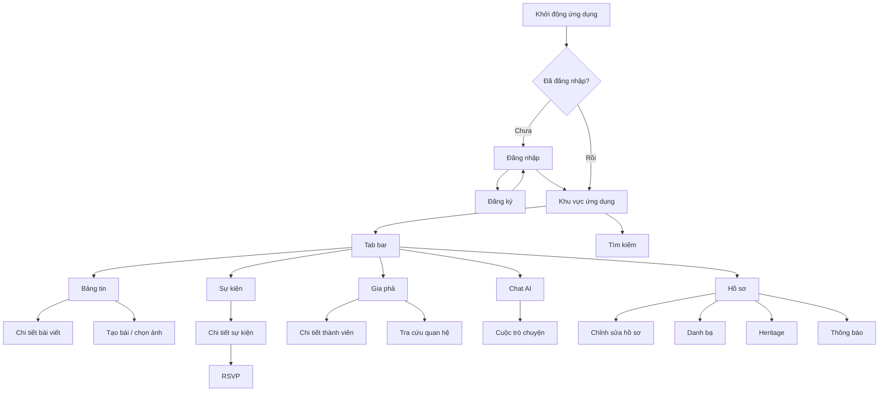

# Thiết kế Mobile (React Native + Expo)

> **Người viết:** TV5 (Lê Nhựt) | **Reviewer:** TV3 (PiLo257) | **Task Jira:** SCRUM-84 | **Hạn nộp review:** Thứ Năm 15/10 (Sprint 2)
> **Trạng thái:** Nháp 
> Cách làm: tạo nhánh `docs/<mã SCRUM>-<tên-ngắn>` từ `develop`, điền vào file này, mở Pull Request vào `develop`. Xem `docs/README.md`.

## 1. Chọn công nghệ
**Quyết định:** React Native + Expo cho ứng dụng mobile iOS/Android.
Lý do chính:
- Phù hợp với hệ React đang được dùng ở web Next.js, giúp tận dụng kiến thức hiện có.
- Phát triển hai nền tảng từ một codebase chính.
- Expo hỗ trợ quy trình chạy thử, phát triển và build ứng dụng.
- Phạm vi ứng dụng chủ yếu là các màn hình nghiệp vụ kết nối REST API.
**So sánh ngắn với Flutter:** Flutter dùng Dart và bộ widget riêng; React Native + Expo dùng JavaScript/TypeScript và hệ React. Cả hai đều hỗ trợ iOS/Android. Nhóm chọn React Native + Expo vì gần với công nghệ web hiện tại, không phải vì Flutter không phù hợp.
Chi tiết quyết định và hệ quả: [`../decisions/adr-mobile.md`].

## 2. Phạm vi mobile
| Chức năng | Có trên mobile | Phạm vi/ghi chú |
|---|---|---|
| Đăng nhập, đăng ký, hồ sơ | Có | Xác thực, xem và cập nhật hồ sơ theo API backend hỗ trợ |
| Bảng tin, tạo bài, ảnh | Có | Xem bảng tin; tạo bài và chọn/đính kèm ảnh |
| Sự kiện, RSVP, thông báo | Có | Xem sự kiện, phản hồi tham dự (RSVP), xem thông báo |
| Cây gia phả, tra quan hệ | Có | Ưu tiên xem cây gia phả và tra cứu quan hệ; không mặc định có công cụ chỉnh sửa cây phức tạp |
| Chat AI, tìm kiếm, tóm tắt | Có | Giao diện chat và tìm kiếm theo chức năng API hiện có |
| Danh bạ, Heritage | Có | Ưu tiên thấp nhất; cắt giảm đầu tiên nếu trễ tiến độ |
| Admin, Dashboard chi tiết | Không — chỉ web | Không xây dựng màn hình quản trị nặng trong phạm vi mobile này |

## 3. Sơ đồ điều hướng
### 3.1. Cấu trúc đề xuất
Dùng **tab bar cho các khu vực chính** và **stack navigation cho luồng chi tiết/tác vụ**. Đề xuất dùng Expo Router để tổ chức điều hướng theo file; có thể điều chỉnh tên tab sau khi nhóm thống nhất UX.



**Ghi chú:** Đây là sơ đồ định hướng ban đầu, chưa phải quyết định UX cuối cùng. Tìm kiếm và thông báo có thể được đặt ở Header hoặc trong một tab/stack riêng tùy thiết kế Figma. Cần thống nhất cách truy cập trước khi hoàn tất wireframe.

### 3.2. Danh sách màn hình dự kiến
| Nhóm | Màn hình | Mức ưu tiên |
|---|---|---|
| Xác thực | Đăng nhập, Đăng ký | Bắt buộc |
| Hồ sơ | Hồ sơ cá nhân, Chỉnh sửa hồ sơ | Bắt buộc |
| Bảng tin | Danh sách bài viết, Chi tiết bài, Tạo bài, Chọn/đính kèm ảnh | Bắt buộc theo phạm vi |
| Sự kiện | Danh sách sự kiện, Chi tiết sự kiện, RSVP | Bắt buộc theo phạm vi |
| Gia phả | Xem cây gia phả, Chi tiết thành viên, Tra cứu quan hệ | Bắt buộc theo phạm vi |
| AI | Chat AI, lịch sử/chi tiết cuộc trò chuyện nếu API hỗ trợ | Bắt buộc theo phạm vi |
| Tìm kiếm | Màn hình tìm kiếm và kết quả | Bắt buộc theo phạm vi |
| Danh bạ | Danh sách và chi tiết liên hệ | Ưu tiên thấp |
| Heritage | Màn hình Heritage theo định nghĩa nghiệp vụ của dự án | Ưu tiên thấp; cần xác nhận |
| Thông báo | Danh sách thông báo, trạng thái đã đọc nếu API hỗ trợ | Bắt buộc theo phạm vi |
| Quản trị | Admin, Dashboard chi tiết | Không làm trên mobile |

## 4. Kiến trúc mobile
### 4.1. Cấu trúc thư mục đề xuất
Cấu trúc dưới đây là đề xuất khởi đầu cho React Native + Expo Router; có thể điều chỉnh theo quy ước repository hiện tại.

```text
mobile/
├── app/
│   ├── (auth)/
│   │   ├── login.tsx
│   │   └── register.tsx
│   ├── (tabs)/
│   │   ├── index.tsx          # Bảng tin
│   │   ├── events.tsx
│   │   ├── family.tsx
│   │   ├── ai.tsx
│   │   └── profile.tsx
│   ├── posts/
│   │   ├── [id].tsx
│   │   └── create.tsx
│   ├── events/
│   │   └── [id].tsx
│   ├── members/
│   │   └── [id].tsx
│   ├── search.tsx
│   ├── notifications.tsx
│   └── _layout.tsx
├── src/
│   ├── components/            # Component dùng chung
│   ├── features/
│   │   ├── auth/
│   │   ├── feed/
│   │   ├── events/
│   │   ├── family/
│   │   ├── ai-chat/
│   │   ├── search/
│   │   ├── contacts/
│   │   └── heritage/
│   ├── services/
│   │   ├── api-client.ts       # Cấu hình gọi REST API
│   │   └── endpoints.ts
│   ├── store/                  # Trạng thái dùng chung phía client
│   ├── hooks/
│   ├── types/
│   ├── constants/
│   └── utils/
├── assets/
├── app.json
├── package.json
└── tsconfig.json
```

### 4.2. Quản lý trạng thái
**Đề xuất ban đầu:**
- **TanStack Query:** quản lý dữ liệu lấy từ API, trạng thái loading/error, cache và cập nhật dữ liệu sau mutation.
- **Zustand:** quản lý trạng thái UI/client dùng chung, ví dụ trạng thái bộ lọc hoặc thông tin phiên đăng nhập tối thiểu.
- **React Hook Form + Zod (tùy chọn):** quản lý form và kiểm tra dữ liệu ở client cho đăng nhập, đăng ký và chỉnh sửa hồ sơ.
Không lưu bản sao không cần thiết của toàn bộ dữ liệu API trong store toàn cục. Dữ liệu nghiệp vụ nên được quản lý qua lớp truy vấn API; thông tin nhạy cảm không được lưu trong cache thông thường.
Các thư viện trên là đề xuất, cần đối chiếu với dependency và quyết định kiến trúc hiện có của nhóm trước khi cài đặt.

### 4.3. Lưu token an toàn
- Sử dụng `expo-secure-store` để lưu token xác thực trên thiết bị; không lưu token trong mã nguồn, log, hoặc `AsyncStorage`.
- Đọc token khi cần tạo request đã xác thực và xử lý trường hợp token hết hạn.
- Khi đăng xuất, xóa token và dữ liệu phiên liên quan khỏi thiết bị.
- Không tự thiết kế cơ chế refresh token nếu backend chưa hỗ trợ; cần làm theo hợp đồng xác thực chính thức của API.
- Nếu API sử dụng access token và refresh token, cần xác nhận cách làm mới token, thời hạn, thu hồi token và xử lý nhiều request cùng lúc khi token hết hạn.

### 4.4. Gọi REST API
- Mobile sử dụng cùng REST API `/api/v1` với web theo yêu cầu dự án.
- Đặt base URL trong biến môi trường/cấu hình theo môi trường; không hard-code địa chỉ máy phát triển vào từng màn hình.
- Tách phần gọi API vào `src/services/`, không gọi HTTP trực tiếp rải rác trong UI.
- Dùng chung kiểu dữ liệu TypeScript cho request/response ở mức phù hợp nếu repository có định nghĩa hợp đồng API.
- Xử lý thống nhất lỗi mạng, lỗi xác thực, lỗi phân quyền, dữ liệu không hợp lệ và lỗi máy chủ.
- Không giả định rằng endpoint hoặc response cụ thể đã tồn tại nếu chưa kiểm tra tài liệu/backend.

### 4.5. Offline cơ bản và xử lý lỗi
Phạm vi offline tối thiểu được đề xuất:
1. Hiển thị trạng thái mất kết nối và nút thử lại.
2. Cho phép hiển thị dữ liệu đã có trong cache khi phù hợp; phải thể hiện dữ liệu có thể chưa mới.
3. Khi không có mạng, không giả vờ rằng thao tác tạo bài, RSVP hoặc cập nhật hồ sơ đã thành công.
4. Chỉ triển khai hàng đợi thao tác ghi khi đã xác định được quy tắc đồng bộ, xử lý xung đột và phản hồi API.
5. Hiển thị trạng thái loading, empty state, lỗi và thử lại nhất quán trên các màn hình.
Đề xuất không bao gồm đồng bộ offline đầy đủ hoặc bảo đảm mọi thao tác ghi có thể thực hiện khi mất mạng.

## 5. Wireframe Figma
Tài liệu liên kết Figma dự kiến: [`../05-ui/figma-links.md`](../05-ui/figma-links.md).
Các màn hình cần có wireframe mobile theo Jira:

| STT | Wireframe | Nội dung chính |
|---:|---|---|
| 1 | Đăng nhập | Form đăng nhập, lỗi nhập liệu, loading và liên kết đăng ký |
| 2 | Bảng tin | Danh sách bài viết, ảnh, trạng thái tải và thao tác mở bài |
| 3 | Tạo bài | Nhập nội dung, chọn ảnh, trạng thái gửi và lỗi |
| 4 | Sự kiện + RSVP | Danh sách/chi tiết sự kiện, thông tin thời gian và phản hồi tham dự |
| 5 | Cây gia phả | Xem cây trên màn hình nhỏ, phóng to/thu nhỏ hoặc điều hướng nếu cần |
| 6 | Chat AI | Danh sách tin nhắn, nhập câu hỏi, loading, lỗi và trạng thái chưa có kết quả |
| 7 | Tìm kiếm | Ô tìm kiếm, bộ lọc nếu có, kết quả và trạng thái rỗng |
| 8 | Danh bạ | Danh sách liên hệ và chi tiết liên hệ ở mức tối thiểu |
