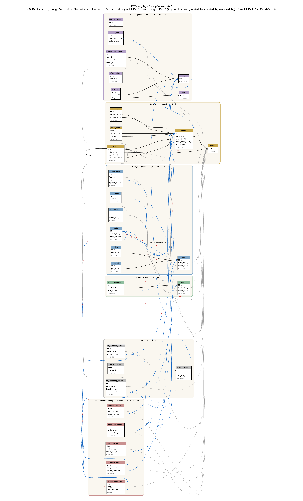

# ERD tổng hợp và quy ước đặt tên CSDL

> **Người viết:** TV2 (Nguyễn Minh Trí) | **Reviewer:** TV5 (Lê Nhựt) | **Task Jira:** SCRUM-28 (2-03)
> **Phiên bản:** v0.5 (18/10/2026) | **Trạng thái:** Chờ review lại. Đã gộp **đủ 5/5 module, 30 bảng**. So với v0.4: bỏ 4 khóa ngoại của cột người thực hiện trong module auth (X17); `ai_embedding_chunk` thêm `branch_id`, `source_type` thêm `EVENT` theo `ai.md` đã merge (PR #35); đóng X6, X12, X14, X15, X17; bỏ X13 (đường dẫn API, không thuộc ERD); đổi tên ảnh và file nguồn không kèm số phiên bản.
> **Nguồn:** `genealogy.md` (TV2), `community-events.md` (TV3), `heritage-directory-dashboard.md` (TV4), `auth.md` (TV1, đã merge PR #31; quy tắc cột người thực hiện theo PR #42), `ai.md` (TV5, đã merge PR #35), quy ước ở `architecture.md` mục 7 và cập nhật của TV1 ngày 09/10/2026. Tất cả đối chiếu trên nhánh `develop` ngày 18/10/2026.
> **Sản phẩm kèm theo:** ảnh `../images/erd.png` và `../images/erd.svg`; file nguồn `erd.dbml` (dán vào dbdiagram.io) và `erd.dot` (Graphviz) cùng thư mục với file này; `data-dictionary.md` (từ điển dữ liệu 30 bảng). Mỗi lần sửa thì ghi đè các file này và tăng số phiên bản ở dòng trên, không tạo file ảnh mới.
---

## 1. Quy ước bắt buộc

| Mục | Quy ước |
|---|---|
| Tên bảng | `snake_case`, số ít. Ngoại lệ duy nhất: **`users`** (tránh từ khóa `user`) |
| Khóa chính | **UUID**, cột `id`, một kiểu duy nhất cho cả dự án |
| Cột chuẩn mọi bảng | `id`, `created_at`, `updated_at`, `deleted_at` (xóa mềm). Không dùng `created_date` |
| Bảng nghiệp vụ thêm | `created_by`, `updated_by` |
| Kiểu thời điểm | `TIMESTAMPTZ` |
| Khóa ngoại | **Chỉ trong cùng module.** Tham chiếu module khác chỉ là cột UUID có index, service kiểm tra, vẽ **nét đứt** |
| Bảng AI | Tiền tố `ai_`, schema `public`. Module khác không có khóa ngoại hay join tới `ai_*` |
| Bảng media | Thuộc community; heritage và events dùng chung (`owner_type`: `POST`, `EVENT`, `HERITAGE`, `PERSON`) |
| Cột người thực hiện | `created_by`, `updated_by`, `reviewed_by`, `actor_user_id` luôn là UUID thường, **không FK**, kể cả khi trỏ tới `users` trong cùng module (`architecture.md` quyết định 4, `auth.md` mục 5). Không vẽ trên sơ đồ |
| Ngoại lệ cột chuẩn | `audit_log` là bảng chỉ thêm: chỉ có `id`, `created_at` (không `updated_at`, `deleted_at`; người thực hiện ở `actor_user_id`). `role`, `user_role`, `refresh_token` là bảng danh mục hoặc bảng kỹ thuật: không có `created_by`, `updated_by` (`auth.md` mục 5.1) |
| `created_by` được NULL | Khi bản ghi do hệ thống, tác vụ nền hoặc người chưa đăng nhập tạo: `notification`, 4 bảng `ai_*`, `users` (tự đăng ký), `member_verification`, `system_config` |
| `UNIQUE` với xóa mềm | Thêm `WHERE deleted_at IS NULL` |
| Sau khi đóng băng | Chỉ qua **Flyway migration** và báo cả nhóm |
| Đặt tên chỉ mục (đề xuất) | `idx_<bảng>_<cột>`, ràng buộc duy nhất `uq_<bảng>_<cột>` |

## 2. Danh sách bảng, người sở hữu, trạng thái

| Module | Người sở hữu | Bảng | Trạng thái nhận bảng |
|---|---|---|---|
| Auth và quản trị (auth, admin) | TV1 Tuấn | `users` | Đầy đủ |
| Auth và quản trị (auth, admin) | TV1 Tuấn | `role` | Đầy đủ |
| Auth và quản trị (auth, admin) | TV1 Tuấn | `user_role` | Đầy đủ |
| Auth và quản trị (auth, admin) | TV1 Tuấn | `refresh_token` | Đầy đủ |
| Auth và quản trị (auth, admin) | TV1 Tuấn | `member_verification` | Đầy đủ |
| Auth và quản trị (auth, admin) | TV1 Tuấn | `audit_log` | Đầy đủ |
| Auth và quản trị (auth, admin) | TV1 Tuấn | `system_config` | Đầy đủ |
| Gia phả (genealogy) | TV2 Trí | `family` | Đầy đủ |
| Gia phả (genealogy) | TV2 Trí | `branch` | Đầy đủ |
| Gia phả (genealogy) | TV2 Trí | `person` | Đầy đủ |
| Gia phả (genealogy) | TV2 Trí | `parent_child` | Đầy đủ |
| Gia phả (genealogy) | TV2 Trí | `marriage` | Đầy đủ |
| Cộng đồng (community) | TV3 PiLo257 | `post` | Đầy đủ |
| Cộng đồng (community) | TV3 PiLo257 | `comment` | Đầy đủ |
| Cộng đồng (community) | TV3 PiLo257 | `reaction` | Đầy đủ |
| Cộng đồng (community) | TV3 PiLo257 | `media` | Đầy đủ |
| Cộng đồng (community) | TV3 PiLo257 | `announcement` | Đầy đủ |
| Cộng đồng (community) | TV3 PiLo257 | `notification` | Đầy đủ |
| Cộng đồng (community) | TV3 PiLo257 | `content_report` | Đầy đủ (mới ở v0.4) |
| Sự kiện (events) | TV3 PiLo257 | `event` | Đầy đủ |
| Sự kiện (events) | TV3 PiLo257 | `event_participant` | Đầy đủ |
| Di sản, danh bạ (heritage, directory) | TV4 Huy Quốc | `heritage_document` | Đầy đủ |
| Di sản, danh bạ (heritage, directory) | TV4 Huy Quốc | `family_story` | Đầy đủ |
| Di sản, danh bạ (heritage, directory) | TV4 Huy Quốc | `outstanding_member` | Đầy đủ |
| Di sản, danh bạ (heritage, directory) | TV4 Huy Quốc | `profession_profile` | Đầy đủ |
| Di sản, danh bạ (heritage, directory) | TV4 Huy Quốc | `education_profile` | Đầy đủ |
| AI | TV5 Lê Nhựt | `ai_embedding_chunk` | Đầy đủ (theo `ai.md` đã merge PR #35) |
| AI | TV5 Lê Nhựt | `ai_chat_session` | Đầy đủ (theo `ai.md` đã merge PR #35) |
| AI | TV5 Lê Nhựt | `ai_chat_message` | Đầy đủ (theo `ai.md` đã merge PR #35) |
| AI | TV5 Lê Nhựt | `ai_summary_cache` | Đầy đủ (theo `ai.md` đã merge PR #35) |

## 3. Khóa ngoại trong cùng module (nét liền)

| Module | Quan hệ |
|---|---|
| Gia phả | `branch.family_id` → `family`; `branch.parent_branch_id` → `branch`; `branch.origin_person_id` → `person`; `person.family_id` → `family`; `person.branch_id` → `branch`; `parent_child.parent_id`, `child_id` → `person`; `marriage.person1_id`, `person2_id` → `person` |
| Cộng đồng | `comment.post_id` → `post`; `reaction.post_id` → `post`. `content_report` không có FK (`target_id` trỏ theo `target_type`) |
| Sự kiện | `event_participant.event_id` → `event` |
| Di sản, danh bạ | Không có khóa ngoại trong module (cả 5 bảng chỉ tham chiếu logic ra ngoài) |
| Auth | `user_role.user_id` → `users`; `user_role.role_id` → `role`; `refresh_token.user_id` → `users`; `member_verification.user_id` → `users`. Cột người thực hiện (`users.created_by`, `users.updated_by`, `member_verification.reviewed_by`, `system_config.updated_by`) không có FK (X17) |
| AI | `ai_chat_message.session_id` → `ai_chat_session` |

## 4. Tham chiếu logic giữa các module (nét đứt)

| Từ | Đến | Nguồn |
|---|---|---|
| `created_by`, `updated_by` của mọi bảng nghiệp vụ; `member_verification.reviewed_by` | `users.id` | Quy ước chung: không FK kể cả trong module auth, không vẽ từng nét |
| `person.user_id` | `users.id` | TV2 |
| `person.avatar_media_id` | `media.id` | TV2 |
| `post.family_id`, `announcement.family_id`, `event.family_id`, `media.family_id`, `content_report.family_id` | `family.id` | TV3 |
| `content_report.reporter_id` | `users.id` | TV3 |
| `content_report.target_id` (theo `target_type`: `POST`, `COMMENT`, `EVENT`, `ANNOUNCEMENT`) | `post`, `comment`, `event`, `announcement` | TV3 (chỉ lưu id, không FK) |
| `post.branch_id`, `announcement.branch_id`, `event.branch_id` | `branch.id` | TV3 (NULL nghĩa là cả gia đình) |
| `media.owner_id` (theo `owner_type`) | `post`, `event`, `heritage_document`, `person` | TV3 |
| `notification.user_id`, `event_participant.user_id` | `users.id` | TV3 |
| `heritage_document.family_id`, `family_story.family_id`, `outstanding_member.family_id`, `profession_profile.family_id`, `education_profile.family_id` | `family.id` | TV4 |
| `heritage_document.media_id` | `media.id` | TV4 |
| `family_story.related_person_id`, `outstanding_member.person_id`, `profession_profile.person_id`, `education_profile.person_id` | `person.id` | TV4 |
| `member_verification.family_id`, `member_verification.branch_id` | `family.id`, `branch.id` | TV1 (`branch_id` NULL nghĩa là quản lý cả gia đình) |
| `audit_log.actor_user_id` | `users.id` | TV1 (cố ý không FK) |
| `audit_log.family_id` | `family.id` | TV1 |
| `audit_log.target_id` (theo `target_type`) | bảng nguồn bất kỳ | TV1 (chỉ ghi nhận, không kiểm tra) |
| `ai_embedding_chunk.family_id`, `ai_chat_session.family_id`, `ai_summary_cache.family_id` | `family.id` | TV5 |
| `ai_embedding_chunk.branch_id` | `branch.id` | TV5 (NULL là toàn gia đình; lọc phạm vi chi, `ai.md` BR-13) |
| `ai_chat_session.user_id` | `users.id` | TV5 |
| `ai_embedding_chunk.source_id` (theo `source_type`: `PERSON`, `POST`, `STORY`, `DOCUMENT`, `EVENT`) | `person`, `post`, `family_story`, `heritage_document`, `event` | TV5 (chỉ lưu id, không FK) |
| `ai_summary_cache.source_id` (theo `source_type`) | bảng nguồn tương ứng | TV5 (chỉ lưu id, không FK) |

## 5. Sơ đồ

Ảnh khá dài; xem bản `../images/erd.svg` để phóng to không vỡ. Nét liền là khóa ngoại cùng module, nét đứt xanh là tham chiếu logic, nét đứt xám là `family_id`/`branch_id`, nét chấm đỏ là `media.owner_id`.

## 6. Kết quả kiểm tra xung đột (lần 3, cập nhật v0.5)

TV2 tổng hợp và báo cáo; các điểm cần quyết do **TV1 (nhóm trưởng)** chốt, chủ sở hữu bảng sửa tài liệu theo. Đến v0.5 các điểm cần quyết đã đóng; X4 là ghi chú nên làm, không chặn đóng băng. X13 (đường dẫn API của module AI) đã bỏ khỏi bảng vì không thuộc ERD.

| Mã | Mức | Phát hiện | Đề xuất | Ai quyết |
|---|---|---|---|---|
| X1 | Đã đóng | `person.current_province` đã có trong `genealogy.md` bản 14/10 (kèm `current_address`, `burial_place`); ERD v0.4 cập nhật theo, khớp SQL dashboard (`heritage-directory-dashboard.md` mục 5.5) | Không cần làm thêm | TV2 (đã sửa) |
| X2 | Đã rõ | Backup/Restore (FR-ADM-04) **không có bảng riêng**: bản sao lưu là tệp trong thư mục `backups/`, sự kiện ghi vào `audit_log` (`BACKUP_CREATED`, `RESTORE_COMPLETED`), theo UC-AUTH-11. Danh sách bản sao lưu đọc từ thư mục | Chấp nhận. Cần SCRUM-68, 77, 86 lo volume `backups/` và `pg_dump` | TV1 (đã chốt) |
| X3 | Đạt | Đã nhận đủ cột 7 bảng auth (`auth.md` mục 5). Bảng tên `users`, `TIMESTAMPTZ`, khóa ngoại chỉ trong module: `user_role` trỏ `users` và `role`, `refresh_token.user_id` và `member_verification.user_id` trỏ `users` (4 FK); `family_id`, `branch_id` là UUID logic | Giữ nguyên | |
| X4 | Nên ghi rõ | Hai chiều tham chiếu logic giữa `media` và `heritage_document`: `media.owner_id` (với `owner_type = HERITAGE`) trỏ tài liệu, đồng thời `heritage_document.media_id` (NOT NULL) trỏ tệp. Vì không có khóa ngoại nên không vướng khi chèn dữ liệu, nhưng cần ghi nguồn sự thật | Ghi rõ: `heritage_document.media_id` là liên kết chính; `media.owner_id` dùng để lọc quyền; service sinh sẵn UUID của tài liệu rồi mới tải tệp | TV3, TV4 |
| X5 | Đã rõ | `event_participant` tham chiếu `users` (cột `user_id`), không phải `person`. Hệ quả: người chưa có tài khoản không thể là người tham dự | Chấp nhận, ghi vào tài liệu sự kiện | TV3 (đã chốt) |
| X6 | Đã đóng | `created_by` cho phép NULL ở `notification`, 4 bảng `ai_*`, `users` (tự đăng ký), `member_verification`, `system_config` | Đã ghi ngoại lệ ở mục 1 (bản ghi do hệ thống, tác vụ nền hoặc người chưa đăng nhập tạo) | TV1 (đã chốt 16/10) |
| X7 | Đạt | Cột chuẩn: toàn bộ bảng của TV1, TV2, TV3, TV4, TV5 đủ `id`, `created_at`, `updated_at`, `deleted_at`, `created_by`, `updated_by`, trừ các ngoại lệ đã ghi ở mục 1 (`audit_log`; `role`, `user_role`, `refresh_token`); dùng `TIMESTAMPTZ`; không còn `created_date` | Giữ nguyên | |
| X8 | Đạt | Khóa ngoại chỉ trong cùng module; các cột sang module khác đều là UUID tham chiếu logic. Ràng buộc `UNIQUE` của TV3, TV4 đều có `WHERE deleted_at IS NULL` | Giữ nguyên | |
| X9 | Đạt | Không bảng nào ngoài `ai_*` tham chiếu vào `ai_*`; `ai_*` chỉ lưu id nguồn và không có khóa ngoại liên module (đúng cả với `ai_chat_message.session_id`, FK nội bộ cùng module) | Giữ nguyên | |
| X10 | Đạt | Mỗi bảng có đúng một người sở hữu (mục 2) | Giữ nguyên | |
| X11 | Đã đóng | `genealogy.md` bản 14/10 đã dùng `TIMESTAMPTZ` và tham chiếu logic tới `users`, khớp ERD | Giữ nguyên | TV2 (đã sửa) |
| X12 | Đã đóng | Số chiều vector và danh sách loại nguồn của `ai_embedding_chunk` | `vector(768)` đã chốt ngày 9/10 (`adr-ai-spike.md` mục 4). `source_type` theo `ai.md` đã merge (PR #35): `PERSON`, `POST`, `STORY`, `DOCUMENT`, `EVENT`; thêm `branch_id` để lọc phạm vi chi. ERD v0.5 đã cập nhật | TV1 (đã chốt), TV5 |
| X14 | Đã đóng | Ngoại lệ cột chuẩn của module auth: `audit_log` chỉ có `id`, `created_at`; `role`, `user_role`, `refresh_token` không có `created_by`, `updated_by` | Đã ghi hai ngoại lệ ở mục 1 theo `auth.md` mục 5.1 | TV1 (đã chốt 16/10) |
| X15 | Đã đóng | Hai nơi cùng nói "người này thuộc gia đình nào": `member_verification.family_id` và `person.family_id` + `person.user_id` | `member_verification` là nguồn sự thật duy nhất (BR-AUTH-11). Chỉ gắn `person.user_id` khi `person.family_id` bằng `family_id` của bản ghi `APPROVED`; khi quản trị chuyển gia đình (BR-AUTH-14) gỡ liên kết cũ qua `GenealogyPort.unlinkAccount(userId)`. Đã thêm BR-GEN-19 và `unlinkAccount` vào `genealogy.md` | TV1 (đã chốt 16/10), TV2 (đã sửa) |
| X16 | Đã đóng | Kiểm duyệt nội dung (FR-ADM-02): `community-events.md` đã thêm bảng `content_report` (BR-COM-12) và cột `hidden_at` ở `post`, `comment`, `announcement`, `event`; ERD v0.4 đã gộp. Module Community cài `ContentModerationPort`, API `POST /api/v1/content-reports` | Giữ nguyên | TV3 (đã làm) |
| X17 | Đã đóng | `created_by`, `updated_by` không đồng nhất trong module auth (có chỗ FK, có chỗ không) | Cột người thực hiện luôn là UUID thường, không FK, kể cả trong cùng module (`architecture.md` quyết định 4, PR #42). ERD bỏ 4 FK: `users.created_by`, `users.updated_by`, `member_verification.reviewed_by`, `system_config.updated_by`; module auth còn 4 FK nghiệp vụ | TV1 (đã chốt 16/10) |

Tiêu chí hoàn thành: "ERD không còn khóa ngoại treo" (hiểu theo mục 1: tham chiếu sang module khác chỉ là cột logic) và "mỗi bảng có người sở hữu": **đã đạt**. 17 khóa ngoại đều nằm trong cùng module, mỗi bảng có một người sở hữu, không còn điểm cần quyết trước khi đóng băng.

## 7. Họp xác nhận và đóng băng

- Nhóm trưởng (TV1) đã chốt X6, X12, X14, X15, X17 (16/10/2026). Việc còn lại: họp 30 phút xác nhận ERD v1 (TV2 ghi biên bản), rồi đóng băng. Mọi thay đổi sau đó qua **Flyway migration** và báo cả nhóm.

| Ngày họp | Người dự | Điểm đã chốt | Việc còn lại |
|---|---|---|---|
| | | | |
