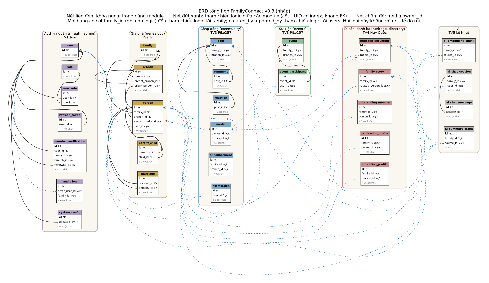

# ERD tổng hợp và quy ước đặt tên CSDL

> **Người viết:** TV2 (Nguyễn Minh Trí) | **Reviewer:** TV5 (Lê Nhựt) | **Task Jira:** SCRUM-28 (2-03)
> **Trạng thái:** Nháp v0.3. Đã gộp **đủ 5/5 module**. `auth.md` (TV1) và `ai.md` (TV5) đang chờ review; nếu sửa thì cập nhật lại ERD.
> **Nguồn:** `genealogy.md` (TV2), `community-events.md` (TV3), `heritage-directory-dashboard.md` (TV4), `auth.md` (TV1, chờ review), `ai.md` (TV5, chờ review), quy ước ở `architecture.md` mục 7 và cập nhật của TV1 ngày 09/10/2026.
> **Sản phẩm kèm theo:** ảnh `../images/erd-v0.3.png` và `../images/erd-v0.3.svg`; file nguồn `erd-v0.3.dbml` (dán vào dbdiagram.io) và `erd-v0.3.dot` (Graphviz) cùng thư mục với file này; `data-dictionary.md` (từ điển dữ liệu 29 bảng).

---

## 1. Quy ước bắt buộc

| Mục | Quy ước |
|---|---|
| Tên bảng | `snake_case`, số ít. Ngoại lệ duy nhất: **`users`** (tránh từ khóa `user`) |
| Khóa chính | **UUID**, cột `id`, một kiểu duy nhất cho cả dự án |
| Cột chuẩn mọi bảng | `id`, `created_at`, `updated_at`, `deleted_at` (xóa mềm). Không dùng `created_date` |
| Bảng nghiệp vụ thêm | `created_by`, `updated_by` |
| Kiểu thời điểm | `TIMESTAMPTZ` |
| Khóa ngoại | **Chỉ trong cùng module.** Tham chiếu module khác chỉ là cột UUID có index, service kiểm tra, vẽ **nét đứt** |
| Bảng AI | Tiền tố `ai_`, schema `public`. Module khác không có khóa ngoại hay join tới `ai_*` |
| Bảng media | Thuộc community; heritage và events dùng chung (`owner_type`: `POST`, `EVENT`, `HERITAGE`, `PERSON`) |
| `UNIQUE` với xóa mềm | Thêm `WHERE deleted_at IS NULL` |
| Sau khi đóng băng | Chỉ qua **Flyway migration** và báo cả nhóm |
| Đặt tên chỉ mục (đề xuất) | `idx_<bảng>_<cột>`, ràng buộc duy nhất `uq_<bảng>_<cột>` |

## 2. Danh sách bảng, người sở hữu, trạng thái

| Module | Người sở hữu | Bảng | Trạng thái nhận bảng |
|---|---|---|---|
| Auth và quản trị (auth, admin) | TV1 Tuấn | `users` | Đầy đủ (tài liệu chờ review) |
| Auth và quản trị (auth, admin) | TV1 Tuấn | `role` | Đầy đủ (tài liệu chờ review) |
| Auth và quản trị (auth, admin) | TV1 Tuấn | `user_role` | Đầy đủ (tài liệu chờ review) |
| Auth và quản trị (auth, admin) | TV1 Tuấn | `refresh_token` | Đầy đủ (tài liệu chờ review) |
| Auth và quản trị (auth, admin) | TV1 Tuấn | `member_verification` | Đầy đủ (tài liệu chờ review) |
| Auth và quản trị (auth, admin) | TV1 Tuấn | `audit_log` | Đầy đủ (tài liệu chờ review) |
| Auth và quản trị (auth, admin) | TV1 Tuấn | `system_config` | Đầy đủ (tài liệu chờ review) |
| Gia phả (genealogy) | TV2 Trí | `family` | Đầy đủ |
| Gia phả (genealogy) | TV2 Trí | `branch` | Đầy đủ |
| Gia phả (genealogy) | TV2 Trí | `person` | Đầy đủ |
| Gia phả (genealogy) | TV2 Trí | `parent_child` | Đầy đủ |
| Gia phả (genealogy) | TV2 Trí | `marriage` | Đầy đủ |
| Cộng đồng (community) | TV3 PiLo257 | `post` | Đầy đủ |
| Cộng đồng (community) | TV3 PiLo257 | `comment` | Đầy đủ |
| Cộng đồng (community) | TV3 PiLo257 | `reaction` | Đầy đủ |
| Cộng đồng (community) | TV3 PiLo257 | `media` | Đầy đủ |
| Cộng đồng (community) | TV3 PiLo257 | `announcement` | Đầy đủ |
| Cộng đồng (community) | TV3 PiLo257 | `notification` | Đầy đủ |
| Sự kiện (events) | TV3 PiLo257 | `event` | Đầy đủ |
| Sự kiện (events) | TV3 PiLo257 | `event_participant` | Đầy đủ |
| Di sản, danh bạ (heritage, directory) | TV4 Huy Quốc | `heritage_document` | Đầy đủ |
| Di sản, danh bạ (heritage, directory) | TV4 Huy Quốc | `family_story` | Đầy đủ |
| Di sản, danh bạ (heritage, directory) | TV4 Huy Quốc | `outstanding_member` | Đầy đủ |
| Di sản, danh bạ (heritage, directory) | TV4 Huy Quốc | `profession_profile` | Đầy đủ |
| Di sản, danh bạ (heritage, directory) | TV4 Huy Quốc | `education_profile` | Đầy đủ |
| AI | TV5 Lê Nhựt | `ai_embedding_chunk` | Đầy đủ |
| AI | TV5 Lê Nhựt | `ai_chat_session` | Đầy đủ |
| AI | TV5 Lê Nhựt | `ai_chat_message` | Đầy đủ |
| AI | TV5 Lê Nhựt | `ai_summary_cache` | Đầy đủ |

## 3. Khóa ngoại trong cùng module (nét liền)

| Module | Quan hệ |
|---|---|
| Gia phả | `branch.family_id` → `family`; `branch.parent_branch_id` → `branch`; `branch.origin_person_id` → `person`; `person.family_id` → `family`; `person.branch_id` → `branch`; `parent_child.parent_id`, `child_id` → `person`; `marriage.person1_id`, `person2_id` → `person` |
| Cộng đồng | `comment.post_id` → `post`; `reaction.post_id` → `post` |
| Sự kiện | `event_participant.event_id` → `event` |
| Di sản, danh bạ | Không có khóa ngoại trong module (cả 5 bảng chỉ tham chiếu logic ra ngoài) |
| Auth | `user_role.user_id` → `users`; `user_role.role_id` → `role`; `refresh_token.user_id` → `users`; `member_verification.user_id`, `reviewed_by` → `users`; `system_config.updated_by` → `users`; `users.created_by`, `updated_by` → `users` (tự tham chiếu) |
| AI | `ai_chat_message.session_id` → `ai_chat_session` |

## 4. Tham chiếu logic giữa các module (nét đứt)

| Từ | Đến | Nguồn |
|---|---|---|
| `created_by`, `updated_by` của mọi bảng nghiệp vụ | `users.id` | Quy ước chung (không vẽ từng nét) |
| `person.user_id` | `users.id` | TV2 |
| `person.avatar_media_id` | `media.id` | TV2 |
| `post.family_id`, `announcement.family_id`, `event.family_id`, `media.family_id` | `family.id` | TV3 |
| `post.branch_id`, `announcement.branch_id`, `event.branch_id` | `branch.id` | TV3 (NULL nghĩa là cả gia đình) |
| `media.owner_id` (theo `owner_type`) | `post`, `event`, `heritage_document`, `person` | TV3 |
| `notification.user_id`, `event_participant.user_id` | `users.id` | TV3 |
| `heritage_document.family_id`, `family_story.family_id`, `outstanding_member.family_id`, `profession_profile.family_id`, `education_profile.family_id` | `family.id` | TV4 |
| `heritage_document.media_id` | `media.id` | TV4 |
| `family_story.related_person_id`, `outstanding_member.person_id`, `profession_profile.person_id`, `education_profile.person_id` | `person.id` | TV4 |
| `member_verification.family_id`, `member_verification.branch_id` | `family.id`, `branch.id` | TV1 (`branch_id` NULL nghĩa là quản lý cả gia đình) |
| `audit_log.actor_user_id` | `users.id` | TV1 (cố ý không FK) |
| `audit_log.family_id` | `family.id` | TV1 |
| `audit_log.target_id` (theo `target_type`) | bảng nguồn bất kỳ | TV1 (chỉ ghi nhận, không kiểm tra) |
| `ai_embedding_chunk.family_id`, `ai_chat_session.family_id`, `ai_summary_cache.family_id` | `family.id` | TV5 |
| `ai_chat_session.user_id` | `users.id` | TV5 |
| `ai_embedding_chunk.source_id` (theo `source_type`: `PERSON`, `POST`, `STORY`, `DOCUMENT`) | `person`, `post`, `family_story`, `heritage_document` | TV5 (chỉ lưu id, không FK) |
| `ai_summary_cache.source_id` (theo `source_type`) | bảng nguồn tương ứng | TV5 (chỉ lưu id, không FK) |

## 5. Sơ đồ

Ảnh khá dài; xem bản `../images/erd-v0.3.svg` để phóng to không vỡ. Nét liền là khóa ngoại cùng module, nét đứt xanh là tham chiếu logic, nét đứt xám là `family_id`/`branch_id`, nét chấm đỏ là `media.owner_id`. Bảng chưa có cột ghi "chờ nộp cột".

## 6. Kết quả kiểm tra xung đột (lần 1, trên dữ liệu thật)

TV2 chỉ tổng hợp và báo cáo. Các dòng ghi "Cần quyết", "Cần ghi rõ", "Nên hỏi" do **TV1 (nhóm trưởng) quyết**; chủ sở hữu bảng tương ứng sửa tài liệu sau khi có quyết định. Các điểm này **không chặn** việc nộp ERD v0.3 để review, nhưng cần xong trước khi đóng băng v1.

| Mã | Mức | Phát hiện | Đề xuất | Ai quyết |
|---|---|---|---|---|
| X1 | **Cần quyết** | `current_province`: câu SQL dashboard (`heritage-directory-dashboard.md` mục 5.5) và thống kê nơi ở dùng cột `person.current_province`, nhưng thiết kế bảng `person` của TV2 chỉ có `current_location`. Bảng `person` thuộc Gia phả. Cần xem `genealogy.md` bản của TV1 có cột này không | Thêm `current_province` vào `person` (TV2), hoặc đổi SQL và FR-DIR-04 dùng `current_location`. Tìm theo nơi ở (FR-DIR-04) cần cột lọc được, nên khả năng cao nên có cột riêng | TV1 (nhóm trưởng) quyết; TV2 và TV4 sửa theo |
| X2 | Đã rõ | Backup/Restore (FR-ADM-04) **không có bảng riêng**: bản sao lưu là tệp trong thư mục `backups/`, sự kiện ghi vào `audit_log` (`BACKUP_CREATED`, `RESTORE_COMPLETED`), theo UC-AUTH-11. Danh sách bản sao lưu đọc từ thư mục | Chấp nhận. Cần SCRUM-68, 77, 86 lo volume `backups/` và `pg_dump` | TV1 (đã chốt) |
| X3 | Đạt | Đã nhận đủ cột 7 bảng auth (`auth.md` mục 5). Bảng tên `users`, `TIMESTAMPTZ`, khóa ngoại chỉ trong module (`user_role`, `refresh_token`, `member_verification`, `system_config` trỏ `users` hoặc `role`); `family_id`, `branch_id` là UUID logic | Giữ nguyên | |
| X4 | Nên ghi rõ | Hai chiều tham chiếu logic giữa `media` và `heritage_document`: `media.owner_id` (với `owner_type = HERITAGE`) trỏ tài liệu, đồng thời `heritage_document.media_id` (NOT NULL) trỏ tệp. Vì không có khóa ngoại nên không vướng khi chèn dữ liệu, nhưng cần ghi nguồn sự thật | Ghi rõ: `heritage_document.media_id` là liên kết chính; `media.owner_id` dùng để lọc quyền; service sinh sẵn UUID của tài liệu rồi mới tải tệp | TV3, TV4 |
| X5 | Đã rõ | `event_participant` tham chiếu `users` (cột `user_id`), không phải `person`. Hệ quả: người chưa có tài khoản không thể là người tham dự | Chấp nhận, ghi vào tài liệu sự kiện | TV3 (đã chốt) |
| X6 | Ngoại lệ chấp nhận | `created_by` cho phép NULL ở `notification` (TV3), cả 4 bảng `ai_*` (TV5), `users` (tự đăng ký), `member_verification`, `system_config` (TV1); khác quy ước NOT NULL của bảng nghiệp vụ | Ghi ngoại lệ ở mục 1: bảng do hệ thống, tác vụ nền hoặc người chưa đăng nhập tạo được phép NULL | Cả nhóm |
| X7 | Đạt | Cột chuẩn: toàn bộ bảng của TV1, TV2, TV3, TV4, TV5 đủ `id`, `created_at`, `updated_at`, `deleted_at`, `created_by`, `updated_by`; dùng `TIMESTAMPTZ`; không còn `created_date` | Giữ nguyên | |
| X8 | Đạt | Khóa ngoại chỉ trong cùng module; các cột sang module khác đều là UUID tham chiếu logic. Ràng buộc `UNIQUE` của TV3, TV4 đều có `WHERE deleted_at IS NULL` | Giữ nguyên | |
| X9 | Đạt | Không bảng nào ngoài `ai_*` tham chiếu vào `ai_*`; `ai_*` chỉ lưu id nguồn và không có khóa ngoại liên module (đúng cả với `ai_chat_message.session_id`, FK nội bộ cùng module) | Giữ nguyên | |
| X10 | Đạt | Mỗi bảng có đúng một người sở hữu (mục 2) | Giữ nguyên | |
| X12 | Nên hỏi | `ai_embedding_chunk.source_type` chỉ có `PERSON`, `POST`, `STORY`, `DOCUMENT`: thiếu `EVENT` và `ANNOUNCEMENT`, trong khi `ai_summary_cache` chưa nêu danh sách loại nguồn. Vector `VECTOR(768)` đang theo ADR, TV5 ghi sẽ thử `1536` nếu tiếng Việt không đạt (đổi kích thước phải cập nhật migration và ERD) | Hỏi TV5: có cần tìm kiếm ngữ nghĩa trên sự kiện, thông báo không; chốt 768 hay 1536 ở SCRUM-34 trước khi đóng băng | TV1 (nhóm trưởng) quyết; TV5 sửa theo |
| X13 | Ngoài ERD, lưu ý | `ai.md` mục 6 đặt `GET /api/v1/search` ngoài `/api/v1/ai/**`, trong khi SRS NFR-08 mô tả lớp AI riêng ở `/api/v1/ai/**` | Hỏi TV5 và TV1 có cần đổi đường dẫn hay sửa SRS | TV1, TV5 |
| X14 | **Cần quyết** | Ngoại lệ về cột chuẩn của TV1: `audit_log` chỉ có `id` và `created_at` (bản ghi chỉ thêm), không có `updated_at`, `deleted_at`; `role`, `user_role`, `refresh_token` không có `created_by`, `updated_by` (TV1 coi không phải bảng nghiệp vụ). Quy ước chung nói mọi bảng có `id`, `created_at`, `updated_at`, `deleted_at` | Ghi hai ngoại lệ chính thức ở mục 1 (bảng chỉ thêm; bảng danh mục và bảng kỹ thuật không cần `created_by`, `updated_by`), hoặc thêm cột cho đủ | TV1 (nhóm trưởng) quyết |
| X15 | **Cần ghi rõ** | Hai nơi cùng nói "người này thuộc gia đình nào": `member_verification.family_id` (theo tài khoản) và `person.family_id` + `person.user_id` (theo hồ sơ thành viên). Hai nguồn có thể lệch (tài khoản thuộc gia đình A nhưng `person` gắn với tài khoản đó thuộc gia đình B) | Thêm quy tắc: chỉ gắn `person.user_id` khi `person.family_id` bằng `member_verification.family_id` của tài khoản đó; kiểm tra ở service Gia phả qua `MembershipQuery` | TV1 (nhóm trưởng) quyết; TV2 cài theo |
| X16 | **Cần quyết** | Thiếu bảng cho kiểm duyệt nội dung (FR-ADM-02): `auth.md` mục 8 câu 6 ghi bảng báo cáo vi phạm và nút "Báo cáo bài viết" thuộc Community nhưng `community-events.md` chưa có bảng này | TV3 thêm bảng (ví dụ `content_report`) vào tài liệu và ERD, hoặc TV1 chốt cách kiểm duyệt khác | TV1 (nhóm trưởng) quyết; TV3 thêm bảng |
| X17 | Nên thống nhất | `created_by`, `updated_by` không đồng nhất trong module auth: có FK ở `users`, `system_config.updated_by`, không FK ở `member_verification`, `system_config.created_by`. Các module khác dùng UUID logic | Thống nhất một cách (đề xuất: luôn UUID logic, không FK, cho dễ migration) | TV1 |
| X11 | Cần sửa phía TV2 | `genealogy.md` bản mình viết trước dùng `TIMESTAMP` và ghi "FK users(id)"; ERD đã dùng `TIMESTAMPTZ` và tham chiếu logic. Tài liệu cần cập nhật cho khớp | TV2 mở PR sửa `genealogy.md` | TV2 |

Tiêu chí hoàn thành: "ERD không còn khóa ngoại treo" (hiểu theo mục 1: tham chiếu sang module khác chỉ là cột logic) và "mỗi bảng có người sở hữu". Về cấu trúc đã đạt (không còn khóa ngoại treo, mỗi bảng một người sở hữu). Còn các điểm cần quyết ở X1, X14, X16 trước khi đóng băng.

## 7. Họp xác nhận và đóng băng

- Nhóm trưởng (TV1) chốt các điểm X1, X12, X14, X15, X16 rồi họp 30 phút xác nhận ERD v1 (TV2 ghi biên bản), rồi đóng băng. Mọi thay đổi sau đó qua **Flyway migration** và báo cả nhóm.

| Ngày họp | Người dự | Điểm đã chốt | Việc còn lại |
|---|---|---|---|
| | | | |
