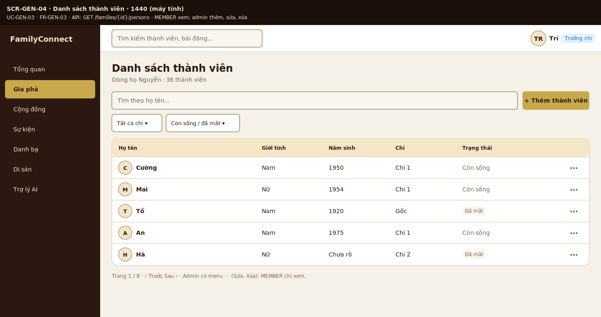
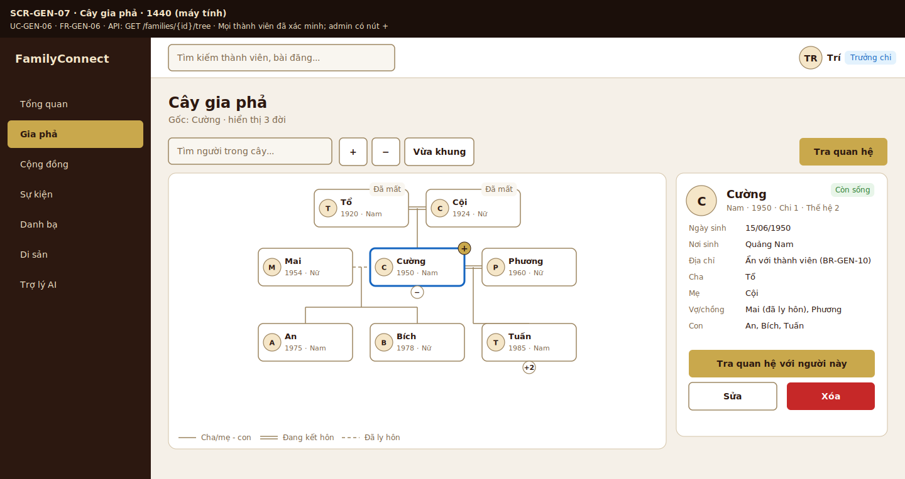
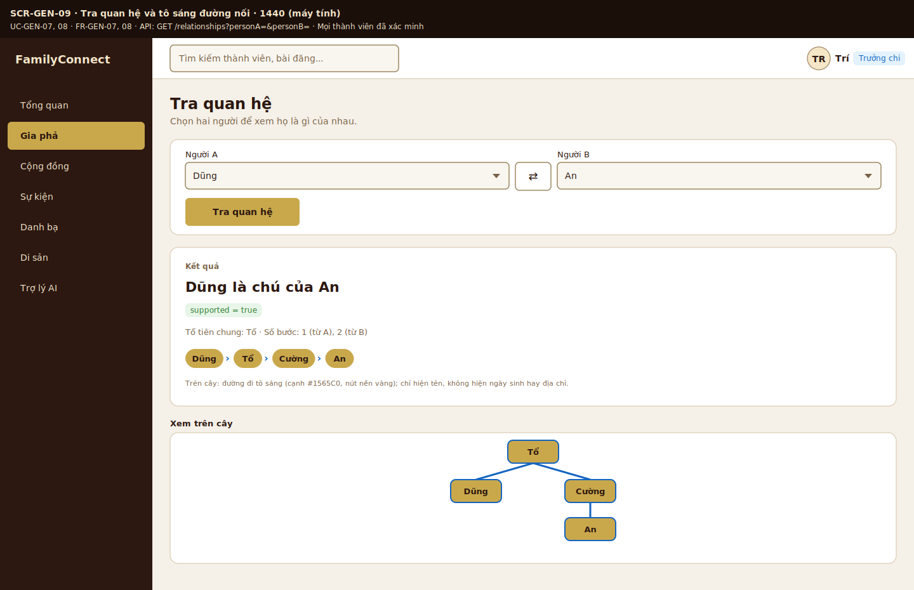

# Wireframe và link Figma

> Mỗi người vẽ màn hình của module mình theo design system của TV5, có cả bản **mobile (điện thoại)**. Dán link Figma (quyền comment) và ảnh xuất ra.

| Module | Người vẽ | Task Jira | Link Figma | Trạng thái |
|---|---|---|---|---|
| Design system | TV5 Lê Nhựt | SCRUM-25 | https://www.figma.com/design/tblrnrxE2SZWtuI3SNPOxp/Untitled?node-id=0-1&t=smjLTgHejAKhJLHG-1 | Chờ review |
| Gia phả (danh sách, cây, chi tiết, tra quan hệ) | TV2 Trí | SCRUM-29 | https://www.figma.com/design/X1osQ1uRgki8P2MBMLzOU7/Gia-ph%E1%BA%A3---Wireframe--SCRUM-29- | Chờ review |
| Community và Events | TV3 PiLo257 | SCRUM-30 | | |
| Heritage, Directory, Dashboard | TV4 Huy Quốc | SCRUM-32 | | |
| Mobile | TV5 Lê Nhựt | SCRUM-84 | | |
| Auth, Admin | TV1 Tuấn | SCRUM-26 | | |

## Ảnh wireframe
> Chèn ảnh đã xuất vào `../images/` rồi liên kết: ``.

### Gia phả (SCRUM-29)

