# FamilyConnect — Hướng dẫn sử dụng Auth, Community và Events

**Task:** SCRUM-75 (8-05) · **Người thực hiện:** TV3 · **Reviewer:** TV1  
**Đối tượng:** người dùng cuối trên Web. **Mã nguồn đối chiếu:** develop `b72bd39`.  
**Minh chứng:** Ảnh Web và seed chụp ngày 19/11/2026 trên môi trường demo. Phạm vi SCRUM-75: Web; hướng dẫn AI và Mobile thuộc SCRUM-98 (TV5) theo `README.md` của thư mục hướng dẫn. Chờ TV1 test chéo.

## 1. Bắt đầu sử dụng

Mở địa chỉ web của FamilyConnect do nhóm cung cấp (môi trường demo local: `http://localhost:3000`). Sử dụng trình duyệt trên máy tính. Người mới cần có tài khoản, mã mời nếu muốn tham gia gia đình và được trưởng họ/trưởng chi duyệt trước khi sử dụng bảng tin hoặc sự kiện.

Để thực hành trên bộ dữ liệu giả, có thể dùng tài khoản demo do người triển khai cung cấp: `ha@demo.familyconnect.vn` (thành viên Chi 2), `phuc@demo.familyconnect.vn` (trưởng họ), `tu@demo.familyconnect.vn` (đang chờ duyệt). Mật khẩu demo chung được ghi trong `docs/09-report/demo-script.md` của nhóm. Không dùng tài khoản demo cho dữ liệu thật.

## 2. Auth — tài khoản và xác minh thành viên

### 2.1 Đăng ký
1. Tại trang đăng nhập, chọn **Đăng ký ngay**.
2. Nhập Họ tên, Email, Mật khẩu (8–72 ký tự), Ngày sinh; số điện thoại không bắt buộc. Người đăng ký phải đủ 16 tuổi theo điều kiện hiển thị trên form.
3. Chọn **Tạo tài khoản**. Khi tạo thành công, trở lại trang đăng nhập.

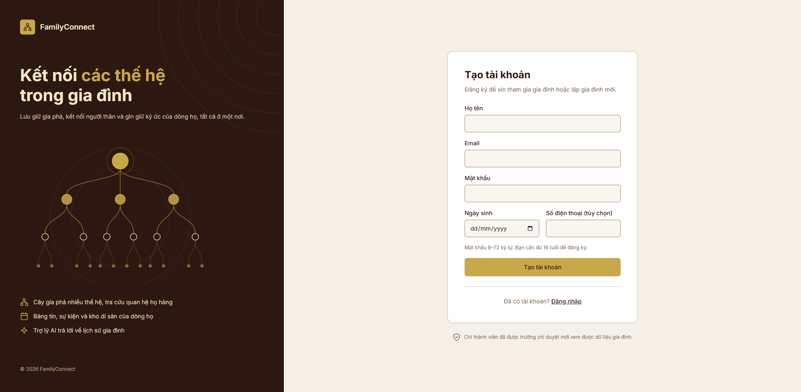

*Màn hình tạo tài khoản.*

### 2.2 Đăng nhập
1. Nhập email và mật khẩu đã đăng ký.
2. Chọn **Đăng nhập**. Nếu nhập sai, kiểm tra lại email và mật khẩu rồi thử lại.
3. Tài khoản đã xác minh sẽ truy cập các chức năng được cấp quyền. Tài khoản chưa thuộc gia đình cần thực hiện mục 2.3.

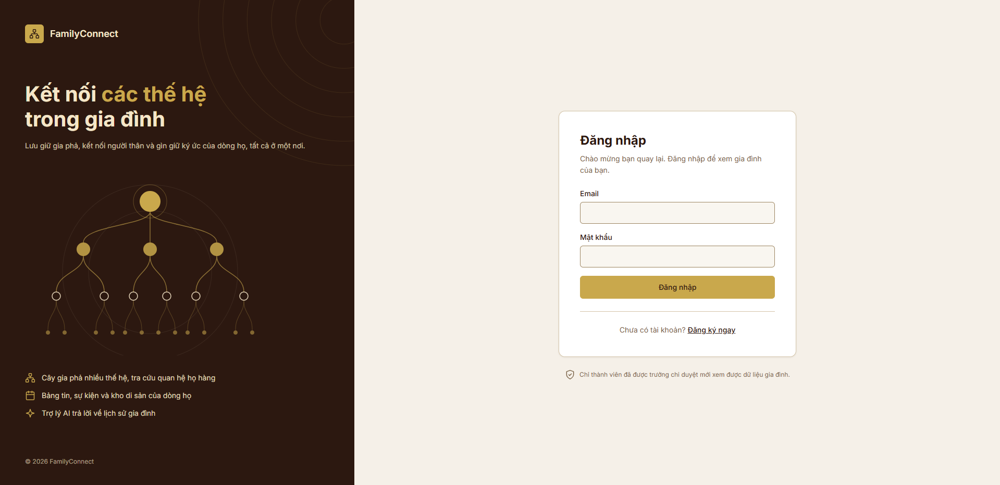

*Màn hình đăng nhập.*

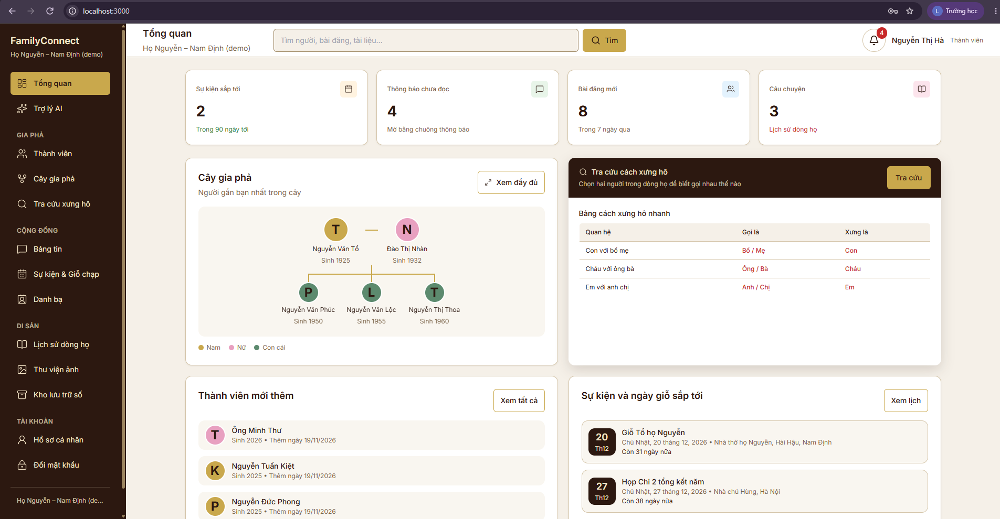

*Trang tổng quan sau khi đăng nhập thành công.*

### 2.3 Tham gia gia đình hoặc lập gia đình mới (web)
1. Tại **Tham gia gia đình**, lấy mã gia đình hoặc mã chi từ trưởng họ/trưởng chi.
2. Dán mã vào **Mã gia đình hoặc mã chi**; nhập lời nhắn nếu cần.
3. Chọn **Gửi yêu cầu**; chờ người quản lý xác minh. Nếu bị từ chối, đọc lý do và gửi lại yêu cầu phù hợp.
4. Nếu muốn lập gia đình riêng, nhập **Tên gia đình** trong mục **Lập gia đình mới**, chọn **Lập gia đình**. Người tạo trở thành trưởng họ.

Khi đang chờ duyệt, chọn **Kiểm tra lại** để cập nhật trạng thái hoặc **Hủy yêu cầu** nếu không muốn tham gia nữa.

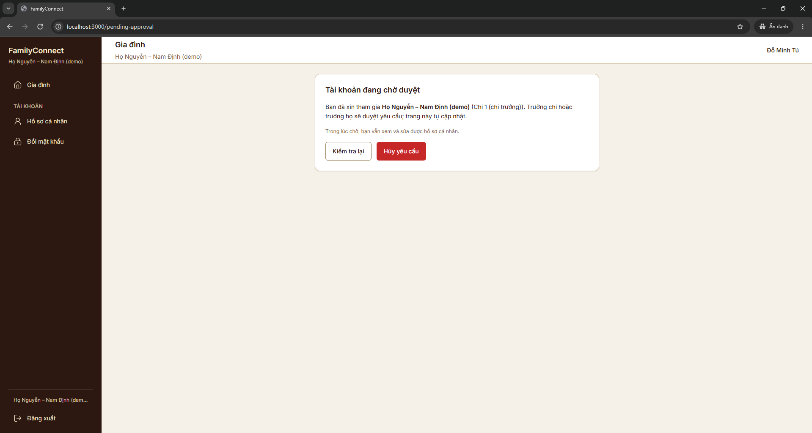

*Tài khoản demo đang chờ duyệt.*

*Form gửi yêu cầu tham gia/lập gia đình chưa có ảnh riêng; các bước trên đối chiếu mã nguồn `/join-family`.*

### 2.4 Xác minh yêu cầu (trưởng họ/trưởng chi)
1. Mở **Duyệt yêu cầu tham gia** (`/join-requests`). Có thể sao chép mã mời ở mục **Mã để mời người thân**.
2. Chọn trạng thái **Chờ duyệt**, tìm yêu cầu đúng người.
3. Chọn **Duyệt**, chọn hồ sơ gia phả và chi nếu phù hợp, xác nhận **Duyệt**. Hoặc chọn **Từ chối**, nhập lý do nếu cần, xác nhận.
4. Người được duyệt đăng nhập lại hoặc làm mới trạng thái để truy cập gia đình. Chỉ duyệt người thân đã được xác minh.

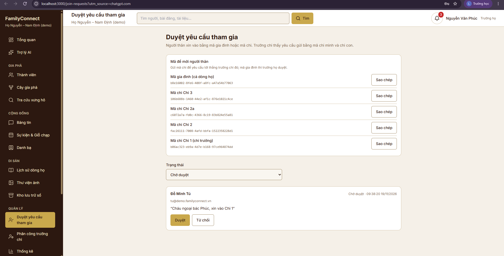

*Danh sách yêu cầu tham gia và mã mời demo.*

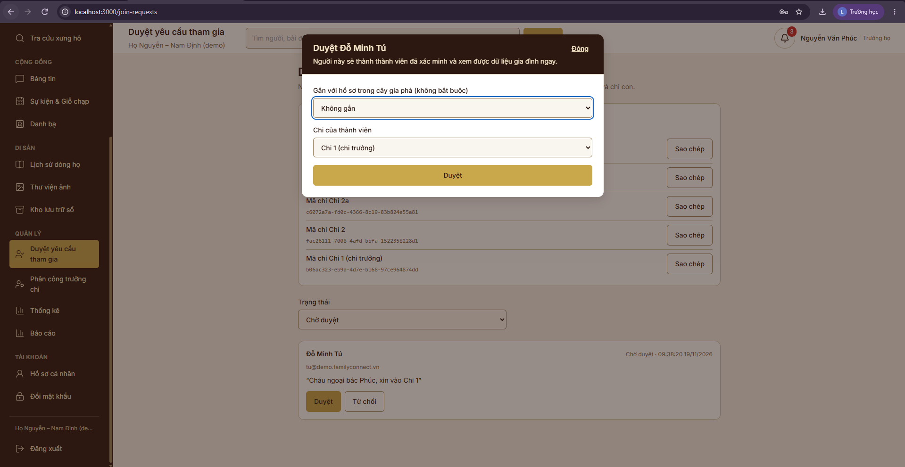

*Hộp thoại duyệt thành viên; chưa xác nhận duyệt tài khoản Tú.*

### 2.5 Hồ sơ, đổi mật khẩu và đăng xuất
- Mở phần tài khoản (`/profile/account`): cập nhật Họ tên, Ngày sinh, Số điện thoại, chọn **Lưu thay đổi**. Email đăng nhập không đổi được.
- Mở phần đổi mật khẩu (`/profile/password`): nhập mật khẩu hiện tại, mật khẩu mới và nhập lại mật khẩu mới, chọn **Đổi mật khẩu**. Đăng nhập lại sau khi đổi.
- Chọn **Đăng xuất** trong giao diện tài khoản khi kết thúc sử dụng, nhất là trên máy dùng chung.

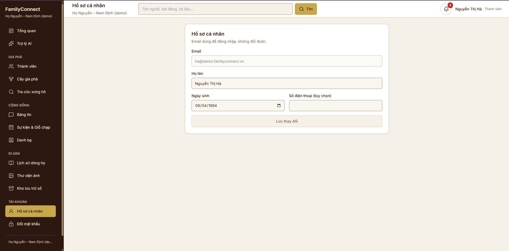

*Hồ sơ tài khoản.*

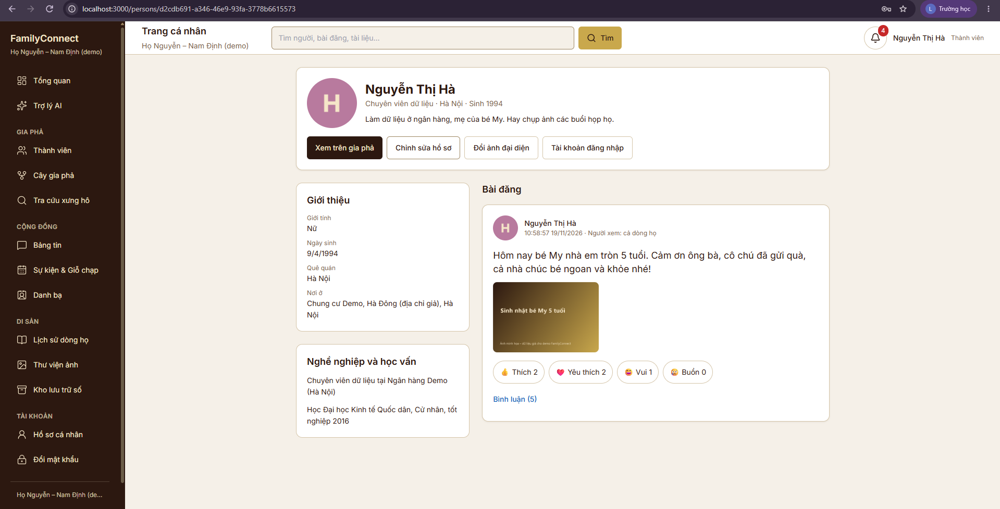

*Trang cá nhân và nút Tài khoản đăng nhập.*

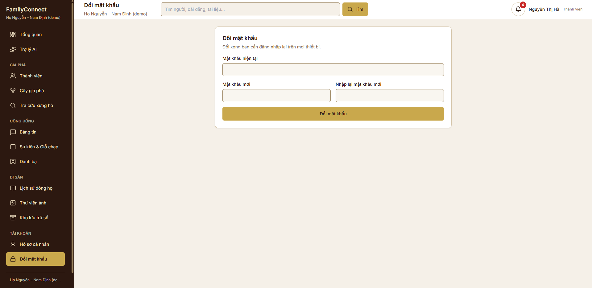

*Form đổi mật khẩu.*

## 3. Community — Bảng tin gia đình

### 3.1 Xem bảng tin
Đăng nhập bằng thành viên đã xác minh, chọn **Bảng tin** ở menu bên trái (trang Bảng tin gia đình, `/community`). Chọn **Tất cả** hoặc **Tin tức gia đình**. Cuộn xem bài; chọn **Xem thêm** nếu có. Nếu chưa xác minh, cần hoàn tất mục 2.3–2.4.

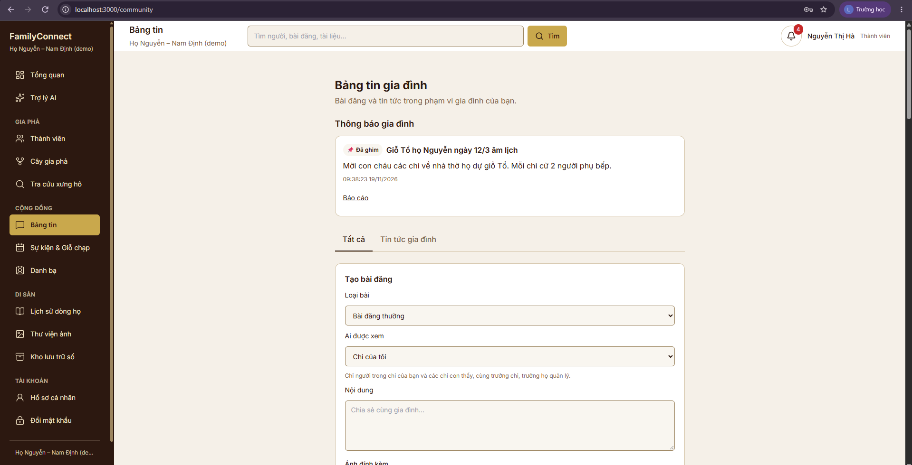

*Bảng tin và thông báo ghim.*

### 3.2 Tạo bài đăng và chia sẻ ảnh
1. Tại **Tạo bài đăng**, chọn **Loại bài** (Bài đăng thường; Tin tức gia đình chỉ dành cho tài khoản có quyền).
2. Tại **Ai được xem**, chọn phạm vi phù hợp: Cả dòng họ; Chi của tôi (nếu có); Con cháu của tôi (nếu đủ điều kiện). Đọc mô tả phạm vi trước khi đăng. Bài giới hạn cho con cháu và vợ/chồng của họ không mặc nhiên hiển thị cho trưởng họ/trưởng chi.
3. Nhập **Nội dung** (tối đa 5000 ký tự). Tại **Ảnh đính kèm**, chọn ảnh JPG/PNG/WebP, tối đa 5 MB mỗi ảnh. Chọn **Bỏ ảnh** để bỏ ảnh chọn nhầm.
4. Chọn **Đăng bài**, chờ hoàn tất. Nếu bài đã tạo nhưng tải ảnh lỗi, chọn **Tải tiếp ảnh** hoặc **Bỏ qua ảnh còn lại**, không tạo lại bài trùng.
5. Kiểm tra bài và ảnh đã xuất hiện trong bảng tin.

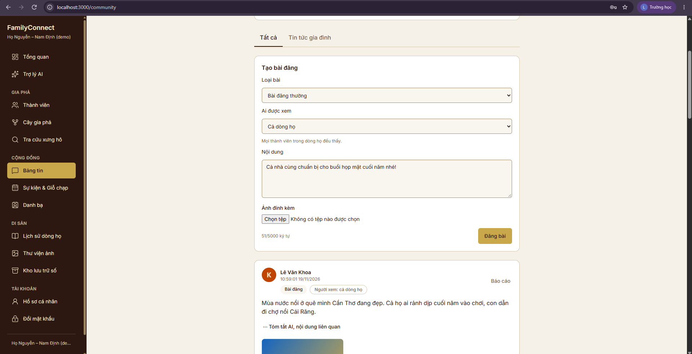

*Form tạo bài đăng thường.*

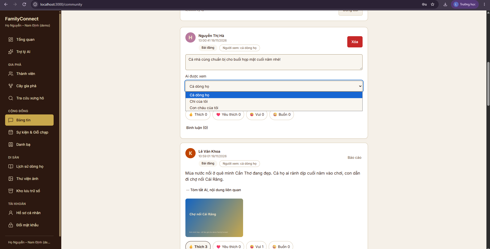

*Các lựa chọn phạm vi khi sửa bài.*

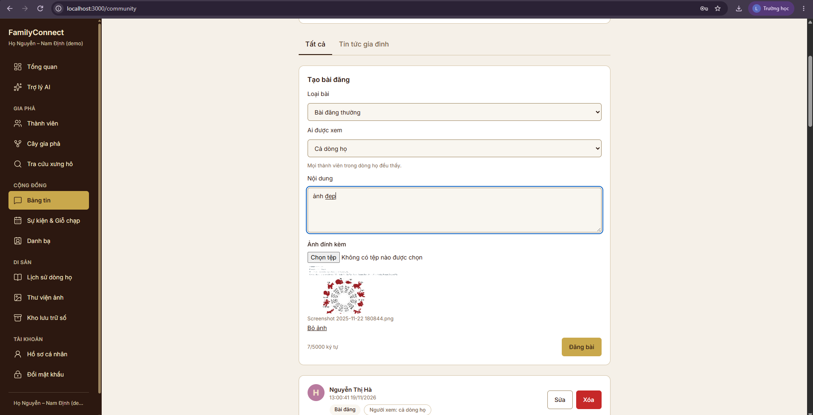

*Ảnh đính kèm được xem trước.*

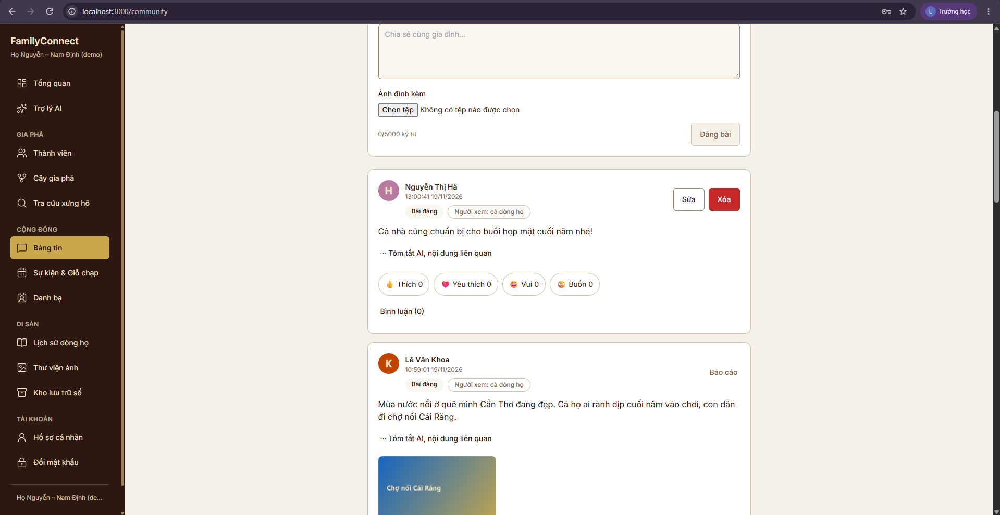

*Bài đăng văn bản xuất hiện thành công.*

Ảnh đính kèm đã có minh chứng xem trước; bài đăng có ảnh từ seed hiển thị ở mục 3.3.

### 3.3 Sửa, xóa, reaction, bình luận
- Với bài có quyền sửa, chọn **Sửa**, cập nhật nội dung/phạm vi, chọn **Lưu bài**. Để xóa bài thử nghiệm, chọn **Xóa**, xác nhận. Không xóa dữ liệu demo chung của nhóm.
- Chọn cảm xúc dưới bài (ví dụ Thích, Yêu thích); chọn cảm xúc khác để đổi hoặc bấm lại cảm xúc đang chọn để bỏ.
- Chọn **Bình luận**, nhập vào **Viết bình luận**, chọn **Gửi bình luận**. Chọn **Trả lời** dưới bình luận gốc, nhập nội dung và **Gửi trả lời**. Trả lời được tổ chức một cấp. Với bình luận có quyền, dùng **Sửa** / **Xóa**.
- Nếu nội dung vi phạm, chọn **Báo cáo**, nhập lý do, chọn **Gửi báo cáo**. Quản trị viên sẽ xem xét.

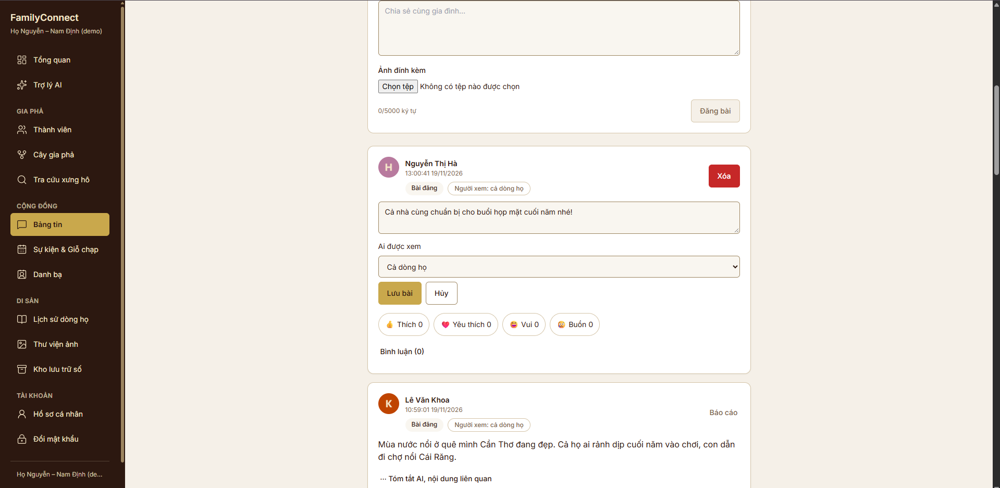

*Form sửa bài.*

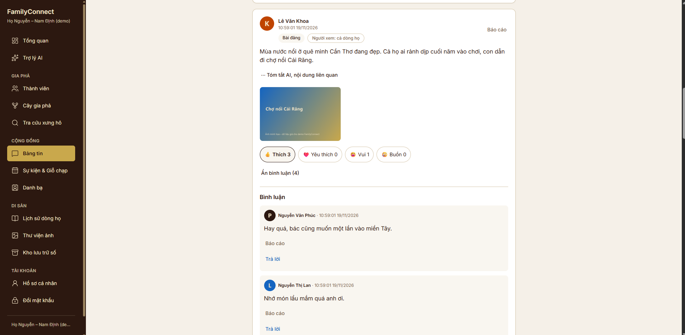

*Bài đăng có ảnh, reaction và bình luận.*

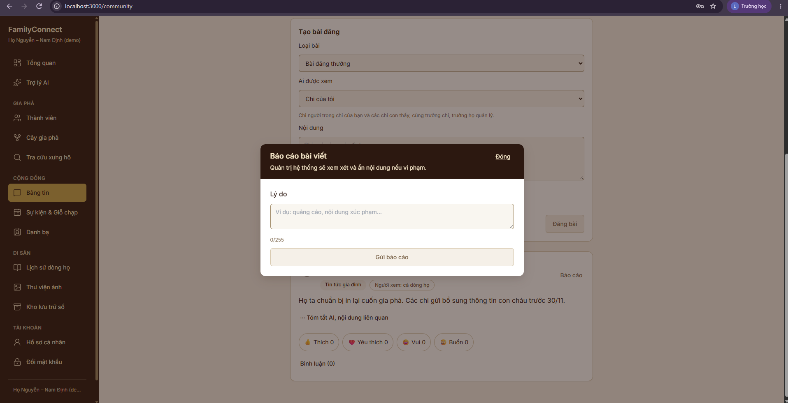

*Hộp thoại báo cáo bài viết.*

### 3.4 Tin tức và thông báo gia đình
Trưởng họ/trưởng chi hoặc quản trị viên có quyền chọn loại bài **Tin tức gia đình** khi đăng. Tại mục **Thông báo gia đình**, nhập Tiêu đề và Nội dung, chọn **Ghim ở đầu bảng tin** nếu cần, chọn **Đăng thông báo**. Dùng **Sửa / ghim** hoặc **Xóa** với thông báo có quyền quản lý. Thành viên thông thường đọc tin và thông báo.

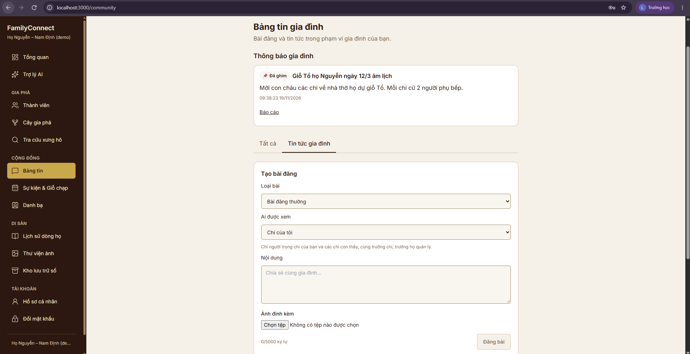

*Bộ lọc tin tức gia đình.*

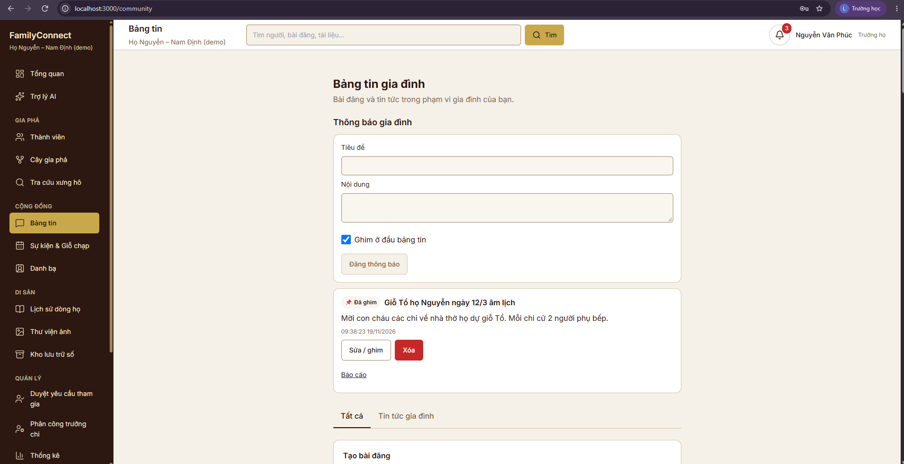

*Trưởng họ quản lý và ghim thông báo.*

## 4. Events — Sự kiện gia đình

### 4.1 Xem và tạo sự kiện
1. Chọn **Sự kiện & Giỗ chạp** ở menu bên trái (trang Sự kiện gia đình, `/events`). Chọn **Sắp tới** hoặc **Đã qua**, xem thời gian, địa điểm và mô tả.
2. Tại **Tạo sự kiện**, nhập Tên sự kiện (tối đa 255 ký tự), Thời gian bắt đầu, Thời gian kết thúc nếu có (phải sau thời gian bắt đầu), Địa điểm và Mô tả.
3. Chọn **Tạo sự kiện**. Kiểm tra kết quả ở danh sách phù hợp.
4. Người tạo hoặc người có quyền quản lý chọn **Sửa**, cập nhật và **Lưu**; chọn **Hủy sự kiện** rồi xác nhận nếu cần. Chỉ thực hành hủy trên sự kiện thử nghiệm do mình tạo.

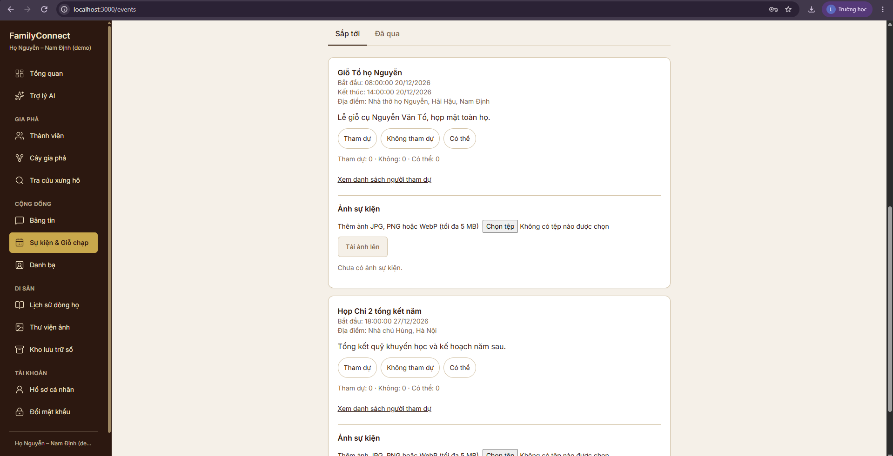

*Danh sách hai sự kiện seed sắp tới.*

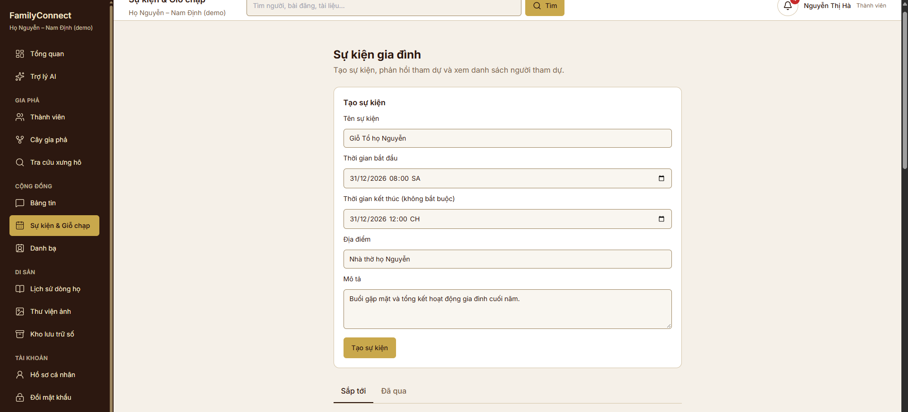

*Form tạo sự kiện với thông tin mẫu ngày 31/12/2026. Tên trong ảnh là Giỗ Tổ họ Nguyễn; sự kiện thử sau đó mang tên Họp mặt gia đình cuối năm.*

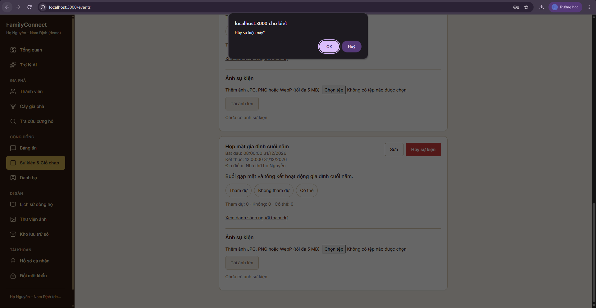

*Hộp thoại xác nhận hủy sự kiện thử nghiệm; phía sau có sự kiện Họp mặt gia đình cuối năm và nút Sửa.*

*Ảnh form sửa riêng chưa được thu thập. Ảnh xác nhận hủy cho thấy sự kiện thử đã xuất hiện trong danh sách. TV3 cho biết đã xác nhận hủy; chưa có ảnh kết quả sau khi hủy.*

### 4.2 RSVP và danh sách người tham dự
1. Tại một sự kiện chưa bắt đầu, chọn **Tham dự**, **Không tham dự** hoặc **Có thể**. Có thể đổi phản hồi trước giờ bắt đầu; mỗi người chỉ có một trạng thái hiện hành.
2. Kiểm tra số lượng theo từng trạng thái trên thẻ sự kiện.
3. Chọn **Xem danh sách người tham dự**, sử dụng **Lọc người tham dự** nếu cần. Người có quyền quản lý thấy ô **Đã có mặt** để cập nhật điểm danh khi thích hợp.
4. Sau khi sự kiện bắt đầu, hệ thống không cho đổi RSVP.

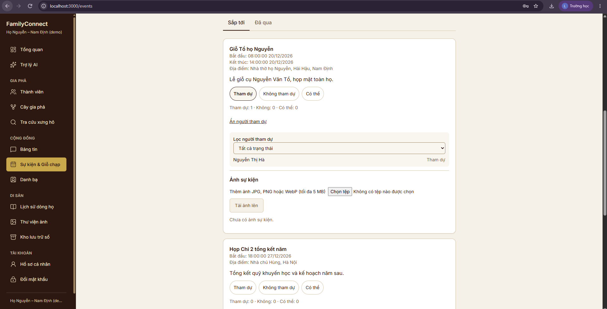

*RSVP Tham dự và danh sách người tham dự đã cập nhật.*

### 4.3 Thư viện ảnh sự kiện
Trong mục **Ảnh sự kiện**, xem ảnh hiện có. Nếu có quyền tải lên, chọn JPG/PNG/WebP không quá 5 MB và chọn **Tải ảnh lên**; kiểm tra ảnh trong thư viện. Nếu chưa có ảnh, hệ thống hiển thị thông báo tương ứng.

*Ảnh sự kiện hiển thị sau khi tải lên.*

### 4.4 Thông báo cá nhân và nhắc sự kiện
1. Chọn biểu tượng chuông trên đầu trang. Số trên chuông phản ánh thông báo chưa đọc.
2. Đọc nội dung; chọn **Xem bài viết** nếu thông báo liên quan bài đăng, hoặc mở sự kiện từ mục Sự kiện khi có nhắc lịch.
3. Chọn **Đánh dấu đã đọc** và kiểm tra trạng thái cập nhật.
4. Với RSVP Tham dự/Có thể, người có quyền xem sự kiện có thể nhận nhắc trước 24 giờ và 1 giờ theo cơ chế lập lịch của hệ thống. Đây là thông báo trong ứng dụng, không phải push notification ngoài ứng dụng.

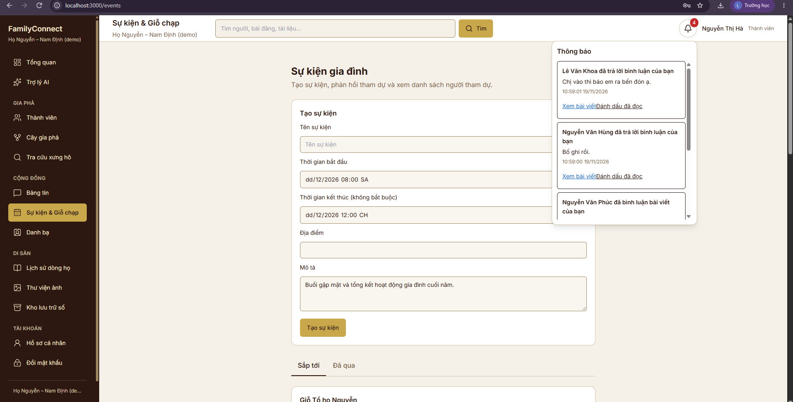

*Chuông thông báo và thao tác đánh dấu đã đọc.*

*Ảnh hiện có là thông báo bình luận/trả lời; chưa có minh chứng nhắc sự kiện 24 giờ/1 giờ.*

## 5. Xử lý tình huống thường gặp
| Tình huống | Cách xử lý |
|---|---|
| Chưa xác minh thành viên | Gửi yêu cầu hoặc chờ trưởng họ/trưởng chi duyệt. |
| Không thấy bài/sự kiện | Kiểm tra gia đình, phạm vi người xem, bộ lọc Sắp tới/Đã qua. |
| Không thấy nút sửa/xóa/đăng tin | Tài khoản chưa có quyền tương ứng. |
| Ảnh không tải lên | Kiểm tra định dạng và kích thước; thử tải tiếp nếu bài đã tạo. |
| RSVP bị khóa | Sự kiện đã bắt đầu, không đổi phản hồi được. |
| Không tải được dữ liệu | Kiểm tra kết nối, chọn Thử lại hoặc làm mới. |

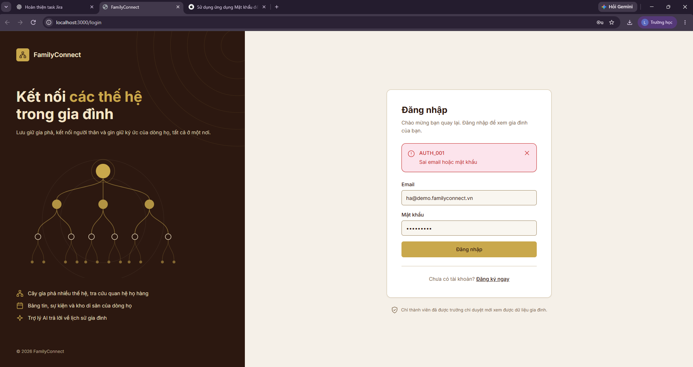

*Ví dụ thông báo AUTH_001 khi email hoặc mật khẩu không đúng.*

## 6. Tự kiểm tra sau khi làm theo hướng dẫn

| Việc cần làm | Kết quả mong đợi |
|---|---|
| Đăng nhập bằng tài khoản đã xác minh | Mở được Tổng quan, Bảng tin, Sự kiện. |
| Đăng nhập tài khoản đang chờ duyệt | Hiện trạng thái chờ duyệt; chưa truy cập được nội dung gia đình. |
| Tạo bài thử kèm ảnh; mở bình luận và chọn cảm xúc | Bài xuất hiện đúng phạm vi, ảnh hiển thị, tương tác được cập nhật. |
| Tạo sự kiện thử, sửa và lưu; chọn RSVP | Thông tin được lưu, số phản hồi và người tham dự được cập nhật. |
| Tải ảnh sự kiện, mở thông báo | Ảnh xuất hiện, thông báo đọc được. |
| Hủy sự kiện thử do mình tạo | Sự kiện thử không còn trong danh sách hoạt động. |

Chỉ dùng dữ liệu giả khi thực hành. Không hủy các sự kiện gốc hoặc duyệt tài khoản Tú đang dành cho demo chung. TV1 ghi nhận kết quả thực tế theo bảng nghiệm thu trong [báo cáo module](../09-report/community-events-report.md).

## 7. Nguồn đối chiếu và xác nhận
Mã nguồn `frontend/src/app/{login,register,join-family,join-requests,community,events}`, các component Auth/Community/Events/NotificationBell, SRS và `docs/09-report/requirements-traceability.md`. Ảnh đính kèm ghi nhận môi trường demo local; không dùng thông tin gia đình thật. TV1 thực hiện theo các bước và ghi kết quả trước khi xác nhận hoàn thành SCRUM-75.
