# TÀI LIỆU HƯỚNG DẪN SỬ DỤNG HỆ THỐNG FAMILYCONNECT (PHIÊN BẢN WEB)

## 1. Phân quyền người dùng trên Web

* **Quản trị viên hệ thống / Quản trị viên chi họ (`SYSTEM_ADMIN` / `BRANCH_ADMIN`):** Quản lý toàn bộ dữ liệu dòng họ, thêm/sửa/xóa thành viên, thiết lập quan hệ gia phả, quản lý kho di sản (lịch sử dòng họ, thư viện ảnh, kho lưu trữ số), xem thống kê và xuất báo cáo.
* **Thành viên dòng họ (`MEMBER`):** Tra cứu cây gia phả, sử dụng công cụ tra cứu xưng hô trực tuyến, tìm kiếm danh bạ và xem thông tin di sản, tổng quan dòng họ.

---

## 2. Hướng dẫn thao tác các chức năng chính (Giao diện Web)

### 2.1. Phân hệ Gia phả (Genealogy)

#### 2.1.1. Quản lý danh sách thành viên và thiết lập quan hệ

1. Trên thanh menu bên trái, chọn mục **Thành viên** (thuộc nhóm *Gia phả*).
2. Tại màn hình quản lý thành viên:
   * **Tìm kiếm thành viên:** Nhập tên vào ô *"Tìm theo họ tên"* và bấm nút **Tìm** để tra cứu nhanh thông tin cá nhân của thành viên.
   * **Thêm thành viên mới:** Bấm nút **Thêm thành viên** ở góc trên bên phải để mở biểu mẫu nhập thông tin chi tiết (họ tên, năm sinh, quê quán, trạng thái...).
   * **Thao tác trên từng thành viên:** Mỗi dòng thành viên đi kèm các nút chức năng quản trị:
     * **Sửa:** Cập nhật thông tin của thành viên **chưa có tài khoản** (tổ tiên, trẻ nhỏ). Hồ sơ đã gắn tài khoản chỉ chính chủ tự sửa qua **Hồ sơ cá nhân** → **Chỉnh sửa hồ sơ** (BR-GEN-20); Trưởng chi, Trưởng họ không sửa được thông tin cá nhân của người khác.
     * **Thêm cha/mẹ:** Thiết lập liên kết huyết thống thế hệ trước cho thành viên đó.
     * **Thêm vợ/chồng:** Thiết lập quan hệ hôn nhân gia đình.

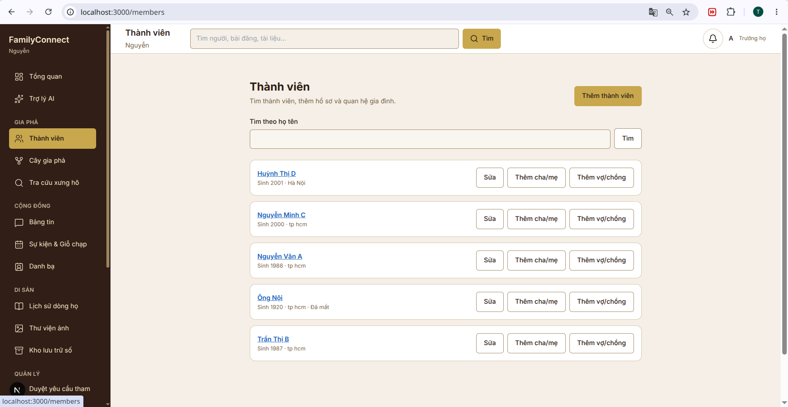

#### 2.1.2. Xem và tương tác với Cây gia phả trực quan

1. Trên thanh menu bên trái, chọn mục **Cây gia phả**.
2. Hệ thống hiển thị sơ đồ phả hệ trực quan theo từng nhánh và thế hệ:
   * **Điều hướng sơ đồ:** Dùng chuột kéo thả để di chuyển vùng nhìn, lăn con lăn chuột hoặc dùng cụm nút điều khiển góc dưới bên trái (`+`, `-`, đặt lại) để phóng to/thu nhỏ toàn cảnh cây gia phả.
   * **Xem chi tiết thành viên:** Nhấp chuột vào thẻ của bất kỳ thành viên nào trên cây để xem thông tin tiểu sử và các mối quan hệ liên quan.

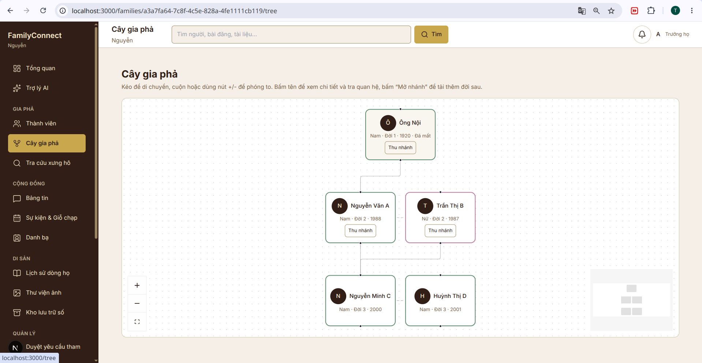

#### 2.1.3. Công cụ tra cứu xưng hô trực tuyến

1. Trên thanh menu bên trái, chọn mục **Tra cứu xưng hô**.
2. Chọn **Người A** và **Người B** từ danh sách thả xuống.
3. Bấm nút **Tra quan hệ**:
   * Hệ thống tự động phân tích đường nối huyết thống/hôn nhân trên cây gia phả và hiển thị kết quả cách xưng hô chuẩn xác giữa hai người (ví dụ: *Nguyễn Văn A là cha của Nguyễn Minh C*) kèm sơ đồ chuỗi quan hệ và hướng dẫn cách gọi/xưng tương ứng.

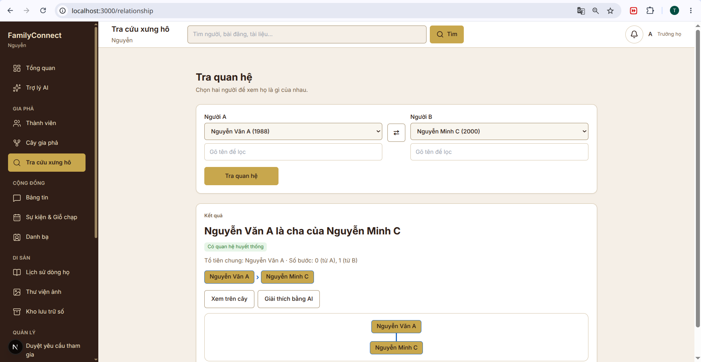

---

### 2.2. Phân hệ Kho di sản (Heritage)

#### 2.2.1. Quản lý Lịch sử dòng họ, Người tiêu biểu và Câu chuyện gia đình

1. Trên thanh menu bên trái, chọn mục **Lịch sử dòng họ** (thuộc nhóm *Kho di sản*).
2. Tại giao diện **Kho di sản**, người dùng có thể theo dõi:
   * **Tư liệu lịch sử:** Các bài viết ghi chép lịch sử hình thành và phát triển của dòng họ (có thể lọc theo danh mục).
   * **Câu chuyện gia đình:** Các giai thoại, ký ức truyền thống được lưu truyền qua các thế hệ.

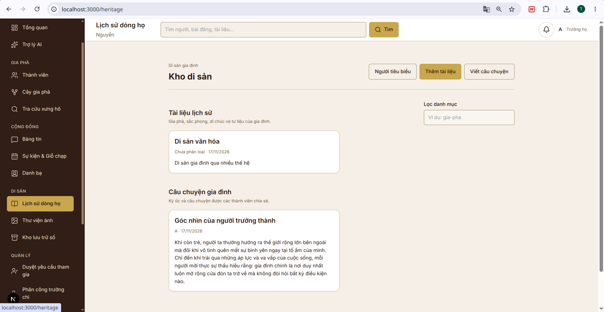

3. **Viết câu chuyện gia đình mới:**
   * Bấm nút **Viết câu chuyện** ở góc trên bên phải.
   * Nhập **Tiêu đề**, chọn **Thành viên liên quan** (nếu có) và nhập **Nội dung câu chuyện**, sau đó bấm **Đăng câu chuyện** để lưu lên hệ thống.

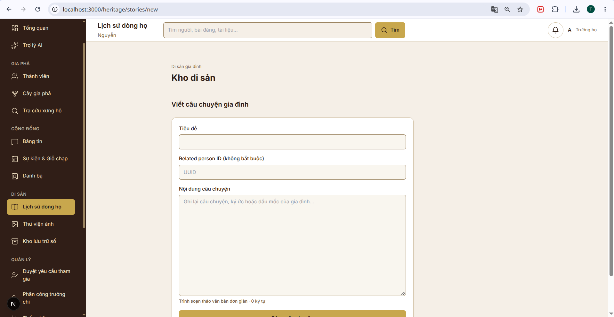

4. **Quản lý danh sách Người tiêu biểu:**
   * Bấm nút **Người tiêu biểu** ở góc trên bên phải để mở trang quản lý các nhân vật có công trạng, đóng góp nổi bật cho dòng họ và đất nước.
   * Chọn **Thành viên**, nhập **Thành tích** và bấm **Thêm người tiêu biểu** để ghi danh; có thể bấm **Sửa** hoặc **Xóa** ở danh sách bên dưới để cập nhật.

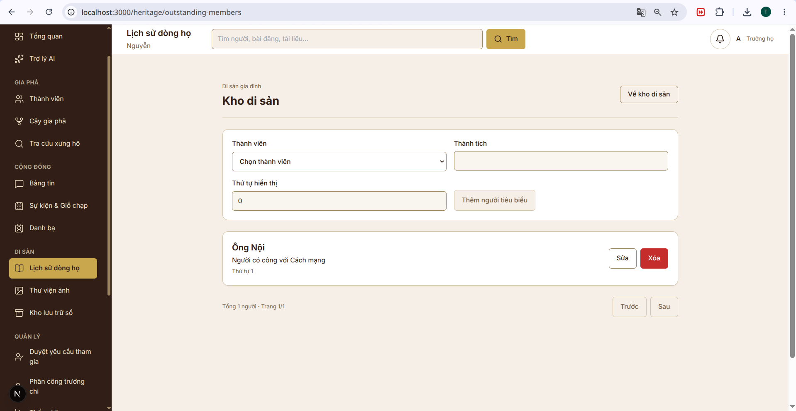

#### 2.2.2. Thư viện ảnh dòng họ

1. Trên thanh menu bên trái, chọn mục **Thư viện ảnh**.
2. **Tải ảnh mới lên thư viện:**
   * Bấm **Choose File** để chọn tệp hình ảnh từ máy tính.
   * Nhập **Chú thích** mô tả cho bức ảnh và bấm nút **Tải ảnh lên**.
3. Các hình ảnh đã đăng tải sẽ hiển thị trong mục **Thư viện ảnh** bên dưới để toàn thể thành viên cùng xem và lưu giữ kỷ niệm.

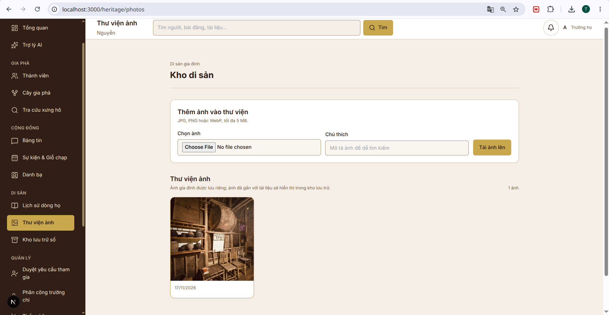

#### 2.2.3. Kho lưu trữ số (Tài liệu, sắc phong, gia phả cổ)

1. Trên thanh menu bên trái, chọn mục **Kho lưu trữ số**.
2. Tại đây lưu trữ các tệp tài liệu quan trọng của dòng họ (bản scan gia phả cổ, sắc phong, văn bia, di chúc...).
3. Người dùng có thể **Lọc danh mục** ở góc phải để tìm nhanh loại tài liệu cần xem và bấm nút **Tải xuống** trên từng mục để lưu tài liệu về máy.

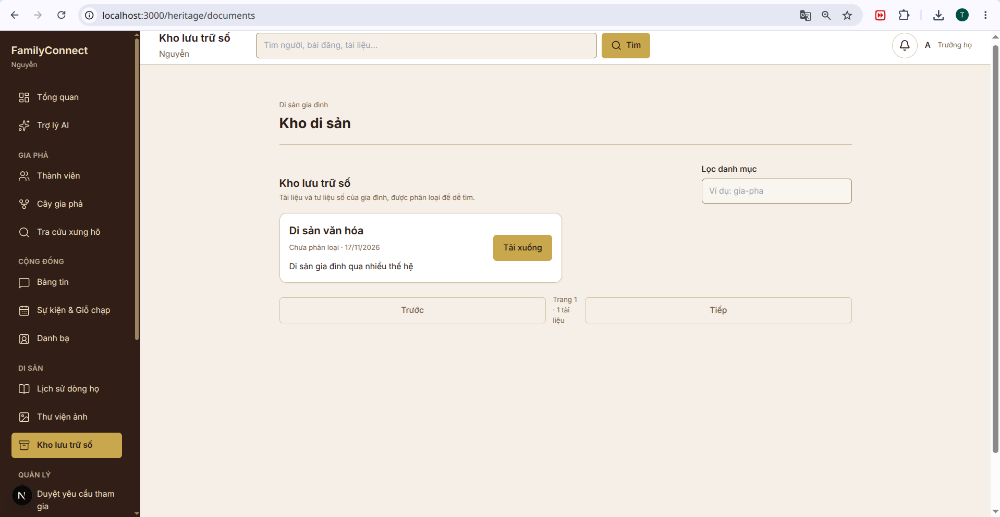

---

### 2.3. Phân hệ Cộng đồng & Báo cáo (Community & Reports)

#### 2.3.1. Danh bạ thành viên

1. Trên thanh menu bên trái, chọn mục **Danh bạ**.
2. Xem họ tên, quan hệ với bạn (ví dụ "dượng", "anh họ (bên nội)"), năm sinh, thế hệ, nghề nghiệp và tỉnh/thành đang sống của các thành viên. Danh bạ **không** hiện số điện thoại và địa chỉ chi tiết (quyền riêng tư, `privacy.md`); với trẻ dưới 16 tuổi chỉ hiện họ tên, quan hệ, năm sinh. Bấm vào một người để mở **trang cá nhân** của người đó.
3. Có thể lọc danh sách theo **Từ khóa tìm kiếm**, **Nghề nghiệp**, **Tỉnh/thành đang ở** hoặc **Thế hệ**, sau đó bấm **Tìm thành viên**. Quản trị viên có thể bấm **Xuất CSV** để tải danh bạ ra tệp bảng tính.

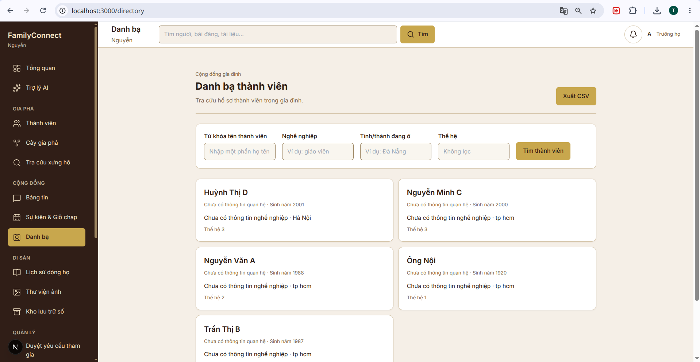

#### 2.3.2. Trang Tổng quan hệ thống

1. Trên thanh menu bên trái, chọn mục **Tổng quan**.
2. Màn hình hiển thị nhanh các chỉ số quan trọng của dòng họ: số lượng thành viên, người tiêu biểu, câu chuyện gia đình, thư viện ảnh, cùng khối **Cây gia phả** thu nhỏ, **Thành viên mới thêm** và **Sự kiện & ngày giỗ sắp tới**.

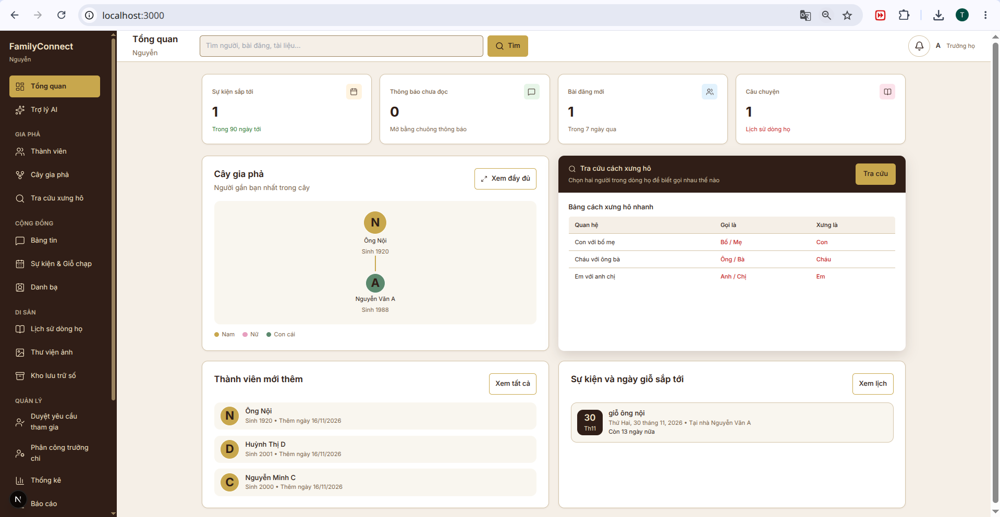

#### 2.3.3. Thống kê nhân khẩu dòng họ

1. Trên thanh menu bên trái, chọn mục **Thống kê**.
2. Hệ thống trực quan hóa dữ liệu dòng họ thông qua các thẻ số liệu và biểu đồ:
   * **Tổng thành viên, Nam, Nữ, Số thế hệ**.
   * **Thành viên theo thế hệ** và **Thành viên theo độ tuổi** (biểu đồ cột).
   * **Cơ cấu giới tính** và **Nghề nghiệp** (biểu đồ phân bổ).

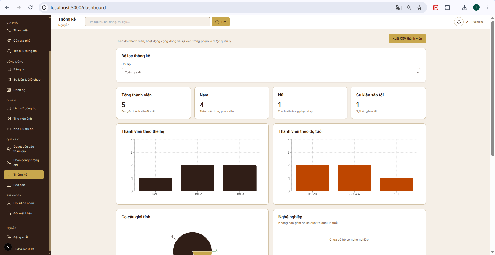

#### 2.3.4. Xuất báo cáo gia phả

1. Trên thanh menu bên trái, chọn mục **Báo cáo**.
2. Chọn **gia đình**, **chi họ** và **khoảng thời gian** cần báo cáo. Mục **Thống kê** và **Báo cáo** chỉ hiện với Trưởng chi, Trưởng họ và Quản trị hệ thống.
3. Bấm **Tải PDF** để xuất tệp báo cáo hoàn chỉnh và xem trực tiếp trên khung **Xem trước báo cáo** ngay bên dưới.

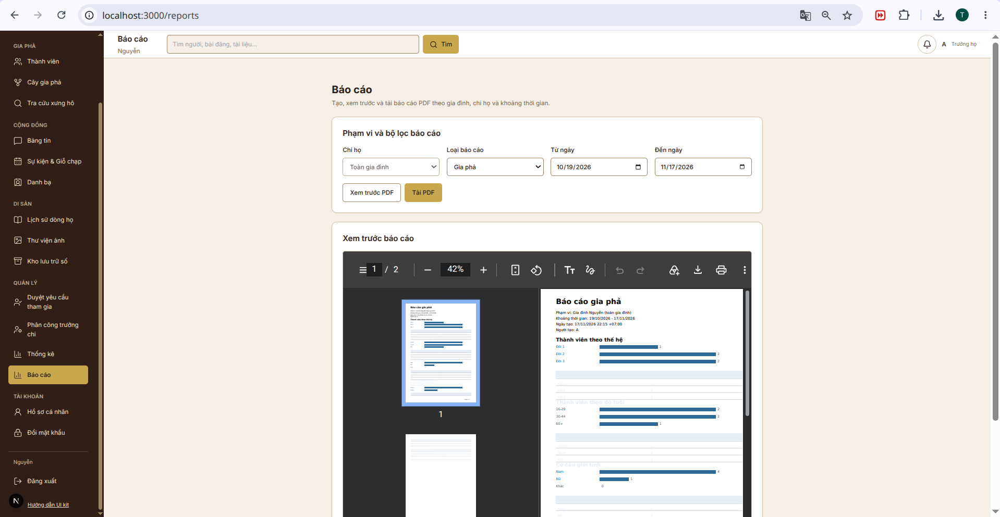

---

## 3. Bảng tổng hợp lỗi thường gặp và cách xử lý

| STT | Mã lỗi / Thông báo hiển thị | Nguyên nhân | Cách khắc phục |
| :--- | :--- | :--- | :--- |
| 1 | **Không có quyền truy cập** (`403`, `PERM_001`) | Tài khoản đang đăng nhập thuộc nhóm quyền `MEMBER` nhưng cố truy cập vào chức năng quản trị hoặc chỉnh sửa dữ liệu. | Liên hệ `SYSTEM_ADMIN` hoặc `BRANCH_ADMIN` để được cấp quyền phù hợp nếu cần thao tác quản trị. |
| 2 | **Phiên đăng nhập hết hạn** (`401 Unauthorized`) | Người dùng không thao tác trên hệ thống trong thời gian dài khiến mã xác thực (Token) hết hiệu lực. | Tải lại trang (nhấn `F5`) và tiến hành đăng nhập lại vào hệ thống. |
| 3 | **Đã đủ cha và mẹ ruột** (`GEN_005`) | Thành viên đã có cha ruột (hoặc mẹ ruột) mà vẫn thêm người cùng vai trò. | Kiểm tra lại; nếu là cha/mẹ nuôi hoặc kế thì chọn loại **nuôi** hoặc **kế**. |
| 4 | **Quan hệ tạo vòng lặp tổ tiên** (`GEN_006`) | Chọn người là con cháu của thành viên làm cha/mẹ của chính thành viên đó. | Kiểm tra lại đúng người thuộc thế hệ trước. |
| 5 | **Cha/mẹ phải sinh trước con** (`GEN_007`) | Ngày sinh của cha/mẹ sau hoặc trùng ngày sinh của con. | Sửa lại ngày sinh hoặc chọn đúng người. |
| 6 | **Không được kết hôn giữa người thân** (`GEN_010`) | Kết hôn giữa người trực hệ hoặc anh chị em ruột; hoặc gán người đang hay đã từng là vợ/chồng làm cha/mẹ của nhau. | Kiểm tra lại người được chọn. |
| 7 | **Không thể xóa thành viên** (`GEN_004`) | Thành viên đang có ràng buộc dữ liệu trên cây gia phả (đang là cha/mẹ hoặc vợ/chồng của thành viên khác). | Gỡ bỏ các liên kết quan hệ (con cái, vợ/chồng) liên quan đến thành viên này trước khi thực hiện xóa. |
| 8 | **Không tìm thấy cách xưng hô giữa hai người** | Hai thành viên được chọn chưa được nối liên kết huyết thống hoặc hôn nhân trên cây gia phả (cây bị đứt nhánh). | Vào mục **Thành viên**, kiểm tra và bổ sung đầy đủ liên kết cha/mẹ cho cả hai nhánh để nối liền cây phả hệ. |
| 9 | **Lỗi tải lên hình ảnh / tài liệu** (`FILE_001` quá dung lượng, `FILE_002` sai định dạng) | Ảnh chỉ nhận `.jpg`, `.png`, `.webp` tối đa 5 MB; tệp `.pdf` tối đa 10 MB và chỉ tải được ở **Kho lưu trữ số**. | Nén giảm dung lượng tệp hoặc chuyển đổi sang định dạng chuẩn trước khi tải lên lại. |
| 10 | **Dữ liệu không hiển thị hoặc tải chậm** | Kết nối mạng không ổn định hoặc bộ lọc tìm kiếm đang áp dụng điều kiện quá hẹp. | Kiểm tra kết nối Internet, đặt lại các điều kiện lọc và nhấn `F5` để làm mới dữ liệu trang. |