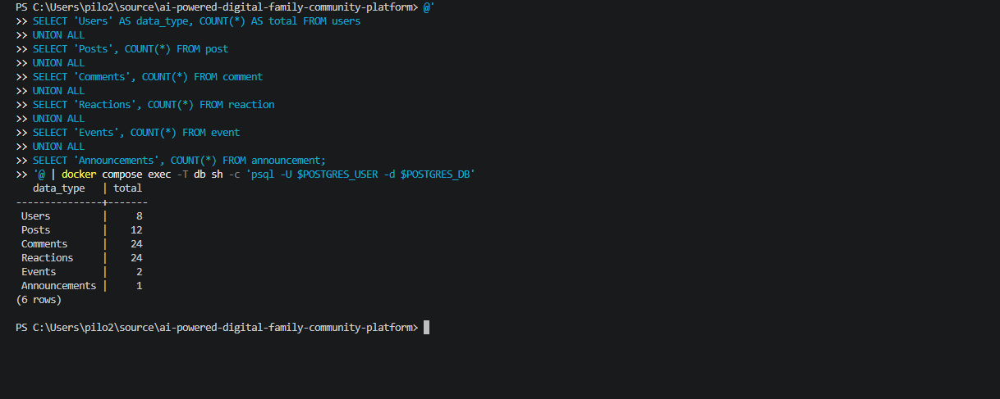
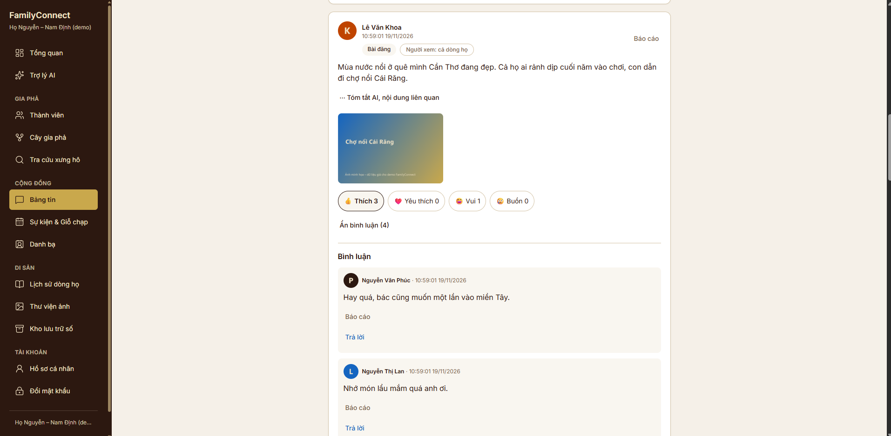
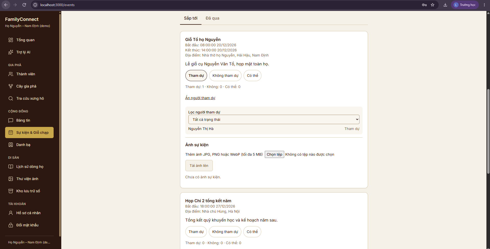

# Báo cáo module Community và Events — FamilyConnect

**Task:** SCRUM-75 · **Người thực hiện:** TV3 · **Reviewer:** TV1  
Phần đóng góp cho chương 4 (Cài đặt) của báo cáo cuối kỳ; thông tin đối chiếu `develop` tại `b72bd39`. Minh chứng Web/seed ngày 19/11/2026; chờ TV1 xác nhận kiểm thử cuối.

## 1. Mục tiêu và phạm vi
Community hỗ trợ giao tiếp nội bộ dòng họ, chia sẻ bài đăng, tin tức, ảnh, bình luận, cảm xúc và thông báo gia đình. Events hỗ trợ tổ chức hoạt động, phản hồi tham dự (RSVP), quản lý người tham dự, lưu ảnh và nhắc lịch. Hai module sử dụng xác thực và phân quyền của Auth, thông tin gia đình/chi từ Genealogy, đồng thời hỗ trợ truy cập trên web và các chức năng thành viên trên mobile.

## 2. Đối chiếu yêu cầu chức năng
| Mã FR | Chức năng | Thành phần triển khai |
|---|---|---|
| FR-COM-01 | Tạo và quản lý bài đăng | Bảng tin web, FeedScreen/CreatePostScreen/PostDetailScreen trên mobile |
| FR-COM-02 | Bình luận, reaction | PostInteractions, API posts/comments/reactions, trả lời bình luận một cấp |
| FR-COM-03 | Tin tức gia đình | Loại NEWS dành cho người có quyền, bộ lọc Tin tức gia đình |
| FR-COM-04 | Chia sẻ ảnh | ImagePicker, media API, chọn ảnh hoặc camera trên mobile |
| FR-COM-05 | Thông báo gia đình | Announcements, đăng và ghim theo quyền |
| FR-EVT-01 | Tạo sự kiện | Trang /events, form tạo/sửa/hủy, danh sách |
| FR-EVT-02 | RSVP | Ba trạng thái GOING, NOT_GOING, MAYBE |
| FR-EVT-03 | Quản lý người tham dự | Danh sách, lọc theo RSVP, cập nhật điểm danh theo quyền |
| FR-EVT-04 | Thư viện ảnh | EventGallery, ảnh bảo vệ bởi API media |
| FR-EVT-05 | Nhắc sự kiện | Lập lịch 24 giờ/1 giờ, notification trong ứng dụng |

## 3. Kiến trúc và cài đặt
Hệ thống dùng Spring Boot modular monolith, Next.js cho web, React Native/Expo cho mobile và PostgreSQL. Web/mobile giao tiếp với backend qua REST API `/api/v1`; JWT xác thực request, tầng service kiểm tra quyền và phạm vi gia đình. Hai module đặt tại `com.familyconnect.modules.community` và `com.familyconnect.modules.events`. Dữ liệu lưu tại các bảng nghiệp vụ như `post`, `comment`, `reaction`, `media`, `announcement`, `event`, `event_participant`, `notification`. Dùng media chung cho ảnh bài đăng và sự kiện; không cấp URL tệp công khai. Chi tiết schema và trường dữ liệu đối chiếu ERD, migration Flyway và OpenAPI của dự án.

### 3.1 Luồng Community
Người dùng đã xác minh chọn loại bài và phạm vi người xem, nhập nội dung và tạo bài. Backend kiểm tra membership, vai trò, phạm vi rồi lưu bài. Ảnh được tải lên sau khi tạo bài và gắn vào bài; nếu gián đoạn, giao diện tiếp tục tải phần ảnh thiếu. Bảng tin lọc theo phạm vi, phân trang theo quy ước API. Bình luận/reaction được ghi trên bài có quyền xem; mỗi người chỉ có một reaction hiện hành, có thể đổi hoặc bỏ. Trả lời bình luận một cấp và thông báo liên quan giúp duy trì tương tác. Thành viên chỉ sửa nội dung của mình; quyền gỡ nội dung của quản trị viên phụ thuộc phạm vi và quy tắc nghiệp vụ. Tin tức/announcement được giới hạn cho người có quyền.

### 3.2 Luồng Events
Người có quyền nhập tên, lịch bắt đầu/kết thúc, địa điểm và mô tả; backend kiểm tra dữ liệu, tạo sự kiện. Người tham gia chọn một trong ba trạng thái RSVP và được đổi trước giờ bắt đầu. Số đếm và danh sách phản hồi được cập nhật theo dữ liệu hiện hành. Người có quyền quản lý có thể sửa/hủy và ghi nhận điểm danh. Gallery dùng lại hệ thống media. Job nhắc lịch dựa trên thời điểm sự kiện và RSVP phù hợp (GOING/MAYBE), tạo thông báo trong ứng dụng; không triển khai push notification ngoài ứng dụng.

### 3.3 Kiểm soát truy cập và dữ liệu
Bài đăng có thể giới hạn cả dòng họ, chi của người đăng hoặc con cháu (nếu điều kiện phù hợp). Backend phải kiểm tra quyền xem độc lập với nút giao diện; thành viên chưa xác minh không truy cập dữ liệu gia đình. Tệp ảnh JPG/PNG/WebP tối đa 5 MB, phục vụ qua API có kiểm tra quyền. RSVP sau khi sự kiện bắt đầu bị từ chối (EVT_001). Các quy tắc này dựa trên SRS và các task SCRUM-38, 46, 47, 53, 89 cùng code hiện hành.

## 4. Dữ liệu demo
Sử dụng `docker/seed-demo.ps1` hiện có trên develop, gồm bước 5/8 và `Seed-Social`. Seed gọi REST API theo tài khoản giả, không chèn trực tiếp vào DB. Không tạo script thứ hai vì script hiện có đã đáp ứng dữ liệu bài đăng, bình luận và sự kiện. Phần đóng góp của SCRUM-75 là đối chiếu, tái chạy và xác minh dữ liệu demo; không ghi nhận TV3 là tác giả toàn bộ script. Khi chạy lần đầu, script dừng tại `GET /persons/me` (400 VALID_001) trên container backend cũ. Sau khi build và chuyển sang cấu hình Docker Compose của develop, API trả HTTP 200; chạy lại seed bổ sung thành công 6 hồ sơ và 6 bài đăng tương tác.

Kết quả truy vấn PostgreSQL ngày 19/11/2026, trước khi thao tác tạo dữ liệu thử nghiệm trên giao diện:

| Dữ liệu | Số lượng thực tế |
|---|---:|
| Tài khoản | 8 |
| Bài đăng | 12 |
| Bình luận | 24 |
| Reaction | 24 |
| Sự kiện | 2 |
| Thông báo gia đình (announcement) | 1 |



### 4.1 Tái tạo và kiểm tra dữ liệu demo (PowerShell)

Chỉ thực hiện trên môi trường demo local, từ thư mục gốc repository, với `.env` đã cấu hình đúng và backend đang chạy phiên bản tương ứng mã nguồn. Nếu đã có đầy đủ dữ liệu demo thì chỉ chạy câu truy vấn kiểm tra, không cần nạp lại. Không dùng lệnh xóa volume để chuẩn bị demo.

```powershell
docker compose up -d
docker compose ps
# Sau khi backend và DB healthy, chỉ chạy seed khi cần nạp dữ liệu demo:
powershell -ExecutionPolicy Bypass -File docker\seed-demo.ps1
```

Truy vấn chỉ đọc dùng để đối chiếu số lượng:

```powershell
@'
SELECT 'Users' AS data_type, COUNT(*) AS total FROM users
UNION ALL SELECT 'Posts', COUNT(*) FROM post
UNION ALL SELECT 'Comments', COUNT(*) FROM comment
UNION ALL SELECT 'Reactions', COUNT(*) FROM reaction
UNION ALL SELECT 'Events', COUNT(*) FROM event
UNION ALL SELECT 'Announcements', COUNT(*) FROM announcement;
'@ | docker compose exec -T db sh -c 'psql -U $POSTGRES_USER -d $POSTGRES_DB'
```

Nếu script gặp lỗi, ghi log và kiểm tra nguyên nhân trước khi chạy lại. Không giả định script luôn tự phục hồi mọi tình trạng nạp dở. Kết quả của lần chạy thực tế: `Du lieu demo da co san, bo sung ho so ca nhan va bai dang tuong tac...` và `Ho so: 6 tai khoan co anh dai dien, que, noi o, hoc van. Bai dang tuong tac: 6.`

Hai sự kiện gốc diễn ra ngày 20 và 27/12/2026. Số lượng trên là ảnh chụp tại thời điểm xác minh seed, không phải số lượng hiện tại sau khi tạo bài/sự kiện thử.

## 5. Kiểm thử và kết quả có căn cứ
- `docs/06-test/community-posts-3-04.md`: tài liệu ghi nhận TV1 chạy 15 ca API ngày 24/10/2026 tại `d2f6f7d`, tất cả đạt, gồm tạo bài, phân quyền, comment/reaction và IDOR. Đây là kết quả lịch sử, không phải lần test SCRUM-75 hiện tại.
- `docs/06-test/events-4-05.md`: có đặc tả ca test và lệnh chạy EventServiceTest; bảng test thủ công chưa ghi kết quả.
- `docs/06-test/events-notifications-5-04.md`: có ca kiểm thử nhắc lịch, gallery, announcement, notification; không khẳng định đã chạy các ca chưa có kết quả.
- `docs/06-test/mobile-community-events-6-10.md`: ghi nhận typecheck, lint, format:check, cấu hình Expo, export Android/iOS đạt ở lần kiểm tra mã nguồn; chưa kiểm chứng trên thiết bị thật tại thời điểm tài liệu đó.
- `docs/09-report/demo-script.md`: lần thử ngày 19/11/2026 có kiểm tra bảng tin, trả lời bình luận, phạm vi và thông báo; tài liệu ghi sửa lỗi mở bài cũ từ thông báo SCRUM-126. Chưa có xác nhận toàn bộ luồng Events trong lần nghiệm thu SCRUM-75. Hướng dẫn AI và Mobile thuộc TV5/SCRUM-98, không yêu cầu nghiệm thu Mobile trong bộ bàn giao này.

## 6. Kết quả giao diện và đánh giá
Các ảnh Web thực tế ghi nhận đăng nhập thành công, tài khoản đang chờ duyệt, form duyệt thành viên, bảng tin, tạo bài văn bản, xem trước ảnh đính kèm, form sửa bài, bình luận/reaction, tin tức, thông báo ghim, danh sách sự kiện, form tạo sự kiện, RSVP, người tham dự, gallery và chuông thông báo.






Xem đầy đủ ảnh và bước thao tác tại [Hướng dẫn sử dụng](../08-user-guide/auth-community-events.md). Ảnh thể hiện giao diện, không thay thế kiểm thử toàn bộ luồng. Chưa xác minh việc lưu chỉnh sửa sự kiện hoặc trạng thái sau khi hủy; chưa có ảnh nhắc lịch thực tế.

## 7. Hạn chế
Nhắc sự kiện chỉ trong ứng dụng; mobile hiện yêu cầu dùng web để gửi mã tham gia/lập gia đình và để tạo/sửa/hủy sự kiện. Hình ảnh của SCRUM-75 giới hạn ở Web; tài liệu AI/Mobile thuộc TV5 (SCRUM-98). Chưa có ảnh form tham gia gia đình và form sửa sự kiện riêng. TV1 cần kiểm tra khả năng người mới làm theo tài liệu; không ghi tỷ lệ PASS khi chưa có kết quả. Không tạo script thuyết trình riêng theo yêu cầu người thực hiện; phần chuẩn bị thuyết trình cần TV3 thực hiện theo kịch bản demo chung của nhóm.

## 8. Nghiệm thu hướng dẫn sử dụng — TV1

Tiêu chí Jira: người mới làm theo hướng dẫn dùng được hệ thống. Đề nghị TV1 hoặc người thử chưa quen hệ thống sử dụng hướng dẫn Web mà không cần TV3 chỉ từng thao tác; ghi kết quả và mọi bước chưa rõ. Các thao tác ghi/xóa dữ liệu thực hiện trên dữ liệu thử, giữ tài khoản và sự kiện gốc dùng chung.

| ID | Nội dung kiểm tra | Kết quả mong đợi | Kết quả thực tế / trạng thái |
|---|---|---|---|
| UG-01 | Đăng ký, đăng nhập, đăng xuất, hồ sơ | Hiểu được các bước và truy cập đúng quyền | Chờ TV1 |
| UG-02 | Tham gia, chờ duyệt, duyệt/từ chối tài khoản thử | Trạng thái và quyền truy cập đúng | Chờ TV1 |
| UG-03 | Bảng tin, tạo/sửa/xóa bài thử kèm ảnh, phạm vi người xem | Nội dung và ảnh hiển thị đúng phạm vi | Chờ TV1 |
| UG-04 | Bình luận, trả lời, cảm xúc, tin tức, thông báo | Thao tác được theo quyền đã mô tả | Chờ TV1 |
| UG-05 | Tạo/sửa/hủy sự kiện thử | Sự kiện và trạng thái cập nhật đúng | Chờ TV1 |
| UG-06 | RSVP, người tham dự, gallery | Phản hồi, danh sách và ảnh được cập nhật | Chờ TV1 |
| UG-07 | Chuông thông báo, đánh dấu đã đọc | Thông báo hiển thị và trạng thái đọc đổi đúng | Chờ TV1 |
| UG-08 | Đối chiếu seed theo mục 4 | Tạo được bài đăng, bình luận và sự kiện từ script demo hiện có | TV3 đã đối chiếu số lượng; chờ TV1 |

Người kiểm tra: chưa ghi nhận. Ngày kiểm tra: chưa ghi nhận. Kết luận: chưa có kết quả nghiệm thu độc lập. Nếu người mới gặp khó khăn, bổ sung/sửa hướng dẫn rồi kiểm tra lại.

## 9. Tài liệu tham chiếu
- `docs/01-srs/use-cases/community-events.md`, `docs/04-api/openapi/community-events.yaml`, `docs/09-report/requirements-traceability.md`.
- `docs/06-test/community-posts-3-04.md`, `events-4-05.md`, `events-notifications-5-04.md`, `mobile-community-events-6-10.md`.
- `docker/seed-demo.ps1`, `docs/09-report/demo-script.md`, `docs/09-report/report-outline.md`.
- Jira SCRUM-75, 38, 46, 47, 53, 89.
