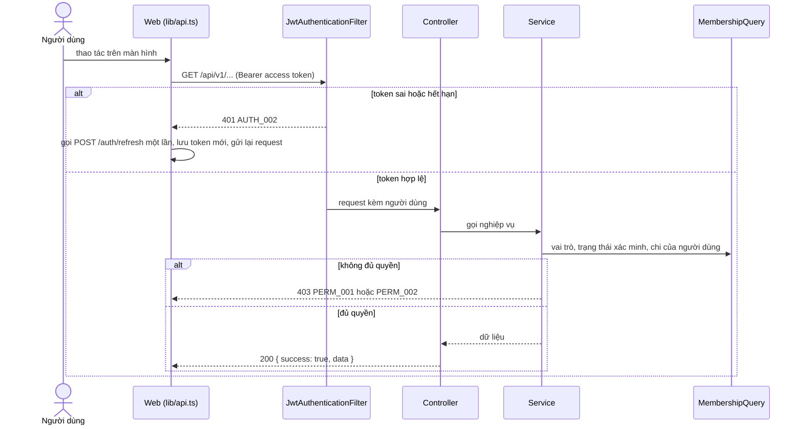
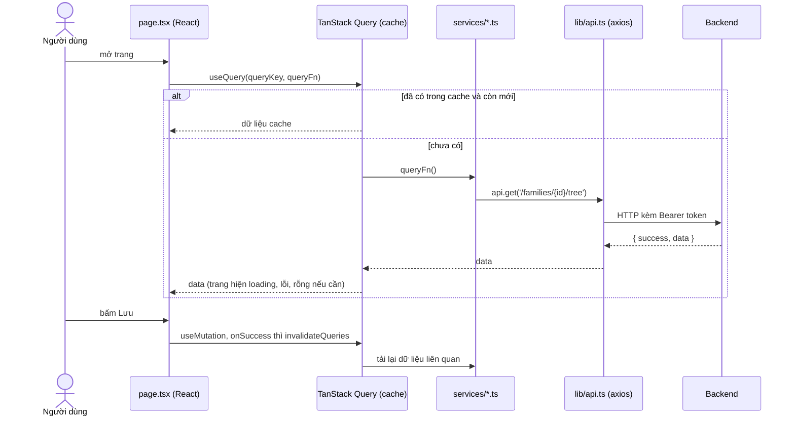
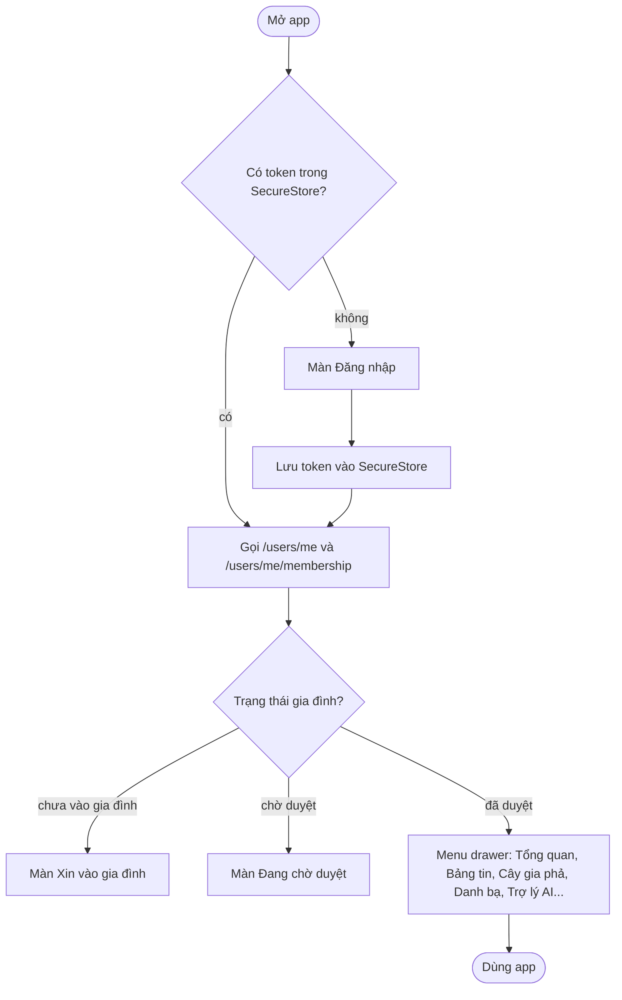
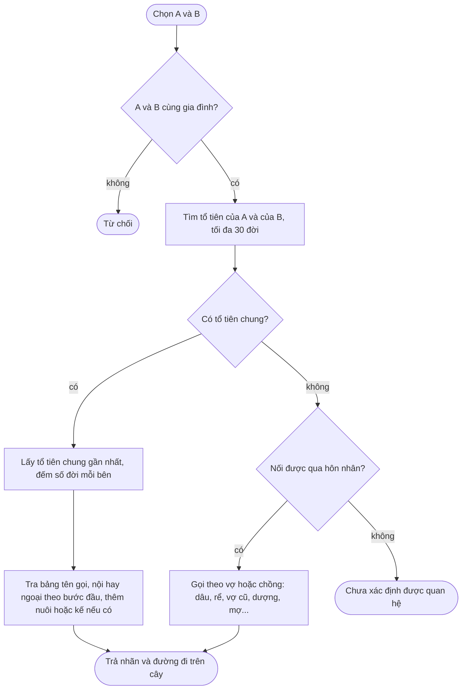
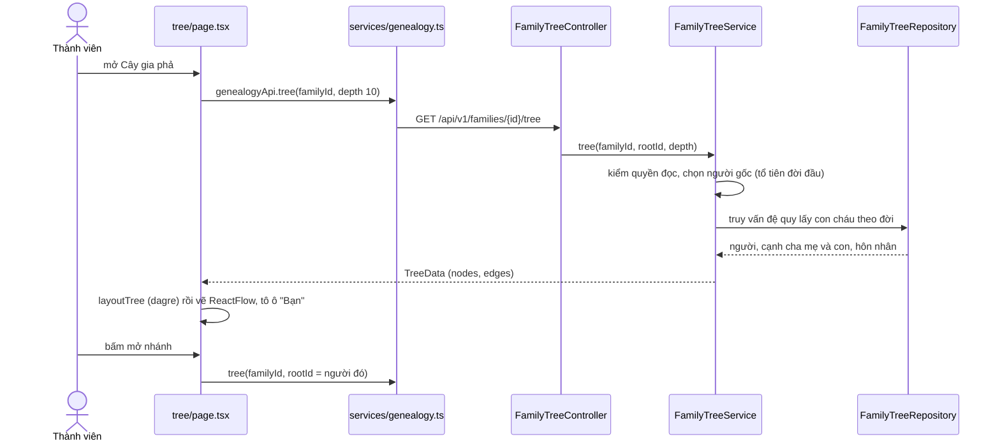
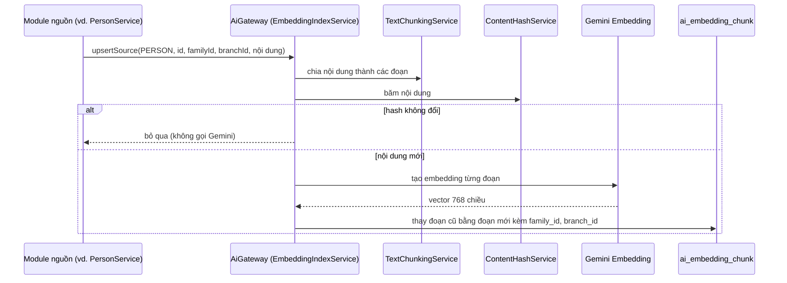
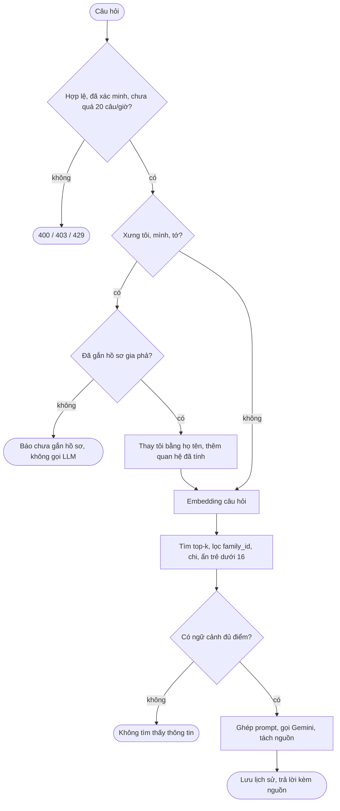
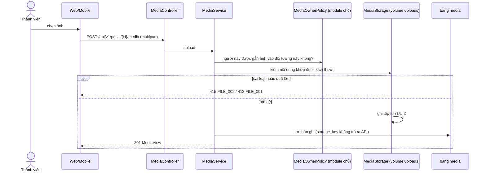
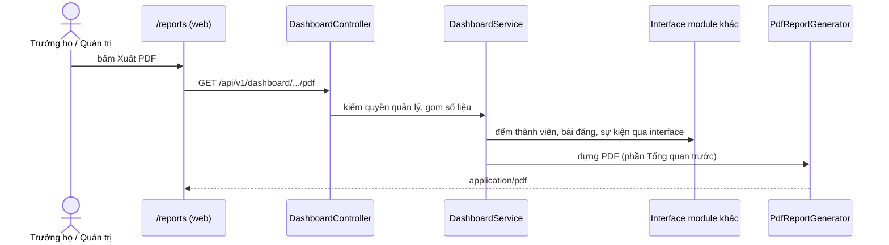
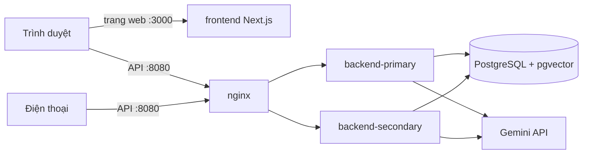

# Hướng dẫn học hệ thống FamilyConnect (chuẩn bị bảo vệ)

**Người soạn:** TV1 Tuấn (SCRUM-131) | **Đối chiếu code:** `develop` ngày 19/11/2026

Tài liệu này giúp từng thành viên trả lời ba loại câu hỏi hội đồng hay hỏi:

1. "Sơ đồ này ai làm, giải thích đi" → mục 1.
2. "Công nghệ X chạy thế nào trong hệ thống" → mục 2 (sequence và lưu đồ hoạt động từng công nghệ).
3. "Cái này trên giao diện nằm ở đâu trong code, mở VS Code chỉ thử" → mục 3.

Sơ đồ chính thức (vẽ draw.io, đen trắng theo quy tắc UML) nằm trong `docs/images/`. Sơ đồ trong tài liệu này viết bằng Mermaid để học nhanh, GitHub tự vẽ.

---

## 1. Sơ đồ nào của ai

| Thành viên | Module phụ trách | Sơ đồ phải giải thích được | File tài liệu gốc |
|---|---|---|---|
| **TV1 Tuấn** | Auth, Admin (tài khoản, duyệt thành viên, quản trị, sao lưu, cấu hình); nhận lại báo cáo Gia phả từ 15/11 | Use Case Auth (`auth-usecase`), Class Auth (`class-auth`), ERD Auth (`erd-auth`), Sequence đăng nhập (`architecture-sequence-login`), Quy trình 1: đăng ký, xin vào gia đình, duyệt (`business-process-1`); người vẽ cả 5 Class Diagram | `auth.md`, `srs.md`, `privacy.md`, `class-diagram.md`, `test-plan.md` |
| **TV2 Trí** | Gia phả (gia đình, chi, thành viên, quan hệ, cây, xưng hô) | Use Case Gia phả (`genealogy-usecase`), Class Gia phả (`class-genealogy`), ERD Gia phả (`erd-genealogy`), ERD tổng (`erd-full`, `erd.png`), Quy trình 2: thêm thành viên và quan hệ (`business-process-2`), lưu đồ thuật toán xưng hô (mục 2.5) | `genealogy.md`, `algorithm-relationship.md`, `erd.md`, `data-dictionary.md` |
| **TV3 PiLo257** | Cộng đồng (bài đăng, bình luận, cảm xúc, ảnh, thông báo) và Sự kiện | Use Case Community/Events (`community-events-usecase`), Class Community/Events (`class-community-events`), ERD Community/Events (`erd-community-events`), Quy trình 3: sự kiện, RSVP, nhắc lịch (`business-process-3`) | `community-events.md`, `business-process.md`, `conventions.md` |
| **TV4 Huy Quốc** | Di sản, Danh bạ, Dashboard; kiến trúc, triển khai | Use Case Heritage/Directory/Dashboard (`heritage-directory-dashboard-usecase`), Class Heritage/Directory (`class-heritage-directory`), ERD Heritage/Directory (`erd-heritage-directory`), Sơ đồ thành phần (`architecture-component`), Sơ đồ triển khai (`architecture-deployment`) | `heritage-directory-dashboard.md`, `architecture.md`, `deploy.md` |
| **TV5 Lê Nhựt** | AI (RAG, tìm kiếm ngữ nghĩa, tóm tắt, gợi ý, giải thích quan hệ) và Mobile | Use Case AI (`ai-usecase`), Class AI (`class-ai`), ERD AI (`erd-ai`), Sequence chatbot (`architecture-sequence-chat`), Quy trình 4: hỏi đáp AI (`business-process-4`) | `ai.md`, `ai-rag.md`, `mobile.md` |

**Cách đọc nhanh từng loại sơ đồ khi bị hỏi:**

- **Use Case:** hình người là tác nhân (vai trò), elip là chức năng. «include» là bắt buộc gọi kèm (ví dụ mọi chức năng AI include "Kiểm soát truy cập"), «extend» là có thể mở rộng. Tam giác rỗng là kế thừa (Trưởng chi kế thừa Thành viên nên làm được mọi việc của Thành viên).
- **Class:** 3 ngăn (tên, thuộc tính, phương thức). Thoi đặc là composition (xóa `Post` thì `Comment` mất theo). `{→ Family}` là tham chiếu sang module khác chỉ lưu UUID, không khóa ngoại.
- **ERD:** chân chim là "nhiều", hai gạch là "đúng một", vòng tròn là "có thể không". Chỉ vẽ khóa ngoại trong cùng module; sang module khác ghi `→ bảng (logic)`.
- **Sequence:** đọc từ trên xuống. Thứ tự đối tượng Actor → Boundary (màn hình) → Control (controller, service) → Entity (bảng). Nét liền là gọi, nét đứt là trả về. Khung `alt` là rẽ nhánh, `opt` là có thể có.
- **Activity (lưu đồ):** chấm đen là bắt đầu, chấm đen có vòng là kết thúc, thoi là điều kiện, mỗi làn là một người thực hiện.

---

## 2. Từng công nghệ: chạy thế nào

### 2.1 Spring Security + JWT (đăng nhập, phân quyền)

- **Ở đâu:** `common/security/JwtAuthenticationFilter.java`, `JwtService.java`, `common/config/SecurityConfig.java`, `EndpointRoles.java`; `modules/auth/service/AuthService.java`, `TokenIssuer.java`, `LoginRateLimiter.java`.
- **Ý chính:** access token sống 15 phút, refresh token dài hơn (cấu hình được). Mỗi request mang `Authorization: Bearer <token>`; filter đọc token, gắn người dùng vào SecurityContext. Quyền kiểm tra ở **service** (theo `MembershipQuery`), không chỉ ở controller. Thứ tự lỗi: AUTH_002 (chưa đăng nhập) → AUTH_003 (bị khóa) → PERM_002 (chưa xác minh) → PERM_001 (không đủ quyền).



Sequence đăng nhập chi tiết: `docs/images/architecture-sequence-login.drawio.png` (giới hạn 5 lần/phút, BCrypt, ghi audit).

### 2.2 Next.js 15 + TanStack Query + axios (web)

- **Ở đâu:** `frontend/src/app/**/page.tsx` (mỗi thư mục là một đường dẫn), `frontend/src/services/*.ts` (gọi API), `frontend/src/lib/api.ts` (axios: gắn token, tự refresh khi 401), `frontend/src/middleware.ts` (chưa đăng nhập thì chuyển về `/login`; chỉ xem cookie đánh dấu phiên, quyền thật do backend kiểm).
- **Kiểu dữ liệu** sinh tự động từ OpenAPI (`npm run gen:api` → `services/generated/`), nên frontend và backend luôn khớp tên trường.



### 2.3 React Native + Expo (mobile)

- **Ở đâu:** `mobile/src/screens/*Screen.tsx` (màn hình), `mobile/src/navigation/` (menu drawer và stack), `mobile/src/services/api.ts` (axios, giống web), `mobile/src/services/token-storage.ts` (token lưu bằng `expo-secure-store`: Keychain trên iOS, Keystore trên Android).
- **Khác web:** không có trang quản trị, thống kê (theo `mobile.md` mục 2); điều hướng bằng menu ☰; `EXPO_PUBLIC_API_BASE_URL` trỏ IP LAN của máy chạy backend.



### 2.4 PostgreSQL 16 + Flyway (cơ sở dữ liệu)

- **Ở đâu:** `backend/src/main/resources/db/migration/V1__...sql` đến `V24__...sql`. Flyway chạy khi backend khởi động: phiên bản nào chưa chạy thì chạy theo thứ tự, ghi vào bảng `flyway_schema_history`. **Không sửa migration đã merge**, muốn đổi thì thêm `V25__...`.
- **Quy ước:** tên bảng số ít `snake_case`, mỗi bảng có `created_at`, `updated_at`, `deleted_at` (xóa mềm); khóa ngoại chỉ trong cùng module.


### 2.5 Thuật toán xưng hô (gia phả)

- **Ở đâu:** `modules/genealogy/service/KinshipCalculator.java` (thuật toán), `RelationshipQueryController` (`GET /api/v1/relationships?personA=&personB=`), tài liệu `algorithm-relationship.md`, test `RelationshipCaseCatalogTest` (51 trường hợp).
- **Ý chính:** tìm **tổ tiên chung gần nhất** (LCA) của A và B bằng cách đi ngược cha mẹ tối đa 30 đời; số đời mỗi bên quyết định tên gọi (1 đời trên là cha/mẹ, 2 đời là ông/bà; khác nhánh là chú, bác, cô, anh họ...). Bước đầu đi qua cha thì "nội", qua mẹ thì "ngoại". Không có huyết thống thì thử qua hôn nhân (dâu, rể, vợ cũ).



### 2.6 React Flow (vẽ cây gia phả trên web)

- **Ở đâu:** `frontend/src/app/families/[id]/tree/page.tsx` dùng `<ReactFlow>` của thư viện `@xyflow/react`; bố cục bằng `components/genealogy/tree-layout.ts` (thư viện dagre, thế hệ trên ở trên); mỗi ô là `components/genealogy/PersonNode.tsx`; bấm một người mở `PersonPanel.tsx`.
- **Tải lười:** lần đầu tải 10 đời từ người gốc; mở nhánh thì gọi thêm `GET /families/{id}/tree?rootId=...`. Cây 500 người dưới 500 ms (`FamilyTreeApiIntegrationTest`).



### 2.7 pgvector + Gemini Embedding (lập chỉ mục cho AI)

- **Ở đâu:** module nào đổi dữ liệu thì gọi interface `AiGateway.upsertSource(...)` (ví dụ `PersonService`, `HeritageService`, `EventAccess`, `ModulePlatformAdapter` của community); hiện thực ở `modules/ai/service/EmbeddingIndexService.java` → `TextChunkingService` (chia đoạn) → `ContentHashService` (bỏ qua nếu nội dung không đổi) → `EmbeddingPipelineService` (gọi Gemini `gemini-embedding-001`, 768 chiều) → bảng `ai_embedding_chunk` (cột `vector(768)`, chỉ mục HNSW).
- **Vì sao chia như vậy:** module nguồn không biết gì về AI, chỉ gọi interface (kiến trúc modular monolith).



### 2.8 RAG với Gemini (trợ lý AI)

- **Ở đâu:** `AiChatController` → `ChatService.chat` (`modules/ai/service/ChatService.java` dòng 79–154) → `EmbeddingChunkRepository` (tìm top-k cosine) → `ChatLanguageModel` (Gemini `gemini-3.5-flash-lite`) → `ChatRepository` (lưu lịch sử).
- **Sơ đồ chính thức:** sequence `architecture-sequence-chat.drawio.png` và lưu đồ `business-process-4.drawio.png`.
- **Chống bịa:** chỉ đưa ngữ cảnh người hỏi được xem; không có ngữ cảnh thì trả "Không tìm thấy thông tin." mà không gọi LLM; quan hệ họ hàng do thuật toán mục 2.5 tính sẵn, LLM chỉ diễn đạt; câu "tôi là ai" dùng hồ sơ gắn tài khoản (BR-AI-17).



### 2.9 Tải tệp (ảnh, PDF)

- **Ở đâu:** `modules/community/media/MediaController.java`, `MediaService.java`, `MediaStorage.java` (kiểm loại tệp bằng nội dung tệp phải khớp đuôi, lưu ổ đĩa với tên UUID), `MediaUploadExceptionHandler.java`. Ảnh jpg/png/webp tối đa 5 MB (413 FILE_001 nếu quá, 415 FILE_002 nếu sai loại); PDF tối đa 10 MB chỉ cho Di sản. Tệp chỉ lấy qua API có kiểm quyền (`GET /media/{id}/content`), không có đường dẫn công khai.



### 2.10 Spring Scheduler (nhắc lịch sự kiện)

- **Ở đâu:** `modules/events/service/EventReminderScheduler.java` (`@Scheduled`, mặc định mỗi 60 giây), `JdbcReminderStore` (tìm sự kiện sắp diễn ra và người nhận), `NotificationService` (tạo thông báo). Khi chạy 2 bản backend (HA), chỉ `backend-primary` bật nhắc lịch (`HA_REMINDERS_ENABLED`) để không gửi đôi.


### 2.11 Báo cáo PDF (PDFBox) và CSV

- **Ở đâu:** `DashboardController` (thống kê, xuất CSV, xuất PDF), `DashboardService`, `PdfReportGenerator` (Apache PDFBox, nhúng font Unicode để có dấu tiếng Việt). CSV có BOM UTF-8, chèn `'` trước ô bắt đầu bằng `=`, `+`, `-`, `@` để chống CSV Injection; trẻ dưới 16 chỉ có id, họ tên, quan hệ, năm sinh.



### 2.12 Docker Compose + Nginx (triển khai, High Availability)

- **Ở đâu:** `docker-compose.yml` (db, backend, frontend), `docker-compose.ha.yml` (nginx + `backend-primary` + `backend-secondary`), `docker/nginx/ha.conf`. Sơ đồ chính thức: `architecture-deployment.drawio.png`.
- **HA mức cơ bản:** 2 bản backend dùng chung DB, ổ uploads, backups và bộ đếm giới hạn tần suất (bảng `ha_rate_limit_*`); nginx bỏ bản lỗi sau 3 giây. Thử tắt một bản: 30/30 request vẫn 200 (`high-availability-7-11.md`). DB vẫn là một bản (điểm lỗi đơn, đã ghi trong hạn chế).



### 2.13 Sao lưu và khôi phục

- **Ở đâu:** `modules/auth/service/BackupService.java`, `BackupController` (`/api/v1/admin/...`), chỉ SYSTEM_ADMIN. Sao lưu bằng `pg_dump` vào volume `backups`; khôi phục bằng `pg_restore` sau khi kiểm phiên bản Flyway của bản sao lưu khớp DB đang chạy (khác thì dừng trước khi đổi dữ liệu). Hướng dẫn: `docs/07-deploy/backup-restore.md`.

---

## 3. Đọc frontend: thứ trên giao diện nằm ở đâu trong code

### 3.1 Quy tắc tìm file (Next.js App Router)

Đường dẫn trên thanh địa chỉ = thư mục trong `frontend/src/app/`. `[id]` là tham số động.

| Trên trình duyệt | File trang | Gọi API qua | Backend xử lý |
|---|---|---|---|
| `/login` | `app/login/page.tsx` | `services/auth.ts` | `AuthController.login` → `AuthService` |
| `/families/{id}/tree` (Cây gia phả) | `app/families/[id]/tree/page.tsx` | `services/genealogy.ts` → `tree()` | `FamilyTreeController` → `FamilyTreeService` |
| `/relationship` (Tra cứu xưng hô) | `app/relationship/page.tsx` | `services/genealogy.ts` → `relationship()` | `RelationshipQueryController` → `KinshipCalculator` |
| `/members` (Thành viên) | `app/members/page.tsx` | `services/genealogy.ts` | `GenealogyController` → `PersonService` |
| `/persons/{id}` (Trang cá nhân) | `app/persons/[personId]/page.tsx` | `services/genealogy.ts`, `services/community/posts.ts` | `GenealogyController`, `CommunityController` |
| `/community` (Bảng tin) | `app/community/page.tsx` + `components/community/PostInteractions.tsx` | `services/community/posts.ts` | `CommunityController` → `CommunityService` |
| `/events` | `app/events/page.tsx` | `services/events/` | `EventController` → `EventService` |
| `/directory` (Danh bạ) | `app/directory/page.tsx` | `services/directory.ts` | `DirectoryController` → `DirectoryService` |
| `/heritage/...` (Di sản) | `app/heritage/**/page.tsx` | `services/heritage.ts` | `HeritageController` |
| `/assistant` (Trợ lý AI) | `app/assistant/page.tsx` | `services/ai.ts` | `AiChatController` → `ChatService` |
| `/search` (Tìm kiếm) | `app/search/page.tsx` | `services/semantic-search.ts` | `AiSearchController` → `SemanticSearchService` |
| `/dashboard`, `/reports` | `app/dashboard/page.tsx`, `app/reports/page.tsx` | `services/dashboard.ts` | `DashboardController` |
| `/admin/{mục}` (Quản trị) | `app/admin/[section]/page.tsx` + `components/admin/AdminConsole.tsx` | `services/admin.ts` | `AdminController`, `BackupController`, `SystemConfigController` |
| Chuông thông báo (header) | `components/layout/NotificationBell.tsx` | `services/notifications.ts` | `NotificationController` |
| Khung trang, menu trái | `components/layout/AppShell.tsx`, `lib/nav.ts` | | |

Mobile: màn hình ở `mobile/src/screens/` cùng tên chức năng (`FamilyTreeScreen.tsx`, `FeedScreen.tsx`, `PostDetailScreen.tsx`, `PersonDetailScreen.tsx`, `AiChatScreen.tsx`...), menu ở `mobile/src/navigation/AppDrawer.tsx`.

### 3.2 Bài tập mẫu: "Cây gia phả trên UI nằm ở đâu?"

Làm theo đúng thứ tự này trước mặt thầy:

1. **Nhìn thanh địa chỉ:** `localhost:3000/families/8f84.../tree` → thư mục `app/families/[id]/tree/`.
2. **Mở file:** trong VS Code bấm `Ctrl+P`, gõ `tree/page`, chọn `frontend/src/app/families/[id]/tree/page.tsx`.
3. **Chỉ chỗ lấy dữ liệu:** dòng 68 `useQuery({ queryKey: ['tree', familyId], queryFn: () => genealogyApi.tree(familyId, { depth: 10 }) })`.
4. **Chỉ chỗ vẽ:** tìm `<ReactFlow` (khoảng dòng 215), giải thích nodes, edges đến từ `layoutTree` trong `components/genealogy/tree-layout.ts`.
5. **Chỉ một ô người:** giữ `Ctrl` bấm vào `PersonNode` ở dòng import → mở `components/genealogy/PersonNode.tsx` (ô "Bạn" tô màu khi `isMe`).
6. **Đi xuống backend:** `Ctrl+Click` vào `genealogyApi.tree` → `services/genealogy.ts` dòng 29 gọi `/families/{familyId}/tree`. Bấm `Ctrl+Shift+F`, gõ `/families/{familyId}/tree` → `FamilyTreeController.java` dòng 25 → `FamilyTreeService.tree` dòng 54.

Số dòng đúng tại `develop` ngày 19/11/2026; code đổi thì tìm theo tên hàm.

### 3.3 Mẹo tìm nhanh bất kỳ thứ gì

| Muốn tìm | Cách làm trong VS Code |
|---|---|
| Một chữ đang thấy trên màn hình, ví dụ "Chỉnh sửa hồ sơ" | `Ctrl+Shift+F`, gõ đúng chữ đó, giới hạn thư mục `frontend/src` (hoặc `mobile/src`) |
| File theo tên | `Ctrl+P`, gõ một phần tên |
| Hàm này được định nghĩa ở đâu | Đặt con trỏ, bấm `F12` (hoặc `Ctrl+Click`) |
| Hàm này được gọi ở đâu | `Shift+F12` |
| API này backend nào xử lý | `Ctrl+Shift+F` đường dẫn API (ví dụ `/posts/{id}/comments`) trong `backend/src/main/java` |
| Quy tắc nghiệp vụ (BR-...) nằm ở code nào | `Ctrl+Shift+F` mã quy tắc, ví dụ `BR-GEN-20`: ra cả tài liệu và chú thích trong code |

### 3.4 Cấu trúc một trang web điển hình

```text
app/<đường dẫn>/page.tsx      ← trang: gọi useQuery/useMutation, ghép component
components/<module>/*.tsx      ← mảnh giao diện dùng lại (PersonNode, PostInteractions...)
services/<module>.ts           ← hàm gọi API (genealogyApi, communityApi...)
services/generated/*.ts        ← kiểu dữ liệu sinh từ OpenAPI (không sửa tay)
lib/api.ts                     ← axios: gắn token, xử lý 401, chuẩn hóa lỗi
tailwind.config.ts             ← màu, cỡ chữ theo design-system.md
```

---

## 4. Câu hỏi hay gặp (trả lời ngắn)

| Câu hỏi | Trả lời |
|---|---|
| Vì sao chọn modular monolith, không microservices? | Nhóm 5 người, một CSDL, triển khai đơn giản; vẫn tách module bằng interface trong gói `api` nên sau này tách dịch vụ được. |
| Module gọi nhau thế nào? | Qua interface Java (`MembershipQuery`, `GenealogyPort`, `AiGateway`...), không join bảng của module khác; tham chiếu chéo chỉ lưu UUID. |
| Làm sao chặn xem dữ liệu gia đình khác (IDOR)? | Mọi truy vấn lọc `family_id` theo membership của người gọi, kiểm ở service; có test gia đình A gọi dữ liệu gia đình B bị từ chối. |
| AI có bịa không? | Chỉ trả lời từ ngữ cảnh đã truy xuất; không có thì "Không tìm thấy thông tin."; đánh giá 40/40 câu trên dữ liệu giả (`ai-quality-scrum-69.md`). |
| Trẻ em được bảo vệ thế nào? | Dưới 16 tuổi: thành viên thường chỉ thấy tên, quan hệ, năm sinh; không có tài khoản; không đưa vào ngữ cảnh gửi AI (`privacy.md`). |
| Ai được sửa thông tin cá nhân? | Hồ sơ đã gắn tài khoản chỉ chính chủ sửa (BR-GEN-20); trưởng chi, trưởng họ chỉ nhập thay người chưa có tài khoản. |
| Vì sao kiểu dữ liệu frontend không bị lệch backend? | Sinh từ OpenAPI bằng `npm run gen:api`; CI kiểm "generated types must match". |
| Test thế nào? | Backend 483 test (JUnit, Mockito, test tích hợp trên PostgreSQL thật) chạy trong CI; web lint, typecheck, build; đo tải k6; thử HA tắt một bản backend. |
