# Hướng dẫn học hệ thống FamilyConnect (chuẩn bị bảo vệ)

**Người soạn:** TV1 Tuấn (SCRUM-131) | **Đối chiếu code:** `develop` ngày 19/11/2026

Tài liệu này giúp từng thành viên trả lời ba loại câu hỏi hội đồng hay hỏi:

1. "Sơ đồ này ai làm, giải thích đi" → mục 1.
2. "Công nghệ X chạy thế nào trong hệ thống" → mục 2 (sequence và lưu đồ hoạt động từng công nghệ).
3. "Cái này trên giao diện nằm ở đâu trong code, mở VS Code chỉ thử" → mục 3.
4. "Em làm phần nào, làm như thế nào" → mục 5 (phần Auth và Admin của TV1 Tuấn); các thành viên khác viết phần của mình theo cùng khung.

Từ tiếng Anh khó hiểu xem bảng thuật ngữ ở mục 0. Sơ đồ chính thức (vẽ bằng draw.io, đen trắng theo quy tắc UML) nằm trong `docs/images/`. Sơ đồ trong tài liệu này viết bằng Mermaid (ngôn ngữ vẽ sơ đồ bằng chữ, GitHub tự vẽ ra hình) để học nhanh; dưới mỗi sơ đồ có đoạn **Đọc sơ đồ bằng lời** để nói lại trước hội đồng.

---

## 0. Bảng thuật ngữ (tiếng Anh → tiếng Việt)

| Thuật ngữ | Nghĩa trong hệ thống này |
|---|---|
| Backend / Frontend | Phần máy chủ (xử lý nghiệp vụ, đọc ghi cơ sở dữ liệu) / phần giao diện người dùng nhìn thấy (web, ứng dụng điện thoại) |
| API, REST API | Cổng để giao diện nói chuyện với máy chủ qua HTTP. REST là cách đặt địa chỉ theo "tài nguyên" (`/families/{id}/tree`) và dùng phương thức GET (đọc), POST (tạo), PUT/PATCH (sửa), DELETE (xóa) |
| Endpoint | Một địa chỉ API cụ thể, ví dụ `POST /api/v1/auth/login` |
| Request / Response | Yêu cầu giao diện gửi lên / phản hồi máy chủ trả về |
| Envelope | "Phong bì" bọc mọi phản hồi: `{ success, data, meta }` khi thành công, `{ success: false, error: { code, message, details } }` khi lỗi |
| Token, access token, refresh token | "Vé" chứng minh đã đăng nhập. Access token: vé ngắn hạn (15 phút) gửi kèm mọi request. Refresh token: vé dài hạn (7 ngày) chỉ dùng để đổi lấy cặp vé mới |
| JWT (JSON Web Token) | Chuẩn vé có chữ ký số: máy chủ ký bằng khóa bí mật, ai sửa nội dung thì chữ ký sai |
| Claims | Các thông tin ghi trong JWT: mã người dùng (`sub`), vai trò (`roles`), lúc cấp (`iat`), lúc hết hạn (`exp`) |
| Hash (băm) | Biến đổi một chiều, không giải ngược được. BCrypt: thuật toán băm mật khẩu cố ý chậm và có "muối" (chuỗi ngẫu nhiên) để chống dò. SHA-256: thuật toán băm nhanh, dùng cho refresh token |
| Authentication / Authorization | Xác thực (bạn là ai: đăng nhập) / phân quyền (bạn được làm gì) |
| RBAC (Role-Based Access Control) | Phân quyền theo vai trò: GUEST (khách), MEMBER (thành viên), BRANCH_ADMIN (trưởng chi, trưởng họ), SYSTEM_ADMIN (quản trị hệ thống) |
| IDOR (Insecure Direct Object Reference) | Lỗ hổng xem được dữ liệu người khác chỉ bằng cách đổi mã trên URL |
| Filter | Bộ lọc chạy trước khi request tới controller (ví dụ đọc token) |
| Controller / Service / Repository | Ba lớp của backend: Controller nhận request và trả response; Service chứa nghiệp vụ và kiểm quyền; Repository đọc ghi cơ sở dữ liệu |
| Entity / DTO | Entity: lớp Java ánh xạ một bảng. DTO (Data Transfer Object): lớp chỉ chở dữ liệu ra vào API, không lộ cột nội bộ như `password_hash` |
| Migration | Tệp SQL đánh số phiên bản (`V1__...sql`) dùng để tạo, đổi cấu trúc cơ sở dữ liệu |
| Modular monolith | Một ứng dụng backend duy nhất nhưng chia module rõ ràng, module gọi nhau qua interface |
| Interface / Port | "Hợp đồng" liệt kê các hàm một module cho module khác gọi (ví dụ `MembershipQuery`); Port là interface đứng ở ranh giới module |
| Transaction (giao dịch) | Nhóm thao tác ghi cơ sở dữ liệu: hoặc thành công hết, hoặc hủy hết (`@Transactional`) |
| Cache | Bộ nhớ đệm, giữ tạm kết quả để khỏi tính hay đọc lại |
| Rate limit | Giới hạn số lần gọi trong một khoảng thời gian (ví dụ 5 lần đăng nhập mỗi phút) |
| Audit log | Nhật ký kiểm toán: ai làm gì, lúc nào, với đối tượng nào, từ IP nào |
| Backup / Restore | Sao lưu / khôi phục dữ liệu |
| HA (High Availability) | Tính sẵn sàng cao: một máy chủ hỏng thì máy kia vẫn phục vụ |
| Nginx, reverse proxy, load balancer | Nginx đứng trước backend, nhận request rồi chia cho các bản backend (chia tải) |
| Docker, image, container, volume | Docker đóng gói ứng dụng thành image (khuôn), chạy ra container (bản đang chạy); volume là ổ dữ liệu giữ lại khi container bị xóa |
| CI (Continuous Integration) | Tích hợp liên tục: mỗi lần đẩy code hay mở Pull Request, GitHub tự build và chạy test |
| Pull Request (PR) | Yêu cầu gộp code từ nhánh của mình vào nhánh chung, có người khác duyệt |
| Embedding, vector | Dãy số (ở đây 768 số) biểu diễn ý nghĩa của một đoạn văn; hai đoạn cùng ý thì vector gần nhau |
| Cosine similarity | Độ giống nhau giữa hai vector (gần 1 là rất giống) |
| LLM (Large Language Model) | Mô hình ngôn ngữ lớn, ở đây là Gemini |
| RAG (Retrieval-Augmented Generation) | Truy xuất rồi mới sinh câu trả lời: tìm đoạn dữ liệu liên quan trước, đưa cho LLM, LLM chỉ trả lời dựa trên đó |
| Prompt | Đoạn chỉ dẫn và ngữ cảnh gửi cho LLM |
| Hook (React) | Hàm đặc biệt của React bắt đầu bằng `use` (ví dụ `useQuery`) |
| Query / Mutation (TanStack Query) | Query: đọc dữ liệu (có bộ nhớ đệm). Mutation: ghi dữ liệu (tạo, sửa, xóa) |
| Lazy loading (tải lười) | Chỉ tải phần đang cần, phần còn lại tải khi người dùng mở ra |
| Use Case / Class / ERD / Sequence / Activity diagram | Sơ đồ chức năng / sơ đồ lớp / sơ đồ thực thể quan hệ (bảng và khóa) / sơ đồ tuần tự (ai gọi ai theo thời gian) / lưu đồ hoạt động |

---

## 1. Sơ đồ nào của ai

| Thành viên | Module phụ trách | Sơ đồ phải giải thích được | File tài liệu gốc |
|---|---|---|---|
| **TV1 Tuấn** | Auth, Admin (tài khoản, duyệt thành viên, quản trị, sao lưu, cấu hình); nhận lại báo cáo Gia phả từ 15/11 | Use Case Auth (`auth-usecase`), Class Auth (`class-auth`), ERD Auth (`erd-auth`), Sequence đăng nhập (`architecture-sequence-login`), Quy trình 1: đăng ký, xin vào gia đình, duyệt (`business-process-1`); người vẽ cả 5 Class Diagram | `auth.md`, `srs.md`, `privacy.md`, `class-diagram.md`, `test-plan.md` |
| **TV2 Trí** | Gia phả (gia đình, chi, thành viên, quan hệ, cây, xưng hô) | Use Case Gia phả (`genealogy-usecase`), Class Gia phả (`class-genealogy`), ERD Gia phả (`erd-genealogy`), ERD tổng (`erd-full`, `erd.png`), Quy trình 2: thêm thành viên và quan hệ (`business-process-2`), lưu đồ thuật toán xưng hô (mục 2.5) | `genealogy.md`, `algorithm-relationship.md`, `erd.md`, `data-dictionary.md` |
| **TV3 PiLo257** | Cộng đồng (bài đăng, bình luận, cảm xúc, ảnh, thông báo) và Sự kiện | Use Case Community/Events (`community-events-usecase`), Class Community/Events (`class-community-events`), ERD Community/Events (`erd-community-events`), Quy trình 3: sự kiện, RSVP, nhắc lịch (`business-process-3`) | `community-events.md`, `business-process.md`, `conventions.md` |
| **TV4 Huy Quốc** | Di sản, Danh bạ, Dashboard; kiến trúc, triển khai | Use Case Heritage/Directory/Dashboard (`heritage-directory-dashboard-usecase`), Class Heritage/Directory (`class-heritage-directory`), ERD Heritage/Directory (`erd-heritage-directory`), Sơ đồ thành phần (`architecture-component`), Sơ đồ triển khai (`architecture-deployment`) | `heritage-directory-dashboard.md`, `architecture.md`, `deploy.md` |
| **TV5 Lê Nhựt** | AI (RAG, tìm kiếm ngữ nghĩa, tóm tắt, gợi ý, giải thích quan hệ) và Mobile | Use Case AI (`ai-usecase`), Class AI (`class-ai`), ERD AI (`erd-ai`), Sequence chatbot (`architecture-sequence-chat`), Quy trình 4: hỏi đáp AI (`business-process-4`) | `ai.md`, `ai-rag.md`, `mobile.md` |

**Cách đọc nhanh từng loại sơ đồ khi bị hỏi:**

- **Use Case:** hình người là tác nhân (vai trò), elip là chức năng. «include» là bắt buộc gọi kèm (ví dụ mọi chức năng AI include "Kiểm soát truy cập"), «extend» là có thể mở rộng. Tam giác rỗng là kế thừa (Trưởng chi kế thừa Thành viên nên làm được mọi việc của Thành viên).
- **Class:** 3 ngăn (tên, thuộc tính, phương thức). Thoi đặc là composition (xóa `Post` thì `Comment` mất theo). `{→ Family}` là tham chiếu sang module khác chỉ lưu UUID, không khóa ngoại.
- **ERD:** chân chim là "nhiều", hai gạch là "đúng một", vòng tròn là "có thể không". Chỉ vẽ khóa ngoại trong cùng module; sang module khác ghi `→ bảng (logic)`.
- **Sequence:** đọc từ trên xuống. Thứ tự đối tượng Actor → Boundary (màn hình) → Control (controller, service) → Entity (bảng). Nét liền là gọi, nét đứt là trả về. Khung `alt` là rẽ nhánh, `opt` là có thể có.
- **Activity (lưu đồ):** chấm đen là bắt đầu, chấm đen có vòng là kết thúc, thoi là điều kiện, mỗi làn là một người thực hiện.

---

## 2. Từng công nghệ: chạy thế nào

### 2.1 Spring Security + JWT (đăng nhập, phân quyền)

- **Ở đâu:** `common/security/JwtAuthenticationFilter.java`, `JwtService.java`, `common/config/SecurityConfig.java`, `EndpointRoles.java`; `modules/auth/service/AuthService.java`, `TokenIssuer.java`, `LoginRateLimiter.java`.
- **Ý chính:** access token sống 15 phút, refresh token dài hơn (cấu hình được). Mỗi request mang `Authorization: Bearer <token>`; filter đọc token, gắn người dùng vào SecurityContext. Quyền kiểm tra ở **service** (theo `MembershipQuery`), không chỉ ở controller. Thứ tự lỗi: AUTH_002 (chưa đăng nhập) → AUTH_003 (bị khóa) → PERM_002 (chưa xác minh) → PERM_001 (không đủ quyền).

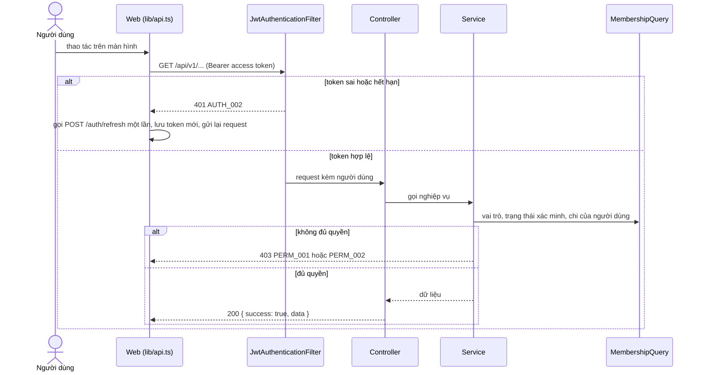

**Đọc sơ đồ bằng lời.** Người dùng bấm một nút trên web. Lớp `lib/api.ts` gửi request lên backend, kèm access token trong header `Authorization`. Request đi qua bộ lọc `JwtAuthenticationFilter` trước tiên. Nếu token sai chữ ký hoặc đã hết hạn, backend trả `401 AUTH_002`; lúc đó web tự gọi `POST /auth/refresh` đúng một lần để đổi cặp token mới, lưu lại rồi gửi lại request cũ, người dùng không thấy gì. Nếu token hợp lệ, bộ lọc tra trạng thái tài khoản (bị khóa thì đánh dấu để trả `AUTH_003`), gắn người dùng vào ngữ cảnh bảo mật của request rồi cho đi tiếp tới Controller. Controller không tự quyết quyền mà gọi Service; Service hỏi `MembershipQuery` "người này thuộc gia đình nào, vai trò gì, đã được duyệt chưa". Thiếu điều kiện thì trả `403 PERM_002` (chưa được duyệt) hoặc `PERM_001` (không đủ quyền); đủ thì trả `200` với dữ liệu bọc trong `{ success: true, data }`.

Sequence đăng nhập chi tiết: `docs/images/architecture-sequence-login.drawio.png` (giới hạn 5 lần/phút, BCrypt, ghi audit), giải thích ở mục 5.3.

### 2.2 Next.js 15 + TanStack Query + axios (web)

- **Ở đâu:** `frontend/src/app/**/page.tsx` (mỗi thư mục là một đường dẫn), `frontend/src/services/*.ts` (gọi API), `frontend/src/lib/api.ts` (axios: gắn token, tự refresh khi 401), `frontend/src/middleware.ts` (chưa đăng nhập thì chuyển về `/login`; chỉ xem cookie đánh dấu phiên, quyền thật do backend kiểm).
- **Kiểu dữ liệu** sinh tự động từ OpenAPI (`npm run gen:api` → `services/generated/`), nên frontend và backend luôn khớp tên trường.

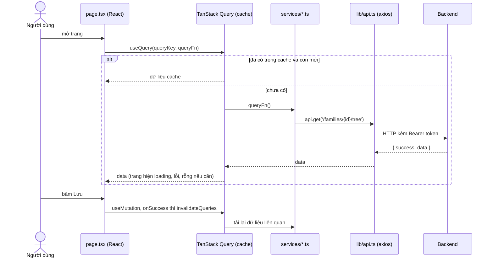

**Đọc sơ đồ bằng lời.** Mỗi trang web là một file `page.tsx` (React). Khi mở trang, trang không gọi API trực tiếp mà nhờ TanStack Query qua hook `useQuery`, kèm một "khóa" (`queryKey`, ví dụ `['tree', familyId]`) và một hàm lấy dữ liệu. TanStack Query xem trong bộ nhớ đệm: có dữ liệu còn mới thì trả ngay, không gọi mạng; chưa có thì chạy hàm lấy dữ liệu ở `services/*.ts`, hàm này gọi axios ở `lib/api.ts`, axios gắn token và gửi HTTP lên backend. Trong lúc chờ, trang hiện trạng thái đang tải; lỗi thì hiện thông báo lỗi; rỗng thì hiện trạng thái rỗng. Khi người dùng bấm Lưu, trang dùng `useMutation` để ghi; ghi xong thì `invalidateQueries` đánh dấu dữ liệu cũ là hết hạn, TanStack Query tự tải lại, nên màn hình luôn khớp dữ liệu mới.

**Next.js chạy thế nào.** Next.js 15 dùng App Router: mỗi thư mục trong `frontend/src/app/` là một đường dẫn. `npm run build` biên dịch TypeScript, kiểm lỗi kiểu và đóng gói; container `frontend` chạy bản đã build ở cổng 3000. File `middleware.ts` chạy trước mỗi trang: chưa có cookie đánh dấu phiên thì chuyển về `/login`. Đây chỉ là tiện lợi cho giao diện; quyền thật luôn do backend kiểm.

### 2.3 React Native + Expo (mobile)

- **Ở đâu:** `mobile/src/screens/*Screen.tsx` (màn hình), `mobile/src/navigation/` (menu drawer và stack), `mobile/src/services/api.ts` (axios, giống web), `mobile/src/services/token-storage.ts` (token lưu bằng `expo-secure-store`: Keychain trên iOS, Keystore trên Android).
- **Khác web:** không có trang quản trị, thống kê (theo `mobile.md` mục 2); điều hướng bằng menu ☰; `EXPO_PUBLIC_API_BASE_URL` trỏ IP LAN của máy chạy backend.


**Đọc sơ đồ bằng lời.** Khi mở app, việc đầu tiên là xem trong kho bảo mật của điện thoại (`expo-secure-store`) đã có token chưa. Chưa có thì hiện màn Đăng nhập; đăng nhập xong thì lưu token vào kho đó. Có token rồi thì app gọi `/users/me` (tôi là ai) và `/users/me/membership` (tôi đã thuộc gia đình nào chưa). Tùy trạng thái gia đình mà app rẽ ba hướng: chưa xin vào gia đình thì hiện màn Xin vào gia đình; đã xin nhưng chưa được duyệt thì hiện màn Đang chờ duyệt; đã được duyệt thì mở menu ngăn kéo (drawer, menu trượt từ cạnh trái, bấm ☰) với các chức năng chính.

**Thư viện mobile khác.** React Navigation: điều hướng giữa các màn (drawer là menu ngăn kéo, native-stack là chồng màn hình, mở màn mới đè lên màn cũ, bấm quay lại thì gỡ ra). `expo-image-picker`: chọn ảnh trong máy hoặc chụp ảnh để đăng bài, đổi ảnh đại diện. `expo-file-system`: tải tệp PDF di sản về máy để mở. react-hook-form và zod: form và kiểm tra dữ liệu giống web. Bản cài trên máy là APK dev build (bản cài thử) do Expo tạo; `EXPO_PUBLIC_API_BASE_URL` trỏ tới IP mạng LAN của máy chạy backend.

### 2.4 PostgreSQL 16 + Flyway (cơ sở dữ liệu)

- **Ở đâu:** `backend/src/main/resources/db/migration/V1__...sql` đến `V24__...sql`. Flyway chạy khi backend khởi động: phiên bản nào chưa chạy thì chạy theo thứ tự, ghi vào bảng `flyway_schema_history`. **Không sửa migration đã merge**, muốn đổi thì thêm `V25__...`.
- **Quy ước:** tên bảng số ít `snake_case`, mỗi bảng có `created_at`, `updated_at`, `deleted_at` (xóa mềm); khóa ngoại chỉ trong cùng module.

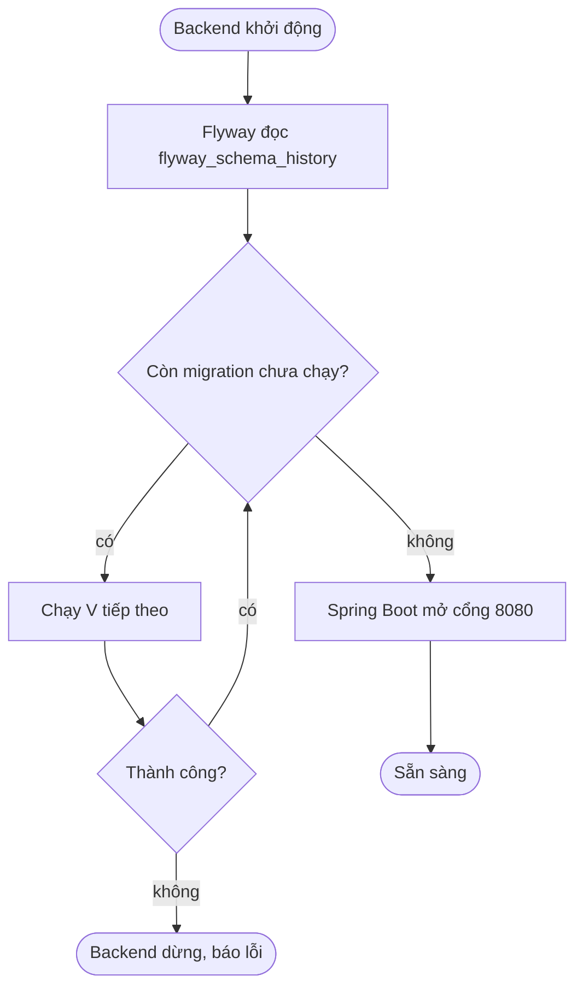

**Đọc sơ đồ bằng lời.** Mỗi lần backend khởi động, Flyway đọc bảng `flyway_schema_history` để biết cơ sở dữ liệu đang ở phiên bản nào (hiện tại là V24). Còn file migration nào số lớn hơn chưa chạy thì chạy lần lượt từng file. Một file lỗi thì backend dừng luôn và báo lỗi, không chạy với cấu trúc bảng nửa vời. Chạy hết rồi Spring Boot mới mở cổng 8080 nhận request. Nhờ vậy máy nào chạy backend cũng có cùng cấu trúc bảng, không ai phải tạo bảng bằng tay.

**PostgreSQL và pgvector.** PostgreSQL 16 là hệ quản trị cơ sở dữ liệu quan hệ (bảng, khóa chính, khóa ngoại, ràng buộc). pgvector là phần mở rộng thêm kiểu cột `vector(768)` và chỉ mục HNSW (chỉ mục tìm vector gần nhau rất nhanh) cho AI. Trong Docker dùng image `pgvector/pgvector:pg16` có sẵn cả hai.

### 2.5 Thuật toán xưng hô (gia phả)

- **Ở đâu:** `modules/genealogy/service/KinshipCalculator.java` (thuật toán), `RelationshipQueryController` (`GET /api/v1/relationships?personA=&personB=`), tài liệu `algorithm-relationship.md`, test `RelationshipCaseCatalogTest` (51 trường hợp).
- **Ý chính:** tìm **tổ tiên chung gần nhất** (LCA) của A và B bằng cách đi ngược cha mẹ tối đa 30 đời; số đời mỗi bên quyết định tên gọi (1 đời trên là cha/mẹ, 2 đời là ông/bà; khác nhánh là chú, bác, cô, anh họ...). Bước đầu đi qua cha thì "nội", qua mẹ thì "ngoại". Không có huyết thống thì thử qua hôn nhân (dâu, rể, vợ cũ).


**Đọc sơ đồ bằng lời.** Người dùng chọn hai người A và B. Hệ thống kiểm trước hai người có cùng gia đình và người hỏi có quyền xem không; không thì từ chối. Sau đó lần ngược từ A lên cha mẹ, ông bà... tối đa 30 đời, làm tương tự với B, rồi tìm tổ tiên chung gần nhất. Có tổ tiên chung thì đếm A cách tổ tiên đó mấy đời, B cách mấy đời, tra bảng tên gọi; nhìn bước đầu tiên đi lên qua cha hay qua mẹ để biết "nội" hay "ngoại"; có con nuôi, con riêng thì thêm chữ "nuôi", "kế". Không có tổ tiên chung thì thử nối qua hôn nhân (vợ, chồng của người có huyết thống) để ra dâu, rể, dượng, mợ, vợ cũ. Không nối được nữa thì báo chưa xác định được. Kết quả trả về gồm nhãn xưng hô và đường đi để tô sáng trên cây.

### 2.6 React Flow (vẽ cây gia phả trên web)

- **Ở đâu:** `frontend/src/app/families/[id]/tree/page.tsx` dùng `<ReactFlow>` của thư viện `@xyflow/react`; bố cục bằng `components/genealogy/tree-layout.ts` (thư viện dagre, thế hệ trên ở trên); mỗi ô là `components/genealogy/PersonNode.tsx`; bấm một người mở `PersonPanel.tsx`.
- **Tải lười:** lần đầu tải 10 đời từ người gốc; mở nhánh thì gọi thêm `GET /families/{id}/tree?rootId=...`. Cây 500 người dưới 500 ms (`FamilyTreeApiIntegrationTest`).

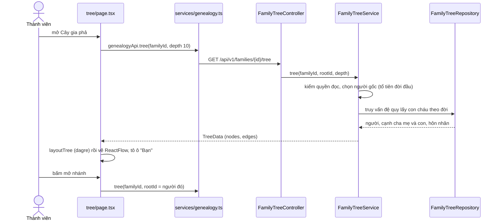

**Đọc sơ đồ bằng lời.** Thành viên mở trang Cây gia phả. Trang gọi hàm `tree` trong `services/genealogy.ts`, hàm này gửi `GET /api/v1/families/{id}/tree` lên `FamilyTreeController`. Controller chuyển cho `FamilyTreeService`; service kiểm quyền đọc gia đình đó, chọn người gốc (tổ tiên đời đầu), rồi nhờ `FamilyTreeRepository` chạy một truy vấn đệ quy (truy vấn tự gọi lại chính nó để lấy con, rồi cháu, rồi chắt...) lấy con cháu theo từng đời. Kết quả là danh sách người (nút) và quan hệ (cạnh). Về tới trình duyệt, hàm `layoutTree` dùng thư viện dagre tính tọa độ từng ô (đời trên ở trên, đời dưới ở dưới), rồi React Flow vẽ ra; ô của chính người xem được tô màu "Bạn". Khi bấm mở một nhánh chưa tải, trang gọi lại API với `rootId` là người đó để lấy thêm phần dưới, chứ không tải cả cây ngay từ đầu.

### 2.7 pgvector + Gemini Embedding (lập chỉ mục cho AI)

- **Ở đâu:** module nào đổi dữ liệu thì gọi interface `AiGateway.upsertSource(...)` (ví dụ `PersonService`, `HeritageService`, `EventAccess`, `ModulePlatformAdapter` của community); hiện thực ở `modules/ai/service/EmbeddingIndexService.java` → `TextChunkingService` (chia đoạn) → `ContentHashService` (bỏ qua nếu nội dung không đổi) → `EmbeddingPipelineService` (gọi Gemini `gemini-embedding-001`, 768 chiều) → bảng `ai_embedding_chunk` (cột `vector(768)`, chỉ mục HNSW).
- **Vì sao chia như vậy:** module nguồn không biết gì về AI, chỉ gọi interface (kiến trúc modular monolith).

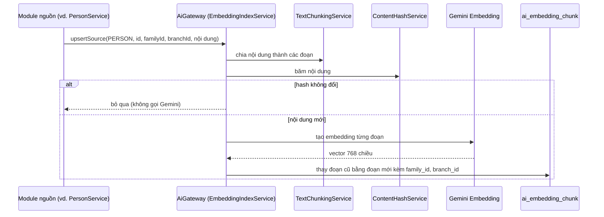

**Đọc sơ đồ bằng lời.** Mỗi khi module khác thêm hay sửa dữ liệu (ví dụ sửa hồ sơ một người), module đó gọi `AiGateway.upsertSource` và đưa nội dung chữ kèm mã gia đình, mã chi. Module AI chia nội dung thành các đoạn ngắn, rồi băm nội dung. Nếu mã băm giống lần trước, tức nội dung không đổi, thì dừng luôn, không gọi Gemini (tiết kiệm tiền và thời gian). Nếu nội dung mới thì gửi từng đoạn cho Gemini để lấy vector 768 số, rồi xóa các đoạn cũ của nguồn đó và ghi các đoạn mới vào bảng `ai_embedding_chunk`, kèm `family_id`, `branch_id` để lúc tìm kiếm lọc đúng phạm vi người hỏi được xem.

### 2.8 RAG với Gemini (trợ lý AI)

- **Ở đâu:** `AiChatController` → `ChatService.chat` (`modules/ai/service/ChatService.java` dòng 79–154) → `EmbeddingChunkRepository` (tìm top-k cosine) → `ChatLanguageModel` (Gemini `gemini-3.5-flash-lite`) → `ChatRepository` (lưu lịch sử).
- **Sơ đồ chính thức:** sequence `architecture-sequence-chat.drawio.png` và lưu đồ `business-process-4.drawio.png`.
- **Chống bịa:** chỉ đưa ngữ cảnh người hỏi được xem; không có ngữ cảnh thì trả "Không tìm thấy thông tin." mà không gọi LLM; quan hệ họ hàng do thuật toán mục 2.5 tính sẵn, LLM chỉ diễn đạt; câu "tôi là ai" dùng hồ sơ gắn tài khoản (BR-AI-17).


**Đọc sơ đồ bằng lời.** Câu hỏi đến, hệ thống kiểm ba điều: nội dung hợp lệ, người hỏi đã được duyệt vào gia đình, chưa vượt 20 câu mỗi giờ. Sai thì trả `400`, `403` hoặc `429` tương ứng. Nếu câu hỏi xưng "tôi", "mình", "tớ" thì xem tài khoản đã gắn với hồ sơ trong gia phả chưa: chưa gắn thì trả lời ngay "chưa biết bạn là ai" mà không gọi LLM; đã gắn thì thay "tôi" bằng họ tên thật và thêm các quan hệ đã tính sẵn bằng thuật toán xưng hô. Sau đó biến câu hỏi thành vector, tìm các đoạn gần nghĩa nhất trong `ai_embedding_chunk`, chỉ lấy đoạn thuộc gia đình và chi người hỏi được xem, bỏ thông tin trẻ dưới 16 tuổi. Không có đoạn nào đủ giống thì trả "Không tìm thấy thông tin." (không để AI tự bịa). Có thì ghép thành prompt, gọi Gemini, tách phần nguồn trích dẫn, lưu lịch sử hội thoại và trả câu trả lời kèm nguồn để người dùng bấm xem.

### 2.9 Tải tệp (ảnh, PDF)

- **Ở đâu:** `modules/community/media/MediaController.java`, `MediaService.java`, `MediaStorage.java` (kiểm loại tệp bằng nội dung tệp phải khớp đuôi, lưu ổ đĩa với tên UUID), `MediaUploadExceptionHandler.java`. Ảnh jpg/png/webp tối đa 5 MB (413 FILE_001 nếu quá, 415 FILE_002 nếu sai loại); PDF tối đa 10 MB chỉ cho Di sản. Tệp chỉ lấy qua API có kiểm quyền (`GET /media/{id}/content`), không có đường dẫn công khai.

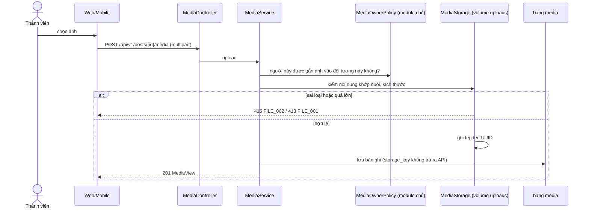

**Đọc sơ đồ bằng lời.** Thành viên chọn ảnh, web hoặc mobile gửi tệp lên dạng multipart (kiểu gửi tệp kèm dữ liệu form). `MediaController` chuyển cho `MediaService`. Service hỏi module chủ của đối tượng (ví dụ module Cộng đồng với bài đăng) "người này có được gắn ảnh vào bài này không" qua `MediaOwnerPolicy`. Rồi `MediaStorage` đọc vài byte đầu của tệp để biết thật sự là ảnh gì, so với đuôi tệp, và kiểm dung lượng: sai loại trả `415 FILE_002`, quá lớn trả `413 FILE_001`. Hợp lệ thì ghi tệp xuống ổ với tên là một UUID ngẫu nhiên (không dùng tên gốc, tránh đoán đường dẫn), lưu một dòng vào bảng `media` và trả `201`. Đường dẫn lưu trên ổ (`storage_key`) không bao giờ trả ra API; muốn xem ảnh phải gọi API có kiểm quyền.

### 2.10 Spring Scheduler (nhắc lịch sự kiện)

- **Ở đâu:** `modules/events/service/EventReminderScheduler.java` (`@Scheduled`, mặc định mỗi 60 giây), `JdbcReminderStore` (tìm sự kiện sắp diễn ra và người nhận), `NotificationService` (tạo thông báo). Khi chạy 2 bản backend (HA), chỉ `backend-primary` bật nhắc lịch (`HA_REMINDERS_ENABLED`) để không gửi đôi.

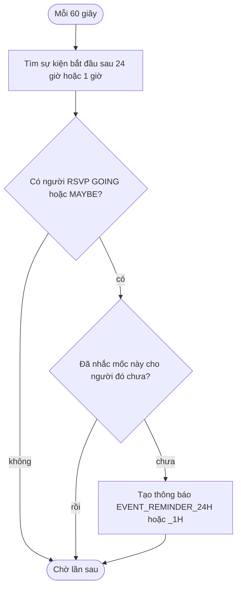

**Đọc sơ đồ bằng lời.** Spring có sẵn bộ hẹn giờ: hàm gắn `@Scheduled` tự chạy mỗi 60 giây, không cần ai bấm. Mỗi lần chạy, hàm tìm các sự kiện sắp bắt đầu sau khoảng 24 giờ hoặc khoảng 1 giờ. Với mỗi sự kiện, lấy những người đã trả lời "Tham gia" hoặc "Có thể". Ai đã được nhắc mốc này rồi thì bỏ qua để không nhắc trùng; ai chưa thì tạo thông báo trong ứng dụng. Xong thì chờ lần chạy sau.

### 2.11 Báo cáo PDF (PDFBox) và CSV

- **Ở đâu:** `DashboardController` (thống kê, xuất CSV, xuất PDF), `DashboardService`, `PdfReportGenerator` (Apache PDFBox, nhúng font Unicode để có dấu tiếng Việt). CSV có BOM UTF-8, chèn `'` trước ô bắt đầu bằng `=`, `+`, `-`, `@` để chống CSV Injection; trẻ dưới 16 chỉ có id, họ tên, quan hệ, năm sinh.

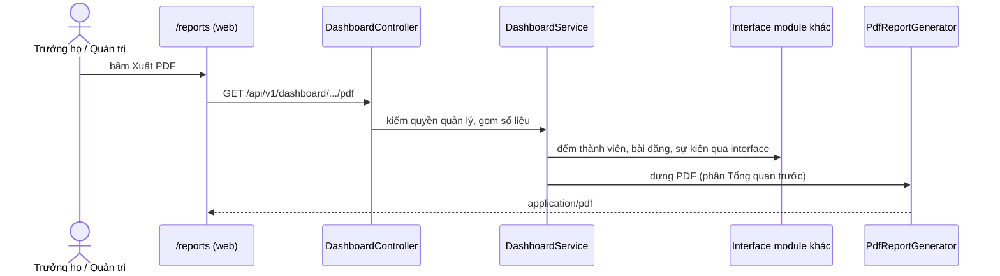

**Đọc sơ đồ bằng lời.** Trưởng họ hoặc quản trị bấm Xuất PDF ở trang `/reports`. Web gọi API của `DashboardController`. `DashboardService` kiểm người này có quyền quản lý gia đình đó không, rồi gom số liệu: số thành viên, bài đăng, sự kiện... bằng cách hỏi các module khác qua interface, không đọc thẳng bảng của họ. Số liệu đưa cho `PdfReportGenerator`, lớp này dùng thư viện Apache PDFBox vẽ từng trang PDF, phần Tổng quan ở đầu, có nhúng font Unicode để hiện đúng dấu tiếng Việt. Trình duyệt nhận tệp `application/pdf` và tải về. Biểu đồ trên trang `/dashboard` thì vẽ bằng thư viện recharts ở phía web.

### 2.12 Docker Compose + Nginx (triển khai, High Availability)

- **Ở đâu:** `docker-compose.yml` (db, backend, frontend), `docker-compose.ha.yml` (nginx + `backend-primary` + `backend-secondary`), `docker/nginx/ha.conf`. Sơ đồ chính thức: `architecture-deployment.drawio.png`.
- **HA mức cơ bản:** 2 bản backend dùng chung DB, ổ uploads, backups và bộ đếm giới hạn tần suất (bảng `ha_rate_limit_*`); nginx bỏ bản lỗi sau 3 giây. Thử tắt một bản: 30/30 request vẫn 200 (`high-availability-7-11.md`). DB vẫn là một bản (điểm lỗi đơn, đã ghi trong hạn chế).

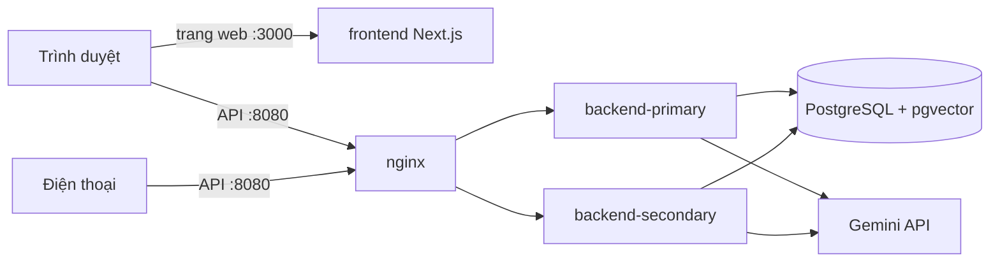

**Đọc sơ đồ bằng lời.** Trình duyệt lấy giao diện từ container `frontend` (Next.js, cổng 3000). Mọi lời gọi API của trình duyệt và điện thoại đi vào Nginx ở cổng 8080. Nginx chia request cho hai bản backend giống hệt nhau: `backend-primary` và `backend-secondary`. Một bản không trả lời trong 3 giây thì Nginx tạm bỏ qua bản đó và gửi sang bản còn lại, nên người dùng không bị gián đoạn. Hai bản backend dùng chung một PostgreSQL, chung ổ ảnh, ổ sao lưu và chung bộ đếm giới hạn tần suất (lưu trong bảng `ha_rate_limit_*`), nên đăng nhập ở bản này rồi gọi sang bản kia vẫn đúng. Cả hai bản đều gọi Gemini cho phần AI. Điểm yếu còn lại là PostgreSQL chỉ có một bản.

**Docker Compose chạy thế nào.** `docker compose up -d --build` đọc `docker-compose.yml`, build image cho backend và frontend, kéo image `pgvector/pgvector:pg16` cho cơ sở dữ liệu, rồi chạy các container theo thứ tự: `db` khỏe (healthcheck đạt) thì backend mới chạy, backend khỏe thì frontend mới chạy. Biến môi trường như `JWT_SECRET`, `GEMINI_API_KEY` lấy từ tệp `.env` (không đưa lên Git). Dữ liệu nằm trong volume nên tắt container không mất dữ liệu; chỉ `docker compose down -v` mới xóa volume.

### 2.13 Sao lưu và khôi phục

- **Ở đâu:** `modules/auth/service/BackupService.java`, `BackupController` (`/api/v1/admin/...`), chỉ SYSTEM_ADMIN. Sao lưu bằng `pg_dump` vào volume `backups`; khôi phục bằng `pg_restore` sau khi kiểm phiên bản Flyway của bản sao lưu khớp DB đang chạy (khác thì dừng trước khi đổi dữ liệu). Hướng dẫn: `docs/07-deploy/backup-restore.md`. Giải thích từng bước ở mục 5.7.

### 2.14 Spring Boot, Spring Data JPA và JDBC (khung backend, đọc ghi dữ liệu)

- **Ở đâu:** `backend/pom.xml` (Java 17, Spring Boot 3.3.5), `backend/src/main/resources/application.yml` (cấu hình), mỗi module trong `modules/<tên>/` có `controller`, `service`, `repository`, `entity`, `dto`.
- **Chạy thế nào:** Spring Boot tự tạo và nối các lớp với nhau (gọi là "tiêm phụ thuộc": lớp nào cần lớp nào thì khai báo ở hàm khởi tạo, Spring tự đưa vào). Spring Data JPA (dùng Hibernate bên dưới) cho phép viết Repository dạng interface, Spring tự sinh câu SQL; Entity là lớp Java ánh xạ một bảng. Chỗ cần SQL đặc biệt (truy vấn đệ quy cây, ghi nhật ký) dùng JDBC (gọi SQL trực tiếp), ví dụ `JdbcAuditLogger`, `JdbcReminderStore`. Hàm có `@Transactional` chạy trong một giao dịch: lỗi giữa chừng thì mọi thay đổi bị hủy.

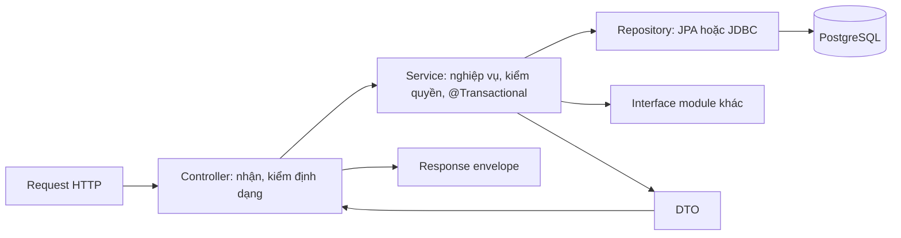

**Đọc sơ đồ bằng lời.** Request vào Controller, Controller chỉ nhận dữ liệu và kiểm định dạng, không chứa nghiệp vụ. Service làm phần chính: kiểm quyền, áp quy tắc nghiệp vụ, gọi Repository để đọc ghi bảng của module mình, và gọi interface của module khác khi cần dữ liệu của họ. Kết quả được chép sang DTO (không bao giờ trả Entity ra ngoài, để không lộ cột như `password_hash`), rồi Controller bọc vào envelope `{ success, data }` và trả về.

### 2.15 Bean Validation và xử lý lỗi tập trung

- **Ở đâu:** các DTO yêu cầu trong `modules/*/dto/` gắn chú thích như `@NotBlank`, `@Email`, `@Size`; `common/exception/GlobalExceptionHandler.java`, `ApiException.java`, `ErrorCode.java`; `common/security/SecurityErrorHandlers.java` (lỗi 401, 403 trước khi tới controller).
- **Chạy thế nào:** Controller nhận DTO có `@Valid`; Spring kiểm từng trường trước khi gọi service. Sai thì ném lỗi, `GlobalExceptionHandler` bắt và trả `400 VALID_001` kèm danh sách trường sai trong `details`. Service muốn báo lỗi nghiệp vụ thì ném `ApiException(ErrorCode.X)`; bộ xử lý chung đổi thành đúng mã HTTP và envelope lỗi. Lỗi không lường trước trả `500 SERVER_001`, không lộ chi tiết lỗi nội bộ (stack trace) ra ngoài.

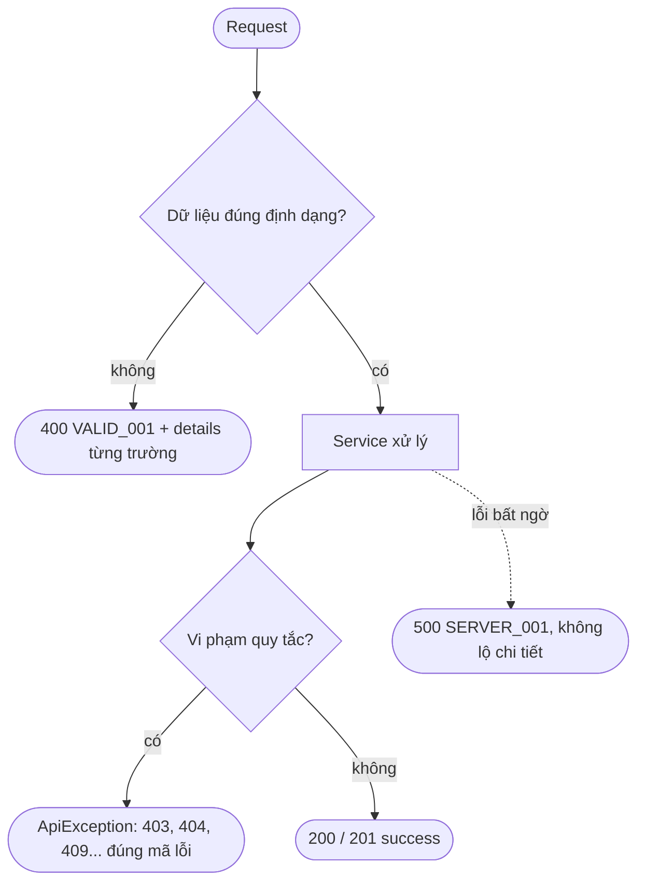

**Đọc sơ đồ bằng lời.** Có ba tầng lọc lỗi. Tầng một: dữ liệu gửi lên sai định dạng (thiếu trường, email sai, chuỗi quá dài) thì dừng ngay với `400 VALID_001` và chỉ rõ trường nào sai. Tầng hai: dữ liệu đúng định dạng nhưng vi phạm quy tắc nghiệp vụ (không đủ quyền, không tìm thấy, trùng lặp) thì service ném lỗi có mã riêng. Tầng ba: lỗi ngoài dự kiến thì trả `500 SERVER_001` chung chung, chi tiết chỉ ghi trong log máy chủ.

### 2.16 springdoc OpenAPI, Swagger UI và sinh kiểu TypeScript

- **Ở đâu:** đặc tả gốc viết tay trong `docs/04-api/openapi/*.yaml` (mỗi module một tệp, có `x-roles` ghi vai trò được gọi); backend có springdoc tạo trang thử API tại `/swagger-ui.html`; web chạy `npm run gen:api` (`frontend/scripts/gen-api-types.mjs`) sinh kiểu TypeScript vào `frontend/src/services/generated/`.
- **Chạy thế nào:** tài liệu API viết trước code (quy tắc "tài liệu đi trước"). Từ tài liệu sinh ra kiểu dữ liệu cho web, nên đổi tên một trường mà quên sửa web thì build lỗi ngay. CI có bước "Kiểu sinh từ OpenAPI phải khớp bản đã commit". Phía backend, test `EndpointRolesDocsSyncTest` kiểm `x-roles` trong tài liệu khớp quyền thật trong `EndpointRoles.java`.

### 2.17 Tailwind CSS, react-hook-form, zod, recharts, lucide-react (thư viện web)

- **Tailwind CSS:** viết giao diện bằng các lớp tiện ích (ví dụ `p-5`, `rounded-card`); màu, cỡ chữ, bo góc khai báo một lần trong `tailwind.config.ts` theo `docs/05-ui/design-system.md`, nên toàn hệ thống cùng một kiểu.
- **react-hook-form + zod:** react-hook-form quản lý ô nhập của form (giá trị, lỗi, trạng thái đang gửi); zod khai báo luật cho từng ô (bắt buộc, độ dài, định dạng email). Bấm Gửi thì zod kiểm trước ở trình duyệt, sai thì hiện lỗi dưới ô, không gửi lên máy chủ. Máy chủ vẫn kiểm lại (mục 2.15) vì không tin dữ liệu từ trình duyệt.
- **recharts:** vẽ biểu đồ cột, tròn trên trang Dashboard từ số liệu API trả về.
- **lucide-react:** bộ biểu tượng (icon) cho menu, nút.

### 2.18 GitHub Actions (CI: tự build và test)

- **Ở đâu:** `.github/workflows/ci.yml`.

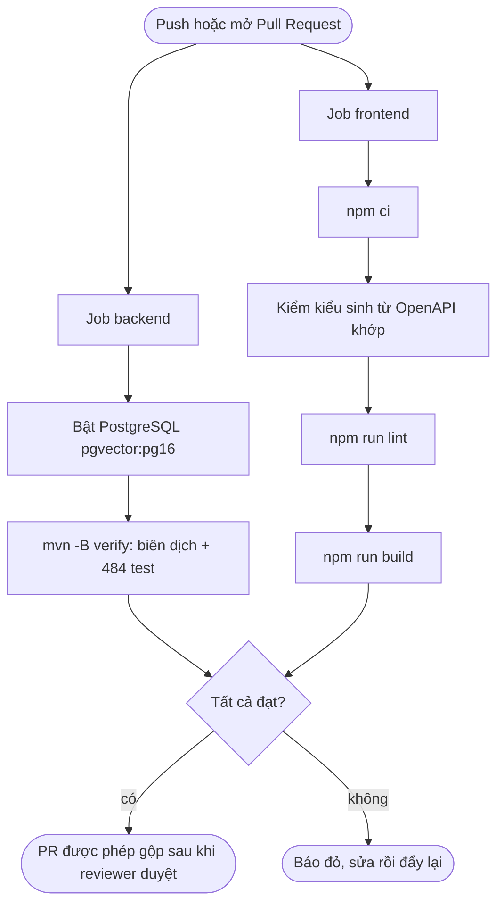

**Đọc sơ đồ bằng lời.** Mỗi lần ai đẩy code hay mở Pull Request, GitHub chạy song song hai việc. Việc backend: dựng một PostgreSQL có pgvector tạm thời, rồi chạy `mvn -B verify` để biên dịch và chạy toàn bộ 484 test (gồm test tích hợp gọi API thật vào cơ sở dữ liệu thật). Việc frontend: cài thư viện, kiểm kiểu dữ liệu sinh từ OpenAPI có khớp bản đã commit không, chạy kiểm lỗi cú pháp và quy ước (`lint`), rồi build thử. Cả hai đạt thì Pull Request mới đủ điều kiện để người review duyệt và gộp vào `develop`.

### 2.19 Kiểm thử: JUnit 5, Mockito, test tích hợp, k6

- **JUnit 5:** khung viết và chạy test Java. Test nằm ở `backend/src/test/java/com/familyconnect/`.
- **Mockito:** tạo đối tượng giả (mock) để test một service riêng lẻ mà không cần cơ sở dữ liệu, ví dụ `AuthServiceTest` giả lập Repository.
- **Test tích hợp (`*IntegrationTest`):** chạy cả ứng dụng Spring với PostgreSQL thật, gọi API như trình duyệt rồi kiểm mã HTTP, mã lỗi, dữ liệu. Ví dụ `RbacMatrixIntegrationTest` thử từng vai trò với từng endpoint.
- **Đăng nhập trong test:** test tích hợp đăng nhập thật qua `POST /auth/login` rồi gửi token như trình duyệt (thư viện `spring-security-test` có khai báo trong `pom.xml` nhưng test hiện không dùng tới).
- **k6:** công cụ đo tải, kịch bản ở `docker/perf/k6-api.js`, kết quả ở `docs/06-test/performance-6-04.md`.

---

## 3. Đọc frontend: thứ trên giao diện nằm ở đâu trong code

### 3.1 Quy tắc tìm file (Next.js App Router)

Đường dẫn trên thanh địa chỉ = thư mục trong `frontend/src/app/`. `[id]` là tham số động.

| Trên trình duyệt | File trang | Gọi API qua | Backend xử lý |
|---|---|---|---|
| `/login` | `app/login/page.tsx` | `services/auth.ts` | `AuthController.login` → `AuthService` |
| `/families/{id}/tree` (Cây gia phả) | `app/families/[id]/tree/page.tsx` | `services/genealogy.ts` → `tree()` | `FamilyTreeController` → `FamilyTreeService` |
| `/relationship` (Tra cứu xưng hô) | `app/relationship/page.tsx` | `services/genealogy.ts` → `relationship()` | `RelationshipQueryController` → `KinshipCalculator` |
| `/members` (Thành viên) | `app/members/page.tsx` | `services/genealogy.ts` | `GenealogyController` → `PersonService` |
| `/persons/{id}` (Trang cá nhân) | `app/persons/[personId]/page.tsx` | `services/genealogy.ts`, `services/community/posts.ts` | `GenealogyController`, `CommunityController` |
| `/community` (Bảng tin) | `app/community/page.tsx` + `components/community/PostInteractions.tsx` | `services/community/posts.ts` | `CommunityController` → `CommunityService` |
| `/events` | `app/events/page.tsx` | `services/events/` | `EventController` → `EventService` |
| `/directory` (Danh bạ) | `app/directory/page.tsx` | `services/directory.ts` | `DirectoryController` → `DirectoryService` |
| `/heritage/...` (Di sản) | `app/heritage/**/page.tsx` | `services/heritage.ts` | `HeritageController` |
| `/assistant` (Trợ lý AI) | `app/assistant/page.tsx` | `services/ai.ts` | `AiChatController` → `ChatService` |
| `/search` (Tìm kiếm) | `app/search/page.tsx` | `services/semantic-search.ts` | `AiSearchController` → `SemanticSearchService` |
| `/dashboard`, `/reports` | `app/dashboard/page.tsx`, `app/reports/page.tsx` | `services/dashboard.ts` | `DashboardController` |
| `/admin/{mục}` (Quản trị) | `app/admin/[section]/page.tsx` + `components/admin/AdminConsole.tsx` | `services/admin.ts` | `AdminController`, `BackupController`, `SystemConfigController` |
| Chuông thông báo (header) | `components/layout/NotificationBell.tsx` | `services/notifications.ts` | `NotificationController` |
| Khung trang, menu trái | `components/layout/AppShell.tsx`, `lib/nav.ts` | | |

Mobile: màn hình ở `mobile/src/screens/` cùng tên chức năng (`FamilyTreeScreen.tsx`, `FeedScreen.tsx`, `PostDetailScreen.tsx`, `PersonDetailScreen.tsx`, `AiChatScreen.tsx`...), menu ở `mobile/src/navigation/AppDrawer.tsx`.

### 3.2 Bài tập mẫu: "Cây gia phả trên UI nằm ở đâu?"

Làm theo đúng thứ tự này trước mặt thầy:

1. **Nhìn thanh địa chỉ:** `localhost:3000/families/8f84.../tree` → thư mục `app/families/[id]/tree/`.
2. **Mở file:** trong VS Code bấm `Ctrl+P`, gõ `tree/page`, chọn `frontend/src/app/families/[id]/tree/page.tsx`.
3. **Chỉ chỗ lấy dữ liệu:** dòng 68 `useQuery({ queryKey: ['tree', familyId], queryFn: () => genealogyApi.tree(familyId, { depth: 10 }) })`.
4. **Chỉ chỗ vẽ:** tìm `<ReactFlow` (khoảng dòng 215), giải thích nodes, edges đến từ `layoutTree` trong `components/genealogy/tree-layout.ts`.
5. **Chỉ một ô người:** giữ `Ctrl` bấm vào `PersonNode` ở dòng import → mở `components/genealogy/PersonNode.tsx` (ô "Bạn" tô màu khi `isMe`).
6. **Đi xuống backend:** `Ctrl+Click` vào `genealogyApi.tree` → `services/genealogy.ts` dòng 29 gọi `/families/{familyId}/tree`. Bấm `Ctrl+Shift+F`, gõ `/families/{familyId}/tree` → `FamilyTreeController.java` dòng 25 → `FamilyTreeService.tree` dòng 54.

Số dòng đúng tại `develop` ngày 19/11/2026; code đổi thì tìm theo tên hàm.

### 3.3 Mẹo tìm nhanh bất kỳ thứ gì

| Muốn tìm | Cách làm trong VS Code |
|---|---|
| Một chữ đang thấy trên màn hình, ví dụ "Chỉnh sửa hồ sơ" | `Ctrl+Shift+F`, gõ đúng chữ đó, giới hạn thư mục `frontend/src` (hoặc `mobile/src`) |
| File theo tên | `Ctrl+P`, gõ một phần tên |
| Hàm này được định nghĩa ở đâu | Đặt con trỏ, bấm `F12` (hoặc `Ctrl+Click`) |
| Hàm này được gọi ở đâu | `Shift+F12` |
| API này backend nào xử lý | `Ctrl+Shift+F` đường dẫn API (ví dụ `/posts/{id}/comments`) trong `backend/src/main/java` |
| Quy tắc nghiệp vụ (BR-...) nằm ở code nào | `Ctrl+Shift+F` mã quy tắc, ví dụ `BR-GEN-20`: ra cả tài liệu và chú thích trong code |

### 3.4 Cấu trúc một trang web điển hình

```text
app/<đường dẫn>/page.tsx      ← trang: gọi useQuery/useMutation, ghép component
components/<module>/*.tsx      ← mảnh giao diện dùng lại (PersonNode, PostInteractions...)
services/<module>.ts           ← hàm gọi API (genealogyApi, communityApi...)
services/generated/*.ts        ← kiểu dữ liệu sinh từ OpenAPI (không sửa tay)
lib/api.ts                     ← axios: gắn token, xử lý 401, chuẩn hóa lỗi
tailwind.config.ts             ← màu, cỡ chữ theo design-system.md
```

---

## 4. Câu hỏi hay gặp (trả lời ngắn)

| Câu hỏi | Trả lời |
|---|---|
| Vì sao chọn modular monolith, không microservices? | Nhóm 5 người, một CSDL, triển khai đơn giản; vẫn tách module bằng interface trong gói `api` nên sau này tách dịch vụ được. |
| Module gọi nhau thế nào? | Qua interface Java (`MembershipQuery`, `GenealogyPort`, `AiGateway`...), không join bảng của module khác; tham chiếu chéo chỉ lưu UUID. |
| Làm sao chặn xem dữ liệu gia đình khác (IDOR)? | Mọi truy vấn lọc `family_id` theo membership của người gọi, kiểm ở service; có test gia đình A gọi dữ liệu gia đình B bị từ chối. |
| AI có bịa không? | Chỉ trả lời từ ngữ cảnh đã truy xuất; không có thì "Không tìm thấy thông tin."; đánh giá 40/40 câu trên dữ liệu giả (`ai-quality-scrum-69.md`). |
| Trẻ em được bảo vệ thế nào? | Dưới 16 tuổi: thành viên thường chỉ thấy tên, quan hệ, năm sinh; không có tài khoản; không đưa vào ngữ cảnh gửi AI (`privacy.md`). |
| Ai được sửa thông tin cá nhân? | Hồ sơ đã gắn tài khoản chỉ chính chủ sửa (BR-GEN-20); trưởng chi, trưởng họ chỉ nhập thay người chưa có tài khoản. |
| Vì sao kiểu dữ liệu frontend không bị lệch backend? | Sinh từ OpenAPI bằng `npm run gen:api`; CI kiểm "generated types must match". |
| Test thế nào? | Backend 484 test (JUnit, Mockito, test tích hợp trên PostgreSQL thật) chạy trong CI; web lint, typecheck, build; đo tải k6; thử HA tắt một bản backend. |

---

## 5. Phần việc của TV1 Tuấn: module Auth (tài khoản) và Admin (quản trị)

### 5.1 Tôi làm gì trong dự án

| Nhóm việc | Nội dung | Task Jira |
|---|---|---|
| Đăng ký, đăng nhập, token | Đăng ký, đăng nhập, làm mới token, đăng xuất, đổi mật khẩu; JWT, BCrypt, giới hạn đăng nhập | SCRUM-35, 36 |
| Phân quyền (RBAC) và hồ sơ | 4 vai trò, thứ tự kiểm quyền, `MembershipQuery` cho mọi module dùng; xem và sửa hồ sơ của mình | SCRUM-43 |
| Xác minh thành viên | Xin vào gia đình, duyệt hoặc từ chối, phạm vi của trưởng chi | SCRUM-35, 57 |
| Quản trị hệ thống | Quản lý người dùng (khóa, đổi vai trò, gán gia đình), kiểm duyệt nội dung, bổ nhiệm trưởng chi | SCRUM-50 |
| Nhật ký kiểm toán | `AuditLogger` dùng chung cho mọi module, trang xem nhật ký | SCRUM-57 |
| Sao lưu, khôi phục | Script `backup.sh`, `restore.sh`, API và trang quản trị | SCRUM-86 |
| Cấu hình hệ thống | Bảng `system_config`, trang cấu hình, `SystemConfigQuery` | SCRUM-94 |
| High Availability | 2 backend sau Nginx, bộ đếm giới hạn dùng chung (V22) | SCRUM-96 |
| Sprint cuối | Chỉ chính chủ sửa hồ sơ (BR-GEN-20), quản trị chọn gia đình, lọc nhật ký theo gia đình | SCRUM-117, 118 |
| Tài liệu | `srs.md`, `auth.md`, `privacy.md`, `test-plan.md`, `class-diagram.md` (vẽ cả 5 Class Diagram), báo cáo cuối, kịch bản demo, tài liệu này | SCRUM-71, 72, 73, 131 |

**Code của tôi nằm ở:** backend `modules/auth/` (controller, service, repository, entity, dto, api) và `common/` (security, config, exception, audit, ha); web `app/login`, `app/register`, `app/profile`, `app/join-family`, `app/join-requests`, `app/pending-approval`, `app/family-roles`, `app/admin/[section]` + `components/admin/AdminConsole.tsx`, `lib/api.ts`, `middleware.ts`; mobile `LoginScreen`, `RegisterScreen`, `MembershipScreens`, `ProfileScreen`, `ChangePasswordScreen`; script `backend/scripts/backup.sh`, `restore.sh`.

**7 bảng của module** (`auth.md` mục 5): `users` (tài khoản), `role` (danh mục 4 vai trò), `user_role` (vai trò toàn hệ thống của từng người), `refresh_token` (chỉ lưu mã băm), `member_verification` (ai thuộc gia đình nào, chi nào, vai trò gì, đã duyệt chưa), `audit_log` (nhật ký), `system_config` (tham số cấu hình). Thêm 2 bảng kỹ thuật `ha_rate_limit_fixed`, `ha_rate_limit_sliding` cho bộ đếm dùng chung khi chạy HA.

### 5.2 Giải thích các sơ đồ của tôi

**a) Use Case Auth (`docs/images/auth-usecase.drawio.png`).** Sơ đồ chia hai khung. Khung trên là phần tài khoản và hồ sơ: Khách chỉ đăng ký (UC-AUTH-01) và đăng nhập (UC-AUTH-02). "Người dùng đã đăng nhập" là tác nhân trừu tượng (không có ai đúng vai này, chỉ để gom chung), được đăng xuất, làm mới token, đổi mật khẩu, sửa hồ sơ (UC-AUTH-03 đến 05). Thành viên chưa xác minh kế thừa người dùng đã đăng nhập (mũi tên tam giác rỗng) và có thêm việc xin vào gia đình (UC-AUTH-06). Khung dưới là duyệt và quản trị: Trưởng chi duyệt hoặc từ chối yêu cầu (UC-AUTH-07); Quản trị hệ thống kế thừa Trưởng chi nên làm được việc đó, cộng thêm quản lý người dùng, kiểm duyệt nội dung, xem nhật ký, sao lưu khôi phục, cấu hình (UC-AUTH-08 đến 12). Mọi chức năng quản trị đều «include» (bắt buộc gọi kèm) UC-AUTH-13 Kiểm soát truy cập theo vai trò: tức là trước khi làm, hệ thống luôn kiểm quyền.

**b) Class Auth (`docs/images/class-auth.drawio.png`).** Lớp `User` giữ thông tin tài khoản và các hành vi: đổi mật khẩu, sửa hồ sơ, khóa, mở khóa, ghi lần đăng nhập. `User` và `Role` quan hệ nhiều-nhiều qua lớp trung gian `UserRole` (đường nét đứt nối vào đường quan hệ là lớp liên kết). `User` chứa `RefreshToken` theo kiểu composition (thoi đặc): xóa người dùng thì token đi theo; `RefreshToken.isUsable` cho biết token còn dùng được không (chưa hết hạn, chưa thu hồi). `MemberVerification` là trung tâm của việc thuộc gia đình: một người có thể có nhiều bản ghi theo thời gian (xin, bị từ chối, xin lại), mỗi bản ghi có trạng thái (`VerificationStatus`: PENDING chờ duyệt, APPROVED đã duyệt, REJECTED bị từ chối, CANCELLED tự hủy, REMOVED bị gỡ) và vai trò trong gia đình (`MemberRole`: MEMBER hoặc BRANCH_ADMIN); các phương thức `approve`, `reject`, `changeRole`, `remove`, `cancel` là các bước chuyển trạng thái. `familyId {→ Family}` nghĩa là chỉ lưu mã của bảng bên module Gia phả, không khóa ngoại. `AuditLog` và `SystemConfig` đọc ghi bằng JDBC nên không có phương thức nghiệp vụ.

**c) ERD Auth (`docs/images/erd-auth.drawio.png`).** `users` nối `user_role` một-nhiều, `role` nối `user_role` một-nhiều: đây là cách biểu diễn nhiều-nhiều trong bảng. `users` nối `refresh_token` và `member_verification` một-nhiều (ký hiệu hai gạch phía `users` là "đúng một", vòng tròn và chân chim phía kia là "không hoặc nhiều"). Cột ghi "(logic)" như `member_verification.family_id` trỏ sang module khác, chỉ lưu UUID có chỉ mục, service tự kiểm. `audit_log` đứng riêng, không khóa ngoại, chỉ thêm không sửa nên không có `updated_at`, `deleted_at`. Hai bảng `ha_rate_limit_*` là bộ đếm kỹ thuật, dòng cũ hơn 1 ngày bị xóa cứng.

**d) Sequence đăng nhập (`docs/images/architecture-sequence-login.drawio.png`).** Người dùng nhập email, mật khẩu (bước 1), màn hình gửi `POST /api/v1/auth/login` (2), `AuthController` chuyển cho `AuthService.login` kèm IP người gọi (3). Service hỏi `LoginRateLimiter` (4): quá 5 lần mỗi phút cho cùng IP và email thì dừng với `429 RATE_001` kèm `Retry-After` (thời gian phải chờ) (5, 6). Sau đó tìm tài khoản theo email (7, 8) và so mật khẩu bằng BCrypt (9). Khung `alt` có ba nhánh: không có tài khoản hoặc sai mật khẩu thì ghi nhật ký `LOGIN_FAILED` và trả `401 AUTH_001` (cùng một mã cho cả hai trường hợp để kẻ xấu không dò được email nào có thật); tài khoản bị khóa (chỉ báo khi mật khẩu đúng) thì ghi `LOGIN_BLOCKED`, trả `403 AUTH_003`; hợp lệ thì lấy vai trò (14, 15), nhờ `TokenIssuer` cấp access token và refresh token (16, 17), ghi lần đăng nhập cuối (18), lấy trạng thái gia đình (19, 20), ghi `LOGIN_SUCCESS` (21) và trả `200` gồm token, thông tin người dùng, trạng thái gia đình (22, 23). Màn hình lưu token (web: `localStorage`, mobile: `expo-secure-store`) (24) và chuyển trang (25).

**e) Quy trình 1: đăng ký, xin vào gia đình, duyệt (`docs/images/business-process-1.drawio.png`).** Lưu đồ có ba làn: Người dùng, Trưởng chi/Quản trị, Hệ thống. Người dùng đăng ký; hệ thống kiểm dữ liệu và email chưa dùng (sai thì `400 VALID_001` hoặc `409 AUTH_004`), tạo tài khoản MEMBER. Người dùng đăng nhập; sai thì `429`, `401` hoặc `403`; đúng thì nhận token. Người dùng gửi yêu cầu tham gia kèm mã gia đình hoặc mã chi và lời nhắn; hệ thống kiểm gia đình, chi có tồn tại và người này chưa thuộc gia đình nào (sai thì `404`, `409 AUTH_005` hoặc `403`). Tiếp theo xem chế độ duyệt trong cấu hình: `AUTO` thì duyệt ngay; `MANUAL` thì tạo yêu cầu PENDING và chờ. Lúc chờ, người xin có thể tự hủy (CANCELLED), hoặc trưởng chi xem danh sách yêu cầu trong phạm vi mình và duyệt hoặc từ chối kèm lý do (ngoài phạm vi thì `403`, đã xử lý rồi thì `409 AUTH_006`). Kết quả APPROVED thì người dùng vào được màn hình gia đình ngay; REJECTED thì thấy lý do và được gửi yêu cầu mới.

### 5.3 Đăng nhập, token và phân quyền chạy thế nào (chi tiết)

1. **Mật khẩu.** Lúc đăng ký, mật khẩu (8 đến 72 ký tự) được băm bằng BCrypt rồi mới lưu vào `users.password_hash`; không ai, kể cả quản trị, đọc được mật khẩu gốc. Lúc đăng nhập, BCrypt băm mật khẩu vừa nhập và so với mã đã lưu. Khi email không tồn tại, code vẫn chạy BCrypt với một mã giả để thời gian trả lời bằng nhau, kẻ xấu không đoán được email nào có thật dựa vào tốc độ (`AuthService.login`).
2. **Access token** là JWT ký HS256 bằng khóa bí mật `JWT_SECRET` (lấy từ biến môi trường), sống 15 phút, chứa mã người dùng và vai trò toàn hệ thống (`JwtService`). Token **không** chứa gia đình, chi hay "đã duyệt" vì những thứ này đổi khi trưởng chi duyệt hay gỡ; server tra lại ở mỗi request nên thay đổi có hiệu lực ngay.
3. **Refresh token** là chuỗi ngẫu nhiên (không phải JWT) sinh bằng `SecureRandom`, sống 7 ngày. Database chỉ lưu mã băm SHA-256 (`TokenIssuer`), nên lộ database cũng không dùng được token. Mỗi refresh token chỉ dùng **một lần**: đổi xong thì token cũ bị thu hồi (`revoked_at`), cấp cặp mới (gọi là xoay vòng). Nếu hai request cùng dùng một token, chỉ một cái thành công.
4. **Đăng xuất, đổi mật khẩu, bị khóa, khôi phục dữ liệu** đều thu hồi mọi refresh token của người đó. Access token đã cấp còn sống tối đa 15 phút, nhưng tài khoản bị khóa thì chặn ngay vì bộ lọc tra trạng thái ở mỗi request.
5. **Mỗi request** đi qua `JwtAuthenticationFilter`: đọc header `Authorization: Bearer ...`, kiểm chữ ký và hạn, tra trạng thái tài khoản (`UserAccountStatusLookup`). Rồi `SecurityConfig` chặn theo bảng `EndpointRoles`, bảng này ghi từng endpoint và vai trò được gọi (ví dụ `GET /admin/users` chỉ SYSTEM_ADMIN). Cuối cùng service kiểm chi tiết qua `MembershipQuery`: `requireVerified` (chưa duyệt thì `PERM_002`), `requireFamilyAccess` (khác gia đình thì `PERM_001`). Thứ tự lỗi luôn là `AUTH_002` → `AUTH_003` → `PERM_002` → `PERM_001` (`auth.md` mục 4.3).
6. **Vai trò hiệu lực** của một request: SYSTEM_ADMIN nếu tài khoản có vai trò đó; nếu không thì BRANCH_ADMIN nếu bản ghi `member_verification` đã duyệt có vai trò đó; còn lại là MEMBER. BRANCH_ADMIN không gán chi là **trưởng họ** (quản lý cả gia đình), có gán chi là **trưởng chi** (quản lý chi đó và các chi con, module Gia phả trả lời qua `GenealogyPort.isBranchWithin`).
7. **Giới hạn tần suất:** đăng nhập 5 lần mỗi phút theo IP và email; làm mới token cũng có giới hạn theo IP (`LoginRateLimiter`, `RefreshRateLimiter`, cửa sổ 60 giây). Chạy một backend thì đếm trong bộ nhớ; chạy 2 backend (HA) thì biến môi trường `HA_SHARED_RATE_LIMITS=true` (trong `docker-compose.ha.yml`) bật chế độ đếm chung trong bảng `ha_rate_limit_fixed`, chủ thể (IP, email) được băm trước khi lưu.
8. **Phía giao diện:** `lib/api.ts` (web) và `services/api.ts` (mobile) tự gắn token; gặp `401` thì gọi refresh **một lần** cho mọi request đang chờ rồi gửi lại; refresh thất bại thì xóa token và về trang đăng nhập; gặp `403 AUTH_003` thì báo tài khoản bị khóa; gặp `403 PERM_002` thì chuyển tới trang xin vào gia đình hoặc đang chờ duyệt.

### 5.4 Xin vào gia đình và duyệt thành viên

- **Mỗi người chỉ một gia đình:** cơ sở dữ liệu có ràng buộc duy nhất từng phần (chỉ áp cho dòng PENDING hoặc APPROVED), nên không thể có hai yêu cầu đang hiệu lực (`AUTH_005`).
- **Gửi yêu cầu** (`POST /join-requests`, `JoinRequestService.create`): người dùng nhập mã gia đình hoặc mã chi (đều là UUID) và lời nhắn. Hệ thống hỏi module Gia phả qua `GenealogyPort` để biết mã đó là gia đình nào hay chi nào. Cấu hình `membership.approval_mode` là `AUTO` thì duyệt luôn, `MANUAL` (mặc định) thì chờ.
- **Duyệt** (`PATCH /join-requests/{id}`, `JoinRequestService.review`): trưởng họ thấy mọi yêu cầu của gia đình; trưởng chi chỉ thấy yêu cầu gắn chi mình hoặc chi con; khác phạm vi thì `403 PERM_001`. Lúc duyệt có thể gắn tài khoản với một hồ sơ có sẵn trong cây (`personId`), module Gia phả kiểm hồ sơ đó cùng gia đình và không phải trẻ dưới 16 tuổi. Duyệt xong có hiệu lực ngay ở request kế tiếp, không cần đăng nhập lại.
- **Người tạo gia đình** tự thành trưởng họ: module Gia phả gọi `MembershipCommand.assignFamilyOwner` trong cùng giao dịch tạo gia đình.
- **Bổ nhiệm trưởng chi** (trang `/family-roles`, `PUT /families/{familyId}/accounts/{userId}`): trưởng họ hoặc quản trị đổi vai trò và chi của thành viên; không tự đổi vai trò của mình; gia đình luôn còn ít nhất một trưởng họ (`ADM_001`).
- Mọi bước ghi nhật ký: `JOIN_REQUESTED`, `JOIN_CANCELLED`, `JOIN_APPROVED`, `JOIN_REJECTED`, `MEMBERSHIP_CHANGED`.

### 5.5 Quản trị hệ thống (trang `/admin`, chỉ SYSTEM_ADMIN)

Trang quản trị là `app/admin/[section]/page.tsx` + `components/admin/AdminConsole.tsx`, chia các mục: Quản lý người dùng, Kiểm duyệt nội dung, Sao lưu và khôi phục, Nhật ký kiểm toán, Cấu hình hệ thống. Ô chọn gia đình trên thanh đầu trang (SCRUM-118) dùng chung để lọc theo gia đình. Backend là `AdminController` → `AdminService`, `BackupController` → `BackupService`, `SystemConfigController` → `SystemConfigService`.

- **Quản lý người dùng** (`/admin/users`): tìm, xem chi tiết; khóa phải có lý do, khóa thì thu hồi mọi refresh token (`USER_LOCKED`, `USER_UNLOCKED`); đổi vai trò toàn hệ thống (`ROLE_CHANGED`); gán người dùng vào gia đình với vai trò MEMBER hoặc BRANCH_ADMIN (`MEMBERSHIP_CHANGED`). Không được tự khóa mình, không tự bỏ quyền quản trị của mình, không khóa quản trị viên hoạt động cuối cùng (`ADM_001`); khi kiểm điều này, hệ thống khóa dòng dữ liệu để hai quản trị bấm cùng lúc không cùng bị khóa (test `AdminConcurrencyIntegrationTest`). Không có xóa tài khoản, chỉ khóa.
- **Kiểm duyệt nội dung** (`/admin/content-reports`): bảng báo cáo và nút "Báo cáo" do module Cộng đồng làm; Admin đọc và xử lý qua interface `ContentModerationPort`, không đọc thẳng bảng của Cộng đồng. Ba hành động: ẩn nội dung, bỏ qua báo cáo, khôi phục nếu ẩn nhầm. Nội dung chỉ bị ẩn bằng cột trạng thái, không xóa cứng. Xử lý rồi mà xử lý lại thì `ADM_002`.
- **Quản trị viên đầu tiên:** không có mật khẩu mặc định trong code. Khi backend khởi động mà chưa có SYSTEM_ADMIN, `BootstrapAdminInitializer` tạo tài khoản từ biến môi trường `BOOTSTRAP_ADMIN_EMAIL`, `BOOTSTRAP_ADMIN_PASSWORD`.

### 5.6 Nhật ký kiểm toán (audit log)

- **Một cửa duy nhất:** mọi module ghi qua interface `AuditLogger.log(action, targetType, targetId, familyId, detail)`, không module nào tự ghi bảng `audit_log`. Cài đặt là `JdbcAuditLogger`: tự lấy người thực hiện từ ngữ cảnh đăng nhập, vai trò hiện tại từ `MembershipQuery`, IP từ request, rồi ghi một dòng bằng JDBC (`AuditLogRepository`).
- **Ghi gì:** đăng ký, đăng nhập thành công, thất bại, bị chặn, đăng xuất, đổi mật khẩu, sửa hồ sơ; xin, duyệt, từ chối; khóa, đổi vai trò, gán gia đình; ẩn và khôi phục nội dung; sao lưu, khôi phục, đổi cấu hình; thao tác quan trọng của module khác (sửa gia phả, gỡ bài, xuất CSV và PDF, `AI_QUERY`).
- **Không ghi:** mật khẩu, token, nội dung câu hỏi AI. Email khi đăng nhập thất bại được che bớt.
- **Chỉ thêm, không sửa, không xóa;** chỉ SYSTEM_ADMIN xem ở mục Nhật ký, lọc theo người, hành động, gia đình (`familyId`, SCRUM-117), thời gian.

### 5.7 Sao lưu và khôi phục

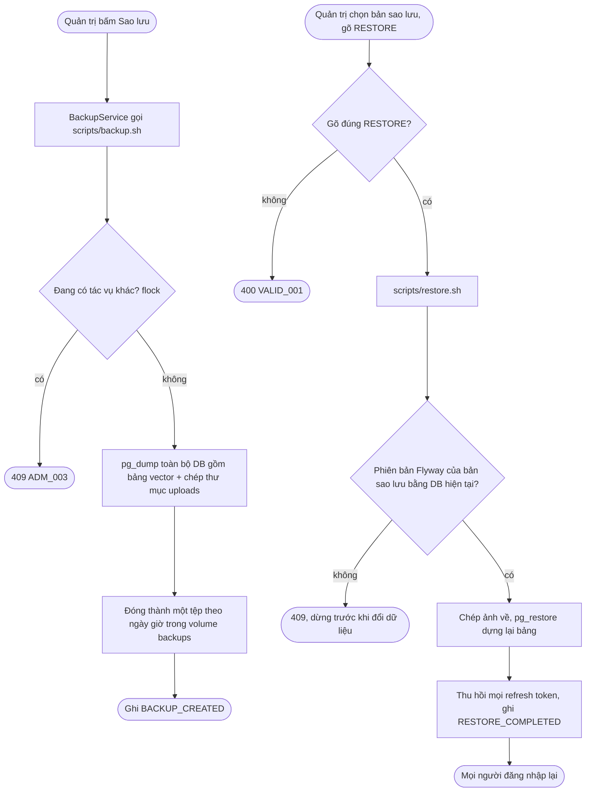

**Đọc sơ đồ bằng lời.** Sao lưu: quản trị bấm nút, `BackupService` chạy script `backup.sh` trong container backend. Script dùng `flock` (khóa tệp) để mỗi lúc chỉ một việc sao lưu hoặc khôi phục, đang bận thì trả `409 ADM_003`. Không bận thì `pg_dump` xuất toàn bộ cơ sở dữ liệu (cả bảng vector của AI) và chép thư mục ảnh, đóng thành một tệp đặt tên theo ngày giờ trong volume `backups` (không nằm trong Git). Khôi phục: quản trị chọn một bản và phải gõ đúng chữ `RESTORE` để tránh bấm nhầm. Script so phiên bản Flyway của bản sao lưu với cơ sở dữ liệu đang chạy; khác nhau thì dừng **trước** khi đổi dữ liệu (vì dựng bảng cũ vào cấu trúc mới sẽ hỏng). Khớp thì chép ảnh về rồi `pg_restore` dựng lại dữ liệu, sau đó thu hồi mọi refresh token để mọi người đăng nhập lại với dữ liệu đã khôi phục. Script chạy quá 15 phút thì bị dừng và báo lỗi.

### 5.8 Cấu hình hệ thống

- Bảng `system_config` có sẵn 10 khóa do Flyway tạo: tên ứng dụng; bật tắt tìm kiếm, chatbot, tóm tắt AI; số câu AI mỗi giờ (1 đến 200); dung lượng và loại ảnh; chế độ duyệt thành viên (`MANUAL` hoặc `AUTO`); thời hạn access token (5 đến 60 phút) và refresh token (1 đến 30 ngày).
- Quản trị chỉ **đổi giá trị** khóa có sẵn, không tạo hay xóa khóa; giá trị sai kiểu hoặc ngoài khoảng thì `400 VALID_001`. Mỗi lần đổi ghi `CONFIG_CHANGED`.
- Module khác đọc qua interface `SystemConfigQuery` (`getInt`, `getBoolean`, `getString`); `SystemConfigService` giữ bộ nhớ đệm 60 giây nên đổi xong có hiệu lực trong vòng 1 phút.
- Khóa bí mật (JWT secret, khóa Gemini, mật khẩu cơ sở dữ liệu) **không** nằm trong bảng này, chỉ ở biến môi trường.

### 5.9 Interface tôi cung cấp cho module khác

| Interface | Ai dùng | Để làm gì |
|---|---|---|
| `MembershipQuery` | Mọi module | Hỏi người dùng thuộc gia đình nào, vai trò gì, đã duyệt chưa; `requireVerified`, `requireFamilyAccess` để kiểm quyền |
| `MembershipCommand` | Gia phả | Gán người tạo gia đình làm trưởng họ |
| `UserDirectory` | Cộng đồng, Di sản, Dashboard | Lấy họ tên người dùng để hiển thị tác giả (không trả email, số điện thoại) |
| `AuditLogger` | Mọi module | Ghi nhật ký kiểm toán |
| `SystemConfigQuery` | AI, Cộng đồng, Auth | Đọc tham số cấu hình |
| `GenealogyPort` (tôi khai báo, Gia phả cài đặt) | Auth | Tra tên gia đình, chi; kiểm chi con; gắn, gỡ tài khoản với hồ sơ |
| `ContentModerationPort` (tôi khai báo, Cộng đồng cài đặt) | Admin | Đọc và xử lý báo cáo vi phạm |

**Vì sao làm hai chiều như vậy:** module khác gọi vào `auth.api`; còn khi Auth cần dữ liệu của Gia phả hay Cộng đồng thì Auth khai báo "cổng ra" và để module kia cài đặt. Nhờ vậy không có phụ thuộc vòng (A cần B, B lại cần A), và Auth không bao giờ đọc thẳng bảng của module khác.

### 5.10 Kiểm thử phần của tôi

| Test | Kiểm gì |
|---|---|
| `AuthApiIntegrationTest`, `AuthServiceTest`, `JwtServiceTest` | Đăng ký, đăng nhập, refresh dùng một lần, đăng xuất, đổi mật khẩu, mã lỗi |
| `RbacMatrixIntegrationTest` | Từng vai trò gọi từng nhóm endpoint ra đúng `200`, `401`, `403` |
| `EndpointRolesDocsSyncTest`, `SecurityConfigTest` | Quyền trong code khớp `x-roles` của tài liệu OpenAPI |
| `JoinRequestApiIntegrationTest`, `MembershipServiceTest` | Xin, duyệt, từ chối, hủy, phạm vi trưởng chi |
| `AdminApiIntegrationTest`, `AdminConcurrencyIntegrationTest`, `ContentReportNotificationsTest` | Quản lý người dùng, không khóa quản trị cuối cùng khi bấm đồng thời, kiểm duyệt, đọc nhật ký |
| `BackupServiceTest`, `SystemConfigApiIntegrationTest` | Sao lưu, khôi phục (mã thoát của script), cấu hình đúng kiểu và khoảng |

### 5.11 Câu hỏi hội đồng có thể hỏi riêng phần Auth, Admin

| Câu hỏi | Trả lời |
|---|---|
| Vì sao cần hai loại token? | Access token ngắn hạn để lộ cũng chỉ dùng được ít phút; refresh token dài hạn nhưng chỉ dùng một lần và lưu dạng băm, nên vừa an toàn vừa không bắt đăng nhập lại liên tục. |
| Sao không để vai trò trưởng chi trong JWT cho nhanh? | Vai trò trong gia đình đổi khi người khác duyệt hoặc gỡ; nếu nằm trong token thì phải chờ token hết hạn mới có hiệu lực. Tra ở mỗi request thì thay đổi có hiệu lực ngay. |
| Lộ cơ sở dữ liệu thì có lộ mật khẩu, token không? | Không: mật khẩu băm BCrypt, refresh token băm SHA-256; khóa ký JWT nằm ở biến môi trường, không trong cơ sở dữ liệu. |
| Đăng nhập sai sao không báo "email không tồn tại"? | Để kẻ xấu không dò được email nào đã đăng ký; cả hai trường hợp đều trả `AUTH_001`, thời gian trả lời cũng bằng nhau. |
| Chống dò mật khẩu thế nào? | 5 lần mỗi phút theo IP và email, quá thì `429 RATE_001`; khi chạy 2 backend thì đếm chung trong cơ sở dữ liệu. |
| Web lưu token ở `localStorage` có an toàn không? | Có rủi ro nếu trang bị chèn mã độc (XSS). Giảm bằng access token 15 phút, refresh token xoay vòng, không hiển thị nội dung người dùng dạng HTML thô. Mobile dùng `expo-secure-store` mã hóa. |
| Quản trị có xem được hết dữ liệu không? | Quản trị xem để quản lý và kiểm duyệt, nhưng không sửa được thông tin cá nhân của người đã có tài khoản (BR-GEN-20) và mọi thao tác đều ghi nhật ký. |
| Hai quản trị cùng khóa nhau thì sao? | Lúc kiểm "còn quản trị hoạt động khác không", hệ thống khóa dòng dữ liệu nên hai thao tác chạy lần lượt, luôn còn ít nhất một quản trị (`ADM_001`). |
