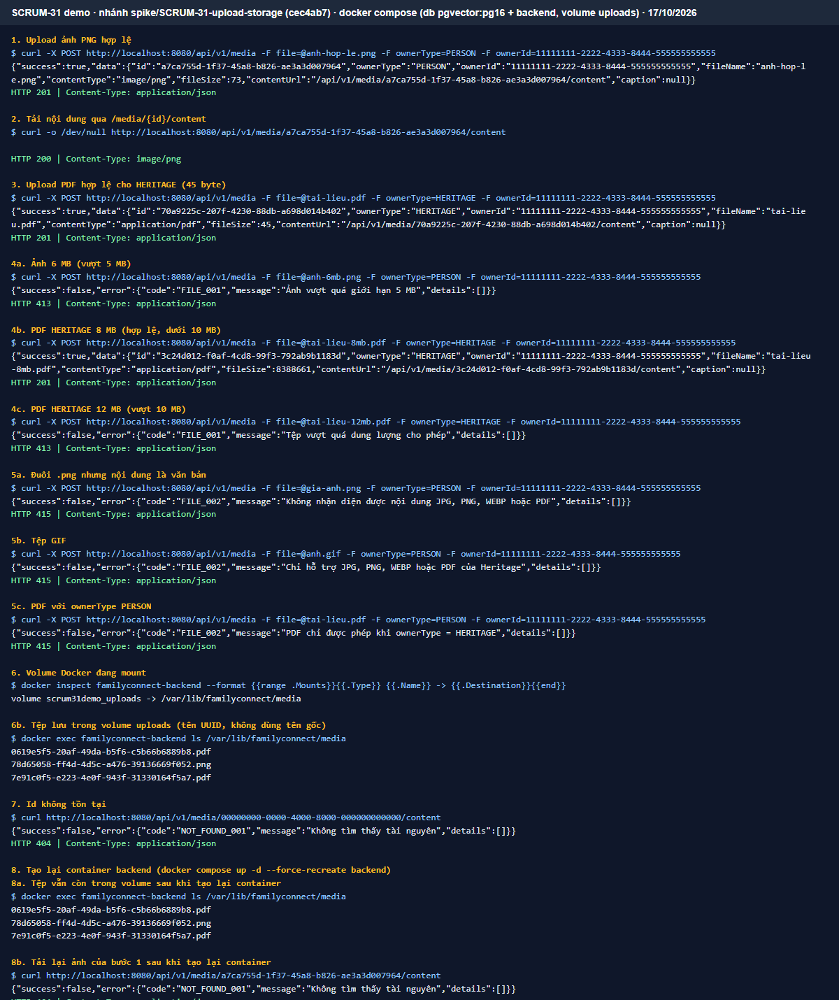

# ADR: Quyết định lưu trữ và tải tệp

- **Ngày:** 17/10/2026
- **Người quyết định:** TV1
- **Trạng thái:** Đã chọn

## 1. Bối cảnh

FamilyConnect cần lưu trữ và tải ảnh cho Community, đồng thời hỗ trợ tệp PDF cho Heritage. Hai phương án được xem xét là lưu tệp trên Docker named volume và sử dụng MinIO tương thích S3.

Giải pháp phải phù hợp với kiến trúc Docker hiện tại, tuân theo quy ước upload của dự án, không công khai trực tiếp tệp và có thể sao lưu cùng dữ liệu hệ thống.

## 2. Các lựa chọn

| Lựa chọn | Ưu | Nhược |
|---|---|---|
| Docker named volume | Đơn giản, dễ triển khai cùng Docker Compose hiện tại; không cần thêm dịch vụ; khớp kiến trúc hiện tại của dự án | Phụ thuộc vào một máy chủ Docker; phải tự sao lưu volume |
| MinIO (S3 compatible) | Tách lưu trữ khỏi backend; phù hợp hơn khi cần mở rộng hoặc nhiều máy chủ | Phải cấu hình và vận hành thêm dịch vụ MinIO; tăng độ phức tạp so với nhu cầu hiện tại |

## 3. Quyết định và lý do

Chọn **Docker named volume** làm phương án lưu trữ tệp trong phạm vi hiện tại của FamilyConnect.

Volume sử dụng tên:

`uploads`

Backend đọc đường dẫn lưu trữ từ biến môi trường:

`MEDIA_STORAGE_PATH`

Trong môi trường Docker hiện tại, đường dẫn mount của backend là:

`/var/lib/familyconnect/media`

Docker Compose sử dụng volume `uploads` mount vào đường dẫn trên và đặt:

`MEDIA_STORAGE_PATH=/var/lib/familyconnect/media`

Giải pháp này được chọn vì phù hợp với kiến trúc Docker hiện tại, đơn giản hơn MinIO và không yêu cầu vận hành thêm một dịch vụ object storage.

MinIO chưa được sử dụng trong phạm vi hiện tại và có thể được xem xét lại khi hệ thống cần lưu trữ phân tán hoặc triển khai trên nhiều máy chủ.

## 4. Hệ quả

- Volume `uploads` phải được duy trì khi container backend được tạo lại.
- Volume `uploads` phải được sao lưu cùng thời điểm với cơ sở dữ liệu PostgreSQL.
- Giải pháp hiện tại phụ thuộc vào một Docker host.
- Hệ thống triển khai phải quản lý việc sao lưu và khôi phục volume `uploads`.

## 5. Chính sách lưu trữ, giới hạn và xử lý tệp

### 5.1. Định dạng và giới hạn

Theo `docs/04-api/conventions.md` mục 7.3:

| Trường hợp | Định dạng | Giới hạn mỗi tệp |
|---|---|---:|
| Tệp ảnh thông thường | JPG, PNG, WEBP | 5 MB |
| Tài liệu với `owner_type = HERITAGE` | PDF | 10 MB |

- Request upload sử dụng `multipart/form-data`, trường tệp tên `file`.
- Tổng dung lượng tệp trong một request tối đa 10 MB.
- Spring cấu hình `max-request-size` là **11 MB** để chừa phần đầu multipart.
- Spring cấu hình `max-file-size` là **10 MB** (bằng giới hạn PDF của Heritage). Giới hạn 5 MB của ảnh do code kiểm tra theo loại tệp. Nếu đặt `max-file-size` 5 MB thì Spring chặn luôn PDF hợp lệ từ 5 đến 10 MB (lỗi tìm thấy khi demo, đã sửa ở spike commit `cec4ab7`; kiểm lại ở mục 7, dòng 4b).
- Khi Spring chặn request vượt cỡ (`MaxUploadSizeExceededException`), backend vẫn phải trả đúng chuẩn lỗi `413 FILE_001` (`success:false, error:{code,message,details}`), không để body rỗng (spike dùng `@RestControllerAdvice` bắt lỗi này, commit `cec4ab7`; kiểm lại ở mục 7, dòng 4c).
- Nginx cấu hình `client_max_body_size 11m` để request hợp lệ không bị Nginx chặn trước khi đến backend; phối hợp TV4 khi cấu hình Docker/Nginx.
- Tệp vượt giới hạn trả HTTP `413` với mã `FILE_001`.
- Định dạng không được hỗ trợ trả HTTP `415` với mã `FILE_002`.
- Tên tệp lưu trữ (`storage_key`) được sinh bằng UUID.
- Loại tệp phải được xác định từ **nội dung thực tế của tệp (magic bytes)**, không chỉ dựa vào phần mở rộng hoặc `Content-Type` do client gửi.
- MIME đã xác định được lưu vào cột `media.file_type`.

### 5.2. Truy cập tệp

Tệp không được công khai bằng đường dẫn lưu trữ trực tiếp.

Endpoint phục vụ nội dung tệp:

`GET /api/v1/media/{id}/content`

Endpoint phải kiểm tra quyền trước khi trả nội dung:

- Không đủ quyền: `403 PERM_001`.
- Không tồn tại hoặc bản ghi đã bị xóa mềm: `404 NOT_FOUND_001`.

Không trả `storageKey` trong API công khai để client tự truy cập tệp.

### 5.3. Xử lý tệp mồ côi

Tệp mồ côi là tệp vật lý còn tồn tại trong volume nhưng không còn bản ghi `media` tương ứng.

Không xóa vật lý ngay trong luồng request thông thường. Tác vụ dọn dẹp phải đối chiếu tệp trong volume với dữ liệu trước khi xóa.

- **Thời gian chờ trước khi xóa:** 24 giờ, được đặt thành tham số cấu hình.
- **Tần suất tác vụ dọn:** mỗi ngày 1 lần, ngoài giờ cao điểm.
- Media đã xóa mềm theo BR-COM-10 vẫn **giữ tệp vật lý**, tương tự cách xử lý của Heritage.
- Chỉ xóa tệp vật lý khi **không còn bản ghi `media` nào tương ứng**.

## 6. Sao lưu

Volume `uploads` phải được sao lưu cùng thời điểm với cơ sở dữ liệu PostgreSQL để tránh tình trạng bản ghi database và tệp vật lý không đồng bộ.

Cách sao lưu và khôi phục volume `uploads` cùng cơ sở dữ liệu ghi vào `docs/07-deploy/deploy.md` ở task SCRUM-68, SCRUM-77 (TV4, Sprint 7-8, mục backup/restore).

## 7. Kết quả demo và kiểm thử

Chạy ngày 17/10/2026 trên nhánh `spike/SCRUM-31-upload-storage` (commit `cec4ab7`, đã sửa `max-file-size` và lỗi `413 FILE_001` sau lần chạy đầu ở `8e6c8be`) bằng `docker compose up --build`: container `db` (pgvector:pg16) và `backend`, volume `uploads` mount vào `/var/lib/familyconnect/media`. Bằng chứng: ảnh `../images/adr-upload-demo.png` (lệnh `curl`, `docker exec` và kết quả thật).

| # | Kiểm tra | Kết quả thực tế | Đánh giá |
|---|---|---|---|
| 1 | Upload ảnh PNG hợp lệ (`ownerType = PERSON`) | `201`, `contentType = image/png`, `contentUrl = /api/v1/media/{id}/content`, không trả `storageKey` | PASS |
| 2 | Tải nội dung qua `GET /api/v1/media/{id}/content` | `200`, `Content-Type: image/png` | PASS |
| 3 | Upload PDF hợp lệ cho Heritage (45 byte) | `201`, `contentType = application/pdf` | PASS |
| 4a | Ảnh 6 MB (vượt 5 MB) | `413 FILE_001` "Ảnh vượt quá giới hạn 5 MB" | PASS |
| 4b | PDF Heritage 8 MB (hợp lệ, dưới 10 MB) | `201`, `contentType = application/pdf` | PASS |
| 4c | PDF Heritage 12 MB (vượt 10 MB) | `413 FILE_001` do Spring chặn, trả đúng chuẩn lỗi | PASS |
| 5 | Định dạng không hỗ trợ: đuôi `.png` nhưng nội dung là văn bản; tệp GIF; PDF với `ownerType = PERSON` | Cả 3 trả `415 FILE_002` | PASS |
| 6 | Tệp nằm trong volume `uploads`, tên UUID | `docker exec ... ls` chỉ thấy `<uuid>.png`, `<uuid>.pdf`, không dùng tên gốc; `docker inspect` xác nhận volume mount vào `/var/lib/familyconnect/media` | PASS |
| 7 | Id không tồn tại | `404 NOT_FOUND_001` | PASS |
| 8a | Tạo lại container backend (`--force-recreate`): tệp còn trong volume | Cả 3 tệp đã upload (1 PNG, 2 PDF) vẫn còn | PASS |
| 8b | Tạo lại container: tải lại ảnh đã upload | `404`, vì spike giữ metadata trong bộ nhớ, mất khi khởi động lại (`V2__create_media_table.sql` của spike đang rỗng) | FAIL (giới hạn của spike) |
| 9 | Kiểm tra quyền khi tải tệp (`403 PERM_001`) | Không kiểm được: spike để `anyRequest().permitAll()`, chưa có đăng nhập | Chưa xác minh |
| 10 | Bản ghi đã xóa mềm trả `404` | Không kiểm được: spike chưa có bảng `media` và chức năng xóa | Chưa xác minh |

Kết luận: phương án Docker named volume lưu và tải được ảnh, PDF; tệp giữ lại khi tạo lại container; nhận diện định dạng theo nội dung tệp và đặt tên UUID đúng quy ước (10 PASS). Lần chạy đầu (`8e6c8be`) dòng 4a, 4b bị FAIL do cấu hình spike; đã sửa theo mục 5.1 và chạy lại đạt. Lỗi 8b cho thấy metadata bắt buộc lưu ở bảng `media` (như mục 5.1, 5.3), không giữ trong bộ nhớ. Dòng 9, 10 kiểm ở task Media chính thức, khi đã có xác thực (SCRUM-35) và bảng `media`.

## 8. Tài liệu tham chiếu

- `docs/04-api/conventions.md`, mục 7.3.
- `docs/01-srs/use-cases/community-events.md`, BR-COM-08 và BR-COM-10.
- `docs/02-design/architecture.md`.
- `docs/07-deploy/deploy.md`.
- `docs/01-srs/use-cases/heritage-directory-dashboard.md`, mục "Xóa tài liệu (9/10/2026)": xóa mềm `heritage_document` thì giữ tệp và bản ghi `media`.
